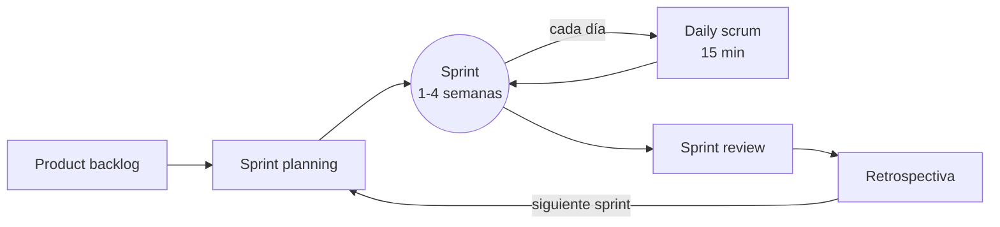
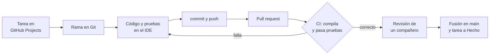

---
{"dg-publish":true,"dg-permalink":"/apuntes/1-dam-ed/unidad-01-desarrollo-de-software/","permalink":"/apuntes/1-dam-ed/unidad-01-desarrollo-de-software/","dg-note-properties":{"unidad":"[[Asignaturas/1DAM_ED/Unidades/Unidad 01/Unidad 01 - Desarrollo de software]]","modulo":"[[Módulos/Entornos de desarrollo]]","libro":"[[Libros/Entornos de desarrollo (1º DAM, 1º DAW)]]"}}
---


```table-of-contents
```

---
# 1. Software y programas

En términos muy generales podemos decir que el ordenador se compone de dos partes bien diferenciadas: **hardware** o parte tangible (circuitos, discos, teclado, etc.) y **software** (lo que no es tangible o físico).

El **software** es el **conjunto de programas** informáticos que actúan sobre el hardware para ejecutar lo que el usuario desee.

Pero, ¿qué es un programa? En pocas palabras, un **programa** es un **conjunto de instrucciones** escritas en un lenguaje de programación y organizadas de forma lógica para controlar el comportamiento del hardware del ordenador y realizar una tarea concreta.

Cada software que usamos a diario (reproductores de audio y video, navegadores web, procesadores de texto, juegos, etc.) se compone de **uno o varios programas** que nos permiten obtener lo que queremos de la máquina (música y vídeos, navegar por la web, editar textos, jugar, etc.).

El software se divide principalmente en dos categorías funcionales:

## 1.1. Software de sistema

Este software actúa como intermediario entre el hardware y el usuario, e incluye a los **sistemas operativos** como **Linux**, **Windows** o **Mac OS**.

Sabemos que un ordenador está compuesto por **muchos elementos *hardware***: procesadores con uno o varios núcleos, memoria RAM, discos HDD, unidades SSD, conexión a red y otros periféricos de E/S. Además, **ejecuta múltiples procesos** que necesitan almacenarse en la memoria RAM, usar el procesador, enviar trabajos a un periférico y otras muchas tareas complejas.

Todo esto lo convierte en un sistema **demasiado complejo** para ser manejado directamente por el ser humano. Por eso se creó un software que administrase el hardware y los recursos del sistema, facilitando al usuario la interacción con la máquina. Ese software es el **sistema operativo**.

Para comprender su importancia, supongamos que no existen los sistemas operativos y queremos abrir un fichero de un disco. Para hacerlo, tendríamos que conocer todo el repertorio de comandos del programa (controlador) que maneja dicho disco, sus parámetros (dirección de bloque, de cilindro, de plato, sectores por pista, etc.) y ejecutarlos en el orden adecuado, evitando errores que podrían dañar el fichero.

Todo esto sería muy complejo, supondría mucho tiempo y esfuerzo y podríamos dañar ese fichero u otros o incluso el propio disco.

El SO **abstrae la complejidad del hardware**, ofreciéndonos una interfaz con un conjunto más simplificado de instrucciones estables que permiten operar sobre los recursos de forma segura.

Por otro lado, en el ordenador se ejecutan muchos procesos de forma simultánea que compiten entre sí por una porción de memoria, un tiempo de uso de la CPU y de los dispositivos de E/S, etc. El SO asigna esos recursos a los distintos procesos de forma **ordenada** y **controlada**, estableciendo un **espacio** en memoria (p.e. una página de memoria RAM) y un **tiempo** para su uso (p.ej. un *quantum* para ejecutarse en la CPU).

Con todo ello, Tanenbaum (2009) indica que las finalidades básicas del SO son:

* Ser una **máquina extendida** que nos oculta la complejidad del hardware y su manejo ofreciéndonos un conjunto de instrucciones fácil y seguro.

* **Administrar los recursos** del sistema por nosotros, evitando errores y complejidad y dando a cada proceso lo que necesite (CPU, memoria, etc.).

Por tanto el sistema operativo (en adelante SO) es el software más relevante de todos ya que es el que **permite al ser humano interactuar con el ordenador**.

El SO es el **primer software que se carga en memoria** y se ejecuta y que se mantiene en la memoria interna hasta que el equipo se apaga. Esto se debe a que el SO se está ejecutando en todo momento para comunicar las órdenes que el usuario envía al hardware a través de las aplicaciones.

## 1.2. Software de aplicación

Se refiere a los programas diseñados para realizar tareas específicas del usuario, como los procesadores de texto, los navegadores web, reproductores de música y vídeo, etc. Las aplicaciones de usuario se ejecutan **sobre el SO**.

Dentro del software de aplicación encontramos el **software de programación**, que se utiliza para crear, mantener y depurar otros programas informáticos. Se trata de un conjunto de herramientas, como **editores de texto**, **compiladores** e **intérpretes**, que facilitan el desarrollo de código fuente en diversos lenguajes de programación.

> [!info] 
> Los **entornos de desarrollo integrados** o **IDE** (*Integrated Development Environment*) son un tipo común de **software de programación** que agrupan estas herramientas para una experiencia más eficiente.

En esta unidad y, en definitiva, a lo largo del módulo nos vamos a centrar en el software de aplicación que nos interesa: el **software de programación**.

## 1.3. Licencias del software

La **licencia** de un programa es el contrato en el que se establece el uso que el usuario final puede hacer de ese programa.

* **Software libre**: garantiza al usuario cuatro libertades: **usar** el programa con cualquier fin, **estudiar** cómo funciona, **modificarlo** y **redistribuirlo**, con o sin cambios. Para estudiarlo y modificarlo hace falta el código fuente, así que siempre se distribuye con él. La licencia libre más habitual es la Licencia Pública General o **<abbr title="General Public License">GPL</abbr>**, que obliga a que las versiones modificadas sigan siendo libres.

* **Software de código abierto** (*open source*): su código fuente es público y se puede estudiar, modificar y redistribuir. En la práctica, casi todo el software libre es de código abierto y viceversa: la diferencia está en el enfoque (el software libre insiste en la libertad del usuario; el código abierto, en las ventajas prácticas de desarrollar en abierto). Además de la GPL, son muy usadas las licencias **permisivas**, como **MIT** o **Apache**, que permiten incluir el código en programas propietarios.

* **Software propietario**: es el software que se distribuye con rígidas condiciones de uso. Generalmente se prohíbe la redistribución, modificación, copia, ejecución simultánea en varias máquinas. Este software normalmente se distribuye en formato binario (es decir, sin acceso al código fuente) para hacer efectiva la prohibición de modificarlo. Sin embargo, el software propietario también puede ser gratuito o de pago.

* **Software de dominio público**: es el que no tiene ningún tipo de licencia y puede ser usado por cualquiera en la forma que desee. El motivo puede ser porque el autor sea desconocido o porque ha pasado el tiempo suficiente para que expiren los derechos de autor.

> [!TIP] Libre no significa gratis
> En inglés, *free* significa a la vez «libre» y «gratis». El software libre puede venderse, y un programa gratuito (*freeware*) puede ser propietario. Las formas de distribución como el *freeware* o el *shareware* se explican en el anexo [[Asignaturas/1DAM_ED/Apuntes/Unidad 01/Anexo - Enfoque clásico/6. Formas de distribución del software\|6. Formas de distribución del software]].

# 2. Relación hardware-software

> [!summary] En pocas palabras
> Un programa solo cobra vida cuando se ejecuta sobre el **hardware**: se carga en la **memoria**, el **procesador** ejecuta sus instrucciones una a una y, cuando necesita leer un archivo o mostrar algo en pantalla, se lo pide al **sistema operativo**, que es quien maneja los **periféricos**. Entender este recorrido ayuda a escribir programas más eficientes y a entender sus errores.

El término ***hardware*** se puede traducir al castellano como «ferretería». Cuando decimos que el hardware es la parte **tangible** de un equipo informático, nos referimos literalmente a lo que se puede tocar: teclado, discos, placa base, chips, cableado, etc.

El hardware como tal no sirve para nada si no hay un software que le diga qué debe hacer. Es como construir un coche y dejarlo en el concesionario: si no hay un conductor que lo utilice, ¿para qué sirve? De la misma forma, el software solo tiene sentido al ejecutarse sobre un hardware. Por eso decimos que **el software se ejecuta sobre el hardware**.

## 2.1. La arquitectura de Von Neumann

Los primeros ordenadores trabajaban con **programas cableados**, estableciendo a mano las conexiones entre las distintas unidades. No existían pantallas ni teclados, y cuando se quería hacer un nuevo programa o modificar uno existente era necesario cambiar la organización de los componentes del sistema.

La publicación de la [arquitectura de Von Neumann](https://es.wikipedia.org/wiki/Arquitectura_de_Von_Neumann) en 1945 supuso una revolución: una máquina de **propósito general**, capaz de ejecutar distintos programas **sin cambiar su estructura**. La clave es que **el programa se guarda en la memoria**, igual que los datos, y el procesador lo lee de ahí. Cambiar de programa es tan sencillo como cargar otro en la memoria.

[John von Neumann](https://es.wikipedia.org/wiki/John_von_Neumann) propuso esta estructura general, que siguen usando los ordenadores actuales:


## 2.2. Los componentes del sistema informático

| Componente | Qué hace | Relación con los programas |
|---|---|---|
| **Procesador** (CPU) | Ejecuta las instrucciones de máquina. Incluye la **unidad de control** (lee e interpreta cada instrucción), la **unidad aritmético-lógica** (ALU, hace los cálculos) y los **registros** (pequeñas memorias ultrarrápidas) | Cada línea de código se convierte en una o muchas instrucciones de máquina que ejecuta el procesador. Los procesadores actuales tienen varios **núcleos**, que ejecutan instrucciones a la vez |
| **Memoria principal** (RAM) | Guarda los programas en ejecución y sus datos. Es rápida pero **volátil**: se borra al apagar | Un programa debe **cargarse en la RAM** para ejecutarse. Cada variable u objeto que crea ocupa espacio en ella |
| **Almacenamiento** (SSD, disco duro) | Guarda los programas y archivos de forma **permanente** | Los programas se instalan aquí. Leer y escribir en él es mucho más lento que en la RAM |
| **Periféricos de entrada y salida** | Comunican el ordenador con el exterior: teclado, ratón, pantalla, red, impresora… | Leer del teclado, mostrar texto o enviar datos por la red son operaciones de entrada/salida, y son las más lentas |
| **Buses** | Conectan todos los componentes y transportan datos, direcciones y señales de control | Toda la información que usa un programa viaja por ellos |

### 2.2.1. La jerarquía de memoria

No toda la memoria es igual: cuanto más rápida, más cara y más pequeña. Por eso los ordenadores combinan varios niveles:

| Nivel | Velocidad | Tamaño típico | ¿Se borra al apagar? |
|---|---|---|---|
| Registros del procesador | La más rápida | Unos pocos bytes | Sí |
| Memoria caché (dentro del procesador) | Muy rápida | Unos megabytes | Sí |
| Memoria RAM | Rápida | 8–32 GB | Sí |
| Almacenamiento (SSD, disco duro) | Lenta en comparación | Cientos de GB o varios TB | No |

> [!TIP] Por qué importa al programar
> Un programa que repite muchas veces la lectura de un archivo es mucho más lento que uno que lo lee una vez y guarda los datos en memoria. Y un programa que crea objetos sin parar puede llegar a agotar la RAM (en Java, el error `OutOfMemoryError`).

## 2.3. Qué ocurre al ejecutar un programa

1. **Carga.** Al abrir el programa, el sistema operativo lo copia del almacenamiento a la **memoria RAM** y crea un **proceso**: el programa en ejecución, con su propio espacio de memoria.
2. **Ejecución.** El procesador repite sin parar el **ciclo de instrucción**: **busca** la siguiente instrucción en la memoria, la **decodifica** y la **ejecuta**. Un procesador actual hace miles de millones de ciclos por segundo.
3. **Entrada y salida.** Cuando el programa necesita un periférico (leer del teclado, guardar un archivo, mostrar algo en pantalla), no lo maneja directamente: se lo pide al sistema operativo mediante una **llamada al sistema**.
4. **Reparto de recursos.** Mientras tanto, el sistema operativo reparte el procesador y la memoria entre todos los procesos que se ejecutan a la vez, de modo que parece que todos funcionan simultáneamente.
5. **Fin.** Al cerrar el programa, el sistema operativo libera su memoria y el resto de recursos.

> [!EXAMPLE] Ejemplo: guardar un documento
> Al pulsar *Guardar* en un editor de texto, el texto está en la **RAM**. El editor hace una llamada al sistema para escribir el archivo; el **sistema operativo** usa el controlador del **SSD** para guardarlo, y el **procesador** coordina todo el proceso. Si se va la luz antes de guardar, se pierde lo que solo estaba en la RAM.

## 2.4. El papel del sistema operativo

La relación entre el hardware y el software se organiza en **capas**:


- El **sistema operativo** es software de sistema que facilita el uso del ordenador de forma **eficiente y segura**. Se ejecuta directamente **sobre el hardware** y atiende las peticiones (**llamadas al sistema**) de las demás aplicaciones. Lo viste en [[Asignaturas/1DAM_ED/Apuntes/Unidad 01/1. Software y programas#1.1. Software de sistema\|1.1. Software de sistema]].
- **Sobre el sistema operativo** se ejecuta el **software de aplicación**, que nunca accede directamente al hardware: se lo pide al sistema operativo a través de su interfaz.

Las herramientas que aprenderemos a manejar en este módulo, es decir, el **software de desarrollo**, son parte de ese **software de aplicación**.

# 3. Algoritmos

Para realizar un programa es necesario idear previamente un algoritmo[^1]. Esto es importante hasta el extremo de que, sin algoritmo, no existiría el programa. 

Un algoritmo es **una secuencia ordenada de pasos que conducen a la solución de un problema**. Los algoritmos tienen tres características fundamentales: 

* Son **precisos**, es decir, deben indicar el orden de realización de los pasos.

* Están **bien definidos**, es decir, si se sigue el algoritmo dos veces usando los mismos datos, debe proporcionar la misma solución.

* Son **finitos**, esto es, deben completarse en un número determinado de pasos. 

Por ejemplo, vamos a diseñar un algoritmo simple que determine si un número N es par o impar:

```
Inicio  
    Si N es divisible entre 2, entonces **ES PAR**  
    Si N no es divisible entre 2, entonces **ES IMPAR**  
Fin 
```

Si te fijas bien, este algoritmo cumple las tres condiciones enumeradas anteriormente (precisión, definición y finitud) y resuelve el problema planteado. Lógicamente, al ordenador no le podemos dar estas instrucciones tal y como las hemos escrito, sino que habrá que expresarlo en un lenguaje de programación. **El algoritmo es la fase previa a la codificación**.

Para crear un programa deben seguirse unos pasos previos, conocidos como fases de desarrollo[^2]. Los más básicos son:

1. **Análisis** del problema: observando los requisitos y dando una primera solución en términos de entrada, proceso y salida.

2. **Diseño**: se resuelve el proceso planteado en el análisis mediante **algoritmos** que indican cómo llegar a la solución.

3. **Implementación**: los algoritmos de la fase de diseño se codifican usando algún lenguaje de programación. 

Un mismo algoritmo puede expresarse de distintas formas usando diferentes **técnicas descriptivas**. Veamos algunas de ellas.

## 3.1. Técnicas descriptivas

### 3.1.1. Pseudocódigo

Describe un algoritmo usando un **subconjunto del lenguaje natural** con una determinada estructura y una serie de restricciones, buscando un equilibrio entre el **lenguaje cotidiano** (natural) y el **formal** (programación). Así el programador se centra en los aspectos lógicos de la solución, no en la sintaxis del lenguaje de programación.

Esta es la estructura general de un algoritmo:
```
Algoritmo <NombreAlgoritmo>  // Cabecera
VAR                          // Bloque de declaración
    tipo_dato variable1;     // de variables
    ...
INICIO                       // Inicio del algoritmo
    acción 1;                // Secuencia de acciones
    acción 2;
    ...
    acción n;
FIN                          // Fin del algoritmo
```

En el pseudocódigo se tienen en cuenta las **primitivas** y **estructuras de control** de la **[[Asignaturas/1DAM_ED/Apuntes/Unidad 01/5. Paradigmas y lenguajes#5.1. Programación estructurada\|programación estructurada]]**.

Existen una serie de expresiones y palabras reservadas al lenguaje propio del pseudocódigo: `INICIO`, `FIN`, `Algoritmo`, etc.

Como normas de buenas prácticas para que el pseudocódigo sea legible:

* Las variables deben estar definidas con un nombre que esté relacionado con su contenido.

* Cada sentencia debe escribirse en una línea y aquellas que formen un bloque deben ir tabuladas para facilitar su comprensión y lectura.

* Aquellas tareas que se repitan pueden definirse en subprogramas y/o subrutinas.

* Se usarán comentarios para aclarar partes del código.

¿Qué encontraremos en un pseudocódigo?

* **Definición de datos**: es conveniente reservar el principio del pseudocódigo para definir las variables que necesitaremos en nuestro programa.

* **Primitivas**:

  * **Salida**: `ESCRIBIR expresión 1, expresión 2,...`

  * **Entrada**: `LEER variable`

  * **Asignación**: `variable1 🡨 variable2` ó `variable1 = variable2`

* **Estructuras de control**: partiremos de las básicas definidas en la programación estructurada. A saber:

  * **Secuencial**: las instrucciones se ejecutan una tras otra, empezando por la primera y acabando por la última.
    
    ```
    instrucción1

    instrucción2

    ...
    ```
  
  * **Alternativa**, donde según una condición se ejecuta uno u otro código. Estas estructuras se presentan de las siguientes formas:

    * **Alternativa simple**:
    ```
    si <condición> entonces
        bloque instrucciones
    fin si
    ```
    * **Alternativa doble**:
    ```
    si <condición> entonces
        secuencia de acciones 1
    si no
        secuencia de acciones 2
    fin si
    ```

    * **Selección múltiple**: ejecuta un bloque de código según el valor de una variable:
    ```
    según <variable1> hacer
        valor1:
            secuencia de acciones 1
        valor2:
            secuencia de acciones 2
        ...
        de otro modo:
            secuencia de acciones N
    fin según
    ```

  * **Iterativa**: repite la ejecución de una secuencia de instrucciones si se cumple una determinada condición. También se conocen como **bucles**, y podemos verlos de las siguientes formas:

    * **Mientras**: se repite la ejecución de la secuencia de acciones mientras se cumpla la condición.
      ```
      Mientras <condición> hacer
          secuencia de acciones
      fin Mientras
      ```

    * **Repetir-Mientras**: la secuencia de acciones se ejecuta al menos una vez y se repite su ejecución hasta que se cumpla la condición.
      ```
      Repetir
          secuencia de acciones
      Hasta Que <condición>
      ```

    * **Para-Hasta**: este bucle hará un número concreto de iteraciones indicadas en su cabecera, desde un valor inicial hasta otro final:
      ```
      Para contador = 0 Hasta 10 Hacer
          secuencia de acciones
      Fin Para
      ```

### 3.1.2. Diagramas de flujo

Los algoritmos pueden expresarse también mediante una **representación gráfica** llamada **diagrama de flujo**. Estos diagramas usan una serie de **símbolos** y **flechas** para ilustrar de manera visual y secuencial los pasos a seguir.

De esta forma puede leerse un algoritmo de forma visual y, en ocasiones, ayuda a entender más rápidamente qué hace.

Hay una máxima en los diagramas de flujo, al igual que en el pseudocódigo: **debe indicarse el inicio y el fin del algoritmo**.

Aunque no hay una simbología estándar establecida, los elementos gráficos más comunes son:

| Símbolo | Descripción |
| :---: | :---- |
|  | Indica el **inicio** y el **fin** del algoritmo. Dentro se indica cada caso. |
|  | **Entrada/Salida**. Dentro de indica si se lee (de teclado) o si se escribe (por pantalla). |
|  | **Proceso**. Dentro se indican las acciones o instrucciones a ejecutar. |
|  | **Condición**. Dentro se expresa la condición a evaluar. De este nodo pueden salir varias flechas dependiendo del resultado de esa evaluación. |
|  | **Subprograma**. Representa la ejecución de un subprograma representado en este u otro diagrama. |
|  | Une unas figuras con otras indicando el orden de ejecución de cada una. |

Un ejemplo podría ser el siguiente, que detecta si una persona es mayor de edad:


Estos diagramas hoy en día **no son muy utilizados** ya que son laboriosos y pueden ser demasiado grandes para expresar algoritmos complejos. Tampoco garantizan que el algoritmo se exprese correctamente, son difíciles de modificar sin una herramienta que ayude a ello.


[^1]:  Vozmediano, A. (2017). ***Java para Novatos: Cómo Aprender Programación Orientada a Objetos con Java Sin Desesperarse en el Intento***. CreateSpace Independent Publishing Platform.

[^2]:  Las fases del desarrollo se estudian en detalle en la unidad 1.

# 4. Lenguajes de programación

> [!summary] En pocas palabras
> Los lenguajes de programación se clasifican por su **nivel** (cerca de la máquina o cerca de las personas), por cómo se **traducen** a código máquina (ensamblados, compilados, interpretados o compilados a código intermedio) y por su **propósito**. Lenguajes como Java se compilan a un **código intermedio** (*bytecode*) que ejecuta una **máquina virtual**, lo que los hace portables.

Los lenguajes de programación nos permiten implementar los algoritmos. Es decir, trasladan los algoritmos al ordenador para indicarle qué debe hacer y cómo debe hacerlo.

Un **lenguaje de programación** es un **lenguaje formal** compuesto por un conjunto predefinido de palabras y símbolos (**léxico** o **alfabeto**) que se utilizan siguiendo unas reglas prefijadas (**sintaxis**), para representar y definir los datos y algoritmos (**semántica**) que constituyen un programa.

Imagina que un lenguaje de programación es como nuestro idioma (el castellano) donde:

* Las palabras y símbolos de nuestro idioma están registradas en el diccionario (p.e. palabras como "comer", "correr" o "casa").

  En un lenguaje de programación, tenemos un conjunto de palabras clave y símbolos predefinidos, como **`if`** (si), **`for`** (para), **`+`**, o **`*`**. Este conjunto limitado de palabras y símbolos es el **léxico** o **alfabeto**.

* Para que nos entendamos al hablar, usamos reglas gramaticales. Por ejemplo, la oración "El gato come" tiene una estructura (sujeto + verbo). Si decimos "Gato el come", la oración pierde sentido.

  De la misma forma, en un lenguaje de programación, la **sintaxis** se refiere a las reglas que determinan cómo se deben combinar las palabras y símbolos para que el programa sea válido. Por ejemplo, en muchos lenguajes, un comando debe terminar con un punto y coma (;).

* Cuando hablamos formamos oraciones con un significado. La frase "La casa es grande" tiene un sentido.

  En programación, la **semántica** es el significado de las instrucciones. Un comando como `x = 5 + 3` no solo cumple con las reglas de sintaxis, sino que tiene un significado claro para la computadora: guardar el valor 8 en la variable `x`.

> [!note] Dicho de otro modo
> ***El lenguaje de programación es el código en el que podemos transmitir al ordenador las órdenes de un programa***
> Moreno Vozmediano, A. 2017.

## 4.1. Clasificación de los lenguajes de programación

Hay muchos lenguajes de programación, con diferencias que van desde su sintaxis hasta la finalidad para la que se han creado. Las clasificaciones más habituales son tres: por su **nivel de abstracción**, por su forma de **traducción a código máquina** y por su **propósito**.

### 4.1.1. Según el nivel de abstracción

El ordenador solo entiende ceros y unos (**lenguaje binario** o **lenguaje máquina**). Las personas usamos el **lenguaje natural**. Los lenguajes de programación están entre ambos extremos:

- **Lenguajes de bajo nivel**: muy cercanos a la máquina. Son el **lenguaje máquina** (binario) y el **lenguaje ensamblador**, que sustituye cada instrucción binaria por un símbolo **mnemotécnico** más fácil de recordar:

  ```
  110100100101110010100010001001111010010110110    ← lenguaje máquina
  ADD D1, D2                                       ← ensamblador
  ```

  Cada instrucción de ensamblador equivale a una de lenguaje máquina, así que ambos dependen del **procesador**: un programa escrito para un procesador Intel no funciona en uno ARM (como el de un móvil o un Mac actual) sin reescribirlo.

- **Lenguajes de alto nivel**: cercanos a la forma de pensar de las personas. Cada instrucción equivale a muchas instrucciones de máquina, y el programa es **independiente del hardware** (**portable**): basta con volver a traducirlo para cada máquina. Ejemplos: C, Java, Python, C#, Kotlin, JavaScript.

| | Bajo nivel (máquina, ensamblador) | Alto nivel (C, Java, Python…) |
|---|---|---|
| Cercanía | A la máquina | A las personas |
| Portabilidad | Ninguna: depende del procesador | Alta: se traduce para cada máquina |
| Velocidad y memoria | Máximo aprovechamiento, si el programa está bien escrito | Algo menor, aunque los traductores actuales optimizan muy bien |
| Facilidad de escribir, depurar y mantener | Muy baja: programas largos y farragosos | Alta: una instrucción equivale a muchas |
| Uso actual | Partes críticas de sistemas operativos, controladores, microcontroladores | Prácticamente todo lo demás |

Por eso **se prefieren los lenguajes de alto nivel**, y el bajo nivel se reserva para casos en los que la velocidad o el control del hardware son vitales. Incluso los sistemas operativos (Windows, macOS, Linux, Android) están escritos casi por completo en lenguajes de alto nivel, con pequeñas partes en ensamblador.

Además, **no todos los lenguajes de alto nivel son iguales**: los hay de «más alto nivel» que otros. C permite manejar directamente la memoria, por lo que es más rápido que Java o Python, pero también más difícil de escribir y depurar.

> [!info] Lectura complementaria
> Cómo surgió el ensamblador y la antigua clasificación de los lenguajes por **generaciones** (3GL, 4GL…) se explican en el anexo [[Asignaturas/1DAM_ED/Apuntes/Unidad 01/Anexo - Enfoque clásico/7. Historia de los lenguajes de programación\|7. Historia de los lenguajes de programación]]. Hoy los lenguajes se clasifican por **paradigmas**: lo verás en [[Asignaturas/1DAM_ED/Apuntes/Unidad 01/5. Paradigmas y lenguajes\|5. Paradigmas y lenguajes]].

### 4.1.2. Según su mecanismo de traducción

Cuando programamos en un lenguaje distinto del lenguaje máquina, el código debe **traducirse a binario** para que el ordenador pueda ejecutarlo. El programa que hace esa traducción puede ser un **ensamblador**, un **compilador** o un **intérprete**.

#### 4.1.2.1. Ensambladores

Traducen los programas escritos en **lenguaje ensamblador** a código binario. Fíjate en que el traductor y el lenguaje se llaman igual: ***ensamblador***. Como el ensamblador es muy próximo al binario, la traducción es sencilla.


> Proceso de ensamblado

#### 4.1.2.2. Compiladores

Traducen **todo el código fuente** de alto nivel a código binario **antes de ejecutarlo**. El resultado es el **código objeto**, que después se enlaza para obtener el ejecutable (lo verás en [[Asignaturas/1DAM_ED/Apuntes/Unidad 01/10. Codificación\|10. Codificación]]).


> Proceso de compilación

La traducción se hace **una sola vez**: el ejecutable se puede usar tantas veces como se quiera sin volver a compilar, salvo que cambie el código fuente. Pero solo funciona en máquinas con el **mismo procesador y sistema operativo** para los que se compiló.

Lenguajes compilados: **C**, **C++**, **Go**, **Rust**.

#### 4.1.2.3. Intérpretes

Traducen el código de alto nivel **mientras se ejecuta**, instrucción a instrucción: no hay una traducción previa de todo el programa ni se genera un ejecutable.


> Proceso de compilación/ejecución de instrucciones de un intérprete

Lenguajes interpretados: **Python**, **Bash**, **PHP**, **Ruby**.

#### 4.1.2.4. Compiladores vs. intérpretes

- **Velocidad**: el programa interpretado es más lento, porque se traduce cada vez que se ejecuta y al mismo tiempo que se ejecuta.
- **Portabilidad**: el programa interpretado funciona en cualquier sistema que tenga el intérprete. El compilado hay que volver a compilarlo para cada procesador y sistema operativo.
- **Distribución**: el compilado se distribuye como ejecutable, sin el código fuente; el interpretado necesita el código fuente y el intérprete.

> [!NOTE] La frontera se difumina
> Hoy muchos «intérpretes» no traducen línea a línea: los motores de **JavaScript** de los navegadores (como V8, de Chrome) y las versiones recientes de **Python** compilan sobre la marcha las partes del programa que más se usan. Esta técnica se llama **compilación JIT** (*Just In Time*), y es la misma que usa Java.

#### 4.1.2.5. La semicompilación: el caso peculiar de Java

Java se diseñó para ser a la vez **portable** (como los lenguajes interpretados) y **eficiente** (como los compilados). Para conseguirlo, la traducción se hace en dos pasos:

1. **Compilación a código intermedio.** El compilador (`javac`) traduce el código fuente a un código binario que no es el de ningún procesador real, sino el de una máquina ficticia: el ***bytecode*** (archivos `.class`). El *bytecode* es el mismo en Windows, Linux o macOS.
2. **Ejecución en una máquina virtual.** La **máquina virtual de Java** o **<abbr title="Java Virtual Machine">JVM</abbr>** (comando `java`) lee el *bytecode* y lo traduce al código máquina del ordenador en el que se ejecuta. Su **compilador JIT** detecta las partes del programa que más se ejecutan y las compila a código máquina nativo, de modo que la velocidad se acerca a la de un lenguaje compilado.


> Compilar a bytecode y ejecutar dicho bytecode en la JVM

Así, un programa compilado una vez funciona en cualquier sistema que tenga instalada una JVM: es el lema de Java, «*escribe una vez, ejecuta en cualquier lugar*».


Siguen la misma idea **Kotlin** y **Scala** (que también generan *bytecode* para la JVM) y **C#** y los demás lenguajes de **.NET**, que se compilan a un código intermedio (CIL) que ejecuta su propia máquina virtual (el CLR).

> [!WARNING] ¿Y Android?
> Las aplicaciones Android se escriben en Kotlin o Java, pero **no se ejecutan en una JVM**: el *bytecode* se convierte a otro formato (DEX) que ejecuta el entorno de Android, **ART**, que además las compila a código nativo al instalarlas.

| | Compilado | Interpretado | Código intermedio + máquina virtual |
|---|---|---|---|
| Qué se distribuye | Ejecutable para un sistema concreto | Código fuente | *Bytecode* |
| Qué hace falta para ejecutarlo | Nada (el sistema operativo) | El intérprete | La máquina virtual |
| Velocidad | Muy alta | Menor (mejora con JIT) | Alta, gracias al JIT |
| Portabilidad | Hay que recompilar para cada sistema | Alta | Alta |
| Ejemplos | C, C++, Go, Rust | Python, Bash, PHP, Ruby | Java, Kotlin, C# |

### 4.1.3. Según su propósito

#### 4.1.3.1. Lenguajes de propósito general

Están diseñados para **una gran variedad de usos**: aplicaciones de escritorio y móviles, web, análisis de datos, videojuegos… Por ejemplo:

* **Python:** muy usado en **ciencia de datos**, **inteligencia artificial**, **automatización** y **desarrollo web** ([Django](https://www.djangoproject.com/), [Flask](https://flask.palletsprojects.com/en/stable/)).
* **Java:** aplicaciones **empresariales**, de **escritorio** y de servidor. También en **Android**, aunque Google recomienda **Kotlin** desde 2019.
* **C/C++:** sistemas de **alto rendimiento**, como **videojuegos**, **sistemas operativos** y **software de simulación**.

#### 4.1.3.2. Lenguajes de scripting

Lenguajes **interpretados** pensados para escribir programas cortos (*scripts*) que **automatizan tareas** del sistema, como [Bash](https://es.wikipedia.org/wiki/Bash) o [PowerShell](https://learn.microsoft.com/es-es/powershell/scripting/overview?view=powershell-7.5). Algunos lenguajes de scripting han acabado siendo de **propósito general**, sobre todo en la web: PHP, Python o JavaScript.

#### 4.1.3.3. Lenguajes de marcado y estilo

**No son lenguajes de programación**: no sirven para escribir algoritmos, sino para **describir la estructura y el aspecto** de un documento.

- [**HTML**](https://developer.mozilla.org/es/docs/Web/HTML) (*HyperText Markup Language*) define la estructura de una página web: párrafos, encabezados, enlaces, imágenes…
- [**CSS**](https://developer.mozilla.org/es/docs/Web/CSS) (*Cascading Style Sheets*) define su aspecto: colores, fuentes, diseño e incluso animaciones.
- Otros lenguajes de marcado son **XML**, **Markdown** (el de estos apuntes) o **YAML**.

#### 4.1.3.4. Lenguajes de gestión de datos

Están especializados en **consultar y manipular datos** (altas, bajas, modificaciones y consultas). El más extendido es <abbr title="Structured Query Language">SQL</abbr>, el estándar de las bases de datos relacionales como **MySQL**, **PostgreSQL** u **Oracle**.

## 4.2. Máquinas virtuales

Una **máquina virtual** es un programa que **emula un ordenador** y puede ejecutar programas como si fuese un ordenador real. Hay dos tipos:

- **Máquinas virtuales de proceso** (o de aplicación): ejecutan **un único programa** escrito en un código intermedio y ocultan los detalles del hardware y del sistema operativo, de modo que el programa se ejecuta igual en cualquier plataforma. Se inician al lanzar el programa y se detienen al terminar. La **JVM** de Java y el **CLR** de .NET son de este tipo, y son las que nos interesan en este módulo.

- **Máquinas virtuales de sistema**: emulan un **ordenador completo**, en el que se instala un sistema operativo. Permiten tener varios sistemas operativos aislados en el mismo equipo.

> [!info] Máquinas virtuales de sistema y contenedores
> Las máquinas virtuales de sistema las gestiona un programa llamado **hipervisor**, como [**VirtualBox**](https://www.virtualbox.org/) (libre), [**VMware**](https://www.vmware.com/products/desktop-hypervisor), **Hyper-V** (incluido en Windows) o **KVM** (incluido en Linux). Se usan para probar sistemas operativos sin instalarlos y, sobre todo, en servidores, donde una misma máquina física ejecuta muchos servicios aislados.
>
> Hoy, para desplegar aplicaciones, se usan mucho los **contenedores** ([**Docker**](https://www.docker.com/)): en lugar de emular un ordenador entero, aíslan la aplicación con sus bibliotecas y comparten el sistema operativo del equipo, por lo que son mucho más ligeros. Los verás en los módulos de sistemas y despliegue.

## 4.3. Un poco de historia

Los lenguajes han ido **alejándose del hardware** para acercarse a la forma de pensar de las personas: del código binario al ensamblador, de ahí a los primeros lenguajes de alto nivel (Fortran, Cobol), a la programación estructurada (Pascal, C), a la orientación a objetos (C++, Java, Python) y, hoy, a lenguajes que combinan objetos y programación funcional (Kotlin, Rust, Swift).

> [!info] Lectura complementaria
> La evolución completa se cuenta en el anexo [[Asignaturas/1DAM_ED/Apuntes/Unidad 01/Anexo - Enfoque clásico/7. Historia de los lenguajes de programación\|7. Historia de los lenguajes de programación]].

> [!info] Índice TIOBE 
> Puedes consultar el ranking del [**Índice TIOBE**](https://www.tiobe.com/tiobe-index/) sobre la **popularidad de los lenguajes** de programación, o el de [IEEE Spectrum](https://spectrum.ieee.org/top-programming-languages), que también tiene en cuenta las ofertas de empleo.

# 5. Paradigmas y lenguajes

> “*Un paradigma de programación representa el enfoque que se utiliza para obtener una solución a un problema, el cual afecta al proceso completo del desarrollo del software*”
> Joyanes Aguilar, L. 2020.

Eso es lo que se hizo para salir de la crisis del software explicada en el apartado anterior con el paradigma de programación estructurada. Veamos ahora algunos de esos paradigmas.

## 5.1. Programación estructurada

Este paradigma se basaba en:

1. Un conjunto de **primitivas**.

   Una **primitiva** es una acción que se realiza de forma inmediata sobre los datos. Las primitivas son:

  * **Asignación**: consiste en guardar un determinado valor en una variable. Puede ser una constante, una variable o el resultado de una expresión, compatible con el tipo de dato de la variable.
    Ejemplo:
    ```
    int valor1 = 10;
    int valor2 = valor1;
    int valor3 = 3 * valor1;
    ```
  
  * **Entrada de datos**: recibe un valor desde un dispositivo de entrada (p.ej. el teclado) y lo almacena en una variable.

    Ejemplo:
    ```c
    scanf(“%d”, &valor); //guarda entrada en “valor”
    ```

  * **Salida de datos**: envía a un dispositivo de salida (pantalla, impresora, etc.) el valor de una variable, un resultado o un mensaje.

    Ejemplo:
    ```c
    printf(“El valor es %d”, valor);
    ```

2. Tres **estructuras de control**. A saber:

  * **Secuencial**.
    Puedes acceder a los apuntes de programación. Aquí tienes el extracto:
    
<div class="transclusion internal-embed is-loaded"><a class="markdown-embed-link" href="/apuntes/1-dam-programacion/unidad-02/2-estructura-secuencial/" aria-label="Open link"><svg xmlns="http://www.w3.org/2000/svg" width="24" height="24" viewBox="0 0 24 24" fill="none" stroke="currentColor" stroke-width="2" stroke-linecap="round" stroke-linejoin="round" class="svg-icon lucide-link"><path d="M10 13a5 5 0 0 0 7.54.54l3-3a5 5 0 0 0-7.07-7.07l-1.72 1.71"></path><path d="M14 11a5 5 0 0 0-7.54-.54l-3 3a5 5 0 0 0 7.07 7.07l1.71-1.71"></path></svg></a><div class="markdown-embed">


```table-of-contents
```

---

La estructura secuencial es aquélla en la que **una acción sigue a otra** (en secuencia). Esta es la estructura algorítmica básica, en la que las instrucciones se ejecutan una tras otra, en el mismo orden en el que fueron escritas.

La estructura secuencial, por lo tanto, es la más simple de las tres estructuras permitidas. A continuación vemos su representación mediante diagrama de flujo y Java:

```java
{ 
    acción 1 
    acción 2 
    ...  
    acción N 
}
```


> Estructura secuencial. Las instrucciones se ejecutan en un orden y una no comienza hasta que la anterior haya terminado.

<iframe src="https://docs.google.com/presentation/d/e/2PACX-1vSWD6B5TX_rV2VFfSLDy1GabxTpElz9lbKycflgrfTtPJ-Vt6Xr3UiMFLfxnZ6E70GuQzSTl7UhaVgL/pubembed?start=true&loop=true&delayms=3000" frameborder="0" width="100%" height="569" allowfullscreen="true" mozallowfullscreen="true" webkitallowfullscreen="true"></iframe>

> [!example] Ejemplo
> Vamos a escribir un algoritmo completamente secuencial que calcule la suma de dos números, a y b.

```java
// Algoritmo suma 
{
    int a, b, suma; 
    a = Integer.parseInt(
        System.console().readLine()
    );

    b = Integer.parseInt( 
       System.console().readLine()
    );
    suma = a + b; 
    System.out.println(suma); 
}
```

Lo que hace este algoritmo es:
1. Leer `a` y `b`
2. Sumar ambos.
3. Escribir por pantalla la suma resultante.

---

<p><span>⬅️ <strong>Anterior:</strong> <a data-tooltip-position="top" aria-label="Asignaturas/1DAM_Programación/Apuntes/Unidad 02/1. La programación estructurada.md" data-href="Asignaturas/1DAM_Programación/Apuntes/Unidad 02/1. La programación estructurada.md" href="Asignaturas/1DAM_Programación/Apuntes/Unidad 02/1. La programación estructurada.md" class="internal-link" target="_blank" rel="noopener nofollow">1. La programación estructurada</a> | 🏠 <strong>Unidad:</strong> <a data-tooltip-position="top" aria-label="Asignaturas/1DAM_Programación/Unidades/Unidad 02/Unidad 02 - Estructuras de control. Calidad del software.md" data-href="Asignaturas/1DAM_Programación/Unidades/Unidad 02/Unidad 02 - Estructuras de control. Calidad del software.md" href="Asignaturas/1DAM_Programación/Unidades/Unidad 02/Unidad 02 - Estructuras de control. Calidad del software.md" class="internal-link" target="_blank" rel="noopener nofollow">Unidad 02 - Estructuras de control. Calidad del software</a> | <strong>Siguiente:</strong> <a data-tooltip-position="top" aria-label="Asignaturas/1DAM_Programación/Apuntes/Unidad 02/3. Estructura selectiva (condicional).md" data-href="Asignaturas/1DAM_Programación/Apuntes/Unidad 02/3. Estructura selectiva (condicional).md" href="Asignaturas/1DAM_Programación/Apuntes/Unidad 02/3. Estructura selectiva (condicional).md" class="internal-link" target="_blank" rel="noopener nofollow">3. Estructura selectiva (condicional)</a> ➡️</span></p>


</div></div>


  * **Alternativa** (condicionales).
    Puedes acceder a los apuntes de programación. Aquí tienes el extracto:
    
<div class="transclusion internal-embed is-loaded"><a class="markdown-embed-link" href="/apuntes/1-dam-programacion/unidad-02/3-estructura-selectiva-condicional/" aria-label="Open link"><svg xmlns="http://www.w3.org/2000/svg" width="24" height="24" viewBox="0 0 24 24" fill="none" stroke="currentColor" stroke-width="2" stroke-linecap="round" stroke-linejoin="round" class="svg-icon lucide-link"><path d="M10 13a5 5 0 0 0 7.54.54l3-3a5 5 0 0 0-7.07-7.07l-1.72 1.71"></path><path d="M14 11a5 5 0 0 0-7.54-.54l-3 3a5 5 0 0 0 7.07 7.07l1.71-1.71"></path></svg></a><div class="markdown-embed">


```table-of-contents
```

---

Los algoritmos que usan únicamente estructuras secuenciales están muy limitados y no tienen ninguna utilidad real. Esa utilidad aparece cuando existe la posibilidad de **ejecutar una de entre varias** secuencias de instrucciones dependiendo de alguna condición asociada a los datos del programa. 

Las estructuras selectivas pueden ser de tres tipos: 

* *simples* 
* *dobles*
* *múltiples* 

## 3.1. Condicional simple

La estructura condicional **simple** se escribe así:

```java
if (condición) {
    acciones
}
```


> Estructura condicional simple

<iframe src="https://docs.google.com/presentation/d/e/2PACX-1vShs9hNZNKTaYzBg3e3ZGSPwrxylHBQM8IFrsfTcAI17tnNcWJO6hvA_kgcPuKeXm18My9bBzjk84O2/pubembed?start=true&loop=true&delayms=3000" frameborder="0" width="100%" height="569" allowfullscreen="true" mozallowfullscreen="true" webkitallowfullscreen="true"></iframe>

La condición que aparece detrás de "if" es siempre una **expresión lógica**, es decir, una expresión cuyo resultado es "verdadero" o "falso". Si el resultado es verdadero, entonces se ejecutan las acciones situadas entre { y }. Si es falso, se saltan las acciones y se prosigue por la siguiente instrucción (lo que haya debajo de la llave de cierre)

> [!NOTE] Lectura de datos con `Scanner`
> En los ejemplos leemos los datos del teclado con un objeto `Scanner`, usando el método adecuado a cada tipo: `nextInt()` para enteros y `nextDouble()` para reales. Para poder usarlo, el programa debe incluir al principio `import java.util.Scanner;`.
> Recuerda que esto lo vimos en [[Asignaturas/1DAM_Programación/Apuntes/Unidad 01/10. Apéndice. Entrada y salida por consola\|la unidad anterior]].

### Ejemplo 1
Hagamos un código que indique si un **número es positivo**, **negativo** o **cero** usando instrucciones condicionales simples:
```java
import java.util.Scanner;

public class MainSigno{
    public static void main(String[] args){
        Scanner teclado = new Scanner(System.in);
        int numero;

        System.out.println("Introduce un número:");
        numero = teclado.nextInt();

        if (numero > 0) {
            System.out.println("El número es positivo");
        }

        if (numero < 0) {
            System.out.println("El número es negativo");
        }

        if (numero == 0) {
            System.out.println("El número es cero");
        }
    }
}
```

Al introducir el número por teclado, la primera instrucción condicional `if (numero > 0)` comprueba si es positivo y, en tal caso, lo indica por pantalla. La siguiente condicional simple `if (numero < 0)` indica en cambio si es negativo. Y la última `if (numero == 0)` dice si es `0`. 

De esta forma **el programa muestra uno y sólo uno de los tres mensajes** según sea el valor introducidos.

> [!warning] Fíjate bien...
> Observa que cuando comprobamos que se cumple una de las condiciones (p.e. que es positivo `numero > 0`), aún así se comprueban el resto de condiciones. ¿Esto es realmente necesario? Obviamente no. Si ya sabemos que el número es positivo, está claro que ni es negativo ni es `0`.
> En los siguientes apartados veremos cómo remediar esto.

### Ejemplo 2
Este código indica si una persona es mayor de edad:
```java
import java.util.Scanner;

public class MainEdad{
    public static void main(String[] args){
        Scanner teclado = new Scanner(System.in);
        int edad;
        System.out.println("Introduce tu edad:");
        edad = teclado.nextInt();

        if (edad >= 18) {
            System.out.println("Eres mayor de edad");
        }

        if (edad < 18) {
            System.out.println("Eres menor de edad");
        }
    }
}
```
Al introducir la edad, la primera instrucción condicional `if (edad >= 18)` comprueba que si la edad es o supera los 18 años. Si es así, ejecuta su bloque de código (las instrucciones que hay entre las llaves `{` y `}`) que en este caso muestra el mensaje `Eres mayor de edad`. Justo después vemos otra condicional `if (edad < 18)` que evalúa si es menor de edad, en cuyo caso se imprimirá en la pantalla el mensaje pertinente.


### Ejemplo 3
El siguiente código calcula el área y el perímetro de un rectángulo usando un condicional simple:
```java
import java.util.Scanner;

public class MainRectangulo{
    public static void main(String[] args){
        Scanner teclado = new Scanner(System.in);
        double base, altura, area, perimetro;

        System.out.println("Introduce la base: ");
        base = teclado.nextDouble();

        System.out.println("Introduce la altura: ");
        altura = teclado.nextDouble();

        if (base > 0 && altura > 0) {
            area = base * altura;
            perimetro = 2 * base + 2 * altura;
            System.out.println("Area = " + area);
            System.out.println("Perimetro = " + perimetro);
        }

        if (base <= 0 || altura <= 0) {
            System.out.println("Los datos son incorrectos");
        }
    }
}
```

Observa que, en la primera instrucción condicional `if (base > 0 && altura > 0)` se comprueba que los dos datos sean positivos; en caso de serlo, se procede al cálculo del área y el perímetro mediante las acciones situadas entre { y }. Más abajo hay otra condicional `if (base <= 0 || altura <= 0)` para el caso de que alguno de los datos sea negativo o cero: en esta ocasión, se imprime en la pantalla un mensaje de error.

## 3.2. Condicional doble

La **forma doble** de la instrucción condicional es:

```java
if (condicion) {
    acciones01 
}
else {
    acciones02
}
```


> Estructura condicional doble

<iframe src="https://docs.google.com/presentation/d/e/2PACX-1vT6LIU-Dqx9yAOm93zEaaQirCxH2RIzsegQuf2vUGNw7EnHjDub-FelT4n7QIViGGIh6CY6VxeJkdaa/pubembed?start=true&loop=true&delayms=3000" frameborder="0" width="100%" height="569" allowfullscreen="true" mozallowfullscreen="true" webkitallowfullscreen="true"></iframe>

En esta forma, la instrucción funciona del siguiente modo: si el resultado de la **`condición`** es **verdadero**, entonces se ejecutan las acciones de la primera parte, es decir, las **`acciones01`**. Si es **falso**, se ejecutan las acciones de la parte `else`, es decir, las **`acciones02`**. 


### Ejemplos  
Podemos reescribir algunos de los programas anteriores usando una alternativa doble:

```java
import java.util.Scanner;

public class MainEdad2{
    public static void main(String[] args){
        Scanner teclado = new Scanner(System.in);
        int edad;

        System.out.println("Introduce tu edad:");
        edad = teclado.nextInt();

        if (edad >= 18) {
            System.out.println("Eres mayor de edad");
        }
        else {
            System.out.println("Eres menor de edad");
        }
    }
}
```

```java
import java.util.Scanner;

public class MainRectangulo2{
    public static void main(String[] args){
        Scanner teclado = new Scanner(System.in);
        double base, altura, area, perimetro;

        System.out.println("Introduce la base:");
        base = teclado.nextDouble();

        System.out.println("Introduce la altura:");
        altura = teclado.nextDouble();

        if (base > 0 && altura > 0) {
            area = base * altura;
            perimetro = 2 * base + 2 * altura;
            System.out.println("Area = " + area);
            System.out.println("Perimetro = " + perimetro);
        }
        else {
            System.out.println("Los datos son incorrectos");
        }
    }
}
```

Lo más interesante de estos algoritmos es compararlos con sus versiones anteriores, ya que **hacen exactamente lo mismo**. ¡Siempre hay varias maneras de resolver el mismo problema! Pero esta solución es un poco más sencilla, **al ahorrarse la segunda condición**, que va implícita en el **`else`**. 

### 3.2.1. Operador ternario

En Java (y en otro lenguajes) existe un operador ternario que se usa generalmente para asignar uno u otro valor a una variable dependiendo de si se cumple o no una condición.

En otras palabras un `if (condición) {acciones de true} else {acciones de false}` expresado como ` (condición) ? <valor si es true> : <valor si es false>`.

Ese operador ternario es una expresión cuyo tipo será el que devuelva según el resultado de la condición. Veámoslo con un ejemplo:

```java
int edad = 20;

String mensaje = "";

// El mensaje dependerá de la edad de la persona:
if (edad >= 18) {
    mensaje = "Eres mayor de edad";
}
else {
    mensaje = "Eres menor de edad";
}

System.out.println(mensaje); // Imprime: Eres mayor de edad

```

La variable `mensaje` de tipo `String` tomará uno de los valores anteriores, según el resultado de la condición `edad >= 18`. Por tanto, el operador ternario devolverá uno de esos dos valores según dicha condición:

```java
int edad = 20;

// Usando operador ternario
String mensaje = (edad >= 18) ? "Eres mayor de edad" : "Eres menor de edad";

System.out.println(mensaje); // Imprime: Eres mayor de edad
```

> [!warning] Cuidado
> El operador ternario es el equivalente al `if-else`, pero en lugar de ejecutar acciones según la condición, **devuelve un valor**. Este operador se recomienda **solo cuando se quiera decidir uno de dos posibles valores**.


### 3.2.2. Condicionales encadenadas (`else if`)

La condicional doble solo distingue **dos** caminos: cuando ocurre algo o cuando no. Pero si hay **tres o más alternativas** que dependen de condiciones distintas, podemos **encadenar** varias condicionales colocando un nuevo `if` justo detrás de cada `else`:

```java
if (condición1) {
    acciones01
}
else if (condición2) {
    acciones02
}
else if (condición3) {
    acciones03
}
else {
    acciones_else
}
```

En este `if` se evalúan las condiciones **en orden, de arriba abajo**. En cuanto una de las condiciones es **verdadera**, se ejecutan **sus** acciones y se **sale** de toda la estructura. Es decir, ejecuta las acciones de la condición y las condiciones siguientes **ya no se evalúan**.

En caso de que **ninguna sea verdadera**, se ejecutan las acciones del `else` final. Este `else` es **opcional**: si no aparece y ninguna condición se cumple, no se ejecuta nada.

Por tanto, **se ejecuta como mucho uno de los bloques**.

> [!NOTE] `else if` no es una instrucción nueva
> En Java no existe una palabra reservada `elseif`. Un `else if` es simplemente un `else` cuya única acción es otro `if`. Es decir, el código anterior equivale a **anidar** condicionales dobles:
>
> ```java
> if (condición1) {
>     acciones01
> }
> else {
>     if (condición2) {
>         acciones02
>     }
>     else {
>         if (condición3) {
>             acciones03
>         }
>         else {
>             acciones_else
>         }
>     }
> }
> ```
>
> Ambas versiones hacen lo mismo, pero la forma encadenada evita que el código se desplace cada vez más a la derecha y resulta mucho más legible.

#### Ejemplo: positivo, negativo o cero

Recuperemos el [[Asignaturas/1DAM_ED/Apuntes/Unidad 01-Desarrollo de software#Ejemplo 1\|#Ejemplo 1]] de la condicional simple, que usaba tres `if` independientes:

```java
import java.util.Scanner;

public class MainPositivoNegativo{
    public static void main(String[] args){
        Scanner teclado = new Scanner(System.in);
        int numero;
    
        System.out.println("Introduce un número:");
        numero = teclado.nextInt();
    
        if (numero > 0) {
            System.out.println("El número es positivo");
        }
        else if (numero < 0) {
            System.out.println("El número es negativo");
        }
        else {
            System.out.println("El número es cero");
        }
    }
}
```

Ventajas frente a la versión con tres `if` simples:

- Si el número es positivo, **no se comprueban** las demás condiciones: el programa hace menos trabajo.
- La última condición (`numero == 0`) **desaparece**: si no es positivo ni negativo, solo puede ser cero, y eso queda recogido en el `else`.
- Queda claro, solo con leer la estructura, que **las alternativas son excluyentes**.

#### Ejemplo: calificación de una nota

Este programa traduce una nota numérica a su calificación:

```java
import java.util.Scanner;

public class MainCalificacion{
    public static void main(String[] args){
        Scanner teclado = new Scanner(System.in);
        double nota;
    
        System.out.println("Introduce la nota (0-10):");
        nota = teclado.nextDouble();
    
        if (nota < 0 || nota > 10) {
            System.out.println("Nota incorrecta");
        }
        else if (nota < 5) {
            System.out.println("Insuficiente");
        }
        else if (nota < 6) {
            System.out.println("Suficiente");
        }
        else if (nota < 7) {
            System.out.println("Bien");
        }
        else if (nota < 9) {
            System.out.println("Notable");
        }
        else {
            System.out.println("Sobresaliente");
        }
    }
}
```

Fíjate en que la condición `nota < 6` **no necesita** comprobar también que `nota >= 5`: si el programa llega a evaluarla es porque la anterior (`nota < 5`) ha sido falsa. **Cada `else if` «hereda» que todas las condiciones anteriores han fallado**.

> [!WARNING] El orden de las condiciones importa
> Como se ejecuta solo el **primer** bloque cuya condición sea verdadera, un orden incorrecto da resultados erróneos. Si en el ejemplo anterior escribiéramos primero `else if (nota < 9)` y después `else if (nota < 6)`, una nota de `5.5` mostraría «Notable», porque `5.5 < 9` es verdadero y la segunda condición nunca llegaría a evaluarse.
>
> Ordena las condiciones de la **más restrictiva a la más general** (o, en rangos, de un extremo al otro) y comprueba primero los **casos de error**.

> [!TIP] ¿`else if` o `switch`?
> - Usa `else if` cuando las condiciones sean **rangos** (`nota < 5`) o **expresiones lógicas distintas** entre sí.
> - Usa la condicional múltiple (`switch`, apartado siguiente) cuando compares **una misma expresión con valores concretos** (`dia == 1`, `dia == 2`…).


## 3.3. Condicional múltiple

En algunas ocasiones nos encontraremos con **selecciones en las que hay más de dos alternativas** (es decir, en las que no basta con los valores "verdadero" y "falso"). Siempre es posible plasmar estas selecciones complejas usando varias estructuras if-else if-else if-else if... anidadas, es decir, unas dentro de otras, pero, cuando el número de alternativas es grande, esta solución puede plantear grandes problemas de escritura y legibilidad del algoritmo. 

Sin embargo, hay que dejar clara una cosa: cualquier instrucción condicional múltiple puede ser sustituida por un conjunto de instrucciones condicionales simples y dobles totalmente equivalentes. 

La **estructura condicional múltiple** sirve, por tanto, para simplificar estos casos de condiciones con muchas alternativas. Su sintaxis general es:

```java
switch (expresión) { 
  case valor1:
      acciones01;
      break;
  case valor2: 
      acciones02;
      break;
  case valor3:
      acciones03;
      break;
  ...
  case valorN: accionesN; break; 
  default: acciones-default;
}
```

> [!info] Importante 
> Fíjate en la instrucción **`break`**. Se utiliza para indicar que una vez realizadas las acciones de un `case`concreto, debe salir del `switch`.
> 
> Tanto `break` como otras instrucciones de salto se verán en el apartado [[Asignaturas/1DAM_Programación/Apuntes/Unidad 02/5. Instrucciones de salto\|5. Instrucciones de salto]]


> Estructura condicional múltiple

<iframe src="https://docs.google.com/presentation/d/e/2PACX-1vT6jREoInqzH1jhoPqU0YZlDZKSqvxClC5Spiio1XaTV5TcMfIU_glZkGxldq9WoSSF1hk7Tzne-_9V/pubembed?start=true&loop=true&delayms=3000" frameborder="0" width="100%" height="569" allowfullscreen="true" mozallowfullscreen="true" webkitallowfullscreen="true"></iframe>

Su funcionamiento es el siguiente: se evalúa **expresión**, que en esta ocasión no tiene que ser de tipo lógico, sino que puede ser entero, carácter, etc[^1]. El resultado de **expresión** se compara con cada uno de los valores **valor1, valor2... valorN**. Si coincide con alguno de ellas, se ejecutan únicamente las acciones situadas a la derecha del valor coincidente (**acciones01, acciones02... accionesN**). Si se diera el caso de que ningún valor fuera coincidente, entonces se ejecutan las **acciones-default** ubicadas al final de la estructura. Esta última parte de la estructura no es obligatorio que aparezca. 

> [!example] Ejemplo 1
> Construyamos un algoritmo que escriba los nombres de los días de la semana en función del valor de una variable entera llamada "día". Su valor se introducirá por teclado. Los valores posibles de la variable "día" serán del 1 al 7: cualquier otro valor debe producir un error.
```java
import java.util.Scanner;

public class MainDiaSemana{
    public static void main(String[] args){
        Scanner teclado = new Scanner(System.in);
        int dia;
        
        System.out.println("Introduce el día de la semana (1-7):");
        dia = teclado.nextInt();
        
        switch (dia) {
            case 1:
                System.out.println("lunes");
                break;
            case 2:
                System.out.println("martes");
                break;
            case 3:
                System.out.println("miércoles");
                break;
            case 4:
                System.out.println("jueves");
                break;
            case 5:
                System.out.println("viernes");
                break;
            case 6:
                System.out.println("sábado");
                break;
            case 7:
                System.out.println("domingo");
                break;
            default:
                System.out.println("El número no es correcto");
        }
    }
}
```


En este programa, la variable **`dia`**, una vez leída, se compara con los siete valores posibles. Si vale 1, se realizará la acción **`System.out.println("lunes");`** si vale 2, se realiza **`System.out.println("martes");`** y así sucesivamente. Por último, si no coincide con ninguno de los siete valores, se ejecuta la parte **`default`**.

Por ejemplo, si se introduce un `3`, mostrará `miércoles`.

¿Y si por despiste olvidamos algún `break`? En tal caso, podemos tener una situación como la siguiente (para centrarnos en el `switch`, damos a `dia` directamente el valor `3`):

```java
public class MainDiaSemana2{
    public static void main(String[] args){
        int dia = 3;
        switch (dia) {
            case 1:
                System.out.println("lunes");
                break;
            case 2:
                System.out.println("martes");
                break;
            case 3:
                System.out.println("miércoles");
                // break; // Supongamos que lo hemos olvidado.
            case 4:
                System.out.println("jueves");
                // break; // Supongamos que lo hemos olvidado.
            case 5:
                System.out.println("viernes");
                break;
            case 6:
                System.out.println("sábado");
                break;
            case 7:
                System.out.println("domingo");
                break;
            default:
                System.out.println("El número no es correcto");
        }
    }
}
```

El código de arriba mostraría lo siguiente por consola:

```
miércoles
jueves
viernes
```

Esto se debe a que va pasando por los distintos `case` hasta que encuentra el suyo (`case 3`), ejecuta ese bloque de código (muestra `miércoles`) pero como **no hay una instrucción `break`** que le indique que debe salir del `switch` y como **el valor ya ha sido evaluado en `case 3`**, dicho valor no se va a volver a evaluar en los demás `case`. Así que pasa al siguiente (`case 4`) y como `dia` ya ha sido evaluado antes, directamente entra a ejecutar el bloque de código de dicho `case`, mostrando `jueves` por consola. Y repite el proceso hasta que se encuentre con un `break` que le diga "sal de este switch" o, si no encuentras ningún `break` en su camino, hasta que ejecute todas las instrucciones posteriores.

Por eso plantearon otra forma de escribir el `switch` y evitar así estos problemas:

```java
switch (expresión) { 
  case valor1 -> {
      acciones01;
  }
  case valor2 -> {
      acciones02;
  }
  case valor3 -> {
      acciones03;
  }
  ...
  case valorN -> {
      accionesN;
  }
  default -> {
      acciones_default;
  }
}
```

> [!note] Nota 
> En este último caso, las llaves no son necesarias si el case abarca una única instrucción.
> 
> Nótese también que aquí **no es necesaria usar la instrucción de salto `break`**.

> [!question] ¿Cómo lo harías? 🤔
> ¿Cómo se podría resolver el mismo problema sin recurrir a la alternativa múltiple, es decir, **utilizando sólo alternativas simples y dobles**

`switch` admite la ejecución de un mismo bloque de código para distintos valores. Por ejemplo, si para el ejemplo anterior quisiéramos saber si el día es laborable (de lunes a viernes) :

```java
import java.util.Scanner;

public class MainSwitch{
    public static void main(String[] args){
        int dia;
        Scanner teclado = new Scanner(System.in);

        System.out.println("Introduce el día de la semana (1-7):");
        dia = teclado.nextInt();
        
        switch(dia) {
            case 1, 2, 3, 4, 5:
                System.out.println("Es laborable");
                break;    
            case 6, 7:
                System.out.println("Fin de semana! No es laborable");
                break;
            default:
                System.out.println("Día incorrecto");
        }
    }
}
```

O su equivalente:

```java
import java.util.Scanner;

public class MainSwitch2{
    public static void main(String[] args){
        int dia;
        Scanner teclado = new Scanner(System.in);

        System.out.println("Introduce el día de la semana (1-7):");
        dia = teclado.nextInt();
        
        switch(dia) {
            case 1:
            case 2:
            case 3:
            case 4:
            case 5:
                System.out.println("Es laborable");
                break;    
            case 6:
            case 7:
                System.out.println("Fin de semana! No es laborable");
                break;
            default:
                System.out.println("Día incorrecto");
        }
    }
}
```

Aunque el más correcto (y elegante) sería:

```java
import java.util.Scanner;

public class MainSwitch3{
    public static void main(String[] args){
        int dia;
        Scanner teclado = new Scanner(System.in);

        System.out.println("Introduce el día de la semana (1-7):");
        dia = teclado.nextInt();
        
        switch(dia) {
            case 1, 2, 3, 4, 5 -> System.out.println("Es laborable");
            case 6, 7 -> System.out.println("Fin de semana! No es laborable");
            default -> System.out.println("Día incorrecto");
        }
    }
}
```

Como podemos ver en el código anterior, el `dia` se evalúa en una sola línea (`case 1, 2, 3, 4, 5 ->`) para comprobar si es uno de esos valores (de lunes a viernes). Si coincide con alguno, indicará que "_Es laborable_".

En el siguiente caso ocurre lo mismo para los días del fin de semana (`case 6, 7 ->`). Si fuera uno de ellos, mostrará por consola "_Fin de semana! No es laborable_".

En cualquier otro caso, indicará que el día no es correcto.

> [!example] Material de apoyo 
> Consulta en las [[Asignaturas/1DAM_Programación/Apuntes/Unidad 02/Referencias\|Referencias]] de esta unidad el apartado de   [[Asignaturas/1DAM_Programación/Apuntes/Unidad 02/Referencias#Condiciones en pseudocódigo SI - IF\|Condiciones en pseudocódigo SI - IF]] para pseudocódigo.
> Para Java, puedes consultar el apartado [[Asignaturas/1DAM_Programación/Apuntes/Unidad 02/Referencias#Estructuras de control condicionales\|Java]]

---

<p><span>⬅️ <strong>Anterior:</strong> <a data-tooltip-position="top" aria-label="Asignaturas/1DAM_Programación/Apuntes/Unidad 02/2. Estructura secuencial.md" data-href="Asignaturas/1DAM_Programación/Apuntes/Unidad 02/2. Estructura secuencial.md" href="Asignaturas/1DAM_Programación/Apuntes/Unidad 02/2. Estructura secuencial.md" class="internal-link" target="_blank" rel="noopener nofollow">2. Estructura secuencial</a> | 🏠 <strong>Unidad:</strong> <a data-tooltip-position="top" aria-label="Asignaturas/1DAM_Programación/Unidades/Unidad 02/Unidad 02 - Estructuras de control. Calidad del software.md" data-href="Asignaturas/1DAM_Programación/Unidades/Unidad 02/Unidad 02 - Estructuras de control. Calidad del software.md" href="Asignaturas/1DAM_Programación/Unidades/Unidad 02/Unidad 02 - Estructuras de control. Calidad del software.md" class="internal-link" target="_blank" rel="noopener nofollow">Unidad 02 - Estructuras de control. Calidad del software</a> | <strong>Siguiente:</strong> <a data-tooltip-position="top" aria-label="Asignaturas/1DAM_Programación/Apuntes/Unidad 02/4. Estructura repetitiva (bucles).md" data-href="Asignaturas/1DAM_Programación/Apuntes/Unidad 02/4. Estructura repetitiva (bucles).md" href="Asignaturas/1DAM_Programación/Apuntes/Unidad 02/4. Estructura repetitiva (bucles).md" class="internal-link" target="_blank" rel="noopener nofollow">4. Estructura repetitiva (bucles)</a> ➡️</span></p>


[^1]: Sin embargo, no suele admitirse una expresión de tipo real por motivos en los que ahora no nos vamos a detener. Lo más habitual es que sea de tipo entero.

</div></div>


  * **Iterativa** (bucles).
    Puedes acceder a los apuntes de programación. Aquí tienes el extracto:
    
<div class="transclusion internal-embed is-loaded"><a class="markdown-embed-link" href="/apuntes/1-dam-programacion/unidad-02/4-estructura-repetitiva-bucles/" aria-label="Open link"><svg xmlns="http://www.w3.org/2000/svg" width="24" height="24" viewBox="0 0 24 24" fill="none" stroke="currentColor" stroke-width="2" stroke-linecap="round" stroke-linejoin="round" class="svg-icon lucide-link"><path d="M10 13a5 5 0 0 0 7.54.54l3-3a5 5 0 0 0-7.07-7.07l-1.72 1.71"></path><path d="M14 11a5 5 0 0 0-7.54-.54l-3 3a5 5 0 0 0 7.07 7.07l1.71-1.71"></path></svg></a><div class="markdown-embed">


```table-of-contents
```

---

Los ordenadores se diseñaron inicialmente para **realizar tareas sencillas y repetitivas**. El ser humano es de lo más torpe acometiendo tareas repetitivas: pronto le falla la concentración y comienza a tener descuidos. Los ordenadores programables, en cambio, pueden realizar la misma tarea muchas veces por segundo durante años y nunca se aburren (o, al menos, hasta hoy no se ha tenido constancia de ello) 

La **estructura repetitiva**, por tanto, reside en la naturaleza misma de los ordenadores y consiste, simplemente, en **repetir varias veces un conjunto de instrucciones**. Las estructuras repetitivas también se llaman **bucles, lazos o iteraciones**. Nosotros preferiremos la denominación "bucle". 

Los bucles tienen que repetir un conjunto de instrucciones **un número finito de veces**. Si no, nos encontraremos con un **bucle infinito** y el algoritmo no funcionará. En rigor, ni siquiera será un algoritmo, ya que no cumplirá la condición de finitud. 

El **bucle infinito** es un peligro que acecha constantemente a los programadores y nos toparemos con él muchas veces a lo largo de este curso. Para conseguir que el bucle se repita sólo un número finito de veces, tiene que existir una **condición de salida** del mismo, es decir, una situación en la que ya no sea necesario seguir repitiendo las instrucciones. 

Por tanto, los bucles se componen, básicamente, de dos elementos:

* *un **cuerpo del bucle** o conjunto de instrucciones que se ejecutan repetidamente*

* *una **condición de salida** para dejar de repetir las instrucciones y continuar con el resto del algoritmo* 

Dependiendo de dónde se coloque la condición de salida (al principio o al final del conjunto de instrucciones repetidas), y de la forma de realizarla, existen tres tipos de bucles, aunque hay que resaltar que, con el primer tipo, se puede programar cualquier estructura iterativa. Pero con los otros dos, a veces el programa resulta más claro y legible. Los tres tipos de bucle se denominan: 

* ***Bucle "mientras... hacer"**: la condición de salida está al principio del bucle.* 

* ***Bucle "hacer... mientras"**: la condición de salida está al final del bucle.* 

* ***Bucle "para"**: la condición de salida está al principio y se realiza con un contador automático.*

## 4.1. Bucle "mientras... hacer" (WHILE)

El bucle "mientras... hacer" o, simplemente, "mientras", es una estructura que se repite **mientras una condición sea verdadera**. La condición, en forma de expresión lógica, se escribe en la cabecera del bucle, y a continuación aparecen las acciones que se repiten (cuerpo del bucle):

```java
while (condición) { 
    acciones (cuerpo del bucle) 
}
```


> Estructura repetitiva "Mientras... hacer" o while

<iframe src="https://docs.google.com/presentation/d/e/2PACX-1vQpWzCkbP8ETX3q2fo8Zr6MS3hs1GuzwPorDG37ksIcwqF-IxdkbRa3UAJ1jtcxc4OwNJbN8aynFUtI/pubembed?start=true&loop=true&delayms=3000" frameborder="0" width="100%" height="569" allowfullscreen="true" mozallowfullscreen="true" webkitallowfullscreen="true"></iframe>

Cuando se llega a una instrucción **mientras**, se evalúa la condición. Si es verdadera, se realizan las acciones y, al terminar el bloque de acciones, se regresa a la instrucción **mientras** (he aquí el bucle o lazo). Se vuelve a evaluar la condición y, si sigue siendo verdadera, vuelve a repetirse el bloque de acciones. Y así, sin parar, hasta que la condición se haga falsa. 

### Ejemplo
Escribir un algoritmo que muestre en la pantalla todos los números enteros entre 1 y 100:
```java
{   
    int cont = 0;   
    while (cont < 100) {
        cont = cont + 1;  
        System.out.println(cont);   
    }    
}
```
Aquí observamos el uso de ** un contador (`cont`) en la condición de salida** de un bucle, un elemento muy común en estas estructuras. Observa la evolución del algoritmo: 
* **`int cont = 0`**. Se declara y se le asigna el valor 0 a la variable **`cont`** (contador) 
* **`while (cont <= 100)`**. Condición de salida del bucle. Es verdadera porque **`cont`** vale 0, y por lo tanto es menor o igual que 100. 
* **`cont = cont + 1`**. Se incrementa el valor de **`cont`** en una unidad. Como valía 0, ahora vale 1.
* **`println(cont)`**. Se escribe por pantalla el valor de **`cont`**, que será 1. 

Después, el flujo del programa regresa a la instrucción **mientras**, ya que estamos en un bucle, y se vuelve a evaluar la condición. Ahora **`cont`** vale 1, luego sigue siendo verdadera. Se repiten las instrucciones del bucle, y **`cont`** se incrementa de nuevo, pasando a valer 2. Luego valdrá 3, luego 4, y así sucesivamente. 

La condición de salida del bucle hace que éste se repita mientras **`cont`** valga menos de 100. De este modo nos aseguramos de escribir todos los números hasta el 100. 

Lo más problemático a la hora de diseñar un bucle es, por lo tanto, **pensar bien su condición de salida**, porque si la condición de salida nunca se hiciera falsa, caeríamos en un bucle infinito. Por lo tanto, **la variable implicada en la condición de salida debe sufrir alguna modificación en el interior del bucle**; si no, la condición siempre sería verdadera. En nuestro ejemplo, la variable **`cont`** se modifica en el interior del bucle: por eso llega un momento, después de 100 repeticiones, en el que la condición se hace falsa y el bucle termina. 

> [!example] Material de apoyo 
> 
<div class="transclusion internal-embed is-loaded"><a class="markdown-embed-link" href="/apuntes/1-dam-programacion/unidad-02/referencias/#tipos-de-bucles-en-pseudocodigo-mientras-while" aria-label="Open link"><svg xmlns="http://www.w3.org/2000/svg" width="24" height="24" viewBox="0 0 24 24" fill="none" stroke="currentColor" stroke-width="2" stroke-linecap="round" stroke-linejoin="round" class="svg-icon lucide-link"><path d="M10 13a5 5 0 0 0 7.54.54l3-3a5 5 0 0 0-7.07-7.07l-1.72 1.71"></path><path d="M14 11a5 5 0 0 0-7.54-.54l-3 3a5 5 0 0 0 7.07 7.07l1.71-1.71"></path></svg></a><div class="markdown-embed">


## Tipos de bucles en pseudocódigo (MIENTRAS - WHILE)

> Aula en la nube. (3 de octubre de 2021). _1.8 Tipos de bucles en pseudocódigo (MIENTRAS - WHILE)_ [Vídeo]. YouTube. https://youtu.be/gWYWRs9d_ZI?si=0LrZKFKynyP-o0Er


</div></div>


## 4.2. Bucle "Hacer... mientras" (DO-WHILE)

El bucle de tipo "Hacer... mientras" es muy similar al bucle "mientras", con la salvedad de que **la condición de salida se evalúa al final del bucle**, y no al principio, como a continuación veremos. Todo bucle "Hacer... mientras" puede escribirse como un bucle "mientras", pero al revés no siempre sucede.  

La forma de la estructura "hacer... mientras" es la que sigue:

```java
do {
    acciones (cuerpo del bucle)
}  while (condicion);
```


> Estructura repetitiva "Hacer... mientras" o **`do-while`**

<iframe src="https://docs.google.com/presentation/d/e/2PACX-1vSXlEFX2_hlRPMDfqSSBPnxy2CSTgRs6IkrmtNPhJagM2wLZXEWudIkcq9FinbnrHu4Xrh6E9HuFmLM/pubembed?start=true&loop=true&delayms=3000" frameborder="0" width="100%" height="569" allowfullscreen="true" mozallowfullscreen="true" webkitallowfullscreen="true"></iframe>

Cuando el ordenador encuentra un bucle de este tipo, ejecuta las acciones escritas entre **{** y **}** y, después, evalúa la **condición**, que debe ser de tipo lógico. Si el resultado es falso, se vuelven a repetir las acciones. Si el resultado es verdadero, el bucle se repite. Si es falso, se sale del bucle y se continúa ejecutando la siguiente instrucción.  

Existe, pues, una diferencia fundamental con respecto al bucle "mientras": **la condición se evalúa al final**. Por lo tanto, las acciones del cuerpo de un bucle "hacer... mientras" se ejecutan **al menos una vez**, cuando en un bucle "mientras" es posible que no se ejecuten ninguna (si la condición de salida es falsa desde el principio) 

### Ejemplo
Diseñar un algoritmo que escriba todos los números enteros entre 1 y 100, pero esta vez utilizando un bucle "hacer... mientras" en lugar de un bucle "mientras":
```java
{   
    int cont = 0;   
    do {
        cont = cont + 1;  
        System.out.println(cont);   
    } while (cont < 100);
}
```

Observa que el algoritmo es básicamente el mismo que en el ejemplo anterior, pero hemos cambiado el lugar de la condición de salida. 

> [!example] Material de apoyo 
> * [[Asignaturas/1DAM_Programación/Apuntes/Unidad 02/Referencias#Bucle DO - WHILE pseudocódigo\|Asignaturas/1DAM_Programación/Apuntes/Unidad 02/Referencias#Bucle DO - WHILE pseudocódigo]]

## 4.3. Bucle "para" (FOR)

En muchas ocasiones se conoce de antemano el número de veces que se desean ejecutar las acciones del cuerpo del bucle. Cuando el número de repeticiones es fijo, lo más cómodo es usar un bucle "para", aunque sería perfectamente posible sustituirlo por uno "mientras". 

La estructura "para" **repite las acciones del bucle un número prefijado de veces e incrementa automáticamente una variable contador** en cada repetición. Su forma general es:

```java
for (inicialización; condición; incremento)
{
    acciones
}
```


> Estructura repetitiva "Para" o  **`for`**

<iframe src="https://docs.google.com/presentation/d/e/2PACX-1vQJdQBitzt_BxFWxrQWqdEkfst_LCkMlLJ32jrGeVn2tXcBhCXHDgYyORAit_L5XA3XPCIZvGNuRLZY/pubembed?start=true&loop=true&delayms=3000" frameborder="0" width="100%" height="569" allowfullscreen="true" mozallowfullscreen="true" webkitallowfullscreen="true"></iframe>

La **inicialización** consiste en la asignación del valor inicial a una variable contador (por ejemplo, cont). La primera vez que se ejecutan las acciones del cuerpo del bucle, la variable cont tendrá el valor especificado en la **inicialización**. En la siguiente repetición, la variable contador se incrementará según lo expresado en la sección **incremento** (por ejemplo, `cont = cont + 1`, o bien `cont++`), y así sucesivamente. El bucle se repetirá mientras que se cumpla la **condición**.

### Ejemplo 1
Diseñar un algoritmo que escriba todos los números enteros entre 1 y 100, utilizando un bucle "para":
```java
{   
    int cont = 0;   
    for (cont = 1; cont <= 100; cont = cont + 1) {
        System.out.println(cont);
    }
}
```

De nuevo, lo más interesante es observar las diferencias de este algoritmo con los dos ejemplos anteriores. Advierte que ahora no es necesario asignar un valor inicial a la variable cont antes de entrar al bucle, ya que se hace en la misma declaración del bucle; y tampoco es necesario incrementar el valor de cont en el cuerpo del bucle (**`cont = cont + 1`**), ya que de eso se encarga el propio bucle "para". Por último, la condición de repetición (cont <= 100) se expresa también en la declaración del bucle. 

### Ejemplo 2
Diseñar un algoritmo que escriba todos los números enteros **impares** entre 1 y 100, utilizando un bucle "para":
```java
{   
    int cont = 0;   
    for (cont = 1; cont <= 100; cont = cont + 2) {
        System.out.println(cont);
    }
}
```
Este ejemplo, similar al anterior, sirve para ilustrar la gran flexibilidad del bucle "para" cuando se conocen bien los límites iniciales y finales del bucle. La variable **`cont`** se incrementará en 2 unidades en cada repetición del bucle, por lo que tomará los valores 1, 3, 5, 7, y así sucesivamente hasta 99.

> [!example] Material de apoyo 
> * [[Asignaturas/1DAM_Programación/Apuntes/Unidad 02/Referencias#Bucle PARA pseudocódigo (FOR)\|Asignaturas/1DAM_Programación/Apuntes/Unidad 02/Referencias#Bucle PARA pseudocódigo (FOR)]]

## 4.4. Contadores, acumuladores, conmutadores

Asociadas a los bucles se encuentran a menudo algunas variables auxiliares. Como siempre se utilizan de la misma manera, las llamamos con un nombre propio (contador, acumulador, etc.), pero hay que dejar claro que no son más que **variables comunes, aunque se usan de un modo especial**.  

### 4.4.1. Contadores

Un contador es una variable (casi siempre de **tipo entero**) cuyo valor **se incrementa o decrementa en cada repetición** de un bucle. Es habitual llamar a esta variable "cont" (de contador) o, con más frecuencia, "i" (de índice). A partir de ahora nosotros la llamaremos de este último modo. 

El **contador** suele usarse de este modo: 

1. **Se inicializa antes de que comience el bucle**. Es decir, se le da un valor inicial. Por ejemplo:  
   `i = 5;`

2. **Se modifica dentro del cuerpo del bucle**. Lo más habitual es que se **incremente** su valor en una unidad. Por ejemplo:  
   `i = i + 1;`

   Esto quiere decir que el valor de la variable "i" se incrementa en una unidad y es asignado de nuevo a la variable contador. Es decir, si i valía 5 antes de esta instrucción, i valdrá 6 después.
   

   Otra forma típica del contador es:
   
   `i = i – 1;`

   En este caso, la variable se **decrementa** en una unidad; si cont valía 5 antes de la instrucción, tendremos que cont valdrá 4 después de su ejecución.
   

   El incremento o decremento no tiene por qué ser de una unidad. La cantidad que haya que incrementar o decrementar vendrá dada por la naturaleza del problema.
   

   Ten en cuenta que en Java, y en todos los lenguajes herederos de C, existe la sintaxis alternativa `i++` e `i--` para representar estos incrementos y decrementos.
   

   ```java
   i++; // Equivalente a i = i + 1

   i--; // Equivalente a i = i - 1
   ```

3. **Se utiliza en la condición de salida del bucle**. Normalmente, se compara con el valor máximo (o mínimo) que debe alcanzar el contador para dejar de repetir las instrucciones del bucle. 

> [!example] Ejemplo 
> Escribir un algoritmo que escriba la tabla de multiplicar hasta el 10 de un número N introducido por el usuario:
> ```java
> import java.util.Scanner;
> public class Main {
>     public static void main(String[] args) {
>         Scanner teclado = new Scanner(System.in);
>         int i, n;
>         System.out.println("** TABLA DE MULTIPLICAR **");
>         System.out.println("Tabla de multiplicar del número...: ");
>         
>         n = teclado.nextInt();
>         i = 1;
>         while (i <= 10) {
>             System.out.println(n + " * " + i + " = " + n * i);
>             i++;
>         }
>         teclado.close();
>     }
> }
> ```

El uso de contadores es casi omnipresente en bucles "mientras" y "repetir", aunque es posible crear bucles que funcionen sin contadores. Recuerda que siempre hay que asignar al contador un **valor inicial** para la primera ejecución del bucle (**i = 1** en nuestro ejemplo) e ir **incrementándolo** (o decrementándolo, según el algoritmo) en cada repetición con una instrucción del tipo **i = i + 1** o **i++** en el cuerpo del bucle. De lo contrario habremos escrito un bucle infinito. 

Por último, hay que prestar atención a la **condición de salida**, que debe estar asociada al valor del contador en la última repetición del bucle (en nuestro caso, 100). Mucho cuidado con el operador relacional (\<, \>, \<=, \>=, etc) que usemos, porque el bucle se puede ejecutar más o menos veces de lo previsto[^1].  

### 4.4.2. Acumuladores

Las variables acumuladoras tienen la misión de **almacenar resultados sucesivos**, es decir, de *acumular* resultados, de ahí su nombre. 

Las variables acumuladores también deben ser **inicializadas**. Si llamamos `acum` a un acumulador, escribiremos antes de iniciar el bucle algo como esto:

```java
acum = 0;
```

Por supuesto, el valor inicial puede cambiar, dependiendo de la naturaleza del problema. Más tarde, en el **cuerpo del bucle**, la forma en la que nos la solemos encontrar es:

```java
acum = acum + n;
```

...siendo `n` otra variable. Si esta instrucción va seguida de otras:

```java
acum = acum + m;   
acum = acum + p;
```

... estaremos acumulando en la variable **`acum`** los valores de las variables `n`, `m`, `p`, etc, lo cual resulta a veces muy útil para resolver ciertos problemas repetitivos.

> [!example] Ejemplo 
> Escribir un algoritmo que pida 10 números por el teclado y los sume, escribiendo el resultado:
> ```java
> {  
>     Scanner teclado = new Scanner(System.in);
>     int i, n, suma;  
>     suma = 0;
>     System.out.println("**** SUMA DE NÚMEROS ****");
>     for (i = 1; i <= 10; i++) {  
>         System.out.println("Introduzca el número a sumar: ");
>         n = teclado.nextInt();
>         suma = suma + n;  
>     }
>     System.out.println("La suma de los números introducidos es " + suma);
>     
>     teclado.close();
> }
> ```

En este algoritmo, **i** es una variable contador típica de bucle. Se ha usado un bucle "para", que es lo más sencillo cuando conocemos previamente el número de repeticiones (10 en este caso). La variable **n** se usa para cada uno de los números introducidos por el teclado, y la variable **suma** es el **acumulador**, donde se van sumando los diferentes valores que toma **n** en cada repetición. 

Observa como, al principio del algoritmo, se le asigna al acumulador el valor 0. Esta es una precaución importante que se debe tomar siempre porque el valor que tenga una variable que no haya sido usada antes es **desconocido** (no tiene por qué ser 0).

Veamos un ejemplo más completo de acumuladores:

```java
import java.util.Scanner;

/**
 * Este programa parte de un dinero total que el usuario debe pagar.
 * Ese dinero total se guarda en deudaTotal.
 * El programa pedirá al usuario que ingrese cantidades hasta cubrir la
 * deuda.
 * Por supuesto, el programa no permite ingresos vacíos o negativos.
 */
public class PagoAPlazos
{
	public static void main(String[] args) {
		Scanner teclado = new Scanner(System.in);
		
		double deudaTotal = 1287.87;
		double sumaAportaciones = 0;  // Acumulador
		double aportacion = 0;
		double deudaRestante = 0;
		
		System.out.println("La deuda total asciende a " + deudaTotal + "€");
		
		/*
		Este bucle se repite mientra el total de aportaciones no llegue a la
		deuda total que se debe.
		*/
		do {
		    System.out.println("Haga un ingreso: ");
		    
		    /*
		    Este bucle se encarga de impedir que se introduzcan
		    importes negativos o a 0.
		    No permitirá el avance hasta que no se haga un ingreso
		    positivo.
		    */
		    do {
    		    aportacion = teclado.nextDouble();
    		    if (aportacion <= 0) {
    		        System.out.println("ERROR! No se permiten ingresos vacíos o negativos.");
    		        System.out.println("Inténtelo de nuevo...");
    		    }
		    } while(aportacion <= 0);
		    
		    // Añadimos otra cantidad al acumulador
		    sumaAportaciones = sumaAportaciones + aportacion;
		    
		    System.out.println("Ingreso realizado!");
		    
		    deudaRestante = deudaTotal - sumaAportaciones;
		    
		    /*
		    deudaRestante es negativa cuando el total de aportaciones realizadas
		    es mayor que la deuta total.
		    En ese caso se paga de más. Por tanto, no hay que mostrar pantalla
		    el mensaje de que aún se debe dinero. 
		    */
		    if (deudaRestante > 0) {
		        System.out.println("Del total de "
		            + deudaTotal
		            + " solo queda por pagar "
		            + deudaRestante);
		    }
		} while(sumaAportaciones < deudaTotal);
		
		System.out.println("La deuda se ha saldado!");
		
		/*
		Del bucle anterior se sale solo cuando el total de aportaciones haya
		llegado (o superado) la deuta total.
		Por tanto, si deudaRestante no es 0 es porque nos hemos pasado y pagado
		de más.
		El valor absoluto (Math.abs()) se halla para mostrar el exceso sin el
		signo negativo:
		*/
		if (deudaRestante != 0) {
		    deudaRestante = Math.abs(deudaRestante);
		    System.out.println("Han sobrado " + deudaRestante + "€");
		}
		
		teclado.close();
	}
}
```

### 4.4.3. Conmutadores

Un **conmutador** (o **interruptor**) es una variable que sólo puede tomar **dos valores**. Pueden ser, por tanto, de tipo booleano, aunque también pueden usarse variables enteras o de tipo carácter. 

La variable conmutador recibirá uno de los dos valores posibles **antes de entrar en el bucle**. Dentro del **cuerpo** del bucle, debe **cambiarse ese valor** bajo ciertas condiciones. Utilizando el conmutador en la **condición de salida** del bucle, puede controlarse el número de repeticiones.

> [!example] Ejemplo 1
> Escribir un algoritmo que sume todos los números positivos introducidos por el usuario a través del teclado. Para terminar de introducir números, el usuario tecleará un número negativo.
> ```java
> {  
>     Scanner teclado = new Scanner(System.in);
>     int n, suma;  
>     boolean terminar;  
>     suma = 0;  
>     terminar = false;  
>     System.out.println("**** SUMA DE NÚMEROS ****");
>     while (terminar == false) {  
>         System.out.println("Introduce un número (negativo para terminar)");
>         n = teclado.nextInt();  
>         if (n >= 0) {  
>             suma = suma + n;  
>         }  
>         else {  
>             terminar = true;  
>         }  
>     }  
>     System.out.println(suma);  
>     
>     teclado.close();
> }
> ```

Este algoritmo es una variación del ejemplo con acumuladores (página 12). Entonces el usuario introducía 10 números, y ahora puede ir introduciendo números indefinidamente, hasta que se canse. ¿Cómo indica al ordenador que ha terminado de introducir números? Simplemente, tecleando un número negativo.

El bucle se controla por medio de la variable "terminar": es el **conmutador**. Sólo puede tomar dos valores: "verdadero", cuando el bucle debe terminar, y "falso", cuando el bucle debe repetirse una vez más. Por lo tanto, "terminar" valdrá "falso" al principio, y sólo cambiará a "verdadero" cuando el usuario introduzca un número negativo.

A veces, el conmutador puede tomar más de dos valores. Entonces ya no se le debe llamar, estrictamente hablando, conmutador. Cuando la variable toma un determinado valor especial, el bucle termina. A ese "valor especial" se le suele denominar valor **centinela**.

> [!example] Ejemplo 2
> Escribir un algoritmo que sume todos los números positivos introducidos por el usuario a través del teclado. Para terminar de introducir números, el usuario tecleará un número negativo.
> ```java
> {  
>     Scanner teclado = new Scanner(System.in);
>     int n, suma;  
>     suma = 0;  
>     terminar = false;  
>     do {  
>         System.out.println("Introduce un número (negativo para terminar)");  
>         n = teclado.nextInt();  
>         if (n >= 0) {  
>             suma = suma + n;  
>         }  
>     } while (n >= 0);  
>     System.out.println(suma);  
>     
>     teclado.close();
> }
> ```

En esta ocasión, las repeticiones se controlan con la variable n, de modo que el bucle termina cuando `n < 0`. Por lo tanto, n se utiliza para ir asignando valores al acumulador suma, y también para salir del bucle: es el valor **centinela**. 

Observa que, en esta ocasión, ha sido más sencillo resolver el problema con un bucle "do... while" y un centinela que con un bucle "while" y un conmutador, porque nos ha quedado una solución más corta.

> [!example] Material de apoyo 
> En las [[Asignaturas/1DAM_Programación/Apuntes/Unidad 02/Referencias\|Referencias]] puedes ver el funcionamiento en pseudocódigo los bucles apartado de [[Asignaturas/1DAM_Programación/Apuntes/Unidad 02/Referencias#Tipos de bucles en pseudocódigo (MIENTRAS - WHILE)\|MIENTRAS (WHILE)]], [[Asignaturas/1DAM_Programación/Apuntes/Unidad 02/Referencias#Bucle DO - WHILE pseudocódigo\|DO - WHILE]] y [[Asignaturas/1DAM_Programación/Apuntes/Unidad 02/Referencias#Bucle PARA pseudocódigo (FOR)\|PARA (FOR)]] para pseudocódigo.
> Para Java, puedes consultar el apartado [[Asignaturas/1DAM_Programación/Apuntes/Unidad 02/Referencias#Estructuras de control iterativas - bucles\|bucles]].

---

<p><span>⬅️ <strong>Anterior:</strong> <a data-tooltip-position="top" aria-label="Asignaturas/1DAM_Programación/Apuntes/Unidad 02/3. Estructura selectiva (condicional).md" data-href="Asignaturas/1DAM_Programación/Apuntes/Unidad 02/3. Estructura selectiva (condicional).md" href="Asignaturas/1DAM_Programación/Apuntes/Unidad 02/3. Estructura selectiva (condicional).md" class="internal-link" target="_blank" rel="noopener nofollow">3. Estructura selectiva (condicional)</a> | 🏠 <strong>Unidad:</strong> <a data-tooltip-position="top" aria-label="Asignaturas/1DAM_Programación/Unidades/Unidad 02/Unidad 02 - Estructuras de control. Calidad del software.md" data-href="Asignaturas/1DAM_Programación/Unidades/Unidad 02/Unidad 02 - Estructuras de control. Calidad del software.md" href="Asignaturas/1DAM_Programación/Unidades/Unidad 02/Unidad 02 - Estructuras de control. Calidad del software.md" class="internal-link" target="_blank" rel="noopener nofollow">Unidad 02 - Estructuras de control. Calidad del software</a> | <strong>Siguiente:</strong> <a data-tooltip-position="top" aria-label="Asignaturas/1DAM_Programación/Apuntes/Unidad 02/5. Instrucciones de salto.md" data-href="Asignaturas/1DAM_Programación/Apuntes/Unidad 02/5. Instrucciones de salto.md" href="Asignaturas/1DAM_Programación/Apuntes/Unidad 02/5. Instrucciones de salto.md" class="internal-link" target="_blank" rel="noopener nofollow">5. Instrucciones de salto</a> ➡️</span></p>

[^1]: Hay que evitar el operador "==" en las condiciones de salida de los bucles, sobre todo si estamos trabajando con números reales.

</div></div>


La **principal ventaja** de la programación estructurada es que el código fuente es más **fácil de leer**. Esto conlleva un **mantenimiento** **más llevadero** ya que el código se presenta más **organizado** (tiene una estructura clara y bien definida) de lo que lo hacía el código antes de este paradigma. 

Pero no todo es bueno. A cambio, en la programación estructurada **todo el programa se concentra en un único bloque**, por lo que un programa de **gran tamaño** sería difícil de leer y mantener. **Tampoco permite la reutilización** eficaz de código, ya que el código es indivisible (todo el programa es un bloque).

Todos estos inconvenientes empujaron a la aparición del siguiente paradigma: la **programación modular**.

## 5.2. Programación modular

La **modularidad** en programación utiliza la técnica de **diseño descendente**, que consiste en **dividir** un problema en subproblemas independientes, llamados **módulos**, más sencillos de resolver, para después recomponer los resultados y obtener la solución al problema inicial. Esta técnica se conoce como “*Divide y vencerás*”.

Que un módulo sea independiente nos permite:

* Por un lado, **centrarnos** en su resolución olvidándonos del resto del problema ya que cada módulo es una **unidad autónoma** que realiza una funcionalidad concreta y puede ser **desarrollado**, **probado** y **modificado** **sin afectar a los demás**.

  Es más, en un equipo **cada programador puede trabajar en un módulo distinto**, todos al mismo tiempo, **de forma independiente** sin que el trabajo de unos interfiera en el de otros. Esto agiliza enormemente el desarrollo de proyectos grandes. 

* Por otra parte, **reutilizar** un módulo en otra parte del programa u otro programa distinto.

Un módulo es un **subprograma**, por lo que hace el papel de un programa. Es decir, puede tener: una sección de declaraciones (variables, constantes, funciones, procedimientos, etc…), unos datos de entrada sobre los que realizar operaciones y datos de salida, que pueden usarse como entrada de otro módulo o bien contribuir directamente a la salida final del programa. Esto permite que el módulo sea totalmente independiente del programa principal:


Con lo dicho anteriormente queda claro que es más fácil mantener y reparar un módulo, que es una fracción del programa principal, que todo un programa estructurado de gran tamaño.

## 5.3. Programación Orientada a Objetos (POO)

La principal diferencia entre la POO y la programación estructurada es que la POO considera que tanto los datos como las operaciones sobre ellos están **totalmente interconectados**, por lo que deben **encapsularse** en un **objeto**:


En dicha figura puede apreciarse que la POO usa objetos para **encapsular** en ellos datos y funcionalidades. Además, los objetos pueden interactuar entre sí enviándose **mensajes**.

La POO parte de la programación modular en el sentido de realizar una división del problema en partes independientes, más pequeñas y sencillas de resolver. Aunque la POO introduce un nuevo concepto, el **objeto**, que tiene:

* Un **estado**, especificado por datos almacenados en campos llamados **propiedades del objeto** (en la figura anterior serían el nombre, la edad…).

* Un **comportamiento** definido por bloques de código conocidos como **métodos**, que permiten **interactuar con otros objetos** o realizar operaciones sobre las propiedades del objeto para cambiar su estado (comprobar la mayoría de edad…).

De esta forma cada objeto es independiente del resto y puede reutilizarse tanto en el mismo programa como en otros.

Los objetos cotidianos que vemos en el día a día (p. ej. una mesa o una silla), los percibimos como particularidades de un tipo de objeto: un mueble.

Para definir la estructura y funcionalidades de un objeto se usan las **clases** donde se añaden los atributos del objeto y las funciones que realizará. La clase es la **definición**, es el **tipo de dato** de los objetos que se crearán a partir de ella.

Una **clase** es una generalización de un tipo de objetos, un concepto abstracto que representa a un grupo de objetos, que se diferencian unos de otros por su estado. Por tanto, una clase es una entidad estática que se compone de atributos y rutinas que definen las operaciones aplicables a los objetos.

Un ejemplo empleando notación UML[^6] de una clase sería el siguiente:


Así, el código de una clase es **reutilizable** en ese mismo programa o en otros distintos ya que cada clase es una unidad. Y como el código está separado en distintas clases, es más fácil detectar errores ya que se localizan fácilmente en la clase correspondiente.

[^6]:  A la hora de diseñar la clase para un tipo de objeto, debemos preguntarnos **qué hace** y **cómo lo hace**. Para ello se utilizan herramientas como el **lenguaje de modelado <abbr title="Unified Modeling Language">UML</abbr>**, que se estudiará más adelante en este módulo.


# 6. Ciclo de vida del software

Entendemos por **desarrollo del software** a todo el proceso desde que se concibe una idea hasta que un programa está implementado en el ordenador y funcionando.


El proceso de desarrollo, que en un principio puede parecer una tarea simple, consta de una serie de pasos de obligado cumplimiento, pues sólo así podremos garantizar que los programas creados son eficientes, fiables, seguros y responden a las necesidades de los usuarios finales (aquellos que van a utilizar el programa).

La construcción de software es un proceso que puede llegar a ser muy complejo y que exige gran coordinación y disciplina del grupo de trabajo que lo desarrolle.

> [!NOTE] Tipos de software y licencias
> Los tipos de software (de sistema y de aplicación) y sus licencias se explican en [[Asignaturas/1DAM_ED/Apuntes/Unidad 01/1. Software y programas\|1. Software y programas]]. Las formas de distribución clásicas (shareware, adware…) están en el anexo [[Asignaturas/1DAM_ED/Apuntes/Unidad 01/Anexo - Enfoque clásico/6. Formas de distribución del software\|6. Formas de distribución del software]].

## 6.1. Ciclo de vida del software

Entendemos como ciclo de vida del software la serie de pasos a seguir para desarrollar un programa. Siempre se debe aplicar un modelo de ciclo de vida al desarrollo de cualquier proyecto software.

Durante décadas se usaron **modelos secuenciales**, en los que cada fase empieza cuando termina la anterior. Hoy la mayoría de los proyectos usan **modelos iterativos** y **metodologías ágiles**.

| Modelo | Idea principal | Cuándo encaja |
|---|---|---|
| **Cascada** | Las fases se suceden una tras otra, sin vuelta atrás | Requisitos fijos y muy claros desde el principio |
| **Cascada con realimentación** | Como el anterior, pero se puede volver a una fase previa | Proyectos rígidos, con pocos cambios previstos |
| **Espiral** | Ciclos repetidos guiados por el **análisis de riesgos** | Proyectos grandes y de alto riesgo |
| **Iterativo incremental** | Ciclos cortos que entregan versiones funcionales | La mayoría de los proyectos actuales |

> [!info] Enfoque clásico
> Los modelos en cascada y en espiral se explican con detalle en el anexo [[Asignaturas/1DAM_ED/Apuntes/Unidad 01/Anexo - Enfoque clásico/1. Modelos de ciclo de vida clásicos\|1. Modelos de ciclo de vida clásicos]].

### Modelo iterativo incremental

Está basado en el modelo en **cascada con realimentación**, donde las fases se repiten y refinan, y van propagando su mejora a las fases siguientes. Combina el diseño iterativo con la entrega incremental.

Se trata de un enfoque de **desarrollo ágil** donde se construye un producto en ciclos repetidos o iteraciones. En **cada iteración se repite el ciclo** de análisis, diseño, desarrollo y pruebas para entregar al final de dicha iteración una versión funcional del producto.

En cada ciclo se añaden nuevas funcionalidades (incrementos) **basándose en el *feedback*** recibido en el ciclo anterior. Cada entrega ofrece un **<abbr title="Minimum Viable Product">MVP</abbr>** o **producto mínimo viable** con pocas funcionalidades pero consolidadas y probadas.

De esta forma se puede entregar un producto funcional rápidamente, minimizando riesgos y adaptándose a los cambios a través de la mejora continua del producto con cada entrega.


## 6.2. Roles del desarrollo del software

En un proyecto intervienen distintos perfiles. Sus nombres cambian según cómo se organice el equipo:

| Equipo tradicional | Qué hace | Equivalente en un equipo ágil (Scrum) |
|---|---|---|
| Jefe de proyecto | Planifica, gestiona plazos y trata con el cliente | Se reparte entre el *Product Owner* y el *Scrum Master* |
| Analista funcional | Define **qué** debe hacer el sistema (requisitos) | *Product Owner*, con ayuda del equipo |
| Arquitecto y analista orgánico | Deciden **cómo** se construye (diseño técnico) | Equipo de desarrollo |
| Programador | Escribe y prueba el código | Equipo de desarrollo |
| Tester | Comprueba que el programa funciona | Equipo de desarrollo (las pruebas son de todos) |

> [!info] Enfoque clásico
> Los roles de un equipo tradicional se describen con detalle en el anexo [[Asignaturas/1DAM_ED/Apuntes/Unidad 01/Anexo - Enfoque clásico/2. Roles tradicionales del desarrollo\|2. Roles tradicionales del desarrollo]]. Los roles ágiles se explican en [[Asignaturas/1DAM_ED/Apuntes/Unidad 01/7. Metodologías ágiles. Scrum y Kanban#7.2.1. Roles\|7.2.1. Roles]].

## 6.3. Metodologías ágiles en la gestión de proyectos

Las metodologías ágiles aplican el modelo iterativo incremental a la **gestión del proyecto**: trabajan en ciclos cortos, priorizan lo que más valor aporta al cliente y se adaptan a los cambios. Las más conocidas son **Scrum** y **Kanban**.

> [!TIP] Para saber más
> Los principios ágiles, Scrum y Kanban se explican con detalle, con un ejemplo de proyecto, en [[Asignaturas/1DAM_ED/Apuntes/Unidad 01/7. Metodologías ágiles. Scrum y Kanban\|7. Metodologías ágiles. Scrum y Kanban]].

## 6.4. Herramientas de apoyo al desarrollo del software

En la práctica, para llevar a cabo varias de las etapas vistas en el punto anterior, contamos con las herramientas informáticas, cuya finalidad principal es **automatizar las tareas** y con ello ganar **fiabilidad** y **tiempo**. 

Esto nos va a permitir centrarnos en los requerimientos del sistema y en el análisis del mismo, que son las causas principales de los fallos del software. 

Durante los años 80 y 90 estas herramientas se agrupaban bajo el nombre de **herramientas CASE** (*Computer-Aided Software Engineering*). Hoy sus funciones las cumplen los IDE, el control de versiones, la integración continua, los gestores de proyectos y los asistentes de IA.

> [!info] Enfoque clásico
> Qué eran las herramientas CASE y cómo se clasificaban (U-CASE, M-CASE, L-CASE, I-CASE) se explica en el anexo [[Asignaturas/1DAM_ED/Apuntes/Unidad 01/Anexo - Enfoque clásico/3. Herramientas CASE\|3. Herramientas CASE]].

> [!TIP] Para saber más
> Las herramientas actuales (IDE, Git, Maven, integración continua, IA…), cómo se encadenan en un proyecto, su relación con las antiguas herramientas CASE y cómo evaluarlas se explican en [[Asignaturas/1DAM_ED/Apuntes/Unidad 01/15. Herramientas del desarrollo actual\|15. Herramientas del desarrollo actual]].

# 7. Metodologías ágiles. Scrum y Kanban

> [!summary] En pocas palabras
> Las metodologías ágiles desarrollan el software en **ciclos cortos**, entregando en cada uno algo que funciona y ajustando el plan según lo que opina el cliente. **Scrum** organiza el trabajo en *sprints* con unos roles y reuniones fijos; **Kanban** se centra en visualizar el trabajo en un tablero y limitar lo que está a medias.

En [[Asignaturas/1DAM_ED/Apuntes/Unidad 01/6. Ciclo de vida del software#6.1. Ciclo de vida del software\|6.1. Ciclo de vida del software]] vimos que el **modelo en cascada** exige conocer todos los requisitos al principio. En la práctica, el cliente cambia de opinión, aparecen problemas imprevistos y la tecnología evoluciona durante el proyecto. Las metodologías ágiles nacen para **aceptar el cambio** en lugar de combatirlo, y aplican a la gestión del proyecto el [[Asignaturas/1DAM_ED/Apuntes/Unidad 01/6. Ciclo de vida del software#Modelo iterativo incremental\|modelo iterativo incremental]].

## 7.1. El manifiesto ágil

En 2001, un grupo de desarrolladores publicó el **Manifiesto por el Desarrollo Ágil de Software** (Beck et al., 2001). Resume la idea en cuatro valores:

| Valoramos más… | …que |
|---|---|
| **Individuos e interacciones** | procesos y herramientas |
| **Software funcionando** | documentación extensiva |
| **Colaboración con el cliente** | negociación contractual |
| **Respuesta ante el cambio** | seguir un plan |

> [!WARNING] Ágil no significa «sin documentación ni plan»
> El manifiesto dice que, aunque lo de la derecha tiene valor, **valoramos más** lo de la izquierda. Un proyecto ágil también planifica, documenta y prueba, pero en pequeñas dosis y de forma continua.

### 7.1.1. Principios ágiles

De estos valores se derivan los principios y características comunes a todas las metodologías ágiles:

* **Colaboración y comunicación**: las metodologías ágiles promueven la colaboración cercana entre los miembros del equipo, así como la comunicación frecuente con los *stakeholders* (partes interesadas) del proyecto.

* **Iteración**: el trabajo se divide en iteraciones o ciclos de desarrollo cortos y enfocados, generalmente de una a cuatro semanas de duración. Al final de cada iteración, se entrega un producto funcional o una parte de él.

* **Priorización**: las tareas y características se priorizan según su valor para el cliente o el proyecto. Esto permite a los equipos centrarse en lo más importante primero.

* **Flexibilidad**: los requisitos pueden cambiar a lo largo del proyecto, y las metodologías ágiles permiten incorporar estos cambios de manera eficiente.

* **Entrega continua**: se busca entregar partes funcionales del producto en forma regular. Esto permite obtener retroalimentación temprana y realizar ajustes en consecuencia.

* **Autoorganización del equipo**: los equipos ágiles son responsables de la planificación y la toma de decisiones. Se espera que sean autoorganizados y autogestionados.

* **Visión del cliente**: se enfoca en satisfacer las necesidades del cliente y en la entrega de valor continuo. La retroalimentación del cliente es fundamental.

* **Medición y mejora continua**: se fomenta la evaluación constante del proceso y la búsqueda de mejoras en la productividad y la calidad.

## 7.2. Scrum

**Scrum** es el marco ágil más extendido. Su guía oficial (Schwaber y Sutherland, 2020) lo define con tres **roles**, cinco **eventos** y tres **artefactos**.

### 7.2.1. Roles

| Rol | Qué hace | En el proyecto de reservas de aulas |
|---|---|---|
| ***Product Owner*** | Representa al cliente. Decide **qué** se hace y en qué orden | La jefa de estudios, que sabe qué necesita el profesorado |
| ***Scrum Master*** | Ayuda al equipo a aplicar Scrum y elimina obstáculos. No es un jefe | Un miembro del equipo que modera las reuniones |
| ***Developers*** (equipo) | Deciden **cómo** se hace y construyen el producto. Incluye programación, pruebas, diseño… | El resto del grupo |

### 7.2.2. Artefactos

- ***Product backlog***: lista **ordenada por prioridad** de todo lo que podría tener el producto. Suele escribirse como **historias de usuario**:

  > Como **profesor**, quiero **ver qué aulas están libres a una hora** para **reservar una sin preguntar en conserjería**.

- ***Sprint backlog***: las historias elegidas para el sprint actual y las tareas en que se dividen.
- **Incremento**: el producto funcionando al final del sprint, con todo lo terminado hasta entonces. Debe cumplir la **definición de hecho** (*Definition of Done*) acordada, por ejemplo: «programado, probado y revisado por otra persona».

### 7.2.3. Eventos



| Evento | Cuándo | Para qué |
|---|---|---|
| ***Sprint*** | Ciclo de duración fija, de 1 a 4 semanas | Contiene todos los demás eventos. Al terminar, hay un incremento |
| ***Sprint planning*** | Al empezar el sprint | Elegir qué historias entran y cómo se van a hacer |
| ***Daily scrum*** | Cada día, 15 minutos como máximo | Revisar el avance hacia el objetivo y detectar bloqueos |
| ***Sprint review*** | Al final del sprint | Enseñar el incremento al *Product Owner* y a los interesados, y recoger su opinión |
| ***Sprint retrospective*** | Tras la *review* | El equipo analiza **cómo ha trabajado** y decide qué mejorar |

> [!TIP] Estimar con puntos
> Muchos equipos estiman el esfuerzo de las historias en **puntos de historia** (1, 2, 3, 5, 8…) en lugar de en horas. Comparar historias entre sí («esta es el doble de difícil que aquella») resulta más fiable que adivinar horas.

## 7.3. Kanban

**Kanban** procede de la fabricación de Toyota y se basa en tres prácticas:

1. **Visualizar el trabajo** en un tablero con columnas que representan los estados de una tarea.
2. **Limitar el trabajo en curso** (*WIP*, *Work In Progress*): cada columna admite un número máximo de tarjetas. Si *En curso* está llena, hay que terminar algo antes de empezar otra cosa.
3. **Gestionar el flujo**: medir cuánto tarda una tarjeta en cruzar el tablero y eliminar los cuellos de botella.

| Por hacer | En curso (máx. 2) | En revisión | Hecho |
|---|---|---|---|
| Listado de aulas | Formulario de reserva | Pantalla de inicio de sesión | Modelo de datos |
| Cancelar reserva | Comprobar aula ocupada | | |
| Avisos por correo | | | |

A diferencia de Scrum, Kanban **no tiene sprints ni roles fijos**: el trabajo fluye de forma continua. Por eso encaja bien en equipos de mantenimiento o soporte, donde las tareas llegan de forma imprevisible.

## 7.4. Herramientas

Los tableros pueden ser físicos (pósits en una pared) o digitales. Las herramientas más usadas son:

- [**GitHub Projects**](https://docs.github.com/es/issues/planning-and-tracking-with-projects) y **GitLab Boards**: el tablero se enlaza con las incidencias (*issues*) y el código del repositorio.
- [**Jira**](https://www.atlassian.com/es/software/jira): muy extendida en empresas, con soporte para Scrum (sprints, *backlog*, gráficos de avance) y Kanban.
- [**Trello**](https://trello.com/es): tableros Kanban sencillos, útiles para empezar.

## 7.5. ¿Ágil o cascada?

| Situación | Enfoque recomendado |
|---|---|
| Requisitos poco claros o que cambian a menudo | Ágil (Scrum) |
| Hay que enseñar avances al cliente con frecuencia | Ágil (Scrum) |
| Flujo continuo de tareas pequeñas e imprevisibles (soporte, mantenimiento) | Kanban |
| Requisitos fijos y bien conocidos, con normativa estricta (sanidad, aviación, contratos públicos cerrados) | Cascada o un enfoque híbrido |

En la práctica, muchas empresas combinan ambos: por ejemplo, Scrum con un tablero Kanban (*Scrumban*), o una planificación inicial en cascada con desarrollo por sprints.

## Referencias

- Beck, K., Beedle, M., van Bennekum, A., Cockburn, A., Cunningham, W., Fowler, M., … Thomas, D. (2001). *Manifiesto por el Desarrollo Ágil de Software*. [https://agilemanifesto.org/iso/es/manifesto.html](https://agilemanifesto.org/iso/es/manifesto.html)
- Schwaber, K. y Sutherland, J. (2020). *La Guía Scrum*. [https://scrumguides.org/](https://scrumguides.org/)

# 8. Análisis

Es la fase de mayor importancia en el desarrollo del proyecto y todo lo demás dependerá de lo bien detallada que esté. También es la más complicada, ya que no está automatizada y depende en gran medida del analista que la realice.

> [!note] Nota 
> Es la **primera etapa** del proyecto, la **más complicada** y la que más depende de la capacidad del analista.

En esta fase se especifican y analizan los **requisitos funcionales** y **no funcionales** del sistema. 

## 8.1. Requisitos

* **Funcionales**: qué funciones tendrá que realizar la aplicación. Qué respuesta dará la aplicación ante todas las entradas. Cómo se comportará la aplicación en situaciones inesperadas.

  No se debe de escatimar tiempo, ya que es primordial conocer la naturaleza del problema en todos sus aspectos. Muchas veces ésto implica pasar tiempo en la empresa del cliente para ver "in situ" todas sus necesidades y poder elegir las opciones más convenientes.

* **No funcionales**: tiempos de respuesta del programa, legislación aplicable, tratamiento ante la simultaneidad de peticiones, etc. Ej: "La aplicación debe funcionar tanto bajo Windows como Linux", "La respuesta a consultas debe ser inferior a 5 segundos".

Lo fundamental es la buena comunicación entre el analista y el cliente para que la aplicación que se va a desarrollar cumpla con sus expectativas. 

La culminación de esta fase es el documento **ERS** (Especificación de Requisitos Software). 

En este documento quedan especificados: 

* La **planificación de las reuniones** que van a tener lugar. 

* Relación de los **objetivos del usuario** cliente y del sistema. 

* Relación de los **requisitos** funcionales y no funcionales del sistema. 

* Relación de **objetivos** prioritarios y **temporalización**. 

* **Reconocimiento** de requisitos mal planteados o que conllevan contradicciones, etc.

Al redactar los requerimientos, debe incorporar algún tipo de **glosario**, que permita añadir definiciones sobre los términos que se van a utilizar en los requerimientos. En el desarrollo de cada proyecto se acuñan palabras o términos que, en base al contexto en el que nos movemos, tienen un significado concreto. El buen entendimiento de estos términos hace que la información fluya entre todos los equipos de forma correcta. Facilitar a quien lee los requerimientos las definiciones de estos términos es clave para que se entienda el objetivo de una determinada característica.

Una vez conocidos los requisitos del proyecto, se debe realizar el **estudio de viabilidad** del proyecto. No importa qué tipo de proyecto es, si se trata de una iniciativa de software, un proyecto educativo o uno de construcción. Analizar la viabilidad de un proyecto es más importante que planificar y para poder concluirlo resulta imprescindible llevar a cabo una investigación completa.

Un estudio de viabilidad permite averiguar si la iniciativa es o no realizable. Para ello, se analizan diferentes perspectivas, como la técnica, la económica o la legal. Se deben de tener en cuenta los **recursos necesarios** tanto humanos como técnicos. Las conclusiones de esta investigación hacen posible comprobar si la inversión merece o no la pena.

Para que el estudio de viabilidad de un proyecto sea efectivo, debe contar, al menos, con las seis siguientes partes:

* **Alcance** del proyecto: contribuye a definir los límites y evitar desviaciones que alejen de los resultados esperados.

* **Análisis** de situación: sirve para identificar las fortalezas y debilidades del enfoque actual.

* Definición de **requisitos**: esta etapa depende del objeto de la atención del proyecto y se nutre de la participación conjunta de integrantes del proyecto a diferentes niveles.

* Determinación del **enfoque**: que representa la solución recomendada o curso de acción óptimo que concluirá en la satisfacción de necesidades.

* Evaluación de la **viabilidad** del proyecto: examina la rentabilidad del enfoque seleccionado. Se tendrán en cuenta los requisitos humanos, técnicos, plazos de entrega, etc.

* Revisión del **estudio de viabilidad** de un proyecto: todos los elementos anteriores se ensamblan en un estudio de viabilidad que debe someterse a una revisión formal en la que participen todas las partes involucradas

## 8.2. Técnicas en la toma de requisitos

* **Entrevistas**: comunicación entre los informáticos y clientes.

* **Brainstorming**: son reuniones en grupo que buscan generar ideas diferentes desde distintos puntos de vista. Es muy adecuado al principio del proyecto.

* **Prototipos**: son versiones iniciales para clarificar algún concepto. Después puede desecharse o usarse como base para añadir más cosas.

* **Casos de uso**: es una técnica definida con UML (*Unified Modeling Language*), se basa en escenarios que describen cómo se usa el software en una determinada situación.

## 8.3. Planificación

Durante esta etapa, también se realiza la planificación. El proceso de planificación tiene como entrada las características del programa a desarrollar. Como salida tiene dos estimaciones numéricas: estimación de **costes** y de **tiempo**.


Nadie puede exigir unas cifras 100% exactas y, su variabilidad, dependerá en gran medida de que no se introduzcan cambios por parte del cliente en los requerimientos. 

Una vez el requerimiento está completo en su fase inicial, es hora de empezar a pensar de forma técnica. Hay que evaluar las necesidades técnicas de los requerimientos para descubrir cabos sueltos que hayan podido quedar. Es normal que surjan más dudas en esta fase. Las dudas tendrán que ser resueltas con el cliente y los requerimientos modificados en consecuencia.

La planificación debe concretar una **especificación técnica**, que debe contemplar:

* **Introducción** - Explicar brevemente qué se pretende con la característica

* **Equipo** - Personas involucradas en el desarrollo, documentación, calidad, etc.

* **Especificación técnica** - Traducción a lenguaje técnico, incluyendo si es necesario referencias a clases, código fuente, etc.

* **Internacionalización** - Si es necesario que la característica cuente con traducción a otros idiomas

* **Plan de Test** - Sugerencias para el equipo de calidad para que realicen la automatización de la verificación de esta tarea.

En la fase de planificación se usan herramientas y metodologías que ayudan a gestionar el proyecto en si, el equipo, los recursos, etc. Veamos algunos. 

### 8.3.1. Diagramas de Gantt

El diagrama de Gantt es una herramienta gráfica cuyo objetivo es exponer el **tiempo de dedicación previsto para diferentes tareas o actividades** a lo largo de un tiempo total determinado.

El **jefe de proyectos** es el encargado de planificar las diferentes tareas que deben desarrollar los diferentes miembros del equipo para conseguir la finalización del proyecto en base a la estimación inicial del mismo.


> Fuente: [Garrybooker > Malyszkz > Mario Fèvre](https://commons.wikimedia.org/wiki/File:GanttChartAnatomyES.svg), CC0, via Wikimedia Commons


## 8.4. Ejemplo

Vamos a plantear un ejemplo, el cliente quiere un programa que le realice una operación aritmética simple. Quiere introducir dos números y que le realice la suma de ambos. Más simple imposible, ¿no?

La lista sería tal que así:

* El usuario podrá introducir dos números

* Cuando el usuario pulse un botón, se le presentará la suma de ambos

Una vez tengamos esta lista, se debe enviar al cliente para ser validada. El cliente debe entender qué es lo que se va a hacer y estar de acuerdo con ello.

Una vez están determinadas las tareas a desarrollar y una fecha estimada, hay que realizar una planificación más detallada de cada tarea.

Ahora lo que hay que hacer es repetir el proceso de análisis sobre cada elemento de la lista, añadiendo un nivel más de detalle. Se tendrán reuniones con el cliente para hablar sobre estas características profundizando más sobre ellas.

De esas reuniones tiene que salir una idea más clara sobre cada punto. Hay que hacer preguntas para saber cómo tiene que funcionar cada característica.

Siguiendo con nuestro ejemplo, sobre el punto uno, tendríamos que preguntar:

* ¿Los números pueden ser flotantes?

* ¿El usuario podrá introducir cualquier carácter o solo aquellos que formen parte de un número?

* ¿Soportará números negativos?

* Sobre el punto dos, estas son algunas de las preguntas:

* ¿Ambos campos son requeridos?

* En el caso de no serlo, si no se introduce uno de los dos operadores, ¿tomamos cero como valor, o mostramos un error?

* Teniendo en cuenta las validaciones del punto anterior, en el caso de tener que mostrar errores, ¿se mostrarán a medida que el usuario vaya escribiendo o de forma puntual al realizar la operación?

* ¿El resultado de la operación debe estar visible en todo momento, o de forma puntual una vez el usuario pulse el botón?

* En el caso de estar visible en todo momento, ¿se debe actualizar a medida que el usuario escribe o borrarse cuando el usuario cambie algún operador?

Como vemos, de un programa tan simple pueden surgir bastantes dudas. Muchas las podríamos resolver con nuestra experiencia y siguiendo algunos patrones de diseño, pero esto es solo un ejemplo. En el mundo real, aunque parezca mentira, las aplicaciones suelen ser algo más complejas...

## 8.5. Documentación final

Hoy el análisis se documenta sobre todo con **historias de usuario** (ver [[Asignaturas/1DAM_ED/Apuntes/Unidad 01/7. Metodologías ágiles. Scrum y Kanban#7.2.2. Artefactos\|7.2.2. Artefactos]]), **casos de uso** y diagramas **UML**, que verás en la unidad de diagramas, junto con el modelo de datos.

> [!info] Enfoque clásico
> Los diagramas de flujo de datos (DFD) y los diccionarios de datos pertenecen al **análisis estructurado** de los años 70 y 80. Se explican en el anexo [[Asignaturas/1DAM_ED/Apuntes/Unidad 01/Anexo - Enfoque clásico/4. Análisis y diseño estructurado\|4. Análisis y diseño estructurado]].

### 8.5.1. Diagramas Entidad/Relación (DER)

Representan los datos y la forma en que se relacionan. Los elementos relevantes de nuestro sistema (entidades) se representan mediante rectángulos. Las características de cada uno de ellos (atributos) se representan mediante elipses. Y las relaciones entre entidades (relaciones) se representan mediante rombos.

ℹ️ **Nota** ℹ️  
La confección de diagramas E/R forma parte del módulo de Bases de Datos.

**Ejemplo 1**

*Se desea diseñar la base de datos de un Instituto. En la base de datos se quiere guardar los datos de los profesores del Instituto (DNI, nombre, dirección y teléfono). Los profesores imparten módulos, y cada módulo tiene un código y un nombre. Cada alumno está matriculado en uno o varios módulos. De cada alumno se desea guardar el nº de expediente, nombre, apellidos y fecha de nacimiento. Los profesores pueden impartir varios módulos, pero un módulo sólo puede ser impartido por un profesor. Cada curso tiene un grupo de alumnos, uno de los cuales es el delegado del grupo*.


> Fuente: desconocida

# 9. Diseño

Se debe **dividir** el sistema en partes y establecer qué **relaciones** habrá entre ellas, además de decidir qué hará exactamente cada parte. 

En definitiva, debemos crear un modelo funcional-estructural de los requerimientos del sistema global, para poder dividirlo y afrontar las partes por separado. 

En este punto, se deben tomar **decisiones importantes**, tales como: 

* **Entidades y relaciones** de las bases de datos. 

* Selección del **lenguaje** de programación que se va a utilizar. 

* Selección del **SGBD** (Sistema Gestor de Base de Datos).

* Etc.


## 9.1. Tipos de diseño

Hay principalmente dos tipos de diseño: el estructurado y el orientado a objetos.

### 9.1.1. Diseño estructurado

Define cada programa como una secuencia de instrucciones que combina tres estructuras básicas: **secuencial**, **condicional** y **repetitiva**. Fue el enfoque dominante hasta los años 90; hoy sus principios se siguen aplicando dentro de cada método de un programa orientado a objetos.

> [!info] Enfoque clásico
> El diseño estructurado se explica con detalle en el anexo [[Asignaturas/1DAM_ED/Apuntes/Unidad 01/Anexo - Enfoque clásico/4. Análisis y diseño estructurado\|4. Análisis y diseño estructurado]].

### 9.1.2. Diseño orientado a objetos

El diseño orientado a objetos no es completamente ajeno al diseño estructurado, sino un enfoque más moderno y más complejo que incorpora también el diseño estructurado. En la orientación a objetos, el sistema se entiende como un conjunto de **objetos** que tienen características o **propiedades** y comportamiento (**métodos**) y que interactúan entre sí.

Para representar los objetos y sus relaciones usaremos los **diagramas de clases** que se crean usando un lenguaje gráfico llamado **UML** (Unified Modeling Language \- Lenguaje de Modelado Unificado) y para detallar el comportamiento de los métodos usaremos los mismos **diagramas de flujo** que usamos en el diseño estructurado.

> [!note] Nota 
> Estos tipos de diagramas los estudiaremos en las unidades 5 y 6 (durante el tercer trimestre).

# 10. Codificación

> [!summary] En pocas palabras
> Durante la codificación, el programa pasa por tres estados: **código fuente** (lo que escribimos), **código objeto** o intermedio (el resultado de traducirlo) y **código ejecutable** (lo que carga el sistema operativo o la máquina virtual). Para programar nos apoyamos en **frameworks** y necesitamos un **entorno de ejecución**, como el JDK de Java. Cómo se hace la traducción (compiladores, intérpretes y semicompilación) se explica en [[Asignaturas/1DAM_ED/Apuntes/Unidad 01/4. Lenguajes de programación#4.1.2. Según su mecanismo de traducción\|4.1.2. Según su mecanismo de traducción]].

Durante la fase de codificación se realiza la labor de **programar**: elegir un lenguaje de programación y escribir el **código fuente** que cumpla lo definido en el análisis y el diseño de la aplicación.

Las **características** deseables de todo código son:

* **Modularidad**: que esté dividido en trozos más pequeños.
* **Corrección**: que haga lo que se le pide realmente.
* **Legibilidad**: que sea fácil de leer, para facilitar su desarrollo y mantenimiento futuro.
* **Eficiencia**: que haga un buen uso de los recursos.
* **Portabilidad**: que se pueda ejecutar en distintos equipos y sistemas.

## 10.1. Algoritmos

Antes de escribir una sola línea de código hay que idear el **algoritmo**: la secuencia ordenada de pasos que resuelve el problema. El algoritmo es la fase previa a la codificación y se representa con pseudocódigo o diagramas de flujo, como viste en [[Asignaturas/1DAM_ED/Apuntes/Unidad 01/3. Algoritmos\|3. Algoritmos]].

Por ejemplo, este algoritmo determina si un número `N` es par o impar:

```
Inicio  
    Si N es divisible entre 2, entonces ES PAR  
    Si N no es divisible entre 2, entonces ES IMPAR  
Fin 
```


## 10.2. Código fuente

El **código fuente** es el conjunto de **instrucciones** que la computadora deberá realizar, escritas por los programadores en algún **lenguaje de alto nivel**:

```java
public class HolaMundo {  
    public static void main(String[] args) {  
        System.out.println("¡Hola, Mundo!");  
    }  
}
```

Para obtenerlo:

1. Se parte de las etapas anteriores de **análisis y diseño**.
2. Se diseña un **algoritmo** para resolver el problema.
3. Se elige un **lenguaje de programación** adecuado para el tipo de aplicación.
4. Se **codifica** el algoritmo en ese lenguaje.

El código fuente **no se puede ejecutar directamente**: hay que traducirlo a código máquina. Si su licencia lo permite, cualquiera puede estudiarlo y modificarlo (**código abierto**); si no, solo lo tiene la empresa que lo desarrolla (**código cerrado**). Lo viste en [[Asignaturas/1DAM_ED/Apuntes/Unidad 01/1. Software y programas#1.3. Licencias del software\|1.3. Licencias del software]].

## 10.3. Código objeto

Es el **código binario** que resulta de **compilar** el código fuente. Todavía no se puede ejecutar, porque le faltan piezas: el código de las bibliotecas que usa y de los demás archivos del programa. Se genera un archivo de código objeto por cada archivo fuente.


Según el lenguaje, el código objeto es de uno de estos dos tipos:

| | Lenguajes compilados (C, C++, Go…) | Lenguajes con máquina virtual (Java, Kotlin, C#…) |
|---|---|---|
| Qué genera el compilador | Código máquina del procesador real | **Código intermedio** (*bytecode* en Java) |
| Archivos | `hola.o` (Linux), `hola.obj` (Windows) | `Hola.class` |
| Quién lo ejecuta | El procesador, después de enlazarlo | La máquina virtual ([[Asignaturas/1DAM_ED/Apuntes/Unidad 01-Desarrollo de software#10.5. Máquinas virtuales\|10.5]]) |

> [!note] Nota
> Solo se genera código objeto cuando el código fuente no tiene errores de compilación. Los lenguajes **interpretados** puros no generan código objeto: el intérprete traduce y ejecuta a la vez (ver [[Asignaturas/1DAM_ED/Apuntes/Unidad 01/4. Lenguajes de programación#4.1.2.3. Intérpretes\|4.1.2.3. Intérpretes]]).

## 10.4. Código ejecutable

En los lenguajes compilados, el **código ejecutable** se obtiene **enlazando** todos los archivos de código objeto con el código de las bibliotecas que usan. Lo hace un programa llamado ***linker*** (**enlazador**). El resultado es un único archivo (`hola` en Linux, `hola.exe` en Windows) que el **sistema operativo** carga en memoria y ejecuta directamente.

En Java no hay enlazado previo: los archivos `.class` se agrupan en un archivo **`.jar`**, y es la **JVM** la que va cargando las clases a medida que las necesita y las traduce a código máquina:

1. Con un editor o un IDE, **escribimos el código fuente** (`MyProgram.java`).
2. El compilador `javac` genera el **bytecode** (`MyProgram.class`).
3. La **JVM** (comando `java`) ejecuta el *bytecode*, traduciéndolo al código máquina del ordenador.


## 10.5. Máquinas virtuales

Una **máquina virtual de proceso**, como la JVM, es una capa de software que **separa el programa del hardware y del sistema operativo**: el mismo *bytecode* se ejecuta en cualquier equipo que tenga instalada la máquina virtual correspondiente. Los tipos de máquinas virtuales se explican en [[Asignaturas/1DAM_ED/Apuntes/Unidad 01/4. Lenguajes de programación#4.2. Máquinas virtuales\|4.2. Máquinas virtuales]].

Sus **funciones principales** son:

* **Portabilidad**: actúa de puente entre el *bytecode* y el hardware concreto. Por eso hay una versión de la JVM para cada sistema operativo, pero el programa es el mismo.
* **Gestión de la memoria**: reserva memoria para los objetos que se crean y libera automáticamente la que ya no se usa (**recolector de basura** o *garbage collector*).
* **Seguridad**: **verifica** el *bytecode* antes de ejecutarlo y **protege las direcciones de memoria**, de modo que un programa no puede acceder a la memoria de otro.
* **Rendimiento**: su compilador **JIT** traduce a código nativo las partes del programa que más se ejecutan.

> [!example] Ejemplo
> Durante años, los programas de ayuda de la [**Agencia Tributaria**](https://sede.agenciatributaria.gob.es/) (como el de la declaración de la renta) se distribuyeron en Java para que funcionasen igual en Windows, Linux y macOS.

## 10.6. Frameworks

Un **framework** es una **estructura de trabajo** que proporciona herramientas, bibliotecas, reglas y componentes reutilizables para desarrollar software **sin partir de cero**. El programador escribe la lógica de su aplicación, y el framework se encarga de lo repetitivo: conexión con bases de datos, seguridad, gestión de peticiones web, interfaces…

| Ventajas | Inconvenientes |
|---|---|
| El desarrollo es **más rápido** | El código queda **muy ligado** al framework: cambiar de framework obliga a reescribir gran parte |
| Se reutiliza código ya probado | Hay que aprender sus reglas y convenciones |
| El diseño es uniforme y sigue buenas prácticas | Puede añadir peso y consumo de recursos innecesarios en proyectos pequeños |

Algunos de los más usados:

| Framework | Lenguaje | Para qué |
|---|---|---|
| [**Spring**](https://spring.io/projects/spring-framework) (y Spring Boot) | Java, Kotlin | Aplicaciones empresariales, web y microservicios |
| [**.NET**](https://dotnet.microsoft.com/es-es/) | C#, F#, Visual Basic | Aplicaciones de escritorio, web y servicios, multiplataforma desde .NET 5 |
| [**Django**](https://www.djangoproject.com/) | Python | Aplicaciones web |
| [**Angular**](https://angular.dev/), [**React**](https://es.react.dev/) | TypeScript, JavaScript | Interfaces web |
| [**Flutter**](https://flutter.dev/), **Jetpack Compose** | Dart, Kotlin | Aplicaciones móviles |

> [!NOTE] .NET: framework y plataforma
> **.NET** empezó siendo un framework solo para Windows (.NET Framework). Hoy es una **plataforma** de código abierto y multiplataforma que incluye, además de bibliotecas, su propia máquina virtual: el **CLR** (*Common Language Runtime*), que ejecuta el código intermedio (CIL) al que se compilan C#, F# o Visual Basic.

## 10.7. Entornos de ejecución

Un **entorno de ejecución** (*runtime*) es el **conjunto de software que un programa necesita para ejecutarse**: la máquina virtual, si la hay, y las bibliotecas básicas del lenguaje. Ejemplos: el de Java (incluido en el JDK), el CLR de .NET o Node.js para JavaScript.

> [!TIP] Dos significados de *runtime*
> La palabra *runtime* se usa también para referirse al **tiempo de ejecución** de un programa, por oposición al **tiempo de compilación**. Por ejemplo, un error *en tiempo de ejecución* es el que aparece al ejecutar el programa, no al compilarlo.

Durante la ejecución, el entorno **se encarga de**:

* **Cargar y enlazar** el código del programa con las bibliotecas que usa.
* **Gestionar la memoria**: reservarla y liberarla.
* **Controlar los errores** que se producen al ejecutar (en Java, las **excepciones**).

### 10.7.1. Funcionamiento del entorno de ejecución

Hasta Java 10, Java se distribuía en dos paquetes:

* El <abbr title="Java Runtime Environment">JRE</abbr>: para **cualquier usuario** que quisiera ejecutar un programa hecho en Java (`.jar`).
* El <abbr title="Java Development Kit">JDK</abbr>: para **desarrolladores**, con las herramientas de desarrollo y, dentro, un JRE para ejecutar.

**Desde Java 11**, Oracle ya no distribuye el JRE por separado: **se usa un único paquete, el JDK**. Las aplicaciones que se entregan a los usuarios suelen llevar incluido su propio entorno de ejecución, reducido con `jlink` y empaquetado con `jpackage`.

#### JDK

El kit de desarrollo de Java o **JDK** incluye los siguientes elementos:


> Fuente: desconocida

##### Herramientas de desarrollo (*Dev Tools*)

Estas son las herramientas más importantes para quien programa en Java:

| Herramienta | Finalidad | Descripción |
| :---: | :---: | :--- |
| `javac`<br>(Java Compiler) | compilación | Traduce el código fuente de los ficheros `.java` al *bytecode* que entiende la máquina virtual. Cada fichero `.java` genera su fichero `.class`. |
| `java` | ejecución | Ejecuta aplicaciones Java: arranca la máquina virtual (JVM), carga el *bytecode* compilado y ejecuta el programa. |
| `jar`<br>(Java Archive) | empaquetado<br>despliegue | Agrupa todos los ficheros que necesita la aplicación (`.class`, imágenes, configuración…) en **un solo archivo comprimido `.jar`**, que puede ejecutarse en cualquier sistema que tenga una JVM. |
| `jlink` | empaquetado<br>despliegue | Crea un entorno de ejecución a medida, solo con las partes del JDK que la aplicación necesita. |
| `jpackage` | empaquetado<br>despliegue | Crea instaladores para cada sistema operativo (`.exe` o `.msi` en Windows, `.dmg` o `.pkg` en macOS, `.deb` o `.rpm` en Linux). |
| `jdb`<br>(Java Debugger) | diagnóstico | Busca y corrige errores en el código desde la terminal. |
| `jcmd` | diagnóstico | Envía comandos de diagnóstico a una aplicación Java en ejecución para revisar su estado. |
| `javadoc` | documentación | Genera páginas web (HTML) con la documentación técnica del proyecto a partir de los comentarios del código. |

> [!info] Para saber más... 
> Si quieres ver cómo se usan algunas de estas herramientas, puedes consultar [[Asignaturas/1DAM_Programación/Apuntes/Unidad 01/8. Primeros pasos en Java#8.2. Ejecutando mi primer programa en Java\|las notas del módulo de Programación]].

##### Entorno de ejecución

* La **Máquina Virtual de Java** (<abbr title="Java Virtual Machine">JVM</abbr>), que ejecuta el *bytecode* en cualquier plataforma, interpretándolo y compilando con JIT las partes más usadas.

  El **ClassLoader** (no se muestra en la figura) es la parte de la JVM que carga las clases en memoria **bajo demanda**, cuando el programa las necesita.

* Las **bibliotecas de clases** que forman la **API** (*Application Programming Interface*) estándar de Java: colecciones, entrada y salida, fechas, red…

> [!warning] Importante 
> La JVM y la API de Java **deben ser de la misma versión**, por eso se distribuyen en un mismo paquete. Un programa compilado con una versión de Java más moderna que la JVM que lo ejecuta da error (`UnsupportedClassVersionError`).

# 11. Pruebas

Una vez finalizada la fase de codificación de un programa, y siguiendo el orden establecido por el ciclo de vida, se pasa a la realización de pruebas. 

Éstas se hacen sobre un dominio o conjunto de datos de prueba, es decir, un conjunto predefinido de datos límite que se introducirán en la aplicación para comprobar que el funcionamiento es correcto en todos los casos.

> [!note] Nota 
> La realización de pruebas es imprescindible para asegurar la **validación** y **verificación** del software construido.

Entre todas las pruebas que se efectúan sobre el software podemos distinguir básicamente: 

* **Pruebas unitarias**   
  Las pruebas unitarias son el primer nivel de pruebas y las más cercanas al código. Su objetivo es verificar que cada unidad individual de código, aisladamente, funciona correctamente según su diseño.

  Consisten en probar de forma aislada cada uno de los componentes individuales más elementales de la aplicación (funciones, métodos, clases…). Estas pruebas **las hace el propio desarrollador**.

  Su objetivo es detectar y corregir errores lo antes posible en el ciclo de desarrollo, garantizando la calidad y estabilidad del código al asegurar que cada unidad funciona como se espera antes de integrarla con otras partes del sistema.

  Como ejemplo tenemos [**JUnit**](https://junit.org/), un framework de código abierto para Java que permite a los desarrolladores **escribir** y **ejecutar pruebas** unitarias **de forma automatizada**.

  Existen otros similares como [**PHPUnit**](https://phpunit.de/) (PHP), [**XCTest**](https://developer.apple.com/documentation/xctest) (Swift/iOS), [**Mocha**](https://mochajs.org/)/[**Jest**](https://jestjs.io/) (JavaScript)

<br>

* **Pruebas de integración**   
  Se realizan **una vez que se han realizado con éxito las pruebas unitarias** y consiste en comprobar el funcionamiento del **sistema completo** viendo cómo interactúan todas sus partes.

  Son el segundo nivel y se realizan después de que las unidades de código han sido probadas. Su objetivo es verificar que los diferentes módulos o componentes del sistema funcionen correctamente cuando se conectan e interactúan entre sí.

  Se centran en los puntos de contacto o interfaces entre los componentes (APIs, bases de datos reales, sistemas de archivos, etc.). Para ello se comprueba el flujo de datos y la comunicación entre partes esenciales (por ejemplo, si el módulo de inicio de sesión se comunica correctamente con la base de datos para autenticar un usuario, o si dos microservicios intercambian información adecuadamente).

  El objetivo principal es detectar fallos en las interfaces o en la transferencia de datos entre módulos que ya funcionan correctamente por separado.

  Estas pruebas las realiza el **equipo de desarrollo** o el **equipo de <abbr title="Quality Assurance">QA</abbr>**.

<br>

* **Prueba final**   
  Conocida como **Beta Test**, las pruebas finales representan el **último nivel** antes del despliegue y a menudo se denominan pruebas de **Aceptación del Usuario** o **Pruebas de Extremo a Extremo** (E2E).

  > [!note] E2E 
> El enfoque E2E (Extremo a Extremo) cubre **todo el stack tecnológico** (frontend, middleware, backend y persistencia de datos).

  Por ejemplo, un *tester* podría registrarse, añadir un producto al carrito y completar una compra.

  El objetivo es garantizar que el producto final sea **útil**, **funcional** y **aceptable** para el cliente o usuario final.

  Se prueba el flujo completo del negocio desde la perspectiva del usuario real. Se simulan acciones de usuario para garantizar que todo el sistema, desde la interfaz hasta la base de datos, satisface los requisitos de negocio especificados por el Analista Funcional.

  Estas pruebas las hace el **equipo de QA**, el **analista funcional** y sobre todo el **cliente** o **usuarios finales** (en el caso de las UAT).

  Debido a la complejidad de estas pruebas suelen usarse herramientas de automatización como **Selenium**, **Cypress** o **Postman** (para flujos de API) y frameworks de automatización que **simulan clics** en la interfaz de usuario.

El período de prueba será normalmente el **pactado** con el cliente. 

Es recomendable que las pruebas del software las realice **personal que no haya desarrollado el software**: equipos de *testers* especializados o incluso el propio cliente final.


> Fuente: desconocida

> [!note] Nota 
> Analizaremos esta fase más en profundidad durante la **unidad 3**.


# 12. Documentación

Es esencial documentar todas las etapas en el desarrollo de software para dar toda la información posible a los usuarios finales y afrontar con más facilidad futuras revisiones y mantenimientos del proyecto. 

Un proyecto mediano o grande sin documentar se convierte en un proyecto sin futuro pues la tarea de mejorarlo o readaptarlo se convertirá en misión imposible. Por tanto, se debe **documentar el proyecto en todas las fases** del mismo, para pasar de una a otra de forma clara y definida.

Una documentación adecuada permite la reutilización de parte de los programas en otras aplicaciones, siempre y cuando se desarrollen con diseño modular.

Distinguimos tres grandes documentos en el desarrollo de software:

|  | GUÍA TÉCNICA  | GUÍA DE USO  | GUÍA DE INSTALACIÓN |
| :---- | ----- | ----- | ----- |
| **Quedan reflejados** | El **diseño** de la aplicación.  La **codificación** de los programas.  Las **pruebas** realizadas.  | Descripción de la **funcionalidad** de la aplicación.  **Forma de comenzar** a ejecutar la aplicación.  **Ejemplos** de uso del programa.  **Requerimientos** software de la aplicación.  **Solución** de los posibles problemas que se pueden presentar. | Toda la información necesaria para:  Puesta en marcha.  Explotación.  Seguridad del sistema.  |
| **¿A quién va dirigido?**  | Al **personal técnico** en informática (analistas y programadores). | A los **usuarios** que van a usar la aplicación (clientes). | Al **personal informático** responsable de la instalación, en colaboración con los usuarios que van a usar la aplicación (clientes). |
| **¿Cuál es su objetivo?**  | **Facilitar** un correcto desarrollo, realizar correcciones en los programas y permitir un mantenimiento futuro. | Dar a los **usuarios** finales toda la **información** necesaria para utilizar la aplicación. | Dar toda la **información** necesaria para garantizar que la **implantación de la aplicación** se realice de forma segura, confiable y precisa. |

# 13. Explotación

Después de las fases anteriores y una vez que las pruebas indican que el software es plenamente funcional y fiable (no se detectan errores) y se han documentado todas las fases, el siguiente paso es la explotación. 

Aunque diversos autores consideran la explotación y el mantenimiento como la misma etapa, en esta ocasión se van a diferenciar en base al momento en que se realizan.

> [!note] Nota 
> La explotación es la fase en que **los usuarios finales conocen la aplicación** y comienzan a utilizarla.

La explotación es la **instalación**, **configuración** y **puesta en funcionamiento** de la aplicación en el equipo final del cliente.

## Instalación

En el proceso de instalación, los programas son transferidos al computador del usuario cliente y posteriormente configurados y verificados.

Es recomendable que los futuros clientes estén presentes en este momento e irles comentando cómo se va planteando la instalación.

En este momento, se suelen llevar a cabo las **Beta Test**, las últimas pruebas que se realizan en los propios equipos del cliente y bajo las cargas de trabajo con las que trabajará la aplicación de forma habitual.

## Configuración

Una vez instalada, pasamos a la fase de configuración.  En ella, asignamos los parámetros de funcionamiento normal de la empresa y probamos que la aplicación es operativa.

En ocasiones esta configuración la hace el propio usuarios final, siempre y cuando se le haya dado la **guía de instalación**.

Si la aplicación es sencilla se suele programar la configuración para que se haga automáticamente tras su instalación.

En caso del **software a medida**, es recomendable que la configuración la hagan aquellos que la han desarrollado.

## Puesta en producción

Una vez se ha configurado, el siguiente y último paso es la fase de puesta en producción. La aplicación pasa a manos de los usuarios finales y se da comienzo a la explotación del software.

> [!note] Nota 
> Es esencial que el equipo de desarrollo tenga **todo preparado** antes de presentar el producto al cliente ya que es el **momento más crítico** del proyecto.


# 14. Mantenimiento

Por su naturaleza, el software es cambiante y **deberá actualizarse y evolucionar** con el tiempo. Deberá ir adaptándose de forma paralela a las mejoras del hardware en el mercado y afrontar situaciones nuevas que no existían cuando el software se construyó. 

Además, **siempre surgen errores** que habrá que ir corrigiendo y nuevas versiones del producto mejores que las anteriores.

Por todo ello, se pacta con el cliente **un servicio de mantenimiento** de la aplicación (que también tendrá un coste temporal y económico). El coste temporal para nosotros será menor en función de la calidad de la documentación generada en la etapa anterior. 

El mantenimiento se define como el **proceso de control, mejora y optimización** del software. No debemos olvidar que hay que realizar una documentación de todas las mejoras y cambios que se realice en el software.

Su duración es la **mayor en todo el ciclo de vida del software**, ya que también comprende las **actualizaciones** y **evoluciones futuras** del mismo.

Los **tipos de cambios** que hacen necesario el mantenimiento del software son los siguientes:

* **Perfectivos**: para **mejorar** la funcionalidad del software. 

* **Evolutivos**: el cliente tendrá en el futuro **nuevas necesidades**. Por tanto, serán necesarias modificaciones, expansiones o eliminaciones de código. 

* **Adaptativos**: modificaciones, actualizaciones... para adaptarse a las **nuevas tendencias** del mercado, a nuevos componentes hardware, etc. 

* **Correctivos**: para corregir los errores que se detecten. Es importante entender y asumir que por muchas pruebas que se realicen siempre pueden surgir errores que sólo se detectan en producción.

# 15. Herramientas del desarrollo actual

> [!summary] En pocas palabras
> Un proyecto actual no usa una única herramienta, sino una **cadena de herramientas** (*toolchain*) conectadas entre sí: un **IDE** para escribir el código, **Git** para guardar sus versiones, **Maven** o **Gradle** para construirlo, **JUnit** para probarlo, un servicio de **integración continua** que lo comprueba todo automáticamente, un **gestor de tareas** para organizar el trabajo y, cada vez más, **asistentes de IA**. Elegirlas bien es parte del trabajo de un desarrollador.

En [[Asignaturas/1DAM_ED/Apuntes/Unidad 01/6. Ciclo de vida del software#6.4. Herramientas de apoyo al desarrollo del software\|6.4. Herramientas de apoyo al desarrollo del software]] viste que las antiguas herramientas CASE han dado paso a herramientas especializadas. En este apartado vemos **cuáles se usan hoy, para qué sirve cada una y cómo trabajan juntas**. Muchas las usarás a fondo en las próximas unidades del módulo.

## 15.1. Las herramientas, fase a fase

| Fase | Para qué | Herramientas habituales |
|---|---|---|
| Planificación y análisis | Organizar tareas, requisitos e incidencias | GitHub Issues y Projects, Jira, Trello |
| Diseño | Diagramas UML, bocetos de pantallas | PlantUML, draw.io, Figma |
| Codificación | Escribir, navegar y depurar el código | IntelliJ IDEA, NetBeans, Eclipse, VS Code |
| Control de versiones | Guardar el historial y trabajar en equipo | Git, con GitHub o GitLab |
| Construcción | Compilar, gestionar dependencias, empaquetar | Maven, Gradle |
| Pruebas | Comprobar automáticamente que el código funciona | JUnit, Mockito, Selenium |
| Calidad del código | Detectar errores y malas prácticas | SonarQube, Checkstyle, analizadores del IDE |
| Integración continua | Construir y probar en cada cambio | GitHub Actions, GitLab CI, Jenkins |
| Documentación | Explicar el código y el proyecto | Javadoc, Markdown (`README.md`) |
| Despliegue y explotación | Instalar y ejecutar la aplicación | Docker, `jpackage`, servicios en la nube |

### 15.1.1. Entornos de desarrollo integrados (IDE)

Un **IDE** reúne en un solo programa el editor, el compilador, el depurador y la conexión con el resto de herramientas. Lo que más ayuda en el día a día:

- **Autocompletado** y detección de errores mientras escribes.
- **Depurador**: ejecutar paso a paso y ver el valor de las variables.
- **Refactorización**: renombrar o mover código de forma segura en todo el proyecto.
- **Integración** con Git, Maven o Gradle, JUnit y asistentes de IA.

Los IDE se estudian a fondo en la unidad de entornos de desarrollo.

### 15.1.2. Control de versiones con Git

**Git** guarda cada versión del código (**commit**), permite volver atrás y que varias personas trabajen a la vez en **ramas** distintas. Los repositorios se suben a plataformas como **GitHub** o **GitLab**, que añaden la revisión de código (*pull requests*), la gestión de incidencias y la integración continua.

```bash
git clone https://github.com/usuario/reservas.git   # descargar el proyecto
git switch -c listado-aulas                         # crear una rama para la tarea
git add .                                           # preparar los cambios
git commit -m "Añade el listado de aulas libres"    # guardar una versión
git push                                            # subirla a GitHub
```

### 15.1.3. Construcción y dependencias: Maven y Gradle

Compilar a mano con `javac` funciona para un archivo, pero no para un proyecto con cientos de clases y bibliotecas externas. **Maven** y **Gradle** automatizan la **construcción**: descargan las bibliotecas que el proyecto necesita (**dependencias**), compilan, ejecutan las pruebas y empaquetan el resultado. Todo se describe en un archivo de configuración; en Maven, el `pom.xml`:

```xml
<dependency>
    <groupId>org.junit.jupiter</groupId>
    <artifactId>junit-jupiter</artifactId>
    <version>5.11.0</version>
    <scope>test</scope>
</dependency>
```

Con `mvn package`, Maven descarga JUnit, compila, pasa las pruebas y genera el `.jar`. Los proyectos de NetBeans de este curso ya usan Maven.

### 15.1.4. Pruebas automáticas e integración continua

Las **pruebas automáticas** (por ejemplo, con **JUnit**) son programas que comprueban que el código hace lo que debe. La **integración continua** (*CI*, *Continuous Integration*) las ejecuta **cada vez que alguien sube un cambio**: si algo falla, el equipo lo sabe en minutos. Con **GitHub Actions** basta un archivo en el repositorio:

```yaml
# .github/workflows/ci.yml
name: CI
on: [push, pull_request]
jobs:
  build:
    runs-on: ubuntu-latest
    steps:
      - uses: actions/checkout@v4
      - uses: actions/setup-java@v4
        with:
          distribution: temurin
          java-version: 21
      - run: mvn --batch-mode package   # compila y ejecuta las pruebas
```

Las pruebas se estudian en la unidad de pruebas, y la integración continua, en la de optimización y control de versiones.

### 15.1.5. Asistentes de inteligencia artificial

Asistentes como [**GitHub Copilot**](https://github.com/features/copilot), [**Claude Code**](https://code.claude.com/), [**Codex**](https://openai.com/es-ES/codex/) u [**OpenCode**](https://opencode.ai/), y editores como [**Cursor**](https://cursor.com/), sugieren código, lo explican, escriben pruebas o buscan errores, integrados en el IDE o en la terminal. No son herramientas CASE en el sentido tradicional, pero cumplen su objetivo principal: **automatizar la codificación** y **reducir errores**.

En la misma línea:

* Las herramientas de **modelado** como **Enterprise Architect** o **Visual Paradigm** ya no solo documentan: **generan fragmentos de código** a partir de los diagramas UML.
* Las plataformas ***low-code*/*no-code*** ([**Appian**](https://appian.com/es/about/explore/overview), [**GeneXus**](https://www.genexus.com/es/productos/genexus/versiones/genexus17/videos/que-es-genexus), Mendix u OutSystems) permiten crear aplicaciones a partir de modelos visuales, con poco o ningún código.

Son muy útiles, pero:

> [!WARNING] La IA no sustituye a entender el código
> - Se **equivoca** con seguridad: hay que revisar y probar todo lo que genera.
> - Si no entiendes el código que entrega, no podrás corregirlo ni mantenerlo.
> - No subas a un asistente código o datos confidenciales sin permiso de la empresa.

### 15.1.6. De las herramientas CASE a las actuales

En lugar de depender de una única herramienta **CASE** que lo hacía todo (ver el anexo [[Asignaturas/1DAM_ED/Apuntes/Unidad 01/Anexo - Enfoque clásico/3. Herramientas CASE\|3. Herramientas CASE]]), los equipos actuales combinan herramientas especializadas que, juntas, cubren las mismas funciones:

| Función CASE tradicional | Herramientas actuales |
| :---- | :---- |
| Modelado de requisitos y diseño (*Upper CASE*) | Enterprise Architect, Visual Paradigm, StarUML, PlantUML, draw.io |
| Desarrollo y codificación (*Lower CASE*) | IDE (IntelliJ IDEA, Eclipse, VS Code, NetBeans) y asistentes de IA |
| Repositorio central del proyecto | GitHub, GitLab, con Jira o GitHub Projects para las tareas |
| Pruebas y control de calidad (*Lower CASE*) | JUnit (pruebas unitarias), Selenium (web), Postman (API), SonarQube |
| Generación de código (*I-CASE*) | Plataformas *low-code*/*no-code* y asistentes de IA |

La idea de CASE, **automatizar las tareas del desarrollo**, sigue más viva que nunca, repartida entre la cadena de herramientas, las plataformas de colaboración y la IA.

## 15.2. Un cambio de principio a fin

Así se encadenan las herramientas cuando un equipo añade una funcionalidad, por ejemplo, el **listado de aulas libres** del proyecto de reservas:



1. La tarea está en el tablero (**GitHub Projects**) y alguien la pasa a *En curso*.
2. Crea una **rama** en **Git** para trabajar sin afectar al resto.
3. Escribe el código y sus **pruebas JUnit** en el **IDE**, ayudándose del depurador y quizá de un asistente de IA.
4. Hace **commit** y **push**, y abre una **pull request** en GitHub.
5. La **integración continua** construye el proyecto con **Maven** y ejecuta las pruebas.
6. Otra persona del equipo **revisa** el código; si todo está bien, se **fusiona** con la rama principal y la tarea pasa a *Hecho*.

## 15.3. Cómo evaluar una herramienta

Para elegir una herramienta no basta con que sea popular. Estos criterios ayudan a compararlas:

| Criterio | Preguntas |
|---|---|
| **Funcionalidad** | ¿Hace lo que necesita el proyecto? ¿Qué lenguajes y tecnologías admite? |
| **Integración** | ¿Se conecta con el resto de herramientas del equipo (Git, Maven, CI…)? |
| **Licencia y coste** | ¿Es libre o propietaria? ¿Gratuita, de pago o con versión educativa? |
| **Comunidad y soporte** | ¿Tiene documentación, actualizaciones frecuentes y mucha gente usándola? |
| **Rendimiento** | ¿Cuántos recursos consume? ¿Funciona bien en los equipos disponibles? |
| **Curva de aprendizaje** | ¿Cuánto cuesta empezar a usarla? |
| **Demanda en el mercado** | ¿La piden las empresas en sus ofertas de empleo? |

> [!EXAMPLE] Ejemplo: elegir un IDE para Java
> - **IntelliJ IDEA**: muy potente en refactorización y análisis de código; la edición Community es gratuita y la Ultimate tiene licencia educativa.
> - **NetBeans**: libre (Apache), sencillo y con Maven integrado; muy usado en formación.
> - **VS Code**: ligero y multilenguaje, pero para Java necesita extensiones.
> - **Eclipse**: libre y muy extensible, habitual en empresas con proyectos antiguos.
>
> Para un curso que empieza con Java y Maven, NetBeans o IntelliJ Community son buenas opciones; para un equipo que trabaja con varios lenguajes, VS Code puede encajar mejor.

# Referencias documentales

## Desarrollo de software y lenguajes

* Tanenbaum, A. S. (2009). ***Sistemas Operativos Modernos*** (3ª ed.). Prentice Hall.

* Vozmediano, A. (2017). ***Java para Novatos: Cómo Aprender Programación Orientada a Objetos con Java Sin Desesperarse en el Intento***. CreateSpace Independent Publishing Platform.

* Aguilar, L. J. (2020). ***Fundamentos de programación: algoritmos, estructura de datos y objetos***. Mcgraw-hill Interamericana de España S.L.

## Scrum

* ***¿Qué es Scrum?*** (s. f.). Scrum.org. [https://www.scrum.org/resources/blog/que-es-scrum](https://www.scrum.org/resources/blog/que-es-scrum)

* ***Qué es SCRUM – Proyectos Ágiles***. (n.d.). Proyectos Ágiles. Retrieved October 24, 2025, from [https://proyectosagiles.org/que-es-scrum/](https://proyectosagiles.org/que-es-scrum/)

* ***Scrum*****.** (n.d.). Atlassian. Retrieved October 24, 2025, from [https://www.atlassian.com/es/agile/scrum](https://www.atlassian.com/es/agile/scrum)

## Kanban

* Martins, J. (2025, 19 enero). ***¿Qué es la metodología Kanban y cómo funciona?*** \[2025\] • Asana. Asana. [https://asana.com/es/resources/what-is-kanban](https://asana.com/es/resources/what-is-kanban)

* Edutin Academy. (2024, 12 diciembre). ***Qué es kanban \- Curso de Lean*** \[Vídeo\]. YouTube. [https://www.youtube.com/watch?v=Njqjl5Fw-VM](https://www.youtube.com/watch?v=Njqjl5Fw-VM)

* marco calle. (2022, 14 abril). ***Cómo usar KANBAN en un Proyecto \- Gestión de Proyectos*** \[Vídeo\]. YouTube. [https://www.youtube.com/watch?v=fefbia9-cnw](https://www.youtube.com/watch?v=fefbia9-cnw)

* Kanban Tool. (2021, 22 marzo). ***¿Qué es un Tablero Kanban?*** \[Vídeo\]. YouTube. [https://www.youtube.com/watch?v=1KwoFHRO6us](https://www.youtube.com/watch?v=1KwoFHRO6us)

## Herramientas para gestión de proyectos

* ***ClickUp***. (s. f.). clickup.com. [https://app.clickup.com/](https://app.clickup.com/)

* Captura, organiza y aborda tus tareas pendientes en cualquier lugar | ***Trello***. (s. f.). [https://trello.com/es](https://trello.com/es)

* Atlassian. (s. f.). ***Jira*** | Software de seguimiento de proyectos e incidencias | Atlassian. [https://www.atlassian.com/es/software/jira](https://www.atlassian.com/es/software/jira)

## Diagrama de Gantt

* Procem Consultores. (2022, 19 agosto). ***¿Qué es un Diagrama de Gantt?*** \- Vídeo Tutorial \#aprendeconPROCEM \[Vídeo\]. YouTube. [https://www.youtube.com/watch?v=yKIYXPd99pc](https://www.youtube.com/watch?v=yKIYXPd99pc)

* iLERNA. (2020, 6 noviembre). ***¿Qué es el Diagrama de Gantt?*** \[Vídeo\]. YouTube. [https://www.youtube.com/watch?v=7dXAFrxBOCY](https://www.youtube.com/watch?v=7dXAFrxBOCY)

* Placker. (2024, 17 mayo). ***Spanish \- Cómo crear un diagrama de Gantt en Placker (con Trello o MS Planner): webinar gratuito*** \[Vídeo\]. YouTube. [https://www.youtube.com/watch?v=ruHOKClM\_wY](https://www.youtube.com/watch?v=ruHOKClM_wY)

* Placker. (2023, 3 agosto). ***Spanish Webinar \- Gestión de Tareas con tableros de Trello y Placker*** \[Vídeo\]. YouTube. [https://www.youtube.com/watch?v=zdS1Cqk4C9k](https://www.youtube.com/watch?v=zdS1Cqk4C9k)

* Placker. (2023a, agosto 3). Spanish \- ***Cómo crear tarjetas espejo con Trello y Placker*** \[Vídeo\]. YouTube. [https://www.youtube.com/watch?v=uAPGcHbic8M](https://www.youtube.com/watch?v=uAPGcHbic8M)

* Placker. (2024b, julio 1). ***Spanish \- Gestión de recursos: planificación eficiente de la carga de trabajo en Trello y Placker*** \[Vídeo\]. YouTube. [https://www.youtube.com/watch?v=MlMBD9RPt0E](https://www.youtube.com/watch?v=MlMBD9RPt0E)

## Requisitos funcionales / no funcionales

* Tech, M. (2025, 11 mayo). ***Requerimientos Funcionales y No Funcionales: qué son, en qué se diferencian y por qué son clave en el diseño de software***. Mentores Tech. [https://www.mentorestech.com/resource-blog-content/requerimientos-funcionales-y-no-funcionales-que-son-en-que-se-diferencian-y-por-que-son-clave-en-el-diseno-de-software](https://www.mentorestech.com/resource-blog-content/requerimientos-funcionales-y-no-funcionales-que-son-en-que-se-diferencian-y-por-que-son-clave-en-el-diseno-de-software)
