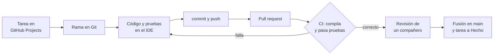

---
{"dg-publish":true,"permalink":"/asignaturas/1-dam-ed/apuntes/unidad-01/15-herramientas-del-desarrollo-actual/","tags":["ingeniería_sw","herramientas"],"dg-note-properties":{"unidad":"[[Asignaturas/1DAM_ED/Unidades/Unidad 01/Unidad 01 - Desarrollo de software]]","descripcion":"Herramientas que se usan hoy en cada fase del desarrollo (IDE, Git, Maven y Gradle, pruebas, integración continua, gestión de tareas, contenedores e IA), un recorrido por todas ellas y cómo evaluarlas.","orden":15,"criterios":["RA1.f","RA1.b"],"tags":["ingeniería_sw","herramientas"]}}
---


```table-of-contents
```

---

> [!summary] En pocas palabras
> Un proyecto actual no usa una única herramienta, sino una **cadena de herramientas** (*toolchain*) conectadas entre sí: un **IDE** para escribir el código, **Git** para guardar sus versiones, **Maven** o **Gradle** para construirlo, **JUnit** para probarlo, un servicio de **integración continua** que lo comprueba todo automáticamente, un **gestor de tareas** para organizar el trabajo y, cada vez más, **asistentes de IA**. Elegirlas bien es parte del trabajo de un desarrollador.

En [[Asignaturas/1DAM_ED/Apuntes/Unidad 01/6. Ciclo de vida del software#6.4. Herramientas de apoyo al desarrollo del software\|6.4. Herramientas de apoyo al desarrollo del software]] viste que las antiguas herramientas CASE han dado paso a herramientas especializadas. En este apartado vemos **cuáles se usan hoy, para qué sirve cada una y cómo trabajan juntas**. Muchas las usarás a fondo en las próximas unidades del módulo.

## 15.1. Las herramientas, fase a fase

| Fase | Para qué | Herramientas habituales |
|---|---|---|
| Planificación y análisis | Organizar tareas, requisitos e incidencias | GitHub Issues y Projects, Jira, Trello |
| Diseño | Diagramas UML, bocetos de pantallas | PlantUML, draw.io, Figma |
| Codificación | Escribir, navegar y depurar el código | IntelliJ IDEA, NetBeans, Eclipse, VS Code |
| Control de versiones | Guardar el historial y trabajar en equipo | Git, con GitHub o GitLab |
| Construcción | Compilar, gestionar dependencias, empaquetar | Maven, Gradle |
| Pruebas | Comprobar automáticamente que el código funciona | JUnit, Mockito, Selenium |
| Calidad del código | Detectar errores y malas prácticas | SonarQube, Checkstyle, analizadores del IDE |
| Integración continua | Construir y probar en cada cambio | GitHub Actions, GitLab CI, Jenkins |
| Documentación | Explicar el código y el proyecto | Javadoc, Markdown (`README.md`) |
| Despliegue y explotación | Instalar y ejecutar la aplicación | Docker, `jpackage`, servicios en la nube |

### 15.1.1. Entornos de desarrollo integrados (IDE)

Un **IDE** reúne en un solo programa el editor, el compilador, el depurador y la conexión con el resto de herramientas. Lo que más ayuda en el día a día:

- **Autocompletado** y detección de errores mientras escribes.
- **Depurador**: ejecutar paso a paso y ver el valor de las variables.
- **Refactorización**: renombrar o mover código de forma segura en todo el proyecto.
- **Integración** con Git, Maven o Gradle, JUnit y asistentes de IA.

Los IDE se estudian a fondo en la unidad de entornos de desarrollo.

### 15.1.2. Control de versiones con Git

**Git** guarda cada versión del código (**commit**), permite volver atrás y que varias personas trabajen a la vez en **ramas** distintas. Los repositorios se suben a plataformas como **GitHub** o **GitLab**, que añaden la revisión de código (*pull requests*), la gestión de incidencias y la integración continua.

```bash
git clone https://github.com/usuario/reservas.git   # descargar el proyecto
git switch -c listado-aulas                         # crear una rama para la tarea
git add .                                           # preparar los cambios
git commit -m "Añade el listado de aulas libres"    # guardar una versión
git push                                            # subirla a GitHub
```

### 15.1.3. Construcción y dependencias: Maven y Gradle

Compilar a mano con `javac` funciona para un archivo, pero no para un proyecto con cientos de clases y bibliotecas externas. **Maven** y **Gradle** automatizan la **construcción**: descargan las bibliotecas que el proyecto necesita (**dependencias**), compilan, ejecutan las pruebas y empaquetan el resultado. Todo se describe en un archivo de configuración; en Maven, el `pom.xml`:

```xml
<dependency>
    <groupId>org.junit.jupiter</groupId>
    <artifactId>junit-jupiter</artifactId>
    <version>5.11.0</version>
    <scope>test</scope>
</dependency>
```

Con `mvn package`, Maven descarga JUnit, compila, pasa las pruebas y genera el `.jar`. Los proyectos de NetBeans de este curso ya usan Maven.

### 15.1.4. Pruebas automáticas e integración continua

Las **pruebas automáticas** (por ejemplo, con **JUnit**) son programas que comprueban que el código hace lo que debe. La **integración continua** (*CI*, *Continuous Integration*) las ejecuta **cada vez que alguien sube un cambio**: si algo falla, el equipo lo sabe en minutos. Con **GitHub Actions** basta un archivo en el repositorio:

```yaml
# .github/workflows/ci.yml
name: CI
on: [push, pull_request]
jobs:
  build:
    runs-on: ubuntu-latest
    steps:
      - uses: actions/checkout@v4
      - uses: actions/setup-java@v4
        with:
          distribution: temurin
          java-version: 21
      - run: mvn --batch-mode package   # compila y ejecuta las pruebas
```

Las pruebas se estudian en la [[Asignaturas/1DAM_ED/Unidades/Unidad 03/Unidad 03 - Pruebas y depuración\|Unidad 03 - Pruebas y depuración]], y la integración continua, en la [[Asignaturas/1DAM_ED/Unidades/Unidad 04/Unidad 04 - Optimización, control de versiones e integración continua\|Unidad 04 - Optimización, control de versiones e integración continua]].

### 15.1.5. Asistentes de inteligencia artificial

Asistentes como [**GitHub Copilot**](https://github.com/features/copilot), [**Claude Code**](https://code.claude.com/), [**Codex**](https://openai.com/es-ES/codex/) u [**OpenCode**](https://opencode.ai/), y editores como [**Cursor**](https://cursor.com/), sugieren código, lo explican, escriben pruebas o buscan errores, integrados en el IDE o en la terminal. No son herramientas CASE en el sentido tradicional, pero cumplen su objetivo principal: **automatizar la codificación** y **reducir errores**.

En la misma línea:

* Las herramientas de **modelado** como **Enterprise Architect** o **Visual Paradigm** ya no solo documentan: **generan fragmentos de código** a partir de los diagramas UML.
* Las plataformas ***low-code*/*no-code*** ([**Appian**](https://appian.com/es/about/explore/overview), [**GeneXus**](https://www.genexus.com/es/productos/genexus/versiones/genexus17/videos/que-es-genexus), Mendix u OutSystems) permiten crear aplicaciones a partir de modelos visuales, con poco o ningún código.

Son muy útiles, pero:

> [!WARNING] La IA no sustituye a entender el código
> - Se **equivoca** con seguridad: hay que revisar y probar todo lo que genera.
> - Si no entiendes el código que entrega, no podrás corregirlo ni mantenerlo.
> - No subas a un asistente código o datos confidenciales sin permiso de la empresa.

### 15.1.6. De las herramientas CASE a las actuales

En lugar de depender de una única herramienta **CASE** que lo hacía todo (ver el anexo [[Asignaturas/1DAM_ED/Apuntes/Unidad 01/Anexo - Enfoque clásico/3. Herramientas CASE\|3. Herramientas CASE]]), los equipos actuales combinan herramientas especializadas que, juntas, cubren las mismas funciones:

| Función CASE tradicional | Herramientas actuales |
| :---- | :---- |
| Modelado de requisitos y diseño (*Upper CASE*) | Enterprise Architect, Visual Paradigm, StarUML, PlantUML, draw.io |
| Desarrollo y codificación (*Lower CASE*) | IDE (IntelliJ IDEA, Eclipse, VS Code, NetBeans) y asistentes de IA |
| Repositorio central del proyecto | GitHub, GitLab, con Jira o GitHub Projects para las tareas |
| Pruebas y control de calidad (*Lower CASE*) | JUnit (pruebas unitarias), Selenium (web), Postman (API), SonarQube |
| Generación de código (*I-CASE*) | Plataformas *low-code*/*no-code* y asistentes de IA |

La idea de CASE, **automatizar las tareas del desarrollo**, sigue más viva que nunca, repartida entre la cadena de herramientas, las plataformas de colaboración y la IA.

## 15.2. Un cambio de principio a fin

Así se encadenan las herramientas cuando un equipo añade una funcionalidad, por ejemplo, el **listado de aulas libres** del proyecto de reservas:



1. La tarea está en el tablero (**GitHub Projects**) y alguien la pasa a *En curso*.
2. Crea una **rama** en **Git** para trabajar sin afectar al resto.
3. Escribe el código y sus **pruebas JUnit** en el **IDE**, ayudándose del depurador y quizá de un asistente de IA.
4. Hace **commit** y **push**, y abre una **pull request** en GitHub.
5. La **integración continua** construye el proyecto con **Maven** y ejecuta las pruebas.
6. Otra persona del equipo **revisa** el código; si todo está bien, se **fusiona** con la rama principal y la tarea pasa a *Hecho*.

## 15.3. Cómo evaluar una herramienta

Para elegir una herramienta no basta con que sea popular. Estos criterios ayudan a compararlas:

| Criterio | Preguntas |
|---|---|
| **Funcionalidad** | ¿Hace lo que necesita el proyecto? ¿Qué lenguajes y tecnologías admite? |
| **Integración** | ¿Se conecta con el resto de herramientas del equipo (Git, Maven, CI…)? |
| **Licencia y coste** | ¿Es libre o propietaria? ¿Gratuita, de pago o con versión educativa? |
| **Comunidad y soporte** | ¿Tiene documentación, actualizaciones frecuentes y mucha gente usándola? |
| **Rendimiento** | ¿Cuántos recursos consume? ¿Funciona bien en los equipos disponibles? |
| **Curva de aprendizaje** | ¿Cuánto cuesta empezar a usarla? |
| **Demanda en el mercado** | ¿La piden las empresas en sus ofertas de empleo? |

> [!EXAMPLE] Ejemplo: elegir un IDE para Java
> - **IntelliJ IDEA**: muy potente en refactorización y análisis de código; la edición Community es gratuita y la Ultimate tiene licencia educativa.
> - **NetBeans**: libre (Apache), sencillo y con Maven integrado; muy usado en formación.
> - **VS Code**: ligero y multilenguaje, pero para Java necesita extensiones.
> - **Eclipse**: libre y muy extensible, habitual en empresas con proyectos antiguos.
>
> Para un curso que empieza con Java y Maven, NetBeans o IntelliJ Community son buenas opciones; para un equipo que trabaja con varios lenguajes, VS Code puede encajar mejor.

---

<p><span>⬅️ <strong>Anterior:</strong> <a data-tooltip-position="top" aria-label="Asignaturas/1DAM_ED/Apuntes/Unidad 01/14. Mantenimiento.md" data-href="Asignaturas/1DAM_ED/Apuntes/Unidad 01/14. Mantenimiento.md" href="Asignaturas/1DAM_ED/Apuntes/Unidad 01/14. Mantenimiento.md" class="internal-link" target="_blank" rel="noopener nofollow">14. Mantenimiento</a> | 🏠 <strong>Unidad:</strong> <a data-tooltip-position="top" aria-label="Asignaturas/1DAM_ED/Unidades/Unidad 01/Unidad 01 - Desarrollo de software.md" data-href="Asignaturas/1DAM_ED/Unidades/Unidad 01/Unidad 01 - Desarrollo de software.md" href="Asignaturas/1DAM_ED/Unidades/Unidad 01/Unidad 01 - Desarrollo de software.md" class="internal-link" target="_blank" rel="noopener nofollow">Unidad 01 - Desarrollo de software</a> | <strong>Siguiente:</strong> <a data-tooltip-position="top" aria-label="Asignaturas/1DAM_ED/Apuntes/Unidad 01/Referencias documentales.md" data-href="Asignaturas/1DAM_ED/Apuntes/Unidad 01/Referencias documentales.md" href="Asignaturas/1DAM_ED/Apuntes/Unidad 01/Referencias documentales.md" class="internal-link" target="_blank" rel="noopener nofollow">Referencias documentales</a> ➡️</span></p>
