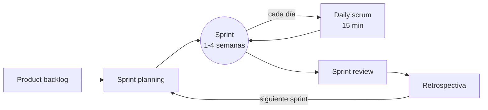

---
{"dg-publish":true,"permalink":"/asignaturas/1-dam-ed/apuntes/unidad-01/7-metodologias-agiles-scrum-y-kanban/","tags":["ingeniería_sw","ágil"],"dg-note-properties":{"unidad":"[[Asignaturas/1DAM_ED/Unidades/Unidad 01/Unidad 01 - Desarrollo de software]]","descripcion":"El manifiesto ágil, Scrum (roles, eventos y artefactos) y Kanban, con su uso en un proyecto real y cuándo conviene cada enfoque.","orden":7,"criterios":["RA1.b","RA1.g"],"tags":["ingeniería_sw","ágil"]}}
---


```table-of-contents
```

---

> [!summary] En pocas palabras
> Las metodologías ágiles desarrollan el software en **ciclos cortos**, entregando en cada uno algo que funciona y ajustando el plan según lo que opina el cliente. **Scrum** organiza el trabajo en *sprints* con unos roles y reuniones fijos; **Kanban** se centra en visualizar el trabajo en un tablero y limitar lo que está a medias.

En [[Asignaturas/1DAM_ED/Apuntes/Unidad 01/6. Ciclo de vida del software#6.1. Ciclo de vida del software\|6.1. Ciclo de vida del software]] vimos que el **modelo en cascada** exige conocer todos los requisitos al principio. En la práctica, el cliente cambia de opinión, aparecen problemas imprevistos y la tecnología evoluciona durante el proyecto. Las metodologías ágiles nacen para **aceptar el cambio** en lugar de combatirlo, y aplican a la gestión del proyecto el [[Asignaturas/1DAM_ED/Apuntes/Unidad 01/6. Ciclo de vida del software#Modelo iterativo incremental\|modelo iterativo incremental]].

## 7.1. El manifiesto ágil

En 2001, un grupo de desarrolladores publicó el **Manifiesto por el Desarrollo Ágil de Software** (Beck et al., 2001). Resume la idea en cuatro valores:

| Valoramos más… | …que |
|---|---|
| **Individuos e interacciones** | procesos y herramientas |
| **Software funcionando** | documentación extensiva |
| **Colaboración con el cliente** | negociación contractual |
| **Respuesta ante el cambio** | seguir un plan |

> [!WARNING] Ágil no significa «sin documentación ni plan»
> El manifiesto dice que, aunque lo de la derecha tiene valor, **valoramos más** lo de la izquierda. Un proyecto ágil también planifica, documenta y prueba, pero en pequeñas dosis y de forma continua.

### 7.1.1. Principios ágiles

De estos valores se derivan los principios y características comunes a todas las metodologías ágiles:

* **Colaboración y comunicación**: las metodologías ágiles promueven la colaboración cercana entre los miembros del equipo, así como la comunicación frecuente con los *stakeholders* (partes interesadas) del proyecto.

* **Iteración**: el trabajo se divide en iteraciones o ciclos de desarrollo cortos y enfocados, generalmente de una a cuatro semanas de duración. Al final de cada iteración, se entrega un producto funcional o una parte de él.

* **Priorización**: las tareas y características se priorizan según su valor para el cliente o el proyecto. Esto permite a los equipos centrarse en lo más importante primero.

* **Flexibilidad**: los requisitos pueden cambiar a lo largo del proyecto, y las metodologías ágiles permiten incorporar estos cambios de manera eficiente.

* **Entrega continua**: se busca entregar partes funcionales del producto en forma regular. Esto permite obtener retroalimentación temprana y realizar ajustes en consecuencia.

* **Autoorganización del equipo**: los equipos ágiles son responsables de la planificación y la toma de decisiones. Se espera que sean autoorganizados y autogestionados.

* **Visión del cliente**: se enfoca en satisfacer las necesidades del cliente y en la entrega de valor continuo. La retroalimentación del cliente es fundamental.

* **Medición y mejora continua**: se fomenta la evaluación constante del proceso y la búsqueda de mejoras en la productividad y la calidad.

## 7.2. Scrum

**Scrum** es el marco ágil más extendido. Su guía oficial (Schwaber y Sutherland, 2020) lo define con tres **roles**, cinco **eventos** y tres **artefactos**.

### 7.2.1. Roles

| Rol | Qué hace | En el proyecto de reservas de aulas |
|---|---|---|
| ***Product Owner*** | Representa al cliente. Decide **qué** se hace y en qué orden | La jefa de estudios, que sabe qué necesita el profesorado |
| ***Scrum Master*** | Ayuda al equipo a aplicar Scrum y elimina obstáculos. No es un jefe | Un miembro del equipo que modera las reuniones |
| ***Developers*** (equipo) | Deciden **cómo** se hace y construyen el producto. Incluye programación, pruebas, diseño… | El resto del grupo |

### 7.2.2. Artefactos

- ***Product backlog***: lista **ordenada por prioridad** de todo lo que podría tener el producto. Suele escribirse como **historias de usuario**:

  > Como **profesor**, quiero **ver qué aulas están libres a una hora** para **reservar una sin preguntar en conserjería**.

- ***Sprint backlog***: las historias elegidas para el sprint actual y las tareas en que se dividen.
- **Incremento**: el producto funcionando al final del sprint, con todo lo terminado hasta entonces. Debe cumplir la **definición de hecho** (*Definition of Done*) acordada, por ejemplo: «programado, probado y revisado por otra persona».

### 7.2.3. Eventos



| Evento | Cuándo | Para qué |
|---|---|---|
| ***Sprint*** | Ciclo de duración fija, de 1 a 4 semanas | Contiene todos los demás eventos. Al terminar, hay un incremento |
| ***Sprint planning*** | Al empezar el sprint | Elegir qué historias entran y cómo se van a hacer |
| ***Daily scrum*** | Cada día, 15 minutos como máximo | Revisar el avance hacia el objetivo y detectar bloqueos |
| ***Sprint review*** | Al final del sprint | Enseñar el incremento al *Product Owner* y a los interesados, y recoger su opinión |
| ***Sprint retrospective*** | Tras la *review* | El equipo analiza **cómo ha trabajado** y decide qué mejorar |

> [!TIP] Estimar con puntos
> Muchos equipos estiman el esfuerzo de las historias en **puntos de historia** (1, 2, 3, 5, 8…) en lugar de en horas. Comparar historias entre sí («esta es el doble de difícil que aquella») resulta más fiable que adivinar horas.

## 7.3. Kanban

**Kanban** procede de la fabricación de Toyota y se basa en tres prácticas:

1. **Visualizar el trabajo** en un tablero con columnas que representan los estados de una tarea.
2. **Limitar el trabajo en curso** (*WIP*, *Work In Progress*): cada columna admite un número máximo de tarjetas. Si *En curso* está llena, hay que terminar algo antes de empezar otra cosa.
3. **Gestionar el flujo**: medir cuánto tarda una tarjeta en cruzar el tablero y eliminar los cuellos de botella.

| Por hacer | En curso (máx. 2) | En revisión | Hecho |
|---|---|---|---|
| Listado de aulas | Formulario de reserva | Pantalla de inicio de sesión | Modelo de datos |
| Cancelar reserva | Comprobar aula ocupada | | |
| Avisos por correo | | | |

A diferencia de Scrum, Kanban **no tiene sprints ni roles fijos**: el trabajo fluye de forma continua. Por eso encaja bien en equipos de mantenimiento o soporte, donde las tareas llegan de forma imprevisible.

## 7.4. Herramientas

Los tableros pueden ser físicos (pósits en una pared) o digitales. Las herramientas más usadas son:

- [**GitHub Projects**](https://docs.github.com/es/issues/planning-and-tracking-with-projects) y **GitLab Boards**: el tablero se enlaza con las incidencias (*issues*) y el código del repositorio.
- [**Jira**](https://www.atlassian.com/es/software/jira): muy extendida en empresas, con soporte para Scrum (sprints, *backlog*, gráficos de avance) y Kanban.
- [**Trello**](https://trello.com/es): tableros Kanban sencillos, útiles para empezar.

## 7.5. ¿Ágil o cascada?

| Situación | Enfoque recomendado |
|---|---|
| Requisitos poco claros o que cambian a menudo | Ágil (Scrum) |
| Hay que enseñar avances al cliente con frecuencia | Ágil (Scrum) |
| Flujo continuo de tareas pequeñas e imprevisibles (soporte, mantenimiento) | Kanban |
| Requisitos fijos y bien conocidos, con normativa estricta (sanidad, aviación, contratos públicos cerrados) | Cascada o un enfoque híbrido |

En la práctica, muchas empresas combinan ambos: por ejemplo, Scrum con un tablero Kanban (*Scrumban*), o una planificación inicial en cascada con desarrollo por sprints.

## Referencias

- Beck, K., Beedle, M., van Bennekum, A., Cockburn, A., Cunningham, W., Fowler, M., … Thomas, D. (2001). *Manifiesto por el Desarrollo Ágil de Software*. [https://agilemanifesto.org/iso/es/manifesto.html](https://agilemanifesto.org/iso/es/manifesto.html)
- Schwaber, K. y Sutherland, J. (2020). *La Guía Scrum*. [https://scrumguides.org/](https://scrumguides.org/)

---

<p><span>⬅️ <strong>Anterior:</strong> <a data-tooltip-position="top" aria-label="Asignaturas/1DAM_ED/Apuntes/Unidad 01/6. Ciclo de vida del software.md" data-href="Asignaturas/1DAM_ED/Apuntes/Unidad 01/6. Ciclo de vida del software.md" href="Asignaturas/1DAM_ED/Apuntes/Unidad 01/6. Ciclo de vida del software.md" class="internal-link" target="_blank" rel="noopener nofollow">6. Ciclo de vida del software</a> | 🏠 <strong>Unidad:</strong> <a data-tooltip-position="top" aria-label="Asignaturas/1DAM_ED/Unidades/Unidad 01/Unidad 01 - Desarrollo de software.md" data-href="Asignaturas/1DAM_ED/Unidades/Unidad 01/Unidad 01 - Desarrollo de software.md" href="Asignaturas/1DAM_ED/Unidades/Unidad 01/Unidad 01 - Desarrollo de software.md" class="internal-link" target="_blank" rel="noopener nofollow">Unidad 01 - Desarrollo de software</a> | <strong>Siguiente:</strong> <a data-tooltip-position="top" aria-label="Asignaturas/1DAM_ED/Apuntes/Unidad 01/8. Análisis.md" data-href="Asignaturas/1DAM_ED/Apuntes/Unidad 01/8. Análisis.md" href="Asignaturas/1DAM_ED/Apuntes/Unidad 01/8. Análisis.md" class="internal-link" target="_blank" rel="noopener nofollow">8. Análisis</a> ➡️</span></p>
