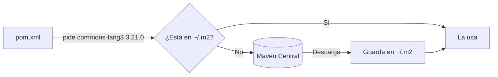

---
{"dg-publish":true,"dg-permalink":"/apuntes/1-dam-ed/unidad-02-entornos-de-desarrollo/","permalink":"/apuntes/1-dam-ed/unidad-02-entornos-de-desarrollo/","dg-note-properties":{"unidad":"[[Asignaturas/1DAM_ED/Unidades/Unidad 02/Unidad 02 - Entornos de desarrollo]]","modulo":"[[Módulos/Entornos de desarrollo]]","libro":"[[Libros/Entornos de desarrollo (1º DAM, 1º DAW)]]"}}
---


```table-of-contents
```

---

# 1. El IDE

Los primeros entornos de desarrollo integrados nacieron a principios de los años 70, y se popularizaron en la década de los 90. Tienen el objetivo de ganar fiabilidad y tiempo en los proyectos de software. Proporcionan al programador una serie de componentes con la misma interfaz gráfica, con la consiguiente comodidad, aumento de eficiencia y reducción de tiempo de codificación.

Normalmente, un IDE está dedicado a un determinado lenguaje de programación. No obstante, las últimas versiones de los IDE tienden a ser compatibles con varios lenguajes (por ejemplo: [Eclipse](https://eclipseide.org/), [NetBeans](https://netbeans.apache.org/front/main/index.html), Microsoft Visual Studio, [Visual Studio Code](https://code.visualstudio.com/), etc.) mediante la instalación de plugins adicionales.

En este tema, nuestro interés se centra en conocer los entornos de desarrollo, los tipos, en función de su licencia y del lenguaje de programación hacia el cual están enfocados.

## 1.1. Evolución histórica

En las décadas de utilización de la tarjeta perforada como sistema de almacenamiento el concepto de **Entorno de Desarrollo Integrado** sencillamente no tenía sentido. Los programas estaban escritos con diagramas de flujo y entraban al sistema a través de las **tarjetas perforadas**. Los programas indicaban directamente las operaciones a realizar.


> Tarjeta perforada binaria
> Fuente: https://es.wikipedia.org/wiki/Tarjeta_perforada

Posteriormente, con la evolución de la tecnología y de los lenguajes de programación, eran compilados o interpretados por **línea de comandos**.


> Fuente: OMPIRE, CC BY-SA 4.0 <https://creativecommons.org/licenses/by-sa/4.0>, via Wikimedia Commons

El primer lenguaje de programación que utilizó un IDE fue el BASIC (que fue el primero en abandonar también las tarjetas perforadas o las cintas de papel). Este primer IDE estaba basado en consola de comandos exclusivamente (normal por otro lado, si tenemos en cuenta que hasta la década de los 90 no entran en el mercado los sistemas operativos con interfaz gráfica). Sin embargo, el uso que hace de la gestión de archivos, compilación y depuración, es perfectamente compatible con los IDE actuales. 

El primer IDE que se hizo público fue [**Maestro**](https://en.wikipedia.org/wiki/Maestro_I). Nació a principios de los 70 y fue instalado por unos 22.000 programadores en todo el mundo. Lideró este campo durante los años 70 y 80\.

El uso de IDE se afianza en los 90 y hoy en día existen multitud entre los que destacamos:

| Entorno de desarrollo | Lenguajes que soporta | Tipo de licencia |
| :---: | ----- | ----- |
| NetBeans | C/C++, Java, JavaScript, PHP, Python.  | De uso público. |
| Eclipse | Ada, C/C++, Java, JavaScript, PHP.  | De uso público. |
| VS Code | Uso principal: JavaScript, TypeScript y Node.js Compatibilidad: C++, C\#, Java, Python, Go, .NET | De uso público. |
| Microsoft VS | Basic, C/C++, C\#.  | Propietario. |
| C++ Builder | C/C++.  | Propietario. |
| JBuilder | Java.  | Propietario. |

> [!note] Nota 
> No hay unos entornos de desarrollo más importantes que otros. La elección del IDE más adecuado dependerá del lenguaje de programación que vayamos a utilizar para la codificación de las aplicaciones y el tipo de licencia con la que queramos trabajar.

## 1.2. Características

> [!info] 
> Debido a la naturaleza cambiante de estos productos, algunos de los datos indicados pueden estar desactualizados.

* **Licencia**: existen IDEs comerciales (p.ej: Jbuilder, Visual Studio...) y otros libres u open source (Eclipse, NetBeans...)

* **Plataforma**: hay IDEs multiplataforma, es decir, funcionan en distintos sistemas (Windows, Linux y Mac, etc.). NetBeans, Visual Studio Code o IntelliJ IDEA son algunos de ellos.
  Otros, en cambio y siendo una minoría, se limitan a un solo sistema. Es el caso de:
  * [Visual Studio](https://visualstudio.microsoft.com/es/) de Microsoft, que corre solamente en Windows
  * [Gambas](https://gambaswiki.org/website/en/main.html), pensado solo para  Linux.

* **Programación visual**: los IDEs que permiten programación visual están diseñados para generar aplicaciones con interfaz gráfico de usuario (GUI). Otros IDEs no permiten programación visual, aunque también se pueden generar aplicaciones GUI programando el interfaz manualmente (usando las funciones del API correspondiente). Esto último es mucho más lento, pero también más flexible y eficiente.

* **Depurador**: es la herramienta principal de la fase de pruebas. Tiene diferentes funciones que ayudan a localizar errores de ejecución en el código fuente. Más adelante hablaremos de estas funciones.

* **Autocompletar**: es una función que facilita la introducción de código fuente. Completa los nombres de métodos, atributos, variables, subprogramas, etc, en cuanto hemos tecleado las primeras letras.

* **Navegador de clases**: un browser que permite navegar por el árbol de clases para acceder rápidamente al código de cualquiera de ellas.

* **Soporte multilenguaje**: muchos IDEs están diseñados para trabajar con un único lenguaje (p.ej: Gambas o Visual Basic trabajan en Basic), pero otros pueden compilar múltiples lenguajes (p.ej: NetBeans o Eclipse). En ocasiones, es necesario instalar plugins o módulos adicionales para extender la capacidad multilenguaje.

* **Encadenamiento de herramientas**: el proceso de generación de un programa ejecutable suele siempre seguir los mismos pasos (luego los veremos en detalle: edición, compilación, montaje, depuración, ejecución). Algunos programas pueden necesitar más pasos (por ejemplo, edición de sonidos, modelado 3D, combinación de estos recursos con el programa final, etc). Pues bien, los IDE proporcionan mecanismos para encadenar herramientas, pero no todos permiten cadenas de la misma longitud ni complejidad, es decir, no todos disponen de las mismas herramientas.

* **Análisis de rendimiento (*profiling*)**: el profiler es una herramienta que realiza pruebas de rendimiento del programa que estamos ejecutando desde el IDE. Sirve para depurar el programa, pues detecta posibles errores al indicarnos, por ejemplo, si un subprograma está tardando demasiado en responder o si una estructura de datos ha crecido más de lo esperado.

* **Cobertura de código**: como la anterior, es una herramienta para la fase de pruebas. Nos indica qué parte del código fuente estamos probando y qué parte no, de modo que podamos diseñar nuevos juegos de pruebas si aún nos queda alguna parte del programa por probar.

* **Refactorización**: es otra técnica asociada a las pruebas, que permite reorganizar el código fuente sin alterar su funcionamiento. Se utiliza cuando se pretende mejorar el rendimiento de parte del código de un programa.

* **Sistema de control de versiones (CVS)**: ayuda a mantener las versiones anteriores conforme se van haciendo modificaciones en el código, permite consultar los cambios que se han hecho y revertirlos en caso necesario, y facilita la coordinación entre varios desarrolladores.

* **Generador automático de documentación**: genera la documentación del programa en algún formato preestablecido y, a menudo, modificable.

# 2. Estructura de un IDE

Piensa en un IDE como en el **taller de un mecánico**: en lugar de ir a buscar cada herramienta a una tienda distinta (un editor por aquí, un compilador por allá, un depurador en otro sitio), lo tienes todo **colgado en la misma pared y al alcance de la mano**. Saber dónde está cada herramienta es lo que te hará trabajar rápido.

En este apartado vamos a «desmontar» la ventana de **Apache NetBeans**, el IDE que usaremos en el curso, para que reconozcas cada zona y sepas cuándo usarla. Lo que aprendas aquí te servirá también en otros IDE (IntelliJ IDEA, Eclipse, Visual Studio Code…): los nombres cambian, pero las piezas son las mismas.

> [!TIP] Aprende con NetBeans abierto
> Este apartado está pensado para leerlo **con NetBeans delante**. Cada vez que veas un callout 🛠️ **Pruébalo**, hazlo en tu ordenador: en diez minutos tendrás el IDE «en los dedos».

## 2.1. Los componentes de un IDE

Por dentro, un IDE es un conjunto de programas que trabajan juntos. Estos son los principales y lo que hacen por ti:

| Componente | ¿Qué hace por ti? | Ejemplo en NetBeans |
| --- | --- | --- |
| **Editor de código** | Colorea la sintaxis, autocompleta, cierra paréntesis y llaves, sangra el código y te muestra los parámetros de cada método. | Escribes `sout` + `Tab` y aparece `System.out.println("");` |
| **Compilador / intérprete** | Traduce tu código y **detecta errores mientras escribes**, sin esperar a ejecutar. | Una línea con un `;` olvidado se subraya en rojo al instante. |
| **Depurador** | Ejecuta el programa paso a paso, lo detiene en puntos de ruptura y te deja ver el valor de las variables. | Botón **Debug Project** (`Ctrl + F5`). |
| **Herramientas de construcción** | Compilan el proyecto entero, gestionan las librerías y generan el ejecutable (`.jar`). | Maven, integrado: **Clean and Build** (`Shift + F11`). |
| **Asistentes y generadores** | Escriben por ti el código repetitivo: constructores, *getters* y *setters*, ventanas gráficas… | `Alt + Insert` → **Getter and Setter…** |
| **Extensiones (*plugins*)** | Añaden lenguajes y funciones nuevas al IDE. | **Tools → Plugins**. Lo veremos en [[Asignaturas/1DAM_ED/Apuntes/Unidad 02/4. Módulos, plugins y extensiones\|4. Módulos, plugins y extensiones]]. |

> [!EXAMPLE] El editor y el compilador, trabajando juntos
> Escribe este código en NetBeans y fíjate en lo que ocurre **antes de ejecutar nada**:
>
> ```java
> public class Saludo {
>     public static void main(String[] args) {
>         String nombre = "Telmo"
>         System.out.println("Hola, " + nombr);
>     }
> }
> ```
>
> - La línea 3 se subraya en rojo: falta el `;`.
> - En la línea 4, `nombr` también aparece en rojo: la variable no existe.
> - En el margen izquierdo aparece una **bombilla** 💡 o un icono de error. Si pasas el ratón por encima, NetBeans te explica el problema; con `Alt + Enter` te propone soluciones.
>
> Sin un IDE, solo te enterarías de estos errores al compilar desde la terminal.


## 2.2. Un vistazo a la ventana de NetBeans

Al abrir un proyecto, la ventana de NetBeans se divide en varias zonas. Esta es la distribución por defecto:


| Nº | Zona | Para qué sirve |
| :---: | --- | --- |
| 1 | **Barra de menús y de herramientas** | Acceso a todas las órdenes; los botones más usados (nuevo proyecto, guardar, ejecutar, depurar) están a un clic. |
| 2 | **Panel de proyectos** (*Projects*) | Muestra tus proyectos y sus paquetes y clases. |
| 3 | **Navegador** (*Navigator*) | Lista los atributos y métodos de la clase que estás editando. |
| 4 | **Editor** | Donde escribes el código. Cada archivo abierto es una pestaña. |
| 5 | **Salida** (*Output*) | Muestra lo que imprime tu programa, los errores de compilación y los mensajes de Maven. |
| 6 | **Barra de estado** | Línea y columna del cursor, modo de inserción y tareas en segundo plano. |

> [!NOTE] La ventana es tuya
> Todos los paneles se pueden **mover, ocultar, minimizar o separar** en otra ventana arrastrando su pestaña. Haz doble clic en la pestaña del editor para maximizarlo y vuelve a hacer doble clic para restaurarlo.
>
> ¿Lo has descolocado todo? **Window → Reset Windows** deja la distribución como al principio.

## 2.3. Los paneles, uno a uno

### 2.3.1. El editor

Es el panel en el que pasarás el 90 % del tiempo. Además de colorear el código, te ayuda a escribirlo:

- **Autocompletado** (`Ctrl + Espacio`): escribe `Sys`, pulsa la combinación y elige `System`.
- **Plantillas de código**: escribe la abreviatura y pulsa `Tab`.

  | Abreviatura | Se convierte en |
  | --- | --- |
  | `psvm` | `public static void main(String[] args) { }` |
  | `sout` | `System.out.println("");` |
  | `fori` | un bucle `for (int i = 0; i < ...; i++)` |
  | `ifelse` | un bloque `if … else` |

- **Sugerencias** (`Alt + Enter` sobre una bombilla 💡): añadir un `import`, crear un método que no existe, rodear con `try-catch`…
- **Formatear** (`Alt + Shift + F`): ordena las sangrías y los espacios de todo el archivo.
- **Comentar o descomentar** líneas (`Ctrl + /`).

> [!TIP] 🛠️ Pruébalo
> En una clase vacía, escribe `psvm` + `Tab` y, dentro, `sout` + `Tab`. Escribe un texto entre las comillas y ejecuta el archivo con `Shift + F6`. Acabas de escribir un programa completo con **dos abreviaturas**.


### 2.3.2. Proyectos (*Projects*) y Archivos (*Files*)

En un IDE no se trabaja con archivos sueltos, sino con **proyectos**: el conjunto de tu código fuente, las librerías que usa y la configuración necesaria para compilarlo y ejecutarlo. NetBeans te enseña ese proyecto de dos formas:

| Panel | Atajo | Qué muestra | Cuándo usarlo |
| --- | --- | --- | --- |
| **Projects** | `Ctrl + 1` | Una vista **lógica**: paquetes, clases y dependencias. | Casi siempre: para crear clases, abrirlas y ejecutar el proyecto. |
| **Files** | `Ctrl + 2` | Las carpetas **reales** del disco: `src/main/java`, `pom.xml`, `target`… | Para ver archivos que *Projects* oculta, como el `.jar` generado en `target/`. |


> [!TIP] 🛠️ Pruébalo
> Ejecuta **Clean and Build** (`Shift + F11`) en tu proyecto. Luego abre el panel **Files** y busca la carpeta `target`: dentro está el `.jar`, el ejecutable de tu programa. En *Projects* no lo verás.

### 2.3.3. El navegador (*Navigator*)

Muestra el **esqueleto de la clase** abierta: sus atributos y sus métodos, con iconos que indican si son públicos o privados. Haz clic en un método y el editor salta directamente a él.

En una clase de 20 líneas no parece gran cosa, pero en una de 800 te ahorra mucho *scroll*. Si no lo ves, ábrelo con `Ctrl + 7`.


### 2.3.4. La salida (*Output*)

Es la «consola» del IDE (`Ctrl + 4`). Aquí aparece:

- Lo que tu programa escribe con `System.out.println()`.
- Lo que el usuario teclea cuando el programa lee datos con `Scanner`: **se escribe en este mismo panel**.
- Los errores en tiempo de ejecución (excepciones), en rojo.
- Los mensajes de Maven al compilar: `BUILD SUCCESS` o `BUILD FAILURE`.

> [!WARNING] Lee los errores: son tus amigos
> Cuando un programa falla, el panel *Output* muestra la **traza** del error. Las líneas en azul son **enlaces**: haz clic en `Saludo.java:4` y el editor te llevará a la línea exacta donde se produjo.
>
> ```text
> Exception in thread "main" java.lang.ArithmeticException: / by zero
>     at es.dam.Saludo.main(Saludo.java:13)
> ```


### 2.3.5. Otros paneles que irás descubriendo

| Panel | Cómo se abre | Para qué sirve |
| --- | --- | --- |
| **Variables** y **Call Stack** | Aparecen al depurar | Ver el valor de las variables y la cadena de llamadas mientras el programa está en pausa. Lo trabajaremos en la Unidad 03. |
| **Action Items** | `Ctrl + 6` | Lista los errores del proyecto y los comentarios `// TODO` que hayas dejado en el código. |
| **Diseño de ventanas** (*Design*) y **Properties** | Al abrir un `JFrame` | Diseñar interfaces gráficas arrastrando botones y campos de texto. |

## 2.4. Los menús, con los atajos que de verdad vas a usar

Los menús agrupan **todas** las órdenes del IDE. No hace falta memorizarlos: lo importante es saber **dónde buscar** y aprender poco a poco los atajos de lo que más uses.

| Menú | Qué encontrarás | Atajos imprescindibles |
| --- | --- | --- |
| **File** (Archivo) | Crear proyectos y archivos, abrir y guardar. | `Ctrl + Shift + N` nuevo proyecto · `Ctrl + N` nuevo archivo · `Ctrl + S` guardar |
| **Edit** (Edición) | Deshacer, copiar, pegar, **buscar y reemplazar**. | `Ctrl + F` buscar · `Ctrl + H` reemplazar · `Ctrl + Shift + F` buscar en todo el proyecto |
| **View** (Ver) | Mostrar u ocultar barras y números de línea. | — |
| **Navigate** (Navegar) | Saltar a una clase, un método o una línea. | `Ctrl + O` ir a una clase · `Ctrl + G` ir a una línea · `Ctrl + clic` ir a la definición |
| **Source** (Código fuente) | Formatear, comentar, corregir `import`, **insertar código**. | `Alt + Shift + F` formatear · `Ctrl + Shift + I` corregir `import` · `Alt + Insert` generar código |
| **Refactor** (Refactorizar) | Cambiar el código sin cambiar lo que hace: renombrar, mover, extraer métodos. | `Ctrl + R` renombrar (cambia el nombre **en todos los sitios** donde se usa) |
| **Run** (Ejecutar) | Compilar y ejecutar. | `F6` ejecutar el proyecto · `Shift + F6` ejecutar el archivo · `Shift + F11` *Clean and Build* |
| **Debug** (Depurar) | Depurar paso a paso. | `Ctrl + F5` depurar · `Ctrl + F8` poner o quitar un punto de ruptura |
| **Tools** (Herramientas) | Plataformas Java, *plugins* y opciones del IDE. | **Tools → Options** para la configuración |
| **Window** (Ventana) | Abrir cualquier panel o restaurar la distribución. | **Window → Reset Windows** |
| **Help** (Ayuda) | Documentación y atajos. | **Help → Keyboard Shortcuts Card**: la chuleta oficial de atajos |

> [!NOTE] ¿*Run*, *Clean and Build* o *Run File*?
> - **Run File** se ejecuta con `Shift + F6` o clic derecho, *Run File*. Permite ejecutar el código del fichero que tenemos en pantalla.
> - **Run** (`F6`) compila solo lo que ha cambiado y ejecuta el programa.
> - **Clean and Build** (`Shift + F11`) borra todo lo compilado y vuelve a construir el proyecto desde cero. Úsalo cuando algo «raro» ocurra (cambios que no se reflejan, errores que no tienen sentido) o cuando quieras generar el `.jar` definitivo.

> [!TIP] 🛠️ Pruébalo: renombrar sin miedo
> Crea una variable `int x = 5;` y úsala en tres líneas distintas. Sitúa el cursor sobre `x`, pulsa `Ctrl + R`, escribe `edad` y pulsa `Enter`. Las cuatro apariciones cambian a la vez. Ahora imagina hacerlo a mano en un proyecto con 50 clases.
> Si no recuerdas esa combinación, haz clic derecho sobre la variable y ve a `Refactor → Rename` 


## 2.5. Práctica guiada: un recorrido completo por el IDE

Vamos a usar casi todas las zonas de NetBeans en un solo ejercicio. Sigue los pasos en orden:

1. **Crea un proyecto**: **File → New Project** (`Ctrl + Shift + N`) → **Java with Maven → Java Application**. Llámalo `RecorridoIDE`.
2. **Localízalo en *Projects***: despliega **Source Packages** y abre la clase que NetBeans ha creado.
3. **Escribe el código** con ayuda del editor: usa `sout` + `Tab` y `Ctrl + Espacio`.

   ```java
   Scanner sc = new Scanner(System.in);
   System.out.print("¿Cuántos años tienes? ");
   int edad = sc.nextInt();
   System.out.println("Dentro de 10 años tendrás " + (edad + 10));
   ```

4. **Corrige el error**: `Scanner` aparecerá en rojo porque falta el `import`. Pulsa `Ctrl + Shift + I` (o `Alt + Enter` sobre la bombilla).
5. **Formatea** el archivo con `Alt + Shift + F`.
6. **Ejecuta** con `F6` y **escribe tu edad en el panel *Output***.
7. **Provoca un error**: vuelve a ejecutar y escribe `hola` en lugar de un número. Lee la excepción en *Output* y **haz clic en el enlace** para ir a la línea que falla.
8. **Mira el navegador** (`Ctrl + 7`): ¿qué métodos tiene tu clase?
9. **Construye el ejecutable** con **Clean and Build** (`Shift + F11`) y búscalo en el panel **Files**, dentro de `target`.

> [!EXAMPLE] Comprueba lo que has aprendido
> Sin mirar los apuntes, ¿sabrías responder?
> - ¿En qué panel ves el `.jar` que genera Maven?
> - ¿Qué atajo usas para cambiar el nombre de una variable en todo el proyecto?
> - Si has descolocado todos los paneles, ¿cómo los recuperas?
> - ¿Qué diferencia hay entre `F6` y `Shift + F11`?

# 3. Configuración y personalización de entornos de desarrollo

Un IDE recién instalado es como una **silla de oficina sin ajustar**: sirve, pero acabarás con dolor de espalda. Dedicar media hora a configurarlo (tema oscuro, letra más grande, formato automático al guardar, tus propias abreviaturas…) te ahorrará muchas horas a lo largo del curso.

En [[Asignaturas/1DAM_ED/Apuntes/Unidad 02/2. Estructura de un IDE\|2. Estructura de un IDE]] aprendiste **dónde está cada cosa** en NetBeans. Ahora vas a aprender a **cambiarla a tu gusto**.

> [!TIP] Aprende con NetBeans abierto
> Como en el apartado anterior, cada callout 🛠️ **Pruébalo** es para hacerlo en tu ordenador. Al final del apartado tendrás un NetBeans **a tu medida** y una copia de su configuración para llevártela a cualquier ordenador.

## 3.1. Dos niveles de configuración: el IDE y el proyecto

Antes de tocar nada, conviene distinguir **qué** estás configurando:

| Nivel | Dónde se cambia | A qué afecta | Ejemplos |
| --- | --- | --- | --- |
| **IDE** (global) | **Tools → Options** | A **todos** tus proyectos, presentes y futuros, pero solo en **tu** ordenador. | Tema oscuro, tamaño de letra, atajos, plantillas de código. |
| **Proyecto** | Clic derecho en el proyecto → **Properties** | Solo a **ese** proyecto, y viaja con él (en Maven, buena parte se guarda en el `pom.xml`). | Versión de Java, clase principal, argumentos del programa, codificación. |

> [!NOTE] ¿Por qué importa la diferencia?
> Si cambias el tema a oscuro, solo te afecta a ti. Pero si cambias la **versión de Java** del proyecto, afecta a cualquiera que lo abra: tu compañero de equipo o el profesor que lo corrige. Por eso la configuración del proyecto va **dentro del proyecto**, y la del IDE, no.

## 3.2. La ventana de opciones: Tools → Options

Casi toda la configuración global está en **Tools → Options** (en macOS, **NetBeans → Preferences**). La ventana se organiza en **categorías** (iconos de la parte superior) y cada categoría, en **pestañas**:

| Categoría | Qué configuras |
| --- | --- |
| **General** | Navegador web, proxy, comprobación de actualizaciones. |
| **Editor** | Formato del código, autocompletado, plantillas, sugerencias, acciones al guardar… |
| **Fonts & Colors** | Tipo y tamaño de letra y colores del código. |
| **Keymap** | Atajos de teclado. |
| **Java** | Opciones de Maven, Ant y otras herramientas de Java. |
| **Team** | Control de versiones (Git). Lo veremos en la Unidad 04. |
| **Appearance** | Aspecto general de la ventana (*Look and Feel*), pestañas del editor. |
| **Miscellaneous** | Otras opciones: archivos, diferencias, terminal… |

> [!TIP] Usa el buscador
> En la esquina superior derecha de la ventana de opciones hay un **cuadro de búsqueda**. Escribe, por ejemplo, `tab` o `font` y NetBeans te lleva a la pestaña donde está esa opción. Es la forma más rápida de encontrar algo cuando no recuerdas dónde estaba.
> 
> 


## 3.3. Que se vea bien: aspecto, colores y letra

### 3.3.1. Tema claro u oscuro

El aspecto de toda la ventana (menús, paneles, botones) se elige en **Appearance → Look and Feel**. Los temas **FlatLaf** son los más modernos: **FlatLaf Light** y **FlatLaf Dark**, entre otros.

> [!WARNING] Hay que reiniciar
> El cambio de *Look and Feel* no se aplica hasta que **cierras y vuelves a abrir NetBeans**.

### 3.3.2. Colores del código y tamaño de letra

Los colores del **editor** son otra cosa: se eligen en **Fonts & Colors → Syntax**.

- **Profile**: conjunto de colores ya preparado. Elige uno que combine con tu tema (por ejemplo, el perfil oscuro si usas FlatLaf Dark); si no, tendrás un editor blanco en una ventana negra.
- **Font**: con la categoría **Default** seleccionada, pulsa el botón **…** junto a *Font* y cambia el tipo y el **tamaño de letra** de todo el editor.

> [!TIP] Fuentes pensadas para programar
> Una buena fuente de programación distingue bien `0` de `O` y `1` de `l` de `I`. Algunas libres: **JetBrains Mono**, **Fira Code**, **Source Code Pro** o **DejaVu Sans Mono**. Tienes que instalarlas en el sistema operativo antes de elegirlas en NetBeans.

> [!TIP] 🛠️ Pruébalo: tu NetBeans en modo oscuro
> 1. **Tools → Options → Appearance → Look and Feel** → elige **FlatLaf Dark** → **OK**.
> 2. Reinicia NetBeans.
> 3. **Tools → Options → Fonts & Colors** → en *Profile*, elige un perfil oscuro.
> 4. Sube el tamaño de letra a 14 o 16 puntos. Cuando proyectes tu pantalla en clase, todos te lo agradecerán.
> 
> 


### 3.3.3. Pequeños ajustes que ayudan mucho

| Ajuste | Dónde | Para qué |
| --- | --- | --- |
| **Números de línea** | **View → Show Line Numbers** | Los mensajes de error indican la línea: así la encuentras al momento. |
| **Pestañas del editor** | **Appearance → Document Tabs** | Elegir si las pestañas van arriba o a un lado, en una o varias filas. |
| **Barra de herramientas** | **View → Toolbars** | Ocultar las barras que no uses para ganar espacio. |
| **Distribución de paneles** | Arrastrando sus pestañas | Ya lo viste en el apartado 2; **Window → Reset Windows** la restaura. |

## 3.4. Que escriba por ti: el editor

La categoría **Editor** es la que más tiempo te ahorrará. Estas son sus pestañas más útiles.

### 3.4.1. Formato (*Formatting*)

Aquí decides **cómo debe quedar tu código** cuando pulses `Alt + Shift + F`:

- **Tabs and Indents**: número de espacios de cada sangría (lo habitual en Java son **4**) y si se usan espacios o tabuladores.
- **Braces**: dónde va la llave de apertura `{`, en la misma línea o en la siguiente.
- **Blank Lines**, **Spaces**, **Wrapping**…: líneas en blanco, espacios alrededor de operadores, cortes de líneas largas.

Cada opción muestra una **vista previa** a la derecha: cambia una y verás el efecto al momento.

> [!EXAMPLE] Mismo código, dos estilos
> ```java
> // Llave en la misma línea (estilo habitual en Java)
> if (edad >= 18) {
>     System.out.println("Mayor de edad");
> }
>
> // Llave en la línea siguiente
> if (edad >= 18)
> {
>     System.out.println("Mayor de edad");
> }
> ```
> Los dos compilan igual. Lo importante es que **todo el equipo use el mismo**: por eso el formato se puede fijar también **por proyecto** (§ 3.6).

### 3.4.2. Formatear al guardar (*On Save*)

¿Se te olvida pulsar `Alt + Shift + F`? En la pestaña **On Save** puedes pedir a NetBeans que, **cada vez que guardes**:

- **Reformat**: formatee el código (todo el archivo o solo las líneas que has cambiado).
- **Remove Trailing Whitespace**: quite los espacios sobrantes al final de las líneas.
- **Organize Imports**: elimine los `import` que no usas y ordene los demás.

Elige el lenguaje en el desplegable *Language* (por ejemplo, **Java**) o deja la configuración para todos.

> [!TIP] 🛠️ Pruébalo: código siempre limpio
> 1. **Tools → Options → Editor → On Save** → *Language*: **Java**.
> 2. Activa **Reformat** (*All Lines*) y **Organize Imports**.
> 3. Abre una clase, descoloca las sangrías a propósito y añade un `import java.util.ArrayList;` que no uses.
> 4. Guarda con `Ctrl + S`. Todo se ordena solo y el `import` sobrante desaparece.

### 3.4.3. Autocompletado (*Code Completion*)

Controla **cuándo y cómo** aparece la lista de sugerencias de `Ctrl + Espacio`:

- **Auto Popup Completion Window**: que la lista salga sola mientras escribes, sin pulsar nada.
- Para Java: que la lista aparezca también al escribir el punto (`.`) después de un objeto, o que se inserten automáticamente los `import` al elegir una clase.

### 3.4.4. Plantillas de código (*Code Templates*)

En el apartado 2 usaste `psvm`, `sout` o `fori`. Están en la pestaña **Code Templates**, y lo mejor es que **puedes crear las tuyas**.

Una plantilla tiene tres partes:

| Parte | Ejemplo |
| --- | --- |
| **Abbreviation** (lo que escribes) | `leer` |
| **Expanded Text** (lo que aparece) | el código de abajo |
| **Description** (opcional) | «Lee un entero con Scanner» |

En el texto expandido puedes usar **marcadores** especiales:

- `${nombre}`: un hueco que rellenas al expandir la plantilla; pasas al siguiente con `Tab` o `Enter`.
- `${cursor}`: dónde se queda el cursor al terminar.

> [!EXAMPLE] Una plantilla para leer un número
> Abreviatura: `leer` · Texto expandido:
>
> ```java
> System.out.print("Introduzca un número entero:");
> int ${variable} = teclado.nextInt();
> ${cursor}
> ```
>
> Escribes `leer` + `Tab`, tecleas el mensaje, pulsas `Tab`, tecleas el nombre de la variable y ya tienes las dos líneas. Cambia el nombre `sc` por el de tu `Scanner` si usas otro.

> [!TIP] 🛠️ Pruébalo: crea tus plantillas
> 1. **Tools → Options → Editor → Code Templates** → *Language*: **Java** → **New**.
> 2. Escribe la abreviatura `leer` y pega el texto expandido del ejemplo. Pulsa **OK**.
> 3. En una clase con un `Scanner sc`, escribe `leer` + `Tab`.
> 4. Reto: crea una plantilla `menu` que escriba un `do … while` con un `switch` dentro. La usarás en muchos ejercicios de Programación.
> 
> 

### 3.4.5. Sugerencias (*Hints*)

Las bombillas 💡 del editor salen de la pestaña **Hints**. Se agrupan por categorías (*Probable Bugs*, *Performance*, *Code Maturity*…) y cada sugerencia se puede **activar, desactivar** o mostrar como **error, aviso o simple sugerencia**.

> [!NOTE] No las apagues sin leerlas
> Muchas sugerencias señalan **errores reales** que el compilador no detecta, como comparar cadenas con \=\= en vez de `equals()`. Antes de desactivar una, lee su descripción: suele explicar por qué el código es sospechoso.

## 3.5. Atajos de teclado: Keymap

En **Tools → Options → Keymap** puedes:

- **Buscar** una acción por su nombre (por ejemplo, `format`) o por su atajo, con el cuadro **Search**, para saber qué combinación tiene.
- **Cambiar** un atajo: selecciona la acción, haz clic en la columna *Shortcut* y pulsa la nueva combinación. Si ya la usa otra acción, NetBeans te avisa del conflicto.
- **Cambiar de perfil** (*Profile*): NetBeans trae perfiles con los atajos de **Eclipse**, **IntelliJ IDEA** o **Emacs**. Muy útil si vienes de otro IDE o vas a usar varios.

> [!WARNING] Cuidado con los atajos del sistema
> Algunas combinaciones las captura antes el sistema operativo (por ejemplo, `Ctrl + Alt + flechas` en algunos escritorios de Linux) y nunca llegan a NetBeans. Si un atajo «no hace nada», es probable que sea eso: asígnale otra combinación.

> [!TIP] 🛠️ Pruébalo: un atajo para ejecutar
> Busca en *Keymap* la acción **Run File** (`Shift + F6`). Si te resulta incómoda, asígnale otra combinación libre. Para volver a los atajos originales, pulsa **Restore Defaults**… o importa la configuración que guardarás en § 3.8.

## 3.6. Las propiedades del proyecto

Clic derecho sobre el proyecto en el panel *Projects* → **Properties**. En un proyecto **Maven** encontrarás, entre otras, estas categorías:

| Categoría | Qué configuras | ¿Dónde se guarda? |
| --- | --- | --- |
| **Sources** | Indica la **versión de la JVM para la cual se compila el código fuente**. Esto le indica al compilador `javac`: <br>- Qué **sintaxis y características del lenguaje** están permitidas al escribir el código. <br>- Qué **formato de *bytecode*** (archivos `.class`) debe generar para que el programa pueda ejecutarse en esa versión de JVM o en una superior, pero **nunca en una inferior**. | En el `pom.xml` |
| **Run** | **Clase principal** (*Main Class*), **argumentos** que recibe `main` (*Arguments*), opciones de la máquina virtual (*VM Options*) y carpeta de trabajo. | En los archivos de configuración de NetBeans del proyecto |
| **Compile** | **Compile on Save**: compilar cada vez que guardas, para que ejecutar sea casi instantáneo. | En la configuración del proyecto |
| **Formatting** | Activar **Use project specific options** para que el proyecto tenga su **propio formato**, distinto del global. | En la configuración del proyecto |
| **Actions** | Qué órdenes de Maven lanza cada botón (*Run*, *Build*, *Debug*…). | En `nbactions.xml` |

> [!EXAMPLE] Pasar argumentos al programa
> ```java
> public class Saludo {
>     public static void main(String[] args) {
>         if (args.length == 0) {
>             System.out.println("Hola, desconocido");
>         } else {
>             System.out.println("Hola, " + args[0]);
>         }
>     }
> }
> ```
> Ejecútalo con `F6`: dirá «Hola, desconocido». Ahora ve a **Properties → Run**, escribe tu nombre en **Arguments**, acepta y vuelve a ejecutarlo. Es exactamente lo mismo que escribir `java Saludo Telmo` en la terminal.
> 

> [!NOTE] Los acentos que salen raros
> Si en la salida aparecen caracteres extraños en lugar de `á`, `ñ` o `¿`, revisa que el **Encoding** del proyecto sea **UTF-8**. Es un problema típico al abrir proyectos creados en otro sistema operativo.


## 3.7. Las versiones de Java: Tools → Java Platforms

Puedes tener **varias versiones del JDK** instaladas a la vez (por ejemplo, la 17 y la 21). En **Tools → Java Platforms** ves cuáles conoce NetBeans y puedes **añadir** otra con **Add Platform…**, indicando su carpeta de instalación.

Después, cada proyecto elige con qué JDK se ejecuta en **Properties → Build → Compile → Java Platform**.

> [!TIP] ¿Qué versión tengo?
> Abre una terminal y escribe `java -version`. Si el resultado no coincide con el JDK que muestra NetBeans, no pasa nada: NetBeans usa el que tenga configurado, no el del sistema.

## 3.8. Llévate tu configuración: exportar e importar

Has dejado NetBeans perfecto… ¿y si cambias de ordenador, o el del aula se reinstala? En la ventana **Tools → Options**, abajo a la izquierda, tienes dos botones:

- **Export**: guarda en un archivo `.zip` las categorías que elijas (editor, colores, atajos, plantillas…).
- **Import**: carga ese `.zip` en otro NetBeans.

> [!TIP] Guárdala en la nube
> Sube el `.zip` a tu Google Drive o a un repositorio. Con dos clics tendrás tu NetBeans igual en casa, en el aula o en el portátil.

> [!WARNING] Si todo se rompe
> Si NetBeans deja de arrancar o se comporta de forma extraña tras muchos cambios, puedes empezar de cero borrando (o renombrando, para conservarla) su **carpeta de usuario**, donde guarda toda la configuración. Su ruta aparece en **Help → About** (*User directory*). Después, importa tu `.zip` y listo.

## 3.9. Práctica guiada: tu NetBeans a medida

Sigue los pasos en orden y, al terminar, entrega o guarda el `.zip` de tu configuración:

1. **Aspecto**: elige un *Look and Feel* (claro u oscuro) y un perfil de colores que combine con él. Reinicia.
2. **Letra**: cambia la fuente del editor por una de programación y ajusta el tamaño.
3. **Números de línea**: actívalos.
4. **Formato**: comprueba que la sangría es de 4 espacios y elige dónde va la llave `{`.
5. **Al guardar**: activa *Reformat* y *Organize Imports* para Java.
6. **Plantillas**: crea las plantillas `leer` y `menu` de § 3.4.4.
7. **Proyecto**: crea un proyecto Maven `MiConfiguracion` con la clase `Saludo` de § 3.6, ponle **UTF-8** y pásale tu nombre como argumento.
8. **Exportar**: en **Tools → Options → Export**, guarda tu configuración como `netbeans_<tu_nombre>.zip`.
9. **Comprobar**: si puedes, impórtala en otro ordenador (o en el NetBeans de un compañero, y después restaura el suyo) y comprueba que tus plantillas funcionan.

> [!EXAMPLE] Comprueba lo que has aprendido
> Sin mirar los apuntes, ¿sabrías responder?
> - Quieres que **todo el equipo** use la llave `{` en la misma línea. ¿Lo configuras en el IDE o en el proyecto? ¿Por qué?
> - ¿Dónde cambias los **argumentos** que recibe el método `main`?
> - Has cambiado a FlatLaf Dark, pero la ventana sigue clara. ¿Qué te falta?
> - ¿Qué marcador usas en una plantilla para indicar dónde queda el cursor?
> - ¿Cómo te llevas tu configuración a otro ordenador?

# 4. Módulos, plugins y extensiones

Piensa en tu móvil: viene con unas cuantas aplicaciones, pero lo haces **tuyo** instalando las que necesitas y borrando las que no usas. Con un IDE pasa lo mismo. Trae lo básico y, con **módulos, *plugins* o extensiones**, puedes añadirle lenguajes nuevos, herramientas de pruebas, temas, asistentes de IA… o quitarle lo que te sobra para que vaya más rápido.

En este apartado verás qué son, qué aportan y cómo **añadirlos y eliminarlos en NetBeans**.

> [!TIP] Aprende con NetBeans abierto
> Como en los apartados anteriores, haz cada 🛠️ **Pruébalo** en tu ordenador. Al terminar sabrás instalar, desactivar y desinstalar módulos sin miedo a estropear el IDE.

## 4.1. Módulos, *plugins* y extensiones

Cuando ves estas tres palabras, ¿no sueles preguntarte si se refieren a lo mismo con distingos nombres?

Casi. Los tres términos designan un **componente que se añade a un programa para ampliar lo que sabe hacer**, sin modificar el programa principal. Dependiendo del entorno de desarrollo, se usa una un otra.

Por ejemplo, los IDE como **NetBeans**, **IntelliJ IDEA** o **Eclipse** usan plugins.

En cambio, VS Code es un editor de código, no un IDE. Aunque muy potente, no usa plugins sino **extensiones**.

| IDE | Cómo los llama | Dónde se consiguen |
| --- | --- | --- |
| **NetBeans** | Módulos y *plugins* | **Tools → Plugins** y el [portal de *plugins* de NetBeans](https://plugins.netbeans.apache.org/) |
| **IntelliJ IDEA** | *Plugins* | **Settings → Plugins** ([JetBrains Marketplace](https://plugins.jetbrains.com/)) |
| **Eclipse** | *Plugins* | **Help → Eclipse Marketplace** ([Eclipse Marketplace](https://marketplace.eclipse.org/)) |
| **Visual Studio Code** | Extensiones | Vista de extensiones, `Ctrl + Mayús + X` ([Visual Studio Marketplace](https://marketplace.visualstudio.com/vscode)) |

### 4.1.1. NetBeans está hecho de módulos

En NetBeans, los módulos no son un añadido: **el IDE entero está construido con ellos**. El editor, el soporte de Java, el de Maven, el de Git… cada uno es un módulo. Técnicamente, un módulo es un archivo `.jar` con clases Java que usan las API del IDE y un archivo especial, el ***manifest***, que lo identifica como módulo.

Esto tiene ventajas muy prácticas:

- **Se desarrollan por separado**: cualquiera puede programar un módulo nuevo sin tocar el resto del IDE.
- **Se reutilizan**: la misma base (la *NetBeans Platform*) sirve para crear otras aplicaciones de escritorio.
- **Se activan solo si hacen falta**: NetBeans no carga lo que no usas, y tú puedes apagar lo que te sobre.

Los módulos se agrupan en **funcionalidades** (*features*), como **Java SE**, **PHP** o **HTML5/JavaScript**. Cuando instalas o desactivas una funcionalidad, NetBeans activa o desactiva a la vez todos sus módulos.

> [!NOTE] Funcionalidades bajo demanda
> La primera vez que creas un proyecto de un tipo nuevo (por ejemplo, tu primer proyecto Java), NetBeans puede tardar unos segundos y mostrar un aviso de **activación**: está encendiendo los módulos de esa funcionalidad, que venían instalados pero apagados para que el IDE arranque más rápido.

## 4.2. ¿Qué pueden aportar?

Hay módulos y extensiones para casi todo. Estas son las categorías más habituales:

| Categoría | Qué añaden | Ejemplo |
| --- | --- | --- |
| **Lenguajes y bibliotecas** | Soporte para un lenguaje que el IDE no trae: colores, autocompletado, compilación. | PHP o C/C++ en NetBeans; Python en VS Code. |
| **Escritura de código** | Ayudas para programar más rápido, incluidos asistentes de IA. | GitHub Copilot en VS Code o IntelliJ. |
| **Edición** | Mejoras del editor: temas, iconos, resaltado, corrección ortográfica. | Temas de colores, *Markdown*. |
| **Depuración** | Depuradores para nuevos lenguajes o más cómodos. | Debugger for Java en VS Code. |
| **Pruebas** | Ejecutar y analizar pruebas desde el IDE. | JUnit (integrado en NetBeans), cobertura de código. |
| **Calidad y refactorización** | Analizadores que avisan de errores y malas prácticas, refactorizaciones nuevas. | SonarQube for IDE, Checkstyle (Unidad 04). |
| **Bases de datos** | Conectarse a una base de datos, consultarla y generar código a partir de ella. | Persistencia con JPA. |
| **Interfaz gráfica** | Diseñadores visuales de ventanas. | JavaFX, el diseñador Swing de NetBeans. |
| **Aplicaciones web** | Servidores, HTML, CSS, JavaScript. | HTML5/JavaScript en NetBeans. |
| **Documentación** | Generar o consultar la documentación del proyecto. | Javadoc. |
| **Control de versiones** | Git, GitHub y similares desde el IDE. | Git (integrado en NetBeans, Unidad 04). |

## 4.3. El gestor de *plugins* de NetBeans

Todo se gestiona desde **Tools → Plugins**. La ventana tiene cinco pestañas:

| Pestaña | Para qué sirve |
| --- | --- |
| **Updates** | Muestra las **actualizaciones** disponibles de lo que ya tienes instalado. |
| **Available Plugins** | Lista los *plugins* que puedes **instalar** desde los catálogos configurados. Tiene un buscador (*Search*). |
| **Downloaded** | Permite instalar un *plugin* que has **descargado a mano** (archivo `.nbm`). |
| **Installed** | Lo que tienes instalado: desde aquí lo **activas, desactivas o desinstalas**. |
| **Settings** | Los **catálogos** (*Update Centers*) de los que NetBeans descarga los *plugins* y la frecuencia con que busca actualizaciones. |


> [!TIP] Primero, actualiza el catálogo
> Si la lista de **Available Plugins** sale vacía o desactualizada, pulsa **Check for Newest** (o **Reload Catalog**). NetBeans descargará la lista más reciente de los catálogos.

## 4.4. Añadir módulos

### 4.4.1. Desde el catálogo

Es la forma normal:

1. **Tools → Plugins → Available Plugins**.
2. Escribe en **Search** lo que buscas (por ejemplo, `PHP`).
3. **Marca la casilla** del *plugin* y lee su descripción en el panel de la derecha: versión, autor y para qué sirve.
4. Pulsa **Install** y sigue el asistente: NetBeans te muestra qué va a instalar (a veces, otros módulos de los que depende), te pide aceptar la **licencia** y lo descarga.
5. Si lo pide, **reinicia** el IDE.

> [!TIP] 🛠️ Pruébalo: añade un lenguaje
> Instala la funcionalidad **PHP** (o la de **HTML5/JavaScript**, si ya tienes PHP). Después ve a **File → New Project** y comprueba que aparece una categoría de proyectos nueva. Acabas de enseñar un lenguaje nuevo a tu IDE.

### 4.4.2. Desde un archivo descargado (`.nbm`)

Algunos *plugins* no están en el catálogo: se descargan de la web de su autor o del [portal de *plugins*](https://plugins.netbeans.apache.org/) como un archivo **`.nbm`** (*NetBeans Module*).

1. **Tools → Plugins → Downloaded → Add Plugins…**
2. Selecciona el archivo `.nbm` y pulsa **Install**.

> [!WARNING] Instala solo lo que sea de fiar
> Un *plugin* es **código que se ejecuta dentro de tu IDE**, con acceso a tus proyectos y a tus archivos. Antes de instalar uno:
> - Descárgalo del catálogo oficial o de la web de su autor, nunca de páginas desconocidas.
> - Comprueba que es **compatible con tu versión** de NetBeans: un *plugin* antiguo puede no funcionar o dar errores.
> - Si NetBeans avisa de que el *plugin* **no está firmado** (*not signed*) o no es de confianza, piénsatelo dos veces.

## 4.5. Desactivar o desinstalar módulos

En **Tools → Plugins → Installed**, marca un *plugin* y elige:

| Acción | Qué hace | Cuándo usarla |
| --- | --- | --- |
| **Deactivate** | El *plugin* sigue en el disco, pero **no se carga**. Se puede volver a activar con **Activate** sin descargar nada y conservando su configuración. | Para hacer pruebas, o si no lo vas a usar durante un tiempo. |
| **Uninstall** | **Borra** el *plugin* del equipo. | Si estás seguro de que no lo necesitas. |

Activa la casilla **Show Details** para ver, en lugar de las funcionalidades, **cada módulo por separado**.

> [!NOTE] Lo que no se puede quitar
> Algunos módulos son imprescindibles para que el IDE funcione (el núcleo, el editor…). NetBeans no te deja desactivarlos, o te avisa de que **otros módulos dependen de ellos**: si desactivas uno, también se desactivarán los que lo necesitan.

> [!TIP] ¿NetBeans va lento o falla?
> Si empieza a ir mal después de instalar algo, **desactiva** los *plugins* sospechosos uno a uno hasta dar con el culpable. Desactivar es reversible; desinstalar, no tanto.

> [!TIP] 🛠️ Pruébalo: aligera tu IDE
> 1. **Tools → Plugins → Installed**.
> 2. Busca una funcionalidad que no uses este curso (por ejemplo, **PHP**, la que instalaste antes) y pulsa **Deactivate**.
> 3. Reinicia NetBeans y comprueba que ya no aparece en **File → New Project**.
> 4. Vuelve a activarla con **Activate**. ¿Has tenido que descargar algo?
> 5. Por último, desinstálala con **Uninstall** si no la vas a usar.
> 
>  

## 4.6. Y en otros IDE…

La idea es la misma en todos: **buscar → instalar → desactivar → desinstalar**. Cambian los menús y el nombre. Lo verás con más detalle en [[Asignaturas/1DAM_ED/Apuntes/Unidad 02/7. Entornos de desarrollo en la práctica#7.3. Añadir y eliminar módulos y extensiones\|7.3. Añadir y eliminar módulos y extensiones]], donde también se gestionan desde el terminal las extensiones de VS Code.

## 4.7. Práctica guiada: amplía y recorta tu NetBeans

1. **Actualiza el catálogo**: **Tools → Plugins → Available Plugins → Check for Newest**.
2. **Revisa las actualizaciones** en la pestaña **Updates** e instala las que haya.
3. **Instala** una funcionalidad nueva desde **Available Plugins** (PHP, HTML5/JavaScript u otra que te indique tu profesor) y comprueba en **File → New Project** que aparecen sus tipos de proyecto.
4. **Mira los detalles**: en **Installed**, activa **Show Details** y cuenta cuántos módulos ha añadido esa funcionalidad.
5. **Desactívala**, reinicia y comprueba que ha desaparecido de **New Project**.
6. **Actívala** de nuevo y comprueba que vuelve sin descargar nada.
7. **Desinstálala** y anota qué diferencia has notado entre desactivar y desinstalar.
8. **Investiga**: busca en el [portal de *plugins*](https://plugins.netbeans.apache.org/) uno que te parezca útil para el curso. Anota su nombre, para qué sirve, si es compatible con tu versión de NetBeans y si te parece de fiar.

> [!EXAMPLE] Comprueba lo que has aprendido
> Sin mirar los apuntes, ¿sabrías responder?
> - ¿Qué diferencia hay entre **desactivar** y **desinstalar** un *plugin*?
> - ¿En qué pestaña instalas un archivo `.nbm`?
> - ¿Por qué NetBeans tarda un poco la primera vez que creas un proyecto Java?
> - Instalas un *plugin* y, desde entonces, NetBeans se cuelga al arrancar. ¿Qué harías?
> - ¿Qué comprobarías antes de instalar un *plugin* que has encontrado en internet?

# 5. Herramientas de construcción (Build Tools) y gestión de dependencias

Imagina que tu programa necesita leer un archivo JSON. Sin una herramienta de construcción, tendrías que buscar en internet una biblioteca que lo haga, descargar su `.jar`, descubrir que ese `.jar` necesita **otros dos** `.jar`, descargarlos también, añadirlos al proyecto a mano… y repetirlo todo en cada ordenador donde abras el proyecto. Con **Maven** basta con escribir **cinco líneas** en un archivo: él se encarga del resto.

En este apartado verás qué hacen las herramientas de construcción y aprenderás a usar **Maven desde NetBeans**: añadir bibliotecas, entender qué pasa al pulsar *Build* y generar un `.jar` que funcione en cualquier ordenador.

> [!TIP] Aprende con NetBeans abierto
> Como en los apartados anteriores, haz cada 🛠️ **Pruébalo** en tu ordenador. Usarás un proyecto **Java with Maven**, el mismo tipo que creas en Programación.

## 5.1. ¿Qué es una herramienta de construcción?

Hoy casi ningún programa se escribe desde cero: usa **bibliotecas, *frameworks* y módulos**, ya sean propios del lenguaje o de terceros. Cuando nuestros programas necesitan ese código para funcionar, se les llama **dependencias**.

Las **herramientas de construcción** (*build tools*) automatizan todo lo que hay que hacer para pasar del código fuente al programa terminado:

| Función | Qué hace | Por qué importa |
| --- | --- | --- |
| **Gestión de dependencias** | Descarga las bibliotecas que necesita el proyecto **y las que necesitan ellas** (dependencias transitivas), y las añade al proyecto. | Se acabó buscar y copiar `.jar` a mano. |
| **Compilación** | Lanza el compilador sobre todo el código fuente. | Un solo botón compila el proyecto entero. |
| **Tareas** | Limpia las carpetas generadas, ejecuta las pruebas, genera la documentación. | Las tareas se hacen siempre igual, sin olvidos. |
| **Empaquetado** | Genera el **artefacto** final: un `.jar`, un `.war`, un paquete de npm… | Es lo que se entrega o se despliega. |

> [!NOTE] El proyecto ya no depende del IDE
> Toda la configuración está en un archivo de texto del proyecto (en Maven, el `pom.xml`). Por eso el mismo proyecto se abre igual en NetBeans, IntelliJ, VS Code o desde el terminal: el IDE solo **lee ese archivo y llama a Maven**. Lo comprobarás en [[Asignaturas/1DAM_ED/Apuntes/Unidad 02/7. Entornos de desarrollo en la práctica#7.5. Generar ejecutables de un mismo código con varios entornos\|7.5]].

Cada ecosistema tiene las suyas:

| Ecosistema | Herramienta | Archivo de configuración | Características |
| --- | --- | --- | --- |
| **Java** | **Maven** | `pom.xml` (XML) | **Convención sobre configuración**: si respetas su estructura de carpetas, el archivo es muy sencillo. |
| **Java, Kotlin** | **Gradle** | `build.gradle` o `build.gradle.kts` (Groovy o Kotlin) | Más flexible y rápida gracias a su caché. Es la opción por defecto en **Android**. |
| **JavaScript** | **npm**[^1] y **Yarn** | `package.json` | Gestores de dependencias de Node.js y del desarrollo web (React, Vue, Angular). |
| **Python** | **pip**, **Poetry**, **uv** | `requirements.txt` o `pyproject.toml` | Instalan paquetes del repositorio PyPI. |

> [!info] 
> Para este curso vamos a usar Maven.

## 5.2. Anatomía de un proyecto Maven

### 5.2.1. La estructura de carpetas

Maven espera encontrar cada cosa en su sitio. Ábrela en el panel **Files** (`Ctrl + 2`) de NetBeans:

```text
MiProyecto/
├── pom.xml                 ← la configuración del proyecto
├── src/
│   ├── main/
│   │   ├── java/           ← tu código fuente
│   │   └── resources/      ← archivos que usa el programa (imágenes, .properties…)
│   └── test/
│       └── java/           ← las pruebas (Unidad 03)
└── target/                 ← lo que genera Maven: .class, .jar… (se puede borrar)
```

> [!TIP] `target/` no se entrega
> La carpeta `target` se regenera cada vez que construyes el proyecto. Cuando entregues un ejercicio, o lo subas a Git, **no la incluyas**: ocupa mucho y no aporta nada.
> Así que si usas git, añádela al `.gitignore`

### 5.2.2. El `pom.xml`

El archivo **POM** o **`pom.xml`** (*Project Object Model*) es el centro neurálgico de la gestión de un proyecto gestionado con Maven. En él se define la configuración del proyecto, sus metadatos y, muy importante, las **dependencias** (librerías externas como JUnit o conectores JDBC) que el proyecto necesita para compilar y ejecutarse.

Maven sigue el principio de **"Convención sobre configuración"**, lo que significa que si respetamos la estructura de carpetas estándar de Maven, el archivo `pom.xml` se mantiene sencillo y compacto.

Cuando creamos un nuevo proyecto, por ejemplo en Netbeans, el fichero `pom.xml` se crea con lo esencial:

```xml
<?xml version="1.0" encoding="UTF-8"?>
<project xmlns="http://maven.apache.org/POM/4.0.0"
         xmlns:xsi="http://www.w3.org/2001/XMLSchema-instance"
         xsi:schemaLocation="http://maven.apache.org/POM/4.0.0 http://maven.apache.org/xsd/maven-4.0.0.xsd">
    <!-- Versión del modelo POM (que es 4.0.0 para Maven 2/3/4) -->
    <modelVersion>4.0.0</modelVersion>

    <!-- Coordenadas GAV: identifican el proyecto -->
    <groupId>es.dam</groupId>
    <artifactId>MiProyecto</artifactId>
    <version>1.0-SNAPSHOT</version>
    <packaging>jar</packaging>

    <!-- Propiedades del Proyecto -->
    <properties>
        <project.build.sourceEncoding>UTF-8</project.build.sourceEncoding>
        <maven.compiler.release>21</maven.compiler.release>
        <exec.mainClass>es.dam.miproyecto.MiProyecto</exec.mainClass>
    </properties>
</project>
```

#### `groupId` + `artifactId` + `version`

* En `groupId` se indica el nombre de la organización, empresa o paquete base del proyecto. Suele usarse un dominio de web, pero al revés (`es.dam`).

* `artifactId` contiene el nombre del proyecto.

* `version` indica la versión actual del proyecto. El sufijo `-SNAPSHOT` significa que esta versión está **en desarrollo**, todavía no es definitiva.

> [!NOTE] Las coordenadas GAV de un proyecto
> `groupId` + `artifactId` + `version` forman las **coordenadas Maven o coordenadas GAV** de un proyecto: su «dirección» única en el mundo. Así es como Maven encuentra cualquier biblioteca entre los millones que hay publicadas.

#### `packaging`

Aquí podemos saber qué tipo de aplicación se va a generar:

* `jar` indica que es una aplicación o biblioteca.
* `war` se usa para aplicaciones web.

#### `maven.compiler.release`

La versión de Java del código. Es lo que cambias en **Properties → Sources** ([[Asignaturas/1DAM_ED/Apuntes/Unidad 02/3. Configuración y personalización de entornos de desarrollo\|apartado 3]]).

Es muy común que en el equipo de desarrollo tengamos instalada en nuestro equipo una versión de Java (ej. JDK 21) distinta a la que hay en el servidor o en el cliente final, que podrían usar una versión diferente o más antigua (ej. Java 17 u 11).

```
  [Tu equipo (IDE)]              [Servidor de Producción / Cliente]
   JDK 21 (Instalado)             JVM 17 (Instalada)
          │                              ▲
          ▼                              │ (Compatibilidad garantizada)
   Compilador javac ──────► Bytecode (.class) para Java 17
 (con target Java 17)
```

Podemos configurar la versión final de Java, o versión objetivo, en nuestro proyecto, la especificamos dentro del bloque `<properties>` del archivo `pom.xml`:

```xml
<properties>
    <!-- Versión del lenguaje y de la JVM de destino a Java 17 -->
    <maven.compiler.release>17</maven.compiler.release>
</properties>
```

Con esto, Maven internamente hace dos cosas:

- **Fuente (`source`):** Comprueba que no uses sintaxis posterior a Java 17.
    
- **Objetivo (`target`):** Genera _bytecode_ binario compatible con la JVM 17.
    
- **Firmas de API (`bootclasspath`):** Evita que uses por error métodos de la librería estándar de Java que no existían aún en la versión 17.

Con esto se entiende la importancia de usar este parámetro en un proyecto real, ya que:

* **Garantiza que el ejecutable funcionará** en las máquinas del cliente final sin obligarles a actualizar su versión de Java. Es decir, nuestra aplicación es portable y facilita el despliegue en producción.
* Asegura que **todos los programadores del proyecto compilen y generen exactamente el mismo tipo de ejecutable**, independientemente del JDK que tenga instalado cada uno en su entorno local (VS Code, NetBeans, IntelliJ).

#### `exec.mainClass`

Un proyecto puede tener muchas clases, cada una con un `public static void main(String[] args)` que permite ejecutar dicha clase.

En `exec.mainClass` se indica cuál de todas esas clases es la que ejecutará su `main` cuando se ejecute la aplicación (**Run** `F6`).

#### `properties`

En cuanto a las propiedades definidas en `<properties>`, permiten definir variables globales para el proyecto. En este bloque se suele especificar la codificación de caracteres (ej. `UTF-8`) y la versión de Java objetivo (ej. `<maven.compiler.release>21</maven.compiler.release>`). 

## 5.3. Dependencias: usar código de otros

Si queremos usar código de terceros, podemos pedirle a Maven que descargue y reconfigure lo necesario por nosotros. Para ello solo tenemos que añadir al fichero `pom.xml` un bloque `<dependencies>` justo después del bloque `<properties>`.

Este bloque `<dependencies>` contendrá los bloques `<dependency>` de cada librería externa que necesitemos. Al guardar el archivo `pom.xml`, el IDE o Maven descargará automáticamente la librería y sus dependencias de forma transparente para el desarrollador.

### 5.3.1. Dónde están las bibliotecas

Las bibliotecas se publican en **repositorios**. El principal es **Maven Central** ([central.sonatype.com](https://central.sonatype.com/)), donde puedes buscar cualquier biblioteca y copiar sus coordenadas.

Si queremos usar una de esas librerías o bibliotecas, lo hacemos a través de Maven, que se encargará de descargar esa dependencia. Al descargarla, Maven la guarda en tu **repositorio local**, la carpeta `.m2/repository` de tu carpeta personal. Así solo se descarga **una vez**, aunque la uses en veinte proyectos.



### 5.3.2. Declarar una dependencia

Si queremos indicar a nuestro Maven que queremos que descargue una dependencia, hemos de incluirla en el fichero `pom.xml`, dentro del elemento `<project>`. Esa dependencia (y cualquier otra) se debein escribir dentro de `<dependencies>`, con sus coordenadas:

```xml
<dependencies>
    <dependency>
        <groupId>org.apache.commons</groupId>
        <artifactId>commons-lang3</artifactId>
        <version>3.21.0</version>
    </dependency>
</dependencies>
```

> [!info] 
> Esa dependencia la puedes extraer del repotirio Maven:
> 
> 
> Solo tienes que copiar la dependencia de dicho repositorio y pegarla en `pom.xml`.

### 5.3.3. Añadir dependencias desde NetBeans

No hace falta escribir el XML a mano. Puedes copiarlo del repositorio, tal y como se ha indicado.

Cuando tengas un mayor nivel de conocimiento, puedes hacerlo de la forma siguiente:

1. En el panel **Projects**, haz clic derecho sobre el nodo **Dependencies** → **Add Dependency…**
2. En el cuadro **Query**, escribe el nombre de la biblioteca (por ejemplo, `commons-lang3`).
3. Elige la versión en los resultados y pulsa **Add**. NetBeans escribe la dependencia en el `pom.xml` y la descarga.

En el nodo **Dependencies** verás la biblioteca; en **Test Dependencies**, las de ámbito `test`.


> [!TIP] Código fuente y documentación de las bibliotecas
> Clic derecho sobre **Dependencies** → **Download Sources** o **Download Javadoc**. Después, con `Ctrl + clic` sobre una clase de la biblioteca verás su código, y con `Ctrl + Espacio`, su documentación.

> [!TIP] 🛠️ Pruébalo: usa una biblioteca
> 1. Crea un proyecto **Java with Maven → Java Application** llamado `Programacion1DAM`.
> 2. Añade la dependencia `commons-lang3` desde **Add Dependency…** y comprueba que aparece en el `pom.xml`.
> 3. Escribe este programa en la clase principal y corrige el `import` con `Ctrl + Shift + I`:
>
>    ```java
>    import org.apache.commons.lang3.StringUtils;
>
>    public class Programacion1DAM {
>        public static void main(String[] args) {
>            String frase = "entornos de desarrollo";
>            System.out.println(StringUtils.capitalize(frase));   // Entornos de desarrollo
>            System.out.println(StringUtils.reverse(frase));      // olloarrased ed sonrotne
>            System.out.println(StringUtils.countMatches(frase, "o"));  // 4
>            System.out.println(StringUtils.isBlank("   "));      // true
>        }
>    }
>    ```
>
> 4. Ejecútalo con `F6`. Acabas de usar código que no has escrito tú… sin descargar nada a mano.
> 5. Busca la biblioteca en tu carpeta `.m2/repository/org/apache/commons/`. Ahí está el `.jar`.

### 5.3.4. Dependencias transitivas

Si tu proyecto usa la biblioteca A y A necesita la B, Maven descarga **también la B**, sin que la escribas. Son las **dependencias transitivas**. En NetBeans puedes verlas:

- Desplegando el nodo **Dependencies**: las transitivas aparecen con un icono más claro.
- Abriendo el `pom.xml` y eligiendo la pestaña **Graph**: un grafo con todas las dependencias y sus relaciones.

> [!WARNING] Cuidado con lo que añades
> Cada dependencia es **código de otros que se ejecuta en tu programa**, y arrastra sus propias dependencias. Usa bibliotecas conocidas y mantenidas, y no añadas una biblioteca enorme para usar una sola función. En otros ecosistemas, como npm, ya ha habido ataques que colaban código malicioso en paquetes muy usados[^1].

### 5.3.5. Alcance de las dependencias

En ocasiones descargamos librerías que queremos usar solo para nuestras pruebas, como es el caso de JUnit. Pero no queremos que se incluyan como parte de nuestra aplicación porque, como hemos dicho, se usan solo para probar.

Otras, en cambio, son necesarias para que la aplicación funcione: conectores a bases de datos, funcionalidades específicas, etc.

En el primer caso, cuando acabamos de desarrollar nuestra aplicación y vamos a entregar el ejecutable (un `.jar`, por ejemplo), **no queremos que ese ejecutable incluya las librerías de pruebas**.

Todo esto se lo podemos especificar a Maven en nuestro fichero `pom.xml` a través del `<scope>`.

El elemento `<scope>` dentro de una dependencia define cuándo y dónde hace falta esa librería:

El elemento `<scope>` indica **cuándo** hace falta la dependencia:

| Ámbito (`scope`) | Cuándo se usa | Ejemplo |
| --- | --- | --- |
| `compile` (el valor por defecto) | La librería es necesaria para compilar, probar y ejecutar el programa. Se empaquetará dentro del archivo final (`.jar`/`.war`) | Conectores a base de datos (MySQL Driver), frameworks/biblioteca de utilidades. |
| `test` | La librería **solo** se usa para compilar y ejecutar las pruebas unitarias; **no se incluye en el programa final** que se entrega al cliente, reduciendo su peso. | JUnit, Mockito. |

> [!info] 
> También podemos encontrar valores como `<scope>provided</scope>` o `<scope>runtime</scope>`, pero no las estudiaremos este curso.

El ámbito de la dependencia se encuentra en cada una de las que incluyamos en nuestro proyecto. Por ejemplo:

```xml
<?xml version="1.0" encoding="UTF-8"?>
<project xmlns="http://maven.apache.org/POM/4.0.0"
         xmlns:xsi="http://www.w3.org/2001/XMLSchema-instance"
         xsi:schemaLocation="http://maven.apache.org/POM/4.0.0 
                             http://maven.apache.org/xsd/maven-4.0.0.xsd">
                             
    <modelVersion>4.0.0</modelVersion>
    
    <groupId>com.dam.entornos</groupId>
    <artifactId>ProyectoEjemplo</artifactId>
    <version>1.0-SNAPSHOT</version>
    <packaging>jar</packaging>
    
    <properties>
        <project.build.sourceEncoding>UTF-8</project.build.sourceEncoding>
        <maven.compiler.release>17</maven.compiler.release>
        <exec.mainClass>com.dam.entornos.proyectoejemplo.ProyectoEjemplo</exec.mainClass>
    </properties>

    <dependencies>
        <!-- Dependencia para funcionalidades de Commons-lang3 -->
        <dependency>
	        <groupId>org.apache.commons</groupId>
	        <artifactId>commons-lang3</artifactId>
	        <version>3.21.0</version>
	    </dependency>
	    
        <!-- Dependencia para Pruebas Unitarias con JUnit 5 -->
        <dependency>
            <groupId>org.junit.jupiter</groupId>
            <artifactId>junit-jupiter-api</artifactId>
            <version>5.10.3</version>
            <scope>test</scope>
        </dependency>
    </dependencies>

</project>
```

En el fichero anterior vemos dos dependencias. La primera no tiene elemento `<scope>`, por lo que toma el valor por defecto (`compile`).

En cambio, la segunda dependencia le dice a nuestro proyecto que se usa solo para realizar pruebas y que no se incluirá en el entregable final. 

## 5.4. El ciclo de vida: qué pasa al pulsar *Build*

Maven construye un proyecto en una secuencia de **fases**, siempre en el mismo orden. Al pedir una fase, Maven ejecuta **también todas las anteriores**:


| Fase | Qué hace |
| --- | --- |
| `clean` | Borra la carpeta `target`. (Pertenece a otro ciclo, el de limpieza.) |
| `compile` | Compila el código de `src/main/java`. |
| `test` | Compila y ejecuta las pruebas de `src/test/java`. Si alguna falla, **se detiene**. |
| `package` | Empaqueta el resultado en un `.jar` dentro de `target`. |
| `install` | Copia el `.jar` en tu repositorio local (`.m2`), para usarlo en otros proyectos. |
| `deploy` | Lo publica en un repositorio remoto. |

Los botones de NetBeans no son más que **atajos para lanzar fases de Maven**:

| Botón de NetBeans | Lo que ejecuta Maven |
| --- | --- |
| **Build** (`F11`) | `mvn install` |
| **Clean and Build** (`Shift + F11`) | `mvn clean install` |
| **Run** (`F6`) | Compila y ejecuta la clase de `exec.mainClass` |
| **Test** (`Alt + F6`) | `mvn test` |

> [!TIP] 🛠️ Pruébalo: mira trabajar a Maven
> Pulsa **Clean and Build** y lee el panel **Output**. Verás líneas como `--- maven-clean-plugin…`, `--- maven-compiler-plugin…`, `--- maven-jar-plugin…` y al final `BUILD SUCCESS`. Cada línea es una fase en marcha.


> [!TIP] Lanzar cualquier fase
> Clic derecho sobre el proyecto → **Run Maven → Goals…** y escribe las fases que quieras, por ejemplo `clean package`. Lo mismo se puede hacer en un terminal, en la carpeta del proyecto: `mvn clean package`.

## 5.5. Generar un `.jar` ejecutable

Para generar un `.jar`, hemos de ejecutar el **Clean and Build** del proyecto `Programacion1DAM`. Si todo va bien (observa la consola de salida para ver si se muestra un mensaje final como `BUILD SUCCESS`), **¡tenemos un `.jar` listo para ejecutar!**
e intenta ejecutar el `.jar` desde un terminal, en la carpeta del proyecto:

```bash
java -jar target/Programacion1DAM-1.0-SNAPSHOT.jar
```

Obtendrás un error parecido a `no main manifest attribute`. El `.jar` existe, pero **no sabe qué clase ejecutar**: esa información va en su ***manifest***, y Maven no la escribe si no se lo pides.

### 5.5.1. Indicar la clase principal

Añade al `pom.xml`, después de `</properties>`, el *plugin* `maven-jar-plugin` configurado con la clase principal:

```xml
<build>
    <plugins>
        <plugin>
            <groupId>org.apache.maven.plugins</groupId>
            <artifactId>maven-jar-plugin</artifactId>
            <version>3.4.2</version>
            <configuration>
                <archive>
                    <manifest>
                        <mainClass>${exec.mainClass}</mainClass>
                    </manifest>
                </archive>
            </configuration>
        </plugin>
    </plugins>
</build>
```

Vuelve a hacer **Clean and Build** y a ejecutar el `.jar`. Ahora arranca… pero falla con un `NoClassDefFoundError: org/apache/commons/lang3/StringUtils`. ¿Por qué?

### 5.5.2. Incluir las dependencias: el *fat jar*

El `.jar` solo contiene **tu** código. La biblioteca `commons-lang3` está en tu `.m2`, pero **no dentro del `.jar`**: en otro ordenador no existiría. La solución es generar un ***fat jar*** (o *uber jar*): un único `.jar` con tu código **y todas sus dependencias**. Lo hace el *plugin* `maven-shade-plugin`; añádelo dentro de `<plugins>`, tras el anterior:

```xml
<plugin>
    <groupId>org.apache.maven.plugins</groupId>
    <artifactId>maven-shade-plugin</artifactId>
    <version>3.6.0</version>
    <executions>
        <execution>
            <phase>package</phase>
            <goals>
                <goal>shade</goal>
            </goals>
        </execution>
    </executions>
</plugin>
```

Fíjate en `<phase>package</phase>`: el *plugin* se **engancha a la fase `package`** del ciclo de vida. Así funciona Maven: cada fase ejecuta los *plugins* que tenga asociados.

Si aún así siguiese dando el mismo error, habría que añadir lo siguiente:

```xml
<plugin>
    <groupId>org.apache.maven.plugins</groupId>
    <artifactId>maven-shade-plugin</artifactId>
    <version>3.6.0</version>
    <executions>
        <execution>
            <phase>package</phase>
            <goals>
                <goal>shade</goal>
            </goals>
            <configuration>
                <transformers>
                    <transformer implementation="org.apache.maven.plugins.shade.resource.ManifestResourceTransformer">
                        <mainClass>${exec.mainClass}</mainClass>
                    </transformer>
                </transformers>
            </configuration>
        </execution>
    </executions>
</plugin>
```

> [!EXAMPLE] Compara los dos `.jar`
> Tras un nuevo **Clean and Build**, en `target` habrá dos archivos: `original-Programacion1DAM-1.0-SNAPSHOT.jar` (solo tu código, unos pocos KB) y `Programacion1DAM-1.0-SNAPSHOT.jar` (con `commons-lang3` dentro, cientos de KB). 
> 
> 
> 
> Ejecuta el segundo con `java -jar`: ya funciona en cualquier ordenador con Java.
> 
> 

## 5.6. ¿Y fuera de Java?

Las ideas son las mismas en todos los ecosistemas: un archivo que declara las dependencias, un repositorio del que se descargan y unas tareas automatizadas. Este es un `package.json` de **npm** para un proyecto web con React:

```json
{
    "name": "mi-app-web",
    "version": "1.0.0",
    "dependencies": {
        "react": "^18.3.1",
        "react-dom": "^18.3.1"
    },
    "scripts": {
        "start": "webpack serve --open",
        "build": "webpack --mode production",
        "test": "jest"
    }
}
```

| Maven | npm |
| --- | --- |
| `pom.xml` | `package.json` |
| `<dependencies>` | `"dependencies"` |
| Maven Central | registro de npm |
| `~/.m2/repository` | carpeta `node_modules` del proyecto |
| `mvn package` | `npm run build` (ejecuta el *script* `build`: `webpack --mode production`) |

## 5.7. Práctica guiada: del código al `.jar` que funciona en cualquier sitio

1. Crea el proyecto Maven `Programacion1DAM` y añade `commons-lang3` desde **Add Dependency…** (§ 5.3.3).
2. Escribe el programa del 🛠️ **Pruébalo** y ejecútalo con `F6`.
3. Abre el `pom.xml`, busca la dependencia que ha escrito NetBeans y mira la pestaña **Graph**.
4. Haz **Clean and Build** y localiza en el panel **Output** las fases `compile` y `package`.
5. Intenta ejecutar el `.jar` desde el terminal y anota el error.
6. Añade el `maven-jar-plugin` (§ 5.5.1), reconstruye y anota el **nuevo** error.
7. Añade el `maven-shade-plugin` (§ 5.5.2), reconstruye y ejecuta el `.jar` bueno.
8. **Reto:** copia solo ese `.jar` a otro ordenador (o pásaselo a un compañero) y ejecútalo allí.
9. **Reto extra:** busca en [Maven Central](https://central.sonatype.com/) la biblioteca **Gson**, añádela y úsala para convertir un objeto Java a JSON con `new Gson().toJson(objeto)`.

> [!EXAMPLE] Comprueba lo que has aprendido
> Sin mirar los apuntes, ¿sabrías responder?
> - ¿Qué tres elementos forman las coordenadas de una biblioteca?
> - ¿Dónde guarda Maven las bibliotecas que descarga? ¿Por qué no las descarga cada vez?
> - ¿Qué fase de Maven ejecuta **Clean and Build**? ¿Y qué fases anteriores se ejecutan con ella?
> - ¿Por qué falla `java -jar` con `no main manifest attribute`? ¿Y con `NoClassDefFoundError`?
> - ¿Para qué sirve `<scope>test</scope>`?

[^1]: En 2025, el ataque Shai-Hulud comprometió cientos de paquetes de npm ([[Asignaturas/1DAM_ED/Apuntes/Unidad 02/8. Referencias\|Rodríguez Sánchez, 2025]]).

# 6. Otras herramientas

El IDE no trabaja solo. Detrás de cada botón de NetBeans hay **programas de línea de comandos** que hacen el trabajo de verdad: cuando pulsas *Build*, NetBeans llama a Maven; cuando haces *Commit*, llama a Git. Saber usar esas herramientas directamente te permite **automatizar** tareas repetitivas, entender qué pasa cuando algo falla y trabajar en equipos donde no todo el mundo usa el mismo IDE.

En este apartado verás el **terminal** (también desde dentro de NetBeans), las **herramientas de línea de comandos** más útiles, cómo **automatizar** tareas con *scripts* y con Maven, y una primera mirada a la **integración continua** y a los **entornos en la nube y en contenedores**.

> [!TIP] Aprende con NetBeans y el terminal abiertos
> Como en los apartados anteriores, haz cada 🛠️ **Pruébalo** en tu ordenador. Usa el proyecto Maven del [[Asignaturas/1DAM_ED/Apuntes/Unidad 02/5. Herramientas de construcción (Build Tools) y gestión de dependencias\|apartado 5]].

## 6.1. El terminal y los *shells*

La **interfaz de línea de comandos** o **<abbr title="Command Line Interface">CLI</abbr>** es una forma de usar el ordenador escribiendo órdenes en lugar de pulsar botones. El programa que lee esas órdenes y las ejecuta es el ***shell*** (intérprete de comandos); el **terminal** es la ventana en la que escribes.

| *Shell* | Sistema operativo | Características |
| --- | --- | --- |
| [**Bash**](https://www.gnu.org/software/bash/) (*Bourne-Again Shell*) | Linux, macOS (y Windows con Git Bash o WSL) | El estándar en Linux y en los servidores. Trabaja con texto. Es el que usaremos en los ejemplos. |
| [**Zsh**](https://www.zsh.org/) (*Z Shell*) | macOS (por defecto), Linux | Compatible con Bash, con mejor autocompletado y temas. Popular con [Oh My Zsh](https://ohmyz.sh/). |
| [**PowerShell**](https://github.com/PowerShell/PowerShell) | Windows, Linux, macOS | **Orientado a objetos**: sus órdenes (*cmdlets*) devuelven objetos, no texto. Sustituye al antiguo `cmd.exe`. |

> [!NOTE] ¿Y si uso Windows?
> Al instalar Git para Windows se instala también **Git Bash**, un terminal con Bash y los comandos de Linux más habituales. Es la forma más sencilla de seguir los ejemplos de este apartado. También puedes usar **WSL** (*Windows Subsystem for Linux*), que ejecuta un Linux completo dentro de Windows.

### 6.1.1. El terminal dentro del IDE

No hace falta salir del IDE para usar el terminal: casi todos traen uno **integrado**, que se abre ya situado en la carpeta del proyecto.

| IDE | Cómo abrir el terminal |
| --- | --- |
| **NetBeans** | **Window → IDE Tools → Terminal**. También, clic derecho sobre el proyecto → **Open in Terminal** (según la versión). |
| **IntelliJ IDEA** | **View → Tool Windows → Terminal** (`Alt + F12`). |
| **Visual Studio Code** | **View → Terminal** (`Ctrl + ñ` en teclado español). |


> [!TIP] 🛠️ Pruébalo: tu primer terminal en NetBeans
> 1. Abre el proyecto Maven del apartado 5 y abre el terminal integrado.
> 2. Escribe `pwd` (en PowerShell también funciona) para ver en qué carpeta estás. Si no estás en la del proyecto, muévete a ella con `cd`.
> 3. Escribe `ls` para ver su contenido. ¿Reconoces `pom.xml`, `src` y `target`?
> 4. Comprueba qué herramientas tienes instaladas: `java -version`, `git --version` y `mvn -version`. Anota cuáles responden.

> [!NOTE] Si `mvn` no responde
> NetBeans trae **su propio Maven** dentro de la instalación, así que puede compilar proyectos aunque `mvn` no funcione en el terminal. Para usarlo desde el terminal hay que instalar Maven aparte y añadir su carpeta `bin` a la variable de entorno `PATH`.

## 6.2. Herramientas de línea de comandos

### 6.2.1. Las que hay detrás de los botones del IDE

Muchas acciones de NetBeans son, en realidad, **una orden de terminal**. Conocerlas te sirve para trabajar sin IDE (en un servidor, en la integración continua) y para entender los errores.

| En NetBeans | En el terminal | Qué hace |
| --- | --- | --- |
| **Clean and Build** | `mvn clean install` | Borra `target` y vuelve a compilar, probar, empaquetar e instalar en el repositorio local. |
| **Build** | `mvn install` | Compila, pasa las pruebas y empaqueta. |
| **Test** | `mvn test` | Ejecuta las pruebas. |
| **Run** | `mvn exec:exec` o `java -jar target/<proyecto>.jar` | Ejecuta el programa. |
| **Team → Commit** | `git commit -m "mensaje"` | Guarda los cambios en el repositorio (lo verás en la [[Asignaturas/1DAM_ED/Apuntes/Unidad 04/2. Git\|Unidad 04]]). |

> [!TIP] La ventana *Output* te lo chiva
> Cuando pulsas **Build**, la primera línea de la ventana **Output** muestra la orden de Maven exacta que ha lanzado NetBeans (`cd …; mvn … install`). Fíjate en ella: es lo que tendrías que escribir en el terminal.

> [!TIP] 🛠️ Pruébalo: compila sin IDE
> 1. Pulsa **Clean and Build** en NetBeans y busca en **Output** la orden que ha ejecutado.
> 2. Cierra el proyecto (o deja NetBeans a un lado) y, en el terminal, sitúate en la carpeta del proyecto y escribe `mvn clean package`.
> 3. Comprueba que aparece el `.jar` en `target` y ejecútalo con `java -jar target/<nombre>.jar`.
> 4. ¿Qué mensaje final da Maven si todo va bien? Introduce un error en el código y repite: ¿qué cambia?

### 6.2.2. Otras herramientas útiles

| Herramienta | Para qué sirve | Ejemplo |
| --- | --- | --- |
| **git** | Control de versiones (Unidad 04). | `git status` |
| **curl** | Hacer peticiones HTTP, por ejemplo, para probar una API. | `curl https://api.github.com/users/octocat` |
| **wget** | Descargar archivos de la web. | `wget https://ejemplo.com/datos.csv` |
| **grep** | Buscar texto dentro de archivos. | `grep -r "TODO" src` |
| **find** | Buscar archivos por nombre, fecha… | `find . -name "*.java"` |
| **cat** | Mostrar el contenido de un archivo. | `cat pom.xml` |
| **wc** | Contar líneas, palabras o caracteres. | `wc -l Main.java` |

Lo potente es **combinarlas** con una **tubería** (*pipe*, el carácter `|`): la salida de una orden se convierte en la entrada de la siguiente.

```bash
# ¿Cuántos archivos .java tiene el proyecto?
find . -name "*.java" | wc -l

# ¿Cuántas líneas de código hay en total?
find src -name "*.java" | xargs cat | wc -l

# ¿Qué tareas pendientes (TODO) hay en el código?
grep -rn "TODO" src
```

> [!TIP] 🛠️ Pruébalo: investiga tu proyecto
> En el terminal integrado de NetBeans, y en la carpeta de tu proyecto:
> 1. Cuenta cuántos archivos `.java` tiene.
> 2. Escribe un comentario `// TODO: revisar` en una clase, guárdala y búscalo con `grep`. ¿Qué indica el número que aparece tras el nombre del archivo?
> 3. Compara con la ventana **Window → Action Items** de NetBeans, que también lista los `TODO`.

> [!NOTE] Herramientas gráficas
> Para probar APIs existen también programas con interfaz gráfica, como [Postman](https://www.postman.com/) o [Bruno](https://www.usebruno.com/). Aun así, `curl` está en todas partes y es el que suelen usar la documentación y los *scripts*.

## 6.3. Automatizar el entorno de desarrollo

**Automatizar** es conseguir que el ordenador haga solo las tareas que repites a menudo: compilar, pasar las pruebas, empaquetar, copiar el resultado… Así se ahorra tiempo y se evitan olvidos. Puedes hacerlo desde el propio IDE o con *scripts*.

### 6.3.1. Automatizar desde NetBeans con Maven

NetBeans permite lanzar **cualquier objetivo (*goal*) de Maven**, no solo los de los botones. Al hacer clic derecho sobre el proyecto → **Run Maven** aparecen tres opciones:

| Opción | Para qué sirve |
| --- | --- |
| **Other Goals…** | Abre un diálogo para escribir los objetivos que quieras (por ejemplo, `clean package`) y ejecutarlos una vez. Si marcas **Save as** (abajo, encima de **OK** y **Cancel**) y le das un nombre, la acción **se guarda** y aparecerá en el menú **Run Maven** con un clic. |
| **Edit Project Goals…** | Crea, modifica o borra las acciones guardadas **de este proyecto**. Se guardan en el archivo `nbactions.xml`, junto al `pom.xml`. |
| **Edit Global Goals…** | Lo mismo, pero para acciones disponibles **en todos tus proyectos Maven**. |

Además, en **Project Properties → Actions** puedes cambiar qué objetivos se ejecutan al pulsar **Build**, **Run**, **Test**… (lo viste en el [[Asignaturas/1DAM_ED/Apuntes/Unidad 02/3. Configuración y personalización de entornos de desarrollo\|apartado 3]]).


> [!TIP] 🛠️ Pruébalo: tu propio botón
> 1. Clic derecho sobre el proyecto → **Run Maven → Other Goals…**
> 2. Escribe `clean package` en **Goals**, marca **Save as** y llámalo `Empaquetar`.
> 3. Pulsa **OK** y comprueba en **Output** que se genera el `.jar`.
> 4. Vuelve a abrir el menú **Run Maven**: ¿aparece tu acción?
> 5. Abre **Run Maven → Edit Project Goals…** y busca tu acción. Después mira en la ventana **Files** el archivo `nbactions.xml`: ¿qué contiene?

### 6.3.2. Automatizar con *scripts*

Un ***script*** es un archivo de texto con una **secuencia de órdenes** que el *shell* ejecuta una tras otra. Sirven, por ejemplo, para:

- **Construir** el proyecto y guardar el resultado con la fecha.
- **Preparar el entorno** de un compañero: descargar dependencias, crear carpetas, configurar variables.
- **Desplegar**: copiar el programa a un servidor.
- **Revisar *logs***: buscar errores en archivos muy grandes.

Este *script* de Bash compila el proyecto con Maven, guarda la salida en un *log* y, si todo va bien, copia el `.jar` a una carpeta `dist` con la fecha en el nombre. Guárdalo como **`construir.sh`** en la carpeta del proyecto (junto a `pom.xml`):

```bash
#!/bin/bash
# construir.sh: compila el proyecto y guarda una copia fechada del .jar

LOG="build.log"
DESTINO="dist"
FECHA=$(date +"%Y-%m-%d_%H-%M")

echo "Compilando el proyecto..."

# Ejecuta Maven y guarda toda su salida en el log.
# El if comprueba si Maven ha terminado bien (código de salida 0).
if mvn clean package > "$LOG" 2>&1; then
    mkdir -p "$DESTINO"
    for JAR in target/*.jar; do
        NOMBRE=$(basename "$JAR" .jar)
        cp "$JAR" "$DESTINO/${NOMBRE}_${FECHA}.jar"
    done
    echo "Compilación correcta. Copias guardadas en $DESTINO:"
    ls "$DESTINO"
else
    echo "Error en la compilación. Últimas líneas de $LOG:"
    tail -n 20 "$LOG"
    exit 1
fi

# Avisos que haya dado Maven
AVISOS=$(grep -c "WARNING" "$LOG")
echo "Avisos (WARNING) en la compilación: $AVISOS"
```

Para ejecutarlo:

```bash
chmod +x construir.sh   # Darle permiso de ejecución (solo la primera vez)
./construir.sh          # Ejecutarlo
```

> [!TIP] 🛠️ Pruébalo: automatiza tu compilación
> 1. Crea `construir.sh` en tu proyecto. Puedes hacerlo desde NetBeans: clic derecho sobre el proyecto en la ventana **Files** → **New → Other → Other → Empty File**.
> 2. Ejecútalo desde el terminal integrado y comprueba que aparece la carpeta `dist` con el `.jar` fechado.
> 3. Introduce un error de compilación y vuelve a ejecutarlo. ¿Qué muestra ahora?
> 4. Ejecútalo dos veces seguidas con un minuto de diferencia: ¿cuántos `.jar` hay en `dist`?

> [!WARNING] *Scripts* y control de versiones
> Las carpetas que se generan solas (`target`, `dist`) y los *logs* **no se suben al repositorio**: se añaden al archivo `.gitignore`. Lo verás en la Unidad 04.

> [!NOTE] Más sobre *scripts*
> Aquí solo se ve lo justo para automatizar el entorno de desarrollo. Los *scripts* de Bash y PowerShell se estudian a fondo en el módulo de **Sistemas Informáticos**.

## 6.4. Integración y entrega continua (CI/CD)

Hasta ahora, la automatización ocurre en **tu** ordenador. En un equipo se da un paso más: cada vez que alguien sube cambios al repositorio, un **servidor** compila el proyecto y pasa las pruebas automáticamente. Es la **integración continua** (<abbr title="Continuous Integration">CI</abbr>).

| Práctica | Qué se automatiza | Para qué |
| --- | --- | --- |
| **Integración continua** (CI) | Compilar, pasar las pruebas y analizar el código con cada `git push`. | Detectar enseguida los errores al juntar el trabajo de varias personas. |
| **Entrega continua** (*Continuous Delivery*) | Además, empaquetar y dejar lista cada versión en un entorno de pruebas (*staging*). | Que publicar sea cuestión de **pulsar un botón** (alguien lo aprueba). |
| **Despliegue continuo** (*Continuous Deployment*) | Además, publicar en producción **sin intervención humana** si todo pasa. | Entregar cambios a los usuarios varias veces al día. |

Las órdenes que ejecuta el servidor son **las mismas que acabas de usar en el terminal** (`mvn package`, `mvn test`…), escritas en un archivo de configuración. Las herramientas más usadas son [GitHub Actions](https://github.com/features/actions), [GitLab CI/CD](https://docs.gitlab.com/ci/) y [Jenkins](https://www.jenkins.io/). Tienes un ejemplo en el [[Asignaturas/1DAM_ED/Apuntes/Unidad 02/9. Anexos#Anexo i. Pipeline sencillo en GitHub Actions\|anexo i]].

> [!NOTE] Lo verás en la Unidad 04
> La integración continua se trabaja en la práctica, con un proyecto Maven y GitHub Actions, en [[Asignaturas/1DAM_ED/Apuntes/Unidad 04/7. Integración continua\|7. Integración continua]].

## 6.5. Entornos en la nube y en contenedores

¿Te ha pasado que un programa funciona en tu ordenador y no en el de clase? Suele deberse a **diferencias en el entorno**: otra versión de Java, una dependencia que falta, otra configuración. Hay dos soluciones que se usan cada vez más, y a menudo juntas.

### 6.5.1. IDE en la nube

Un **IDE en la nube** se usa **desde el navegador**: el código, el compilador y el propio IDE están en un servidor remoto.

- **Ventajas**: no hay que instalar nada, se puede trabajar desde cualquier equipo y todo el equipo usa **el mismo entorno**, ya configurado.
- **Inconvenientes**: necesita conexión a internet y, pasado un uso gratuito, suele ser de pago.

Ejemplos: [GitHub Codespaces](https://github.com/features/codespaces) (VS Code en el navegador, integrado en GitHub) y [Gitpod](https://www.gitpod.io/) (funciona con GitHub, GitLab y Bitbucket).

### 6.5.2. Contenedores

Un **contenedor** empaqueta una aplicación junto con **todo lo que necesita para ejecutarse** (sistema operativo base, versión de Java, bibliotecas, configuración), de forma **aislada** y **portátil**: funciona igual en cualquier equipo. La herramienta más usada es [Docker](https://www.docker.com/).

Los IDE pueden usar un contenedor como entorno de desarrollo. Se describe en un archivo **`devcontainer.json`**, que guardas en el repositorio: al abrir el proyecto, VS Code, IntelliJ o Codespaces crean el contenedor y todo el equipo trabaja con lo mismo. Tienes un ejemplo en el [[Asignaturas/1DAM_ED/Apuntes/Unidad 02/9. Anexos#Anexo ii. Ejemplo de fichero `devcontainer.json`\|anexo ii]].

> [!NOTE] ¿Y NetBeans?
> NetBeans no tiene soporte propio para `devcontainer.json` ni versión en la nube: es un IDE de escritorio. Aquí se nota una **característica específica** de cada entorno: VS Code e IntelliJ apuestan por el desarrollo remoto y en contenedores; NetBeans, por el trabajo local.

## 6.6. Comparación: ¿qué ofrece cada entorno?

| Característica | NetBeans | IntelliJ IDEA | VS Code |
| --- | --- | --- | --- |
| Terminal integrado | ✅ | ✅ | ✅ |
| Maven integrado | ✅ (incluye Maven) | ✅ (incluye Maven) | Con extensión |
| Acciones de Maven personalizadas | ✅ **Run Maven → Other Goals** | ✅ Ventana **Maven** y *Run Configurations* | ✅ Con extensión y *tasks* |
| Contenedores (`devcontainer.json`) | ❌ | ✅ (*Dev Containers*) | ✅ (extensión *Dev Containers*) |
| Uso en la nube | ❌ | Con *JetBrains Gateway* y Codespaces | ✅ Codespaces, Gitpod, `vscode.dev` |

> [!WARNING] Comprueba tu versión
> Los IDE cambian rápido: los menús y las funciones de la tabla pueden variar según la versión que tengas instalada.

## 6.7. Práctica guiada: automatiza tu proyecto

1. **Terminal integrado**: abre el terminal en NetBeans, sitúate en tu proyecto Maven y anota qué versiones de `java`, `git` y `mvn` tienes.
2. **La orden oculta**: pulsa **Clean and Build** y copia de **Output** la orden de Maven que ha lanzado NetBeans.
3. **Sin IDE**: compila y ejecuta el proyecto solo desde el terminal (`mvn clean package` y `java -jar`).
4. **Investiga el código**: cuenta los archivos `.java` del proyecto y busca los `TODO` con `grep`.
5. **Botón propio**: crea en **Run Maven → Other Goals…** una acción llamada `Probar` que ejecute `clean test`.
6. **Script**: crea `construir.sh`, ejecútalo y comprueba la carpeta `dist`. Después, provoca un error y comprueba que el *script* lo detecta.
7. **Mejora el *script***: haz que, además, ejecute el `.jar` recién copiado si la compilación ha ido bien.
8. **Compara**: con la tabla del apartado 6.6, explica qué IDE elegirías para un equipo cuyos miembros usan ordenadores muy distintos, y por qué.

> [!EXAMPLE] Comprueba lo que has aprendido
> Sin mirar los apuntes, ¿sabrías responder?
> - ¿Qué diferencia hay entre el **terminal** y el ***shell***?
> - ¿Qué orden de Maven lanza NetBeans al pulsar **Clean and Build**?
> - ¿Para qué sirve el carácter `|` en el terminal?
> - ¿Cómo sabe el *script* `construir.sh` si Maven ha terminado bien?
> - ¿Qué diferencia hay entre **entrega continua** y **despliegue continuo**?
> - ¿Qué problema resuelven los contenedores?

# 7. Entornos de desarrollo en la práctica

Hasta ahora has trabajado casi siempre con **NetBeans**. Pero en una empresa te puedes encontrar con cualquier otro entorno, y un buen profesional sabe **elegir** la herramienta adecuada. En este apartado vas a instalar **tres entornos** (uno libre, uno propietario y un editor multilenguaje), mantenerlos al día, ampliarlos y usarlos para generar ejecutables: de **varios lenguajes con un mismo entorno**, y de **un mismo código con varios entornos**.

| Entorno | Empresa o comunidad | Licencia | Para qué lo usaremos |
| --- | --- | --- | --- |
| **Apache NetBeans** | Fundación Apache | **Libre** (Apache 2.0) | IDE para Java con Maven: nuestra referencia. |
| **IntelliJ IDEA** | JetBrains | **Propietario**, con funciones gratuitas y otras de pago (hay licencias educativas gratuitas). | IDE profesional para Java. |
| **Visual Studio Code** | Microsoft | Gratuito. Su código base (*Code - OSS*) es libre (MIT); la distribución oficial lleva una licencia propietaria de Microsoft. | Editor ligero y **multilenguaje**. |

> [!NOTE] Libre no es lo mismo que gratuito
> Un programa **libre** permite usar, estudiar, modificar y redistribuir su código. Un programa **propietario** puede ser gratuito, pero su licencia limita lo que se puede hacer con él. VS Code es un buen ejemplo de la diferencia: su código es libre, pero el instalador que descargamos de Microsoft no lo es. Existe una distribución totalmente libre, [VSCodium](https://vscodium.com/).

> [!TIP] Aprende con los tres entornos abiertos
> Haz cada 🛠️ **Pruébalo** en tu ordenador. Lo que ya sabes hacer en NetBeans (apartados 3 a 6) te servirá de guía: en los otros entornos la idea es la misma, solo cambian los menús.

> [!WARNING] Versiones
> Los nombres de los menús y de las opciones cambian de una versión a otra. Si no encuentras una opción, búscala con el buscador de los ajustes del IDE o consulta su documentación oficial.

## 7.1. Instalar entornos de desarrollo

### 7.1.1. Primero, el JDK

Antes de instalar un IDE para Java necesitas el **JDK** (*Java Development Kit*), que incluye el compilador `javac`. Usa una versión **LTS** (de soporte extendido), por ejemplo la de [Eclipse Temurin](https://adoptium.net/). Los tres entornos usarán **el mismo JDK**: se instala una sola vez.

> [!TIP] 🛠️ Pruébalo: ¿tienes el JDK?
> Abre un terminal (o el terminal integrado de NetBeans, como en el [[Asignaturas/1DAM_ED/Apuntes/Unidad 02/6. Otras herramientas\|apartado 6]]) y escribe:
> ```bash
> java -version
> javac -version
> ```
> Si ambos muestran la versión, el JDK está instalado y en el `PATH`. Si `javac` no responde, tienes solo el JRE: instala el JDK.

### 7.1.2. Formas de instalación

Los IDE se pueden instalar de varias formas. Conviene conocerlas, porque cada una cambia la manera de **actualizar** el programa (lo verás en el [[Asignaturas/1DAM_ED/Apuntes/Unidad 02-Entornos de desarrollo#7.2. Configurar las actualizaciones\|7.2]]):

| Forma | Ejemplo | Quién actualiza el IDE |
| --- | --- | --- |
| **Instalador** descargado de la web oficial | `.exe`, `.dmg`, `.deb`, `.rpm` | El propio IDE, o el gestor de paquetes si es `.deb`/`.rpm`. |
| **Gestor de paquetes** del sistema | `apt`, `zypper`, `winget` | El gestor de paquetes. |
| **Paquete universal** | Flatpak, Snap | Flatpak o Snap. |
| **Gestor del fabricante** | JetBrains Toolbox | La aplicación del fabricante. |
| **Versión portable** (archivo comprimido) | `.zip`, `.tar.gz` | Nadie: hay que descargar la nueva versión a mano. |

### 7.1.3. Los tres entornos

| | **NetBeans** (libre) | **IntelliJ IDEA** (propietario) | **VS Code** |
| --- | --- | --- | --- |
| **Dónde se descarga** | [netbeans.apache.org](https://netbeans.apache.org/front/main/download/) | [jetbrains.com/idea](https://www.jetbrains.com/idea/download/) o con **JetBrains Toolbox** | [code.visualstudio.com](https://code.visualstudio.com/) |
| **Durante la instalación** | Indica la carpeta del JDK si no la detecta sola. | Al abrirlo, acepta la licencia. Para las funciones de pago, pide una **licencia educativa** con el correo del centro. | Después, instala el **Extension Pack for Java** de Microsoft (`Ctrl + Mayús + X`). |
| **Comprobar que funciona** | **File → New Project → Java with Maven → Java Application** | **New Project → Java**, con **Maven** como *Build system* | Crea `Hola.java` y ejecútalo con el botón ▷ (*Run*). |
| **Java y Maven** | Incluidos | Incluidos | Con extensiones |


> [!TIP] Instalar varios IDE no es un problema
> Los IDE no interfieren entre sí: cada uno guarda su configuración en su propia carpeta. Lo que comparten es el **JDK**. Eso sí, cada IDE ocupa espacio y memoria, así que cierra los que no estés usando.

> [!TIP] 🛠️ Pruébalo: instala un entorno propietario y uno multilenguaje
> 1. Instala **IntelliJ IDEA** (directamente o con JetBrains Toolbox) y **VS Code** con el Extension Pack for Java.
> 2. Anota, para cada uno, **qué forma de instalación** has usado (tabla del 7.1.2) y **qué licencia** tiene.
> 3. Crea en cada uno un proyecto o archivo «Hola mundo» y ejecútalo.

## 7.2. Configurar las actualizaciones

Un IDE se actualiza en **dos niveles**: el propio entorno y sus extensiones o *plugins*. Las actualizaciones corrigen errores y fallos de seguridad, pero también pueden cambiar el comportamiento del entorno o romper una extensión. Por eso, en un equipo de trabajo es habitual **controlar cuándo** se actualiza, en lugar de hacerlo siempre de forma automática.

| | **NetBeans** | **IntelliJ IDEA** | **VS Code** |
| --- | --- | --- | --- |
| **Dónde** | **Tools → Plugins → Settings** | **Settings → Appearance & Behavior → System Settings → Updates** | **Archivo → Preferencias → Configuración** (`Ctrl + ,`), busca `update` |
| **Frecuencia de comprobación** | **Check for updates**: cada inicio, cada día, cada semana… o nunca. | Casilla de **comprobación automática** del IDE y de los *plugins*. | `update.mode`: `default`, `start`, `manual` o `none`. |
| **Extensiones** | Pestaña **Updates** del mismo diálogo. | Se actualizan desde **Settings → Plugins**. | `extensions.autoUpdate` y `extensions.autoCheckUpdates`. |
| **De dónde descarga** | **Update Centers**: se pueden activar, desactivar o añadir. | **Canal**: estable (*Release*) o de prueba (*Early Access Program*, EAP). | Marketplace de Visual Studio. |

En NetBeans ya conoces la ventana: es la misma del [[Asignaturas/1DAM_ED/Apuntes/Unidad 02/4. Módulos, plugins y extensiones#4.3. El gestor de *plugins* de NetBeans\|gestor de *plugins*]]. En VS Code, los ajustes también se pueden escribir en el archivo `settings.json`:

```json
{
  "update.mode": "manual",
  "extensions.autoUpdate": false
}
```

> [!NOTE] Si lo instaló otro, lo actualiza otro
> Si el IDE se instaló con un gestor de paquetes (`apt`, `zypper`, Snap…), lo actualiza ese gestor, y los ajustes del propio IDE no tienen efecto sobre él. Si IntelliJ se instaló con **JetBrains Toolbox**, las actualizaciones se configuran desde Toolbox, que permite incluso **volver a una versión anterior** (*rollback*).


> [!TIP] 🛠️ Pruébalo: actualizaciones bajo control
> 1. En **NetBeans**, haz que compruebe las actualizaciones **cada semana** y mira qué *Update Centers* tienes activos.
> 2. En **IntelliJ IDEA**, comprueba en qué **canal** estás. ¿Te conviene el EAP para clase? ¿Por qué?
> 3. En **VS Code**, pon `update.mode` en `manual` y desactiva la actualización automática de extensiones. Abre `settings.json` (**Abrir configuración (JSON)** en la paleta de comandos, `Ctrl + Mayús + P`) y comprueba que aparecen tus cambios.

## 7.3. Añadir y eliminar módulos y extensiones

En el [[Asignaturas/1DAM_ED/Apuntes/Unidad 02/4. Módulos, plugins y extensiones\|apartado 4]] lo hiciste en NetBeans. En los otros entornos se sigue el mismo esquema: **buscar → instalar → desactivar → desinstalar**.

| Acción | **NetBeans** (**Tools → Plugins**) | **IntelliJ IDEA** (**Settings → Plugins**) | **VS Code** (vista de extensiones, `Ctrl + Mayús + X`) |
| --- | --- | --- | --- |
| **Buscar e instalar** | Pestaña **Available Plugins** → marcar → **Install** | Pestaña **Marketplace** → **Install** | Buscar por nombre → **Instalar** |
| **Ver las instaladas** | Pestaña **Installed** | Pestaña **Installed** | Filtro `@installed` |
| **Desactivar** | **Deactivate** | Desmarcar la casilla del *plugin* | Rueda dentada → **Deshabilitar** |
| **Desinstalar** | **Uninstall** | Menú del *plugin* → **Uninstall** | Rueda dentada → **Desinstalar** |

VS Code permite además gestionar las extensiones **desde el terminal**, lo que sirve para **automatizar** la preparación de un equipo (por ejemplo, en un *script* como los del [[Asignaturas/1DAM_ED/Apuntes/Unidad 02/6. Otras herramientas#6.3.2. Automatizar con *scripts*\|apartado 6.3.2]]):

```bash
code --list-extensions
code --install-extension ms-python.python
code --uninstall-extension ms-python.python
```

> [!TIP] Desactivar antes que desinstalar
> Si un IDE va lento o falla después de instalar algo, **desactiva** las extensiones sospechosas una a una hasta encontrar la culpable. Así puedes volver a activarla sin reinstalarla ni perder su configuración.

> [!TIP] 🛠️ Pruébalo: el mismo *plugin* en dos entornos
> 1. Instala **SonarQube for IDE** (lo usarás en la Unidad 04) en **IntelliJ IDEA** y en **VS Code**.
> 2. Desactívalo en los dos y vuelve a activarlo.
> 3. En VS Code, haz lo mismo desde el terminal: lista las extensiones con `code --list-extensions` y busca la de SonarQube.
> 4. ¿En cuál de los tres entornos te ha resultado más cómodo? ¿Cuál necesita reiniciar?

## 7.4. Generar ejecutables de varios lenguajes en un mismo entorno

Un entorno **multilenguaje**, como VS Code, permite trabajar con varios lenguajes en la misma ventana. Para cada lenguaje hace falta su **extensión** (para editar y depurar) y su **compilador o intérprete** (para ejecutar), que se instalan por separado.

Vas a generar en VS Code un ejecutable a partir de código en **Java** y otro a partir de código en **C**:

| | Java | C |
| --- | --- | --- |
| **Extensión** | Extension Pack for Java | C/C++ (Microsoft) |
| **Herramienta necesaria** | JDK y Maven | Compilador `gcc` |
| **Qué se genera** | `.jar` (*bytecode* para la JVM) | Ejecutable nativo del sistema operativo |
| **Cómo se genera** | `mvn package` | `gcc hola.c -o hola` |
| **Cómo se ejecuta** | `java -jar target/<proyecto>.jar` | `./hola` (`hola.exe` en Windows) |

### 7.4.1. Java con Maven

1. Crea un proyecto con la paleta de comandos (`Ctrl + Mayús + P`) → **Java: Create Java Project** → **Maven**.
2. Escribe un programa sencillo en la clase principal.
3. Abre el terminal integrado (**View → Terminal**) y genera el paquete:

   ```bash
   mvn package
   ```

4. El `.jar` aparece en la carpeta `target/`. Para que `java -jar` sepa qué clase ejecutar, el `pom.xml` debe indicar la **clase principal**, como viste en [[Asignaturas/1DAM_ED/Apuntes/Unidad 02/5. Herramientas de construcción (Build Tools) y gestión de dependencias#5.5.1. Indicar la clase principal\|5.5.1. Indicar la clase principal]]. Si no, se puede ejecutar con:

   ```bash
   java -cp target/<proyecto>.jar <paquete>.<ClasePrincipal>
   ```

### 7.4.2. C

1. Instala el compilador `gcc` si no lo tienes (en Linux suele venir con el paquete `build-essential` o `gcc`; en Windows, con [MSYS2](https://www.msys2.org/)) y la extensión **C/C++** de Microsoft.
2. Crea un archivo `hola.c` en otra carpeta y ábrela en el mismo VS Code:

   ```c
   #include <stdio.h>

   int main(void) {
       printf("Hola desde C\n");
       return 0;
   }
   ```

3. Compílalo y ejecútalo desde el terminal integrado, o con el botón ▷ de la extensión C/C++, que lanza `gcc` por ti:

   ```bash
   gcc hola.c -o hola
   ./hola
   ```


> [!EXAMPLE] Compara los resultados
> El `.jar` funciona en cualquier sistema con una JVM; el ejecutable de C, solo en el sistema operativo y el procesador para el que se ha compilado. Es la diferencia entre **código intermedio** y **código nativo** que viste en la Unidad 01 ([[Asignaturas/1DAM_ED/Apuntes/Unidad 01/10. Codificación#10.5. Máquinas virtuales\|10.5. Máquinas virtuales]]).

> [!NOTE] ¿Y NetBeans?
> NetBeans también es multilenguaje: con los módulos de PHP o HTML5/JavaScript (apartado 4) trabaja con esos lenguajes en el mismo entorno. Para C/C++ el soporte depende de *plugins* externos, por eso aquí usamos VS Code.

## 7.5. Generar ejecutables de un mismo código con varios entornos

Como el proyecto de Java usa **Maven**, su configuración (el `pom.xml`) **no depende del IDE**. Eso permite abrir **el mismo proyecto** en varios entornos y generar el ejecutable con cualquiera de ellos.

| | **NetBeans** | **IntelliJ IDEA** | **VS Code** |
| --- | --- | --- | --- |
| **Abrir el proyecto** | **File → Open Project** (lo reconoce por el `pom.xml`) | **File → Open** y elegir la carpeta o el `pom.xml` | **File → Open Folder** |
| **Generar el `.jar`** | **Clean and Build** | Ventana **Maven** → **Lifecycle → package** | Vista **Maven** → *package*, o `mvn package` en el terminal |
| **Archivos propios del IDE** | `nbactions.xml` | Carpeta `.idea/` | Carpeta `.vscode/` |


> [!NOTE] Lo que es del proyecto y lo que es del IDE
> Cada IDE añade al proyecto sus propios archivos de configuración (última fila de la tabla). Estos archivos **no se suben al repositorio** (se excluyen con `.gitignore`, como verás en la Unidad 04), para que cada miembro del equipo pueda usar el IDE que prefiera. Lo que se comparte es el código y el `pom.xml`.

> [!TIP] El IDE no es imprescindible
> Los tres IDE generan el `.jar` llamando a Maven. Por eso también se puede generar sin ningún IDE, con `mvn package` desde el terminal, como hiciste en el [[Asignaturas/1DAM_ED/Apuntes/Unidad 02/6. Otras herramientas#6.2.1. Las que hay detrás de los botones del IDE\|apartado 6.2.1]]. Así es como lo hacen los servidores de **integración continua** ([[Asignaturas/1DAM_ED/Apuntes/Unidad 02/6. Otras herramientas#6.4. Integración y entrega continua (CI/CD)\|6.4. Integración y entrega continua]]).

> [!TIP] 🛠️ Pruébalo: un proyecto, tres entornos
> 1. Abre en **NetBeans** el proyecto Maven que creaste en VS Code y genéralo con **Clean and Build**.
> 2. Ábrelo en **IntelliJ IDEA** y genéralo desde la ventana **Maven**.
> 3. Después de cada generación, copia el `.jar` de `target/` a otra carpeta con un nombre distinto (`netbeans.jar`, `intellij.jar`, `vscode.jar`).
> 4. Ejecuta los tres: ¿se comportan igual? ¿Tienen el mismo tamaño?
> 5. Mira la carpeta del proyecto en el explorador de archivos: ¿qué archivos o carpetas ha añadido cada IDE?

## 7.6. Práctica guiada: elige tu entorno

1. **Instala** IntelliJ IDEA y VS Code (con las extensiones de Java y C/C++) y anota la forma de instalación y la licencia de cada uno.
2. **Actualizaciones**: configura en los tres entornos la comprobación de actualizaciones de forma **manual** o **semanal**. Haz una captura de cada ajuste.
3. **Extensiones**: instala, desactiva y vuelve a activar el mismo *plugin* (por ejemplo, SonarQube for IDE) en los tres entornos.
4. **Varios lenguajes, un entorno**: en VS Code, genera un `.jar` a partir de un proyecto Maven y un ejecutable nativo a partir de `hola.c`. Ejecuta los dos.
5. **Un código, varios entornos**: genera el `.jar` del mismo proyecto con NetBeans, IntelliJ IDEA y VS Code (o el terminal) y compáralos.
6. **Conclusión**: completa esta tabla y explica qué entorno elegirías para un proyecto Java en equipo y cuál para un proyecto con varios lenguajes.

| | NetBeans | IntelliJ IDEA | VS Code |
| --- | --- | --- | --- |
| Licencia | | | |
| Forma de instalación | | | |
| Dónde se configuran las actualizaciones | | | |
| Cómo se gestionan las extensiones | | | |
| Cómo se genera el `.jar` | | | |
| Lo que más te ha gustado | | | |

> [!EXAMPLE] Comprueba lo que has aprendido
> Sin mirar los apuntes, ¿sabrías responder?
> - ¿Qué diferencia hay entre un programa **libre** y uno **gratuito**? Pon un ejemplo con los entornos de este apartado.
> - Has instalado VS Code con `apt` y cambias `update.mode` a `none`. ¿Dejará de actualizarse? ¿Por qué?
> - ¿Qué necesitas para compilar código C en VS Code, además de la extensión?
> - ¿Por qué el `.jar` funciona en cualquier sistema y el ejecutable de C no?
> - ¿Por qué un proyecto Maven se puede abrir en cualquier IDE? ¿Qué archivos no deberías compartir con tu equipo?

# 8. Referencias

* Java Code Geeks. (2021, 26 mayo). **Java NetBeans IDE Tutorial** \[Vídeo\]. YouTube. [https://www.youtube.com/watch?v=wdpxnKry0ic](https://www.youtube.com/watch?v=wdpxnKry0ic)

* EdTics Academy. (2023, 24 abril). **Introducción a NetBeans IDE para principiantes: Aprender a programar en Java** \[Vídeo\]. YouTube. [https://www.youtube.com/watch?v=SXIOxvxWf7A](https://www.youtube.com/watch?v=SXIOxvxWf7A)

* Rodríguez Sánchez, R. R. S. (2025, 8 octubre). ***Shai‑Hulud: El ataque masivo a npm que sacude la cadena de suministro del software***. S|ngular \- Insights. [https://www.sngular.com/es/insights/417/shai-hulud-el-ataque-masivo-a-npm](https://www.sngular.com/es/insights/417/shai-hulud-el-ataque-masivo-a-npm)

## Depuración

* Charly Cimino. (2023, 16 octubre). **DEBUG 🪲 en Java ☕ con Netbeans👨🏻\_💻 Ejecutá tu CÓDIGO LÍNEA a LÍNEA 🐾** \[Vídeo\]. YouTube. [https://www.youtube.com/watch?v=SMzHetM\_Uj8](https://www.youtube.com/watch?v=SMzHetM_Uj8)

* Programando en JAVA. (2023, 8 diciembre). **DEPURACIÓN (DEBUG) en JAVA con INTELLIJ IDEA \- Tutorial Completo Fácil** \[Vídeo\]. YouTube. [https://www.youtube.com/watch?v=zmhwCK2lG3Y](https://www.youtube.com/watch?v=zmhwCK2lG3Y)

* Aprendo Informática. (2022, 9 junio). **Curso de Java: 71 \- Debug, depuración, como debuggear en visual studio code, Ciclos y Arreglos** \[Vídeo\]. YouTube. [https://www.youtube.com/watch?v=RxGdKF-AmJ4](https://www.youtube.com/watch?v=RxGdKF-AmJ4)

* Kevin De La Coba Malam. (2021, 20 noviembre). **DEBUG JAVA EN VSCODE\!\!\!** \[Vídeo\]. YouTube. [https://www.youtube.com/watch?v=KKQBol95uTg](https://www.youtube.com/watch?v=KKQBol95uTg)

## Control de versiones

* Atlassian. (s. f.-b). ***Qué es Git | Atlassian Git Tutorial***. [https://www.atlassian.com/es/git/tutorials/what-is-git](https://www.atlassian.com/es/git/tutorials/what-is-git)

# 9. Anexos

## Anexo i. Pipeline sencillo en GitHub Actions

Los ***pipelines*** se definen mediante archivos de configuración que indican a la herramienta qué comandos ejecutar y cuándo. A menudo, estos comandos son los mismos *shell scripts* que el desarrollador usaría localmente.

En este caso veamos un ejemplo de un fichero de configuración hecho en yaml:

```yaml
# .github/workflows/node.js.yml
name: Integracion Continua de Node.js

# Desencadenante: Este pipeline se ejecuta cuando se hace push o pull request a la rama 'main'
on:
  push:
    branches: [ "main" ]
  pull_request:
    branches: [ "main" ]

# Define los trabajos (jobs) que se ejecutarán
jobs:
  build:
    runs-on: ubuntu-latest # Ejecutar en un servidor Linux (Ubuntu)
    steps:
    - uses: actions/checkout@v4 # Paso 1: Descargar el código
    - name: Configurar Node.js 20
      uses: actions/setup-node@v4
      with:
        node-version: '20' # Paso 2: Asegurar la versión correcta del entorno
    - name: Instalar dependencias
      run: npm ci # Paso 3: Usar el gestor de dependencias (npm)
    - name: Ejecutar pruebas unitarias
      run: npm test # Paso 4: ¡El paso de CI más importante!
    - name: Simulación de Entrega
      # Si el paso 'npm test' pasa, este paso se ejecuta.
      run: echo "Build exitoso. Artefacto listo para Entorno de Staging."
```

## Anexo ii. Ejemplo de fichero `devcontainer.json`

`.devcontainer/devcontainer.json`:

```json
{
  // Nombre que se mostrará en el IDE
  "name": "Entorno de Desarrollo Java/Maven",
  
  // Imagen base de Docker que define el S.O. y las herramientas
  "image": "[mcr.microsoft.com/devcontainers/java:21](https://mcr.microsoft.com/devcontainers/java:21)",
  
  // Ajustes de VS Code específicos para este proyecto
  "settings": {
    "java.jdt.ls.vmargs": "-noverify -Xmx1G -Djava.net.useSystemProxies=true"
  },
  
  // Extensiones de VS Code que se instalarán automáticamente en el contenedor
  "customizations": {
    "vscode": {
      "extensions": [
        "vscjava.vscode-java-pack",
        "redhat.vscode-xml"
      ]
    }
  },
  
  // Comando que se ejecuta después de crear el contenedor (ej. instalar dependencias)
  "postCreateCommand": "mvn install"
}
```

---

<p><span>🏠 <strong>Unidad:</strong> <a data-tooltip-position="top" aria-label="Asignaturas/1DAM_ED/Unidades/Unidad 02/Unidad 02 - Entornos de desarrollo.md" data-href="Asignaturas/1DAM_ED/Unidades/Unidad 02/Unidad 02 - Entornos de desarrollo.md" href="Asignaturas/1DAM_ED/Unidades/Unidad 02/Unidad 02 - Entornos de desarrollo.md" class="internal-link" target="_blank" rel="noopener nofollow">Unidad 02 - Entornos de desarrollo</a></span></p>