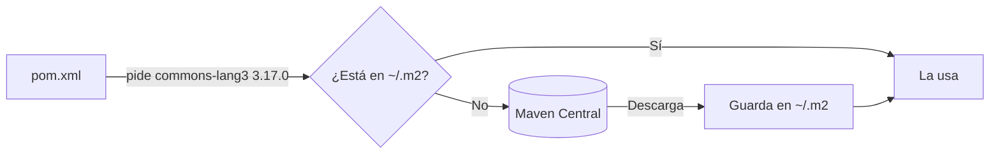
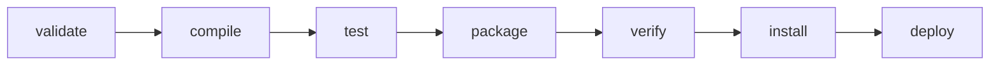

---
{"dg-publish":true,"dg-permalink":"/apuntes/1-dam-ed/unidad-03/5-herramientas-de-construccion-build-tools-y-gestion-de-dependencias/","permalink":"/apuntes/1-dam-ed/unidad-03/5-herramientas-de-construccion-build-tools-y-gestion-de-dependencias/","tags":["ide"],"dg-note-properties":{"unidad":"[[Asignaturas/1DAM_ED/Unidades/Unidad 02/Unidad 02 - Entornos de desarrollo]]","descripcion":"Qué son las herramientas de construcción y cómo usar Maven desde NetBeans para gestionar dependencias, recorrer el ciclo de vida y generar un .jar ejecutable.","orden":5,"criterios":["RA2.c","RA2.e"],"tags":["ide"],"estado":"revisar"}}
---


```table-of-contents
```

---

Imagina que tu programa necesita leer un archivo JSON. Sin una herramienta de construcción, tendrías que buscar en internet una biblioteca que lo haga, descargar su `.jar`, descubrir que ese `.jar` necesita **otros dos** `.jar`, descargarlos también, añadirlos al proyecto a mano… y repetirlo todo en cada ordenador donde abras el proyecto. Con **Maven** basta con escribir **cinco líneas** en un archivo: él se encarga del resto.

En este apartado verás qué hacen las herramientas de construcción y aprenderás a usar **Maven desde NetBeans**: añadir bibliotecas, entender qué pasa al pulsar *Build* y generar un `.jar` que funcione en cualquier ordenador.

> [!TIP] Aprende con NetBeans abierto
> Como en los apartados anteriores, haz cada 🛠️ **Pruébalo** en tu ordenador. Usarás un proyecto **Java with Maven**, el mismo tipo que creas en Programación.

## 5.1. ¿Qué es una herramienta de construcción?

Hoy casi ningún programa se escribe desde cero: usa **bibliotecas, *frameworks* y módulos de terceros**. Como el programa necesita ese código para funcionar, se les llama **dependencias**.

Las **herramientas de construcción** (*build tools*) automatizan todo lo que hay que hacer para pasar del código fuente al programa terminado:

| Función | Qué hace | Por qué importa |
| --- | --- | --- |
| **Gestión de dependencias** | Descarga las bibliotecas que necesita el proyecto **y las que necesitan ellas** (dependencias transitivas), y las añade al proyecto. | Se acabó buscar y copiar `.jar` a mano. |
| **Compilación** | Lanza el compilador sobre todo el código fuente. | Un solo botón compila el proyecto entero. |
| **Tareas** | Limpia las carpetas generadas, ejecuta las pruebas, genera la documentación. | Las tareas se hacen siempre igual, sin olvidos. |
| **Empaquetado** | Genera el **artefacto** final: un `.jar`, un `.war`, un paquete de npm… | Es lo que se entrega o se despliega. |

> [!NOTE] El proyecto ya no depende del IDE
> Toda la configuración está en un archivo de texto del proyecto (en Maven, el `pom.xml`). Por eso el mismo proyecto se abre igual en NetBeans, IntelliJ, VS Code o desde el terminal: el IDE solo **lee ese archivo y llama a Maven**. Lo comprobarás en [[Asignaturas/1DAM_ED/Apuntes/Unidad 02/7. Entornos de desarrollo en la práctica#7.5. Generar ejecutables de un mismo código con varios entornos\|7.5]].

Cada ecosistema tiene las suyas:

| Ecosistema | Herramienta | Archivo de configuración | Características |
| --- | --- | --- | --- |
| **Java** | **Maven** | `pom.xml` (XML) | **Convención sobre configuración**: si respetas su estructura de carpetas, el archivo es muy sencillo. Es la que usamos en clase. |
| **Java, Kotlin** | **Gradle** | `build.gradle` o `build.gradle.kts` (Groovy o Kotlin) | Más flexible y rápida gracias a su caché. Es la opción por defecto en **Android**. |
| **JavaScript** | **npm**[^1] y **Yarn** | `package.json` | Gestores de dependencias de Node.js y del desarrollo web (React, Vue, Angular). |
| **Python** | **pip**, **Poetry**, **uv** | `requirements.txt` o `pyproject.toml` | Instalan paquetes del repositorio PyPI. |

## 5.2. Anatomía de un proyecto Maven

### 5.2.1. La estructura de carpetas

Maven espera encontrar cada cosa en su sitio. Ábrela en el panel **Files** (`Ctrl + 2`) de NetBeans:

```text
MiProyecto/
├── pom.xml                 ← la configuración del proyecto
├── src/
│   ├── main/
│   │   ├── java/           ← tu código fuente
│   │   └── resources/      ← archivos que usa el programa (imágenes, .properties…)
│   └── test/
│       └── java/           ← las pruebas (Unidad 03)
└── target/                 ← lo que genera Maven: .class, .jar… (se puede borrar)
```

> [!TIP] `target/` no se entrega
> La carpeta `target` se regenera cada vez que construyes el proyecto. Cuando entregues un ejercicio, o lo subas a Git, **no la incluyas**: ocupa mucho y no aporta nada.

### 5.2.2. El `pom.xml`

**POM** significa *Project Object Model*. Esto es lo esencial de un `pom.xml` recién creado en NetBeans:

```xml
<?xml version="1.0" encoding="UTF-8"?>
<project xmlns="http://maven.apache.org/POM/4.0.0"
         xmlns:xsi="http://www.w3.org/2001/XMLSchema-instance"
         xsi:schemaLocation="http://maven.apache.org/POM/4.0.0 http://maven.apache.org/xsd/maven-4.0.0.xsd">
    <modelVersion>4.0.0</modelVersion>

    <!-- Coordenadas: identifican el proyecto -->
    <groupId>es.dam</groupId>
    <artifactId>MiProyecto</artifactId>
    <version>1.0-SNAPSHOT</version>
    <packaging>jar</packaging>

    <properties>
        <project.build.sourceEncoding>UTF-8</project.build.sourceEncoding>
        <maven.compiler.release>21</maven.compiler.release>
        <exec.mainClass>es.dam.miproyecto.MiProyecto</exec.mainClass>
    </properties>
</project>
```

| Elemento | Qué indica |
| --- | --- |
| `groupId` | La organización o el grupo, escrito como un dominio al revés (`es.dam`). |
| `artifactId` | El nombre del proyecto. |
| `version` | La versión. `SNAPSHOT` significa «en desarrollo, todavía no es definitiva». |
| `packaging` | Qué se genera: `jar` para una aplicación o biblioteca. |
| `maven.compiler.release` | La versión de Java del código. Es lo que cambias en **Properties → Sources** ([[Asignaturas/1DAM_ED/Apuntes/Unidad 02/3. Configuración y personalización de entornos de desarrollo\|apartado 3]]). |
| `exec.mainClass` | La clase que se ejecuta al pulsar **Run** (`F6`). |

> [!NOTE] Las coordenadas
> `groupId` + `artifactId` + `version` forman las **coordenadas** de un proyecto: su «dirección» única en el mundo. Así es como Maven encuentra cualquier biblioteca entre los millones que hay publicadas.

## 5.3. Dependencias: usar código de otros

### 5.3.1. Dónde están las bibliotecas

Las bibliotecas se publican en **repositorios**. El principal es **Maven Central** ([central.sonatype.com](https://central.sonatype.com/)), donde puedes buscar cualquier biblioteca y copiar sus coordenadas.

Cuando Maven descarga una dependencia, la guarda en tu **repositorio local**, la carpeta `.m2/repository` de tu carpeta personal. Así solo se descarga **una vez**, aunque la uses en veinte proyectos.



### 5.3.2. Declarar una dependencia

Las dependencias se escriben dentro de `<dependencies>`, con sus coordenadas:

```xml
<dependencies>
    <dependency>
        <groupId>org.apache.commons</groupId>
        <artifactId>commons-lang3</artifactId>
        <version>3.17.0</version>
    </dependency>
</dependencies>
```

El elemento `<scope>` indica **cuándo** hace falta la dependencia:

| Ámbito (`scope`) | Cuándo se usa | Ejemplo |
| --- | --- | --- |
| `compile` (el valor por defecto) | Para compilar y ejecutar el programa. | Una biblioteca de utilidades. |
| `test` | **Solo** para las pruebas; no va en el programa final. | JUnit (Unidad 03). |
| `provided` | Para compilar, pero el entorno de ejecución ya la trae. | Las API de un servidor web. |
| `runtime` | Solo para ejecutar, no para compilar. | Un controlador de base de datos. |

### 5.3.3. Añadir dependencias desde NetBeans

No hace falta escribir el XML a mano:

1. En el panel **Projects**, haz clic derecho sobre el nodo **Dependencies** → **Add Dependency…**
2. En el cuadro **Query**, escribe el nombre de la biblioteca (por ejemplo, `commons-lang3`).
3. Elige la versión en los resultados y pulsa **Add**. NetBeans escribe la dependencia en el `pom.xml` y la descarga.

En el nodo **Dependencies** verás la biblioteca; en **Test Dependencies**, las de ámbito `test`.


> [!TIP] Código fuente y documentación de las bibliotecas
> Clic derecho sobre **Dependencies** → **Download Sources** o **Download Javadoc**. Después, con `Ctrl + clic` sobre una clase de la biblioteca verás su código, y con `Ctrl + Espacio`, su documentación.

> [!TIP] 🛠️ Pruébalo: usa una biblioteca
> 1. Crea un proyecto **Java with Maven → Java Application** llamado `Programacion1DAM`.
> 2. Añade la dependencia `commons-lang3` desde **Add Dependency…** y comprueba que aparece en el `pom.xml`.
> 3. Escribe este programa en la clase principal y corrige el `import` con `Ctrl + Shift + I`:
>
>    ```java
>    import org.apache.commons.lang3.StringUtils;
>
>    public class Programacion1DAM {
>        public static void main(String[] args) {
>            String frase = "entornos de desarrollo";
>            System.out.println(StringUtils.capitalize(frase));   // Entornos de desarrollo
>            System.out.println(StringUtils.reverse(frase));      // olloarrased ed sonrotne
>            System.out.println(StringUtils.countMatches(frase, "o"));  // 4
>            System.out.println(StringUtils.isBlank("   "));      // true
>        }
>    }
>    ```
>
> 4. Ejecútalo con `F6`. Acabas de usar código que no has escrito tú… sin descargar nada a mano.
> 5. Busca la biblioteca en tu carpeta `.m2/repository/org/apache/commons/`. Ahí está el `.jar`.

### 5.3.4. Dependencias transitivas

Si tu proyecto usa la biblioteca A y A necesita la B, Maven descarga **también la B**, sin que la escribas. Son las **dependencias transitivas**. En NetBeans puedes verlas:

- Desplegando el nodo **Dependencies**: las transitivas aparecen con un icono más claro.
- Abriendo el `pom.xml` y eligiendo la pestaña **Graph**: un grafo con todas las dependencias y sus relaciones.

> [!WARNING] Cuidado con lo que añades
> Cada dependencia es **código de otros que se ejecuta en tu programa**, y arrastra sus propias dependencias. Usa bibliotecas conocidas y mantenidas, y no añadas una biblioteca enorme para usar una sola función. En otros ecosistemas, como npm, ya ha habido ataques que colaban código malicioso en paquetes muy usados[^1].

## 5.4. El ciclo de vida: qué pasa al pulsar *Build*

Maven construye un proyecto en una secuencia de **fases**, siempre en el mismo orden. Al pedir una fase, Maven ejecuta **también todas las anteriores**:



| Fase | Qué hace |
| --- | --- |
| `clean` | Borra la carpeta `target`. (Pertenece a otro ciclo, el de limpieza.) |
| `compile` | Compila el código de `src/main/java`. |
| `test` | Compila y ejecuta las pruebas de `src/test/java`. Si alguna falla, **se detiene**. |
| `package` | Empaqueta el resultado en un `.jar` dentro de `target`. |
| `install` | Copia el `.jar` en tu repositorio local (`.m2`), para usarlo en otros proyectos. |
| `deploy` | Lo publica en un repositorio remoto. |

Los botones de NetBeans no son más que **atajos para lanzar fases de Maven**:

| Botón de NetBeans | Lo que ejecuta Maven |
| --- | --- |
| **Build** (`F11`) | `mvn install` |
| **Clean and Build** (`Shift + F11`) | `mvn clean install` |
| **Run** (`F6`) | Compila y ejecuta la clase de `exec.mainClass` |
| **Test** (`Alt + F6`) | `mvn test` |

> [!TIP] 🛠️ Pruébalo: mira trabajar a Maven
> Pulsa **Clean and Build** y lee el panel **Output**. Verás líneas como `--- maven-clean-plugin…`, `--- maven-compiler-plugin…`, `--- maven-jar-plugin…` y al final `BUILD SUCCESS`. Cada línea es una fase en marcha.


> [!TIP] Lanzar cualquier fase
> Clic derecho sobre el proyecto → **Run Maven → Goals…** y escribe las fases que quieras, por ejemplo `clean package`. Lo mismo se puede hacer en un terminal, en la carpeta del proyecto: `mvn clean package`.

## 5.5. Generar un `.jar` ejecutable

Haz **Clean and Build** del proyecto `Programacion1DAM` e intenta ejecutar el `.jar` desde un terminal, en la carpeta del proyecto:

```bash
java -jar target/Programacion1DAM-1.0-SNAPSHOT.jar
```

Obtendrás un error parecido a `no main manifest attribute`. El `.jar` existe, pero **no sabe qué clase ejecutar**: esa información va en su ***manifest***, y Maven no la escribe si no se lo pides.

### 5.5.1. Indicar la clase principal

Añade al `pom.xml`, después de `</properties>`, el *plugin* `maven-jar-plugin` configurado con la clase principal:

```xml
<build>
    <plugins>
        <plugin>
            <groupId>org.apache.maven.plugins</groupId>
            <artifactId>maven-jar-plugin</artifactId>
            <version>3.4.2</version>
            <configuration>
                <archive>
                    <manifest>
                        <mainClass>${exec.mainClass}</mainClass>
                    </manifest>
                </archive>
            </configuration>
        </plugin>
    </plugins>
</build>
```

Vuelve a hacer **Clean and Build** y a ejecutar el `.jar`. Ahora arranca… pero falla con un `NoClassDefFoundError: org/apache/commons/lang3/StringUtils`. ¿Por qué?

### 5.5.2. Incluir las dependencias: el *fat jar*

El `.jar` solo contiene **tu** código. La biblioteca `commons-lang3` está en tu `.m2`, pero **no dentro del `.jar`**: en otro ordenador no existiría. La solución es generar un ***fat jar*** (o *uber jar*): un único `.jar` con tu código **y todas sus dependencias**. Lo hace el *plugin* `maven-shade-plugin`; añádelo dentro de `<plugins>`, tras el anterior:

```xml
<plugin>
    <groupId>org.apache.maven.plugins</groupId>
    <artifactId>maven-shade-plugin</artifactId>
    <version>3.6.0</version>
    <executions>
        <execution>
            <phase>package</phase>
            <goals>
                <goal>shade</goal>
            </goals>
        </execution>
    </executions>
</plugin>
```

Fíjate en `<phase>package</phase>`: el *plugin* se **engancha a la fase `package`** del ciclo de vida. Así funciona Maven: cada fase ejecuta los *plugins* que tenga asociados.

> [!EXAMPLE] Compara los dos `.jar`
> Tras un nuevo **Clean and Build**, en `target` habrá dos archivos: `original-Programacion1DAM-1.0-SNAPSHOT.jar` (solo tu código, unos pocos KB) y `Programacion1DAM-1.0-SNAPSHOT.jar` (con `commons-lang3` dentro, cientos de KB). Ejecuta el segundo con `java -jar`: ya funciona en cualquier ordenador con Java.


## 5.6. ¿Y fuera de Java?

Las ideas son las mismas en todos los ecosistemas: un archivo que declara las dependencias, un repositorio del que se descargan y unas tareas automatizadas. Este es un `package.json` de **npm** para un proyecto web con React:

```json
{
    "name": "mi-app-web",
    "version": "1.0.0",
    "dependencies": {
        "react": "^18.3.1",
        "react-dom": "^18.3.1"
    },
    "scripts": {
        "start": "webpack serve --open",
        "build": "webpack --mode production",
        "test": "jest"
    }
}
```

| Maven | npm |
| --- | --- |
| `pom.xml` | `package.json` |
| `<dependencies>` | `"dependencies"` |
| Maven Central | registro de npm |
| `~/.m2/repository` | carpeta `node_modules` del proyecto |
| `mvn package` | `npm run build` (ejecuta el *script* `build`: `webpack --mode production`) |

## 5.7. Práctica guiada: del código al `.jar` que funciona en cualquier sitio

1. Crea el proyecto Maven `Programacion1DAM` y añade `commons-lang3` desde **Add Dependency…** (§ 5.3.3).
2. Escribe el programa del 🛠️ **Pruébalo** y ejecútalo con `F6`.
3. Abre el `pom.xml`, busca la dependencia que ha escrito NetBeans y mira la pestaña **Graph**.
4. Haz **Clean and Build** y localiza en el panel **Output** las fases `compile` y `package`.
5. Intenta ejecutar el `.jar` desde el terminal y anota el error.
6. Añade el `maven-jar-plugin` (§ 5.5.1), reconstruye y anota el **nuevo** error.
7. Añade el `maven-shade-plugin` (§ 5.5.2), reconstruye y ejecuta el `.jar` bueno.
8. **Reto:** copia solo ese `.jar` a otro ordenador (o pásaselo a un compañero) y ejecútalo allí.
9. **Reto extra:** busca en [Maven Central](https://central.sonatype.com/) la biblioteca **Gson**, añádela y úsala para convertir un objeto Java a JSON con `new Gson().toJson(objeto)`.

> [!EXAMPLE] Comprueba lo que has aprendido
> Sin mirar los apuntes, ¿sabrías responder?
> - ¿Qué tres elementos forman las coordenadas de una biblioteca?
> - ¿Dónde guarda Maven las bibliotecas que descarga? ¿Por qué no las descarga cada vez?
> - ¿Qué fase de Maven ejecuta **Clean and Build**? ¿Y qué fases anteriores se ejecutan con ella?
> - ¿Por qué falla `java -jar` con `no main manifest attribute`? ¿Y con `NoClassDefFoundError`?
> - ¿Para qué sirve `<scope>test</scope>`?

[^1]: En 2025, el ataque Shai-Hulud comprometió cientos de paquetes de npm ([[Asignaturas/1DAM_ED/Apuntes/Unidad 02/8. Referencias\|Rodríguez Sánchez, 2025]]).

---

<p><span>⬅️ <strong>Anterior:</strong> <a data-tooltip-position="top" aria-label="Asignaturas/1DAM_ED/Apuntes/Unidad 02/4. Módulos, plugins y extensiones.md" data-href="Asignaturas/1DAM_ED/Apuntes/Unidad 02/4. Módulos, plugins y extensiones.md" href="Asignaturas/1DAM_ED/Apuntes/Unidad 02/4. Módulos, plugins y extensiones.md" class="internal-link" target="_blank" rel="noopener nofollow">4. Módulos, plugins y extensiones</a> | 🏠 <strong>Unidad:</strong> <a data-tooltip-position="top" aria-label="Asignaturas/1DAM_ED/Unidades/Unidad 02/Unidad 02 - Entornos de desarrollo.md" data-href="Asignaturas/1DAM_ED/Unidades/Unidad 02/Unidad 02 - Entornos de desarrollo.md" href="Asignaturas/1DAM_ED/Unidades/Unidad 02/Unidad 02 - Entornos de desarrollo.md" class="internal-link" target="_blank" rel="noopener nofollow">Unidad 02 - Entornos de desarrollo</a> | <strong>Siguiente:</strong> <a data-tooltip-position="top" aria-label="Asignaturas/1DAM_ED/Apuntes/Unidad 02/6. Otras herramientas.md" data-href="Asignaturas/1DAM_ED/Apuntes/Unidad 02/6. Otras herramientas.md" href="Asignaturas/1DAM_ED/Apuntes/Unidad 02/6. Otras herramientas.md" class="internal-link" target="_blank" rel="noopener nofollow">6. Otras herramientas</a> ➡️</span></p>