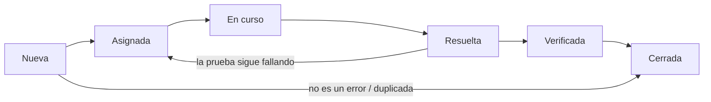

---
{"dg-publish":true,"dg-permalink":"/apuntes/1-dam-ed/unidad-03-pruebas-y-depuracion/","permalink":"/apuntes/1-dam-ed/unidad-03-pruebas-y-depuracion/","dg-note-properties":{"unidad":"[[Asignaturas/1DAM_ED/Unidades/Unidad 03/Unidad 03 - Pruebas y depuración]]","modulo":"[[Módulos/Entornos de desarrollo]]","libro":"[[Libros/Entornos de desarrollo (1º DAM, 1º DAW)]]"}}
---


```table-of-contents
```

---

# 1. Planificación de las pruebas

Durante todo el proceso de desarrollo de software, desde la fase de diseño, en la implementación y una vez desarrollada la aplicación, es necesario realizar un conjunto de **pruebas** que permitan verificar que el software que se está creando es correcto y cumple con las especificaciones impuestas por el usuario.

En el proceso de desarrollo de software, nos vamos a encontrar con un conjunto de actividades, donde es muy fácil que se produzca un **error humano**. Estos errores humanos pueden ser: una incorrecta especificación de los objetivos, errores producidos durante el proceso de diseño y errores que aparecen en la fase de desarrollo.

Mediante la realización de **pruebas de software**, se van a realizar las **tareas de verificación y validación del software**.

> [!note] Verificación 
> Asegura la calidad del proceso.
> 
> Plantea la pregunta "¿Estamos construyendo el producto **correctamente**?" Se enfoca en que un sistema o parte de un sistema, cumple con los **requisitos funcionales**.
> 
> Con la verificación se comprueba si la aplicación se está construyendo correctamente. Por ello aquí se incluyen procesos como revisiones de código y pruebas unitarias.

> [!note] Validación 
> Asegura la adecuación del producto al uso previsto.
> 
> Plantea la pregunta "¿Estamos construyendo el producto **correcto**?"
> 
> Es el proceso de evaluación del sistema o de uno de sus componentes, para determinar si satisface las necesidades del usuario indicadas en los **requisitos de negocio**.
> 
> Aquí se llevan a cabo pruebas de aceptación y betas del producto para asegurar que el software resuelve el problema del cliente. |

Hasta hace unos años, el enfoque utilizado se centraba en el **modelo en espiral** y una **visión de las pruebas como fases separadas**. En dicho modelo se seguían los siguientes pasos:

1. Las pruebas empezarían con las **pruebas unitarias**, donde se analizaría el código implementado. 

2. Seguiríamos en la **prueba de integración**, donde se presta atención al diseño y la construcción de la arquitectura del software. 

3. El siguiente paso sería la **prueba de validación**, donde se comprueba que el sistema construido cumple con lo establecido en el análisis de requisitos de software.

4. Finalmente se alcanza la **prueba de sistema** que verifica el funcionamiento total del software y otros elementos del sistema.

En la actualidad, **las pruebas no son una fase que ocurre al final**, sino una actividad **continua** e **integrada** en el ciclo de vida del desarrollo del software. Ya no se redactan grandes documentos estáticos al comienzo, sino que se sigue una estrategia basada en la **eficiencia** y la **automatización**.

Es decir, se ha pasado de una planificación basada en el "Modelo en Espiral" (más rígido) a una estrategia basada en la **Pirámide de Pruebas** y el **<abbr title="Test-driven development">TDD</abbr>**, que son las prácticas habituales en el sector productivo.

## 1.1. La pirámide de pruebas (*Testing Pyramid*)


> Federico. (2018, 6 junio). ***Pirámide para las Pruebas de Performance*** - Federico Toledo. Federico Toledo. https://federico-toledo.com/piramide-para-las-pruebas-de-performance/

* **Base - Pruebas unitarias**  
  Deben ser las más numerosas. Son rápidas, prueban pequeños trozos de código y se ejecutan en milisegundos.

* **Segunda capa - Pruebas de integración/API**  
  Menos numerosas que las unitarias. Verifican que los distintos módulos o servicios (como la base de datos o una API) se comunican correctamente.

* **Cúspide - Pruebas E2E / UI / Manuales**  
  Son las más lentas y frágiles. Simulan el comportamiento real del usuario en la aplicación. En esta capa las pruebas deben ser **pocas** y **muy específicas**.

## 1.2. Test Driven Development (TDD)

En lugar del modelo tradicional (Escribir código > Probar), la tendencia actual es el **desarrollo guiado por pruebas** o **TDD** (*Test Driven Development*). Es una técnica de diseño de software que sigue un ciclo corto y repetitivo:

1. **RED** (Rojo)  
   Lo primero que se hace es escribir una **prueba que falle** para una funcionalidad que **aún no existe**.

2. **GREEN** (Verde)  
   Escribimos el **código mínimo** necesario para que la prueba pase.

3. **REFACTOR** (Refactorizar)  
   Una vez que el test no falla, se limpia y mejora el código escrito **asegurándose de que el test sigue pasándose**.

¿Qué se consigue con esta forma de programar? Que el código sea *testeable* desde el primer momento y además **se evita el código innecesario**.

Se puede ver un ejemplo de desarrollo con TDD en el apartado de **[[Asignaturas/1DAM_ED/Apuntes/Unidad 03/4. Pruebas de caja blanca - análisis estructural\|Pruebas unitarias y TDD]]**.


## 1.3. Verificación y validación continua (CI/CD)

Aunque los conceptos de verificación (¿Estamos construyendo el producto correctamente?) y validación (¿Estamos construyendo el producto que el cliente quiere?) siguen vigentes, hoy se aplican de forma continua:

Cada vez que un programador sube código a un repositorio remoto (en la actualidad suelen enfocarse al gestor de versiones Git), **un servidor ejecuta automáticamente todas las pruebas**. Si una falla, el código no se integra. Esto se conoce como **integración continua** o **<abbr title="Continuous Integration">CI</abbr>**.

# 2. Tipos de pruebas

Dada la complejidad de las aplicaciones informáticas, que se desarrollan en la actualidad, es prácticamente imposible, probar todas las combinaciones que se pueden dar dentro de un programa o entre un programa y las aplicaciones que pueden interactuar con él. Por este motivo, en el diseño de los casos de prueba, siempre es necesario asegurar que con ellos se obtiene un nivel aceptable de probabilidad de que se detectarán los errores existentes.

Las pruebas deben buscar un compromiso entre la cantidad de recursos que se consumirá en el proceso de prueba, y la probabilidad obtenida de que se detecten los errores existentes. 

No existe una clasificación oficial o formal, sobre los diversos tipos de pruebas de software. En la ingeniería del software, nos encontramos con dos enfoques fundamentales:

* Prueba de la **Caja Blanca** (*White Box Testing*): en este caso se prueba la aplicación desde dentro, usando su lógica de aplicación. Suelen ser realizadas por los **desarrolladores o personal cualificado**.

  
  
  * **Todas las sentencias se ejecutan al menos una vez**. Si hay un bucle habrá que incluir casos de prueba en los que la ejecución entra en el bucle y casos de prueba cuya ejecución se salta el bucle.

  * **Todas las condiciones se ejecutan en su parte verdadera y en su parte falsa**. Habrá al menos dos casos de prueba: uno que pasa por la parte en la que se cumple la condición y otro que pasa por la parte en la que no se cumple esa condición.

  * **Los bucles se ejecutan en sus límites**. Todos los programadores, incluso los más experimentados, pueden tropezar en los límites de los bucles. Si un bucle se ejecuta exclusivamente para valores que van desde n hasta m, tendremos que incluir casos de prueba que llegan al bucle con los valores n-1, n, m y m+1. Observa que se trata del primer y último valor que entran al bucle y de los valores adyacentes que no entran.

  * **Todas las estructuras de datos se usan para asegurar su validez**. Por ejemplo, si nuestro programa incluye algún array, la prueba no estará completa si no incluye un caso de prueba que use ese array.

* Prueba de la **Caja Negra** (*Black Box Testing*): cuando una aplicación es probada usando su interfaz externa, sin preocuparnos de la implementación de la misma. Aquí lo fundamental es comprobar que los resultados de la ejecución de la aplicación, son los esperados, en función de las entradas que recibe. Estas pruebas pueden ser realizadas por personas ajenas al desarrollo del producto.

  
  
  Una prueba de tipo **Caja Negra** se lleva a cabo sin tener que conocer ni la estructura, ni el funcionamiento interno del sistema. Cuando se realiza este tipo de pruebas, solo se conocen las entradas adecuadas que deberá recibir la aplicación, así como las salidas que les correspondan, pero no se conoce el proceso mediante el cual la aplicación obtiene esos resultados.

# 3. El flujo de pruebas

**Tradicionalmente**, las pruebas se ubicaban **al final**, tras el desarrollo. La secuencia de pruebas que se realizaban seguían el siguiente orden:

* **Prueba unitaria**: se centra en cada unidad de software, en cada módulo del código fuente. Aquí es donde se utilizan las pruebas de caja blanca y de caja negra. Probaremos cada método, cada clase, etc.

* **Prueba de integración**: a partir de los módulos probados individualmente, se prueba el funcionamiento conjunto. 

* **Prueba de regresión**: cada vez que se realiza una modificación en un programa, es necesario comprobar que el resto del programa sigue funcionando como se espera.

* **Prueba de validación**: en el entorno real de trabajo y con intervención del usuario final. Se basa en determinar si se cumplen los requisitos y se usan para ello pruebas de caja negra de dos tipos:

  * **Prueba alfa**: con el usuario final en el lugar de desarrollo. El desarrollador observa y registra los errores y problemas.

  * **Prueba beta**: con el usuario final en su propio lugar de trabajo. El desarrollador no está presente, pero será informado por el usuario.

* **Prueba del sistema**: para verificar funcionalidad y rendimiento. Se prueba su integración con otros elementos del sistema. Incluye las siguientes:

  * **Prueba de recuperación**: se fuerza el fallo del software y se comprueba que la recuperación es satisfactoria.

  * **Prueba de seguridad**: se intenta verificar que el sistema está protegido contra accesos ilegales.

  * **Prueba de resistencia** o ***estrés***: enfrenta al sistema con situaciones que demandan gran cantidad de recursos: accesos simultáneos, uso de memoria, etc.

Muchas de estas pruebas se siguen usando hoy en día, pero **ha cambiado el orden y el momento en el que se hacen**.

En la actualidad se aplica el concepto de ***Shift-Left Testing*** (probar lo antes posible). En el entorno profesional se sigue el siguiente flujo de trabajo:

1. **Pruebas en local**  
   Las lleva a cabo el propio programador, que ejecuta sus tests unitarios antes de subir nada al repositorio.

2. **Pruebas en integración continua (CI)**  
   Al hacer push al repositorio remoto, un servidor (GitHub Actions, Jenkins, etc.) ejecuta todos los tests automáticamente.

3. **Pruebas en Staging/Pre-producción**  
   Pruebas de integración y E2E[^1] en un entorno casi idéntico al real.

4. **Pruebas en Producción**  
   Monitorización y **tests de humo[^2]** (*smoke tests*) para asegurar que la subida ha sido exitosa.


[^1]:  E2E: pruebas *End-to-End* que simulan el flujo completo de una aplicación como si fuesen el usuario final. Se realizan de principio a fin, validando no solo componentes individuales, sino la integración de todo el sistema (interfaz de usuario, APIs, bases de datos, etc.) para asegurar que funciona como se espera y cumple con los requisitos del negocio.

[^2]:  Son pruebas iniciales y superficiales para verificar de forma rápida que las funciones más críticas funcionan.

# 4. Pruebas de caja blanca - análisis estructural

Este tipo de pruebas, se basan en unos criterios de cobertura lógica, cuyo cumplimiento determina la mayor o menor seguridad en la detección de errores. Los criterios de cobertura que se siguen son:

* **Cobertura de sentencias**: se han de generar casos de pruebas suficientes para que cada instrucción del programa sea ejecutada, al menos, una vez.

* **Cobertura de decisiones**: se trata de crear los suficientes casos de prueba para que cada opción resultado de una prueba lógica del programa, se evalúe al menos una vez a cierto y otra a falso.

* **Cobertura de condiciones**: se trata de crear los suficientes casos de prueba para que cada elemento de una condición, se evalúe al menos una vez a falso y otra a verdadero.

* **Cobertura de condiciones y decisiones**: consiste en cumplir simultáneamente las dos anteriores.

* **Cobertura de caminos**: es el criterio más importante. Establece que se debe ejecutar al menos una vez cada secuencia de sentencias encadenadas, desde la sentencia inicial del programa, hasta su sentencia final. La ejecución de este conjunto de sentencias, se conoce como camino. Como el número de caminos que puede tener una aplicación, puede ser muy grande, para realizar esta prueba, se reduce el número a lo que se conoce como camino de prueba.

* **Cobertura del camino de prueba**: se pueden realizar dos variantes, una indica que cada bucle se debe ejecutar sólo una vez, ya que hacerlo más veces no aumenta la efectividad de la prueba y otra que recomienda que se pruebe cada bucle tres veces: la primera sin entrar en su interior, otra ejecutándose una vez y otra más ejecutándose dos veces.

Es necesario obtener una medida de la complejidad del diseño de un procedimiento. A partir de esa medida se establece un conjunto básico de caminos de ejecución y, finalmente, se diseñan casos de prueba para cada uno de esos caminos. Se trata de conseguir que, durante la prueba, todas las sentencias del programa se ejecutan al menos una vez, por eso se trata de una prueba de caja blanca. Veamos a continuación los pasos a seguir para medir dicha complejidad.

## 4.1. Grafos de flujo

En un grafo de flujo los nodos son círculos que representan un grupo de sentencias que siempre se ejecutan juntas y las flechas indican la dirección que sigue el flujo entre los nodos. Podemos obtener el grafo de flujo a partir de un diagrama de flujo o a partir del código.

###  Ejemplo 1: Grafo de flujo a partir de un diagrama de flujo (Mayor)

Aquí tenemos el diagrama de flujo para un algoritmo que solicita dos números al usuario y dice cuál de ellos es mayor, o si son iguales.


Para obtener el grafo de flujo se numera cada elemento del diagrama (lectura, escritura, condición, etc), incluido el inicio **(I)** y el final **(F)**.

Posteriormente, al dibujar el grafo, agrupamos en un solo nodo todos los elementos del diagrama que siempre se ejecutan juntos.

La siguiente imagen muestra el **grafo de flujo**.


Tenemos:

* **Nodos**: cada uno de los círculos. En el ejemplo hay 6 nodos.

* **Aristas**: cada una de las flechas. En el ejemplo hay 7 aristas.

* **Nodos predicado**: son los nodos de los que salen dos o más aristas (son los nodos que contienen una condición).
  En el ejemplo hay 2 nodos predicado (los marcados en amarillo).

* **Regiones**: cada una de las áreas encerradas por nodos y aristas.

  > [!warning] Ojo 
  > El área exterior del grafo es una región más.

  En el ejemplo hay **3 regiones**.

###  Ejemplo 2: Grafo de flujo a partir de código o pseudocódigo (Sumador)

En realidad, no hay diferencias en la construcción del grafo a partir de un diagrama de flujo, pseudocódigo o código. En el código (o pseudocódigo) se numera cada elemento y se procede de la misma forma.

En el siguiente ejemplo tenemos un método **Java** en el que se pide al usuario que introduzca dos enteros positivos y devuelve la suma. Antes de sumar comprueba que los valores introducidos son, efectivamente, positivos. Cada línea de código ha sido numerada (incluyendo inicio y fin), pero observa que la línea que tiene **la condición compleja tiene dos números**. Esto es porque, aunque nosotros lo escribimos como una única condición, en realidad se comprueban una tras otra.

> [!note] Nota 
> Hay que tener especial cuidado con las condiciones complejas porque tendrán que representarse mediante varios nodos, tantos como condiciones simples equivalentes

```java
(I) public void suma() {
(1)     Scanner leerDeTeclado = new Scanner(System.in);
(2)     int a, b, resultado;

(3)     System.out.println("Introduce un nº positivo:");
(4)     a = leerDeTeclado.nextInt();
(5)     System.out.println("Introduce otro nº positivo:");
(6)     b = leerDeTeclado.nextInt();
(7)(8)  if (a > 0 && b > 0) {
(9)         resultado = a + b;
(10)        System.out.println("El resultado es " + resultado);
        }
        else {
(11)        System.out.println("No son positivos");
        }
(12)    leerDeTeclado.close();
(F) }
```


* El número ***(7)*** corresponde a la primera condición: ***a>0***. Si cuando el compilador evalúa esta condición obtiene un valor ***falso***, no evaluará la segunda porque independientemente de su valor, el camino a seguir ya está determinado.

* El número ***(8)*** corresponde a la segunda condición: ***b>0***. Esta condición sólo será evaluada en caso de que la primera tenga un valor de ***verdadero***.


## 4.2. Complejidad ciclomática

Mide la complejidad de un programa y es inversamente proporcional a la facilidad de mantener el código. Es decir, lo ideal es que la complejidad ciclomática de nuestro código sea lo más baja posible.

Esta complejidad se puede representar con una de las siguientes fórmulas:

```
V(G) = nº aristas - nº nodos + 2

V(G) = nº nodos predicado + 1

V(G) = nº de regiones*
```

En la segunda cabe recordar que los "***nodos predicado***" son aquellos de los que **sale más de una arista**.

Coincide con el número de caminos distintos que puede seguir el flujo. Contar el número de caminos puede ser complicado, sobre todo cuando aumenta el tamaño y complejidad del grafo. 

Por eso nos ayuda saber que ese número coincide con:

* El número de **caminos** distintos.  
* El número de **regiones** del grafo.  
* El número de **aristas**, restando el número de nodos y sumando 2: (aristas - nodos + 2)  
* El número de **nodos predicado** más 1: (predicados + 1)

Lo recomendable es mantener la complejidad ciclomática **por debajo de 10**. Por encima del valor 20 en un procedimiento entraña un riesgo alto porque indica que se trata de un programa complejo. Si pasa de 50 hablamos de "muy alto riesgo" o incluso, de programas no testeables.


Para evitar estos valores podemos ayudarnos de la programación modular, es decir, dividir el programa en varios módulos o subprogramas.

**Ejemplo 1: Complejidad ciclomática del [[Asignaturas/1DAM_ED/Apuntes/Unidad 03/4. Pruebas de caja blanca - análisis estructural#Ejemplo 1 Grafo de flujo a partir de un diagrama de flujo (Mayor)\|programa Mayor]].**  
El grafo tiene 6 nodos, 7 aristas, 2 nodos predicado y 3 regiones. Si aplicamos las fórmulas veremos que la complejidad ciclomática del ejemplo 1 es 3, es decir, hay 3 caminos distintos y son:

* **Camino 1**: I, 1, 2, 3, 4, F  
* **Camino 2**: I, 1, 2, 3, 5, 6, F  
* **Camino 3**: I, 1, 2, 3, 5, 7, F

**Ejemplo 2: Complejidad ciclomática del [[Asignaturas/1DAM_ED/Apuntes/Unidad 03/4. Pruebas de caja blanca - análisis estructural#Ejemplo 2 Grafo de flujo a partir de código o pseudocódigo (Sumador)\|programa Sumador]].**  
Este grafo tiene 5 nodos, 6 aristas, 2 nodos predicado y 3 regiones. Aplicando cualquiera de las fórmulas expuestas anteriormente concluimos que tiene 3 caminos distintos y por tanto, tendremos que elaborar 3 casos de prueba. Los caminos son:

* **Camino 1**: I, 1-7, 8, 9-10, 12, F  
* **Camino 2**: I, 1-7, 8, 11, 12, F  
* **Camino 3**: I, 1-7, 11, 12, F

Para ver más ejemplos, se puede consultar el siguiente vídeo:

<iframe width="560" height="315" src="https://www.youtube.com/embed/iILl-n57IEs?si=59U5rk4Z6Otz34a7" title="YouTube video player" frameborder="0" allow="accelerometer; autoplay; clipboard-write; encrypted-media; gyroscope; picture-in-picture; web-share" referrerpolicy="strict-origin-when-cross-origin" allowfullscreen></iframe>

> 🎦 Juan V. Carrillo (jvprofe). (2016a, mayo 2). ***Complejidad ciclomática: cómo calcularla*** [Vídeo]. YouTube. https://www.youtube.com/watch?v=iILl-n57IEs


## 4.3. Elaboración de casos de prueba

Según el IEEE, un **caso de prueba es un conjunto de entradas, condiciones de ejecución y resultados esperados, desarrollados para un objetivo particular**, como, por ejemplo, ejercitar un camino concreto de un programa o verificar el cumplimiento de un determinado requisito, incluyendo toda la documentación asociada.

Una vez conocida la complejidad ciclomática del módulo, hay que construir casos de prueba para cada camino, eligiendo datos de entrada que provoquen la bifurcación de los nodos predicado hacia donde nosotros queremos.

Construimos una tabla con una fila para cada camino, describimos el caso de prueba, normalmente con los valores de entrada y el resultado que sería correcto.

***Ejemplo 1: casos de prueba necesarios para chequear todos los caminos ([[Asignaturas/1DAM_ED/Apuntes/Unidad 03/4. Pruebas de caja blanca - análisis estructural#Ejemplo 1 Grafo de flujo a partir de un diagrama de flujo (Mayor)\|mayor]])***

| *Caso de prueba* | Valores de entrada | Resultado esperado |
| ----- | ----- | ----- |
| El usuario introduce el primer nº mayor que el segundo. **Camino 1**. | numero1 = 10 <br>numero2 = 5 | Mostrará el nº **10** |
| El usuario introduce el primer nº menor que el segundo. **Camino 2**. | numero1 = 1 <br>numero2 = 5 | Mostrará el nº **5** |
| El usuario introduce el primer nº igual que el segundo. **Camino 3**. | numero1 = 8 <br>numero2 = 8 | Mostrará el mensaje "**son iguales**" |

***Ejemplo 2: casos de prueba necesarios para chequear todos los caminos del [[Asignaturas/1DAM_ED/Apuntes/Unidad 03/4. Pruebas de caja blanca - análisis estructural#Ejemplo 2 Grafo de flujo a partir de código o pseudocódigo (Sumador)\|sumador]]***

| *Caso de prueba* | Valores de entrada | Resultado esperado |
| ----- | ----- | ----- |
| El usuario introduce dos valores positivos. **Camino 1**. | a = 24 <br>b = 45 | Mensaje: "El resultado es: 69" y final |
| El usuario introduce un valor positivo y un valor no positivo. **Camino 2**. | a = 18 <br>b = -12 | Mensaje: "No son positivos" y final |
| El usuario introduce un primer no positivo (el 2º valor es irrelevante). **Camino 3**. | a = -15 <br>b = 4 | Mensaje: "No son positivos" y final |


## 4.4. Caminos imposibles

Se dice que existen caminos imposibles en un grafo de flujo cuando existen nodos predicado a los que llega más de una arista. 

### Ejemplo 3: Grafo de flujo a partir de un diagrama de flujo (Adivinador)

Aquí tenemos el diagrama de flujo para un algoritmo que genera un número aleatorio y pide al usuario que lo adivine[^3]. El usuario podrá seguir intentándolo hasta acertar y finalizar. Si no acierta, se le informa si el número que tiene que adivinar es mayor o menor que el introducido.


En el grafo de flujo podemos observar que tenemos:

- 7 nodos.  
- 9 aristas.  
- 3 nodos predicado (en amarillo).  
- 4 regiones.

> [!info] 
> La realidad es que habría infinitos caminos, puesto que un usuario podría introducir eternamente el mismo valor. Pero debes recordar que **buscamos un conjunto básico de caminos en el que todas las sentencias se ejecutan al menos una vez**.

Si aplicamos las fórmulas veremos que la complejidad ciclomática es 4, es decir, hay 4 caminos distintos. Sin embargo, en este caso no es cierto porque algunos de los caminos resultantes **no son posibles**. 


**Por ejemplo**, uno de los caminos que podríamos obtener de este grafo es: **I, 1, 2, 3, 4, 5, 6, 8, 9, 10, 11, F**. Si este camino pasa **del nodo 6 al 8** es porque la condición ***intento > nPensado*** se evalúa como cierta. Puesto que el valor de las variables **intento** y **nPensado** no se alteran en los nodos 8 y 9, cuando llegamos al nodo 10, la condición ***intento = nPensado*** se tiene que evaluar como **falsa**. Por tanto, desde el nodo **10** debe pasar al nodo **3** y no al nodo **11**. 

Es decir, **el camino propuesto es imposible, la única forma de llegar a 11 es desde el camino que va directo desde 6 a 9, 10**.

Una vez descubierta esta situación dibujaremos el verdadero grafo de flujo, en el que **repetiremos** el nodo 9,10 tantas veces como sea necesario para que se ajuste a la situación real.

El grafo resultante sería el siguiente:


Una vez obtenido un grafo en el que todos los caminos son posibles, ya podemos definir los casos de prueba.

| Caso de prueba | Valores de entrada | Resultado esperado |
| ----- | ----- | :---: |
| El usuario acierta el nº al primer intento. Camino 1. | nPensado = 34 <br>intento = 34 | “Enhorabuena. Acertaste en 1” |
| El usuario introduce un nº mayor y después el nº correcto. Camino 2. | nPensado = 52 <br>intento = 75 y 52 | "Debe ser menor" "Enhorabuena. Acertaste en 2" |
| El usuario introduce un nº menor y después el nº correcto. Camino 3. | nPensado = 17 <br>intento = 5 y 17 | "Debe ser mayor" "Enhorabuena. Acertaste en 2" |


[^3]:  En los anexos se incluye un código Java de este algoritmo. Prueba con él para hacer este ejercicio.

# 5. Pruebas funcionales (caja negra

Las pruebas funcionales siguen el enfoque de las pruebas de **caja negra**. A diferencia de las pruebas de caja blanca, aquí no nos importa el código fuente y las bifurcaciones que haya en él. Nos centramos en que, para una entrada dada, la salida sea la esperada según los requisitos del cliente. Es decir, nos interesa que el software realice las funciones que se esperan de él.

Comprenderán aquellas actividades cuyo objetivo sea verificar una acción específica o funcional dentro del código de una aplicación. Las pruebas funcionales intentan responder a las preguntas ¿puede el usuario hacer esto? o ¿funciona esta utilidad de la aplicación?

Para realizar este tipo de pruebas, se deben **analizar las entradas y las salidas** de cada componente, verificando que el resultado es el esperado. Sólo se van a considerar las entradas y salidas del sistema, sin preocuparnos por la estructura interna del mismo.

> [!example] Ejemplo
> Si estamos implementando una aplicación que realiza un determinado cálculo científico, en el enfoque de las pruebas funcionales, solo nos interesa verificar que ante una determinada entrada a ese programa el resultado de la ejecución del mismo devuelve como resultado los datos esperados. Este tipo de prueba, no consideraría, en ningún caso, el código desarrollado, ni el algoritmo, ni la eficiencia, ni si hay partes del código innecesarias, etc.

Las estrategias recomendadas para las pruebas de caja negra o funcionales son:

* Segmentación de datos por **clases de equivalencia**  
  Para no probar todas las entradas posibles(p.e. números enteros), que sería casi imposible, dividimos las entradas en conjuntos de datos que el programa debería tratar de la misma forma.

  > [!example] Ejemplo - Gestión de biblioteca
  > Imaginemos que tenemos que desarrollar un sistema para una biblioteca que calcule multas por retraso en las devoluciones.
  > 
  > La regla de negocio establece que:
  >   - Hasta 5 días de retraso: 1€ por día.
  >   - Más de 5 días: 2€ por cada día adicional.
  > 
  > Una vez implementado, podemos hacer los siguientes conjuntos o clases de datos:
  >   - **Clase 1** (datos no válidos): con estos datos, el sistema debería dar algún error. Por ejemplo, los **días negativos**.
  >   - **Clase 2** (datos válidos - tarifa base): estos datos prueban el funcionamiento normal (sin recargos). Para ello se introducirá entre 0 y 5 días de retraso.
  >   - **Clase 3** (datos válidos - con recargo): el funcionamiento será correcto pero evaluando las situaciones en las que excedemos el límite. En este caso, más de 5 días de retraso.

* Análisis de **valores límite**  
  Los errores suelen esconderse en las "fronteras" de estas clases. Por eso, a la hora de implementar un caso de prueba se van a elegir como valores de entrada aquellos que se encuentran **en los límites de las clases de equivalencia**.

  Siguiendo con el ejemplo anterior, con el **límite de 5 días**, los valores críticos son:

  - Límite inferior: **-1** (no válido) y **0** (válido).  
  - Límite frontera: **5** (último día de tarifa base) y **6** (primer día con recargo).

* **Pruebas aleatorias**  
  Consiste en generar entradas aleatorias para la aplicación que hay que probar. Se suelen utilizar generadores de prueba, que son capaces de crear un volumen de casos de prueba al azar, con los que será alimentada la aplicación. Este tipo de pruebas, se suelen utilizar en aplicaciones que no sean interactivas, ya que es muy difícil generar las secuencias de entrada adecuadas de prueba, para entornos interactivos.

* **Pruebas parametrizadas**  
  JUnit permite realizar pruebas de forma óptima **evitando repetir código**. Esto se consigue con tests parametrizados que se verán más adelante (consulta las [**aserciones avanzadas**](#aserciones-avanzadas)).

Veamos un ejemplo práctico con la implementación de **casos de prueba**.

En un entorno profesional, estos casos **se documentan directamente en el código de pruebas**. Vamos a actualizar nuestro test de JUnit para cubrir estas clases y límites:

```java
import static org.junit.jupiter.api.Assertions.*;
import org.junit.jupiter.api.Test;
import org.junit.jupiter.params.ParameterizedTest;
import org.junit.jupiter.params.provider.ValueSource;

class CalculadoraMultasFuncionalTest {

    CalculadoraMultas calc = new CalculadoraMultas();

    @Test
    void testValoresLimiteTarifaBase() {
        // Límite exacto: 5 días -> 5€
        assertEquals(
                5.0,
                calc.calcular(5),
                "Frontera: El día 5 debe ser tarifa base");
    }

    @Test
    void testValoresLimiteRecargo() {
        // Límite exacto: 6 días -> (5*1) + (1*2) = 7€
        assertEquals(
                7.0,
                calc.calcular(6),
                "Frontera: El día 6 debe aplicar recargo");
    }

    @Test
    void testEntradaInvalida() {
        // Clase de equivalencia inválida: días negativos
        // Suponiendo que nuestro método lanza una excepción
        // ante datos erróneos
        assertThrows(IllegalArgumentException.class, () -> {
            calc.calcular(-1);
        }, "Debe lanzar excepción para días negativos");
    }
}
```

## 5.1. Clases de equivalencia

Una clase de equivalencia es el **conjunto de todos los valores para los que el programa debería comportarse del mismo modo**. Cuando usamos clases de equivalencia, diseñamos un caso de prueba para un valor al azar de cada clase y damos por aprobados todos los valores.

Las clases de equivalencia se determinan a partir de cada condición:

* Si una condición especifica un **rango**, tendremos **una clase válida** (dentro del rango) y **dos clases no válidas** (una por encima del rango y otra por debajo).

> [!info]  
> Por ejemplo, una condición que se aplica a valores enteros entre 0 y 100 genera una clase válida (todos los valores entre 0 y 100), una clase no válida con todos los valores menores que 0 y una clase no válida con todos los valores mayores que 100.

* Si una condición requiere un **valor específico** tendremos **una clase válida** (ese valor) y **dos clases no válidas** (una por encima del valor y otra por debajo).

  > [!info]  
  > Por ejemplo, el control de la división se aplica exclusivamente al valor cero. Tendremos **una clase no válida** (el cero), **una clase válida** con los valores **menores que cero** y **una clase válida** con los valores **mayores que cero**.

* Si una condición especifica un **conjunto**, tendremos **una clase válida** (valor perteneciente al conjunto) y **una clase no válida** (no perteneciente al conjunto).

  > [!info]  
  > Por ejemplo, una condición que se aplica a los **números pares** genera una clase válida (el conjunto de los números pares) y una clase no válida (el conjunto de los números impares).

* Si es una **condición lógica** (*booleano*) tendremos **una clase válida** (valor que cumple la condición) y **una clase no válida** (valor que no cumple la condición).

  > [!info]  
  > Se llaman clases de equivalencia no válidas a las que corresponden a valores que el programa debe rechazar y clases de equivalencia válidas a las que el programa debe aceptar.

### Ejemplo 1: clasificador de población  
Tenemos un método que a partir de la edad y el género (hombre -H- o mujer -M-) devuelve el mensaje que corresponde según la tabla que se muestra a continuación.

| Edad | Género | Respuesta |
| ----- | ----- | ----- |
| De 0 a 17 - [0 - 17] | Cualquiera | menor |
| De 18 a 64 - [18 - 64] | Hombre | trabajador |
| De 65 a 125 - [65 - 125] | Mujer | trabajadora |
|  | Hombre | jubilado |
|  | Mujer | jubilada |

Debemos implementar varias clases en Java. Comencemos por crear nuestras propias excepciones:  

```java
public class EdadErroneaException extends Exception {
    public EdadErroneaException(String msg) {
        super(msg);
    }

    public EdadErroneaException(int i) {
        // Llama al constructor anterior:
        this("Edad incorrecta: " + i + ". Rango válido: [0-125]");
    }
}
```

```java
class GeneroErroneoException extends Exception {
    public GeneroErroneoException(String msg) {
        super(msg);
    }
    
    public GeneroErroneoException() {
        // Llama al constructor anterior:
        this("Género incorrecto");
    }
}
```

Y ahora el método:

```java
    ...
    public static String clasifica(int edad, char genero)
            throws EdadErroneaException, GeneroErroneoException {
        String respuesta = "";
        genero = Character.toUpperCase(genero);
        
        if (edad < 0 || edad > 125) {
            throw new EdadErroneaException(edad);
        }
        if (edad < 18) {
            respuesta = "menor";
        }
        else {
            if (edad < 65) {
                switch (genero) {
                    case 'H':
                        respuesta = "trabajador";
                        break;
                    case 'M':
                        respuesta = "trabajadora";
                        break;
                    default:
                        throw new GeneroErroneoException();
                }
            }
            else {
                switch (genero) {
                    case 'H':
                        respuesta = "jubilado";
                        break;
                    case 'M':
                        respuesta = "jubilada";
                        break;
                    default:
                        throw new GeneroErroneoException();
                }    
            }
        }
        return respuesta;
    }
    ...
```

El valor de entrada **edad** genera 5 clases de equivalencia (3 válidas, 2 no válidas):

| Valor de edad | Clase de equivalencia |
| :---: | ----- |
| edad < 0 | **NV1** (clase **N**o **V**álida 1) |
| 0 <= edad < 18 | **V2** (clase **V**álida 2) |
| 18 <= edad < 65 | **V3** |
| 65 <= edad <= 125 | **V4** |
| 125 < edad | **NV5** |

El valor de entrada **género** genera 3 clases de equivalencia (2 válidas, 1 no válida):

| Valor de genero | Clase de equivalencia |
| :---: | ----- |
| genero = 'h' o 'H' | **V6** (clase **V**álida 6) |
| genero = 'm' o 'M' | **V7** (clase **V**álida 7) |
| Cualquier otro valor | **NV8** (clase **N**o **V**álida 8) |

Y la entrada completa del método, que incluye ambos datos, necesitará **15 casos de prueba** que son los que se obtienen de combinar las **5 clases de la edad** con las **3 clases del género** (5 x 3 = 15)

| Clases de equivalencia | Valores elegidos | Resultado esperado |
| ----- | ----- | ----- |
| NV1 con V6 | edad = -7 y genero = 'h' | Genera una excepción por edad |
| NV1 con V7 | edad = -7 y genero = 'M' | Genera una excepción por edad |
| NV1 con NV8 | edad = -7 y genero = 'a' | Genera una excepción por edad |
| V2 con V6 | edad = 15 y genero = 'H' | "menor" |
| V2 con V7 | edad = 15 y genero = 'm' | "menor" |
| V2 con NV8 | edad = 15 y genero = 's' | "menor" |
| V3 con V6 | edad = 50 y genero = 'H' | "trabajador" |
| V3 con V7 | edad = 50 y genero = 'm' | "trabajadora" |
| V3 con NV8 | edad = 50 y genero = '?'  | Genera una excepción por género |
| V4 con V6 | edad = 100 y genero = 'h' | "jubilado" |
| V4 con V7 | edad = 100 y genero = 'M' | "jubilada" |
| V4 con NV8 | edad = 100 y genero = '9'  | Genera una excepción por género |
| NV5 con V6 | edad = 200 y genero = 'h' | Genera una excepción por edad |
| NV5 con V7 | edad = 200 y genero = 'M' | Genera una excepción por edad |
| NV5 con NV8 | edad = 200 y genero = 'o' | Genera una excepción por edad |

Nuestras pruebas deben incluir al menos estos 15 casos de prueba porque las clases de equivalencia nos dicen que son **15 situaciones claramente distintas**. No obstante, se pueden crear más (varios casos de prueba para cada clase de equivalencia).

## 5.2. Análisis de valores límite

Este análisis se basa en el hecho de que los errores tienden a producirse con más frecuencia en los extremos de los rangos de entrada. Este análisis complementa la prueba anterior, eligiendo valores que están justo en los límites de las clases de equivalencia.

El análisis de valores límite debería buscar también probar los valores límite en la salida, es decir, buscar valores de entrada que provocan salidas en los extremos de los rangos. Esto tiene una mayor dificultad.

* Si una condición especifica un **rango** (por ejemplo, la entrada de edad válida entre 0 y 125) cogemos los valores límite (interno y externo) de ambos extremos del rango.

  Por ejemplo, para el **rango [0-125]**, tomaremos los valores **-1, 0, 125 y 126**.

  Si aplicamos esta regla a las condiciones de salida (por ejemplo, un programa que devuelve la edad de una persona), se deberán diseñar casos de prueba que provoquen salidas en los límites del rango de los valores esperados, aunque no siempre será posible. Por ejemplo, **probablemente no es posible probar el caso en que una persona tenga -1 año, ya que seguramente la propia clase persona lo impida**.

* Si una condición especifica un **número de entradas** (por ejemplo, un programa que requiere 5 números para sumarlos), se deben diseñar casos de prueba con los valores máximo y mínimo, uno justo por debajo del mínimo y uno justo por encima del máximo.

  Por ejemplo, si se requieren entre 3 y 7 entradas, diseñamos casos de prueba con 2, 3, 7 y 8 entradas.

  Si aplicamos esta regla a las condiciones de salida, se deberán diseñar casos de prueba que provoquen salidas con un número de valores en los límites del número de valores esperado, aunque no siempre será posible.

* Si las estructuras de datos internas son limitadas, hay que diseñar pruebas que trabajen en sus límites.

| Valor requerido | Casos de prueba |
| ----- | ----- |
| Entero entre 1 y 100 inclusive | `0`, `1`, `100`, `101` |
| Nº real de 0 a 25 | `-0.1`, `0`, `25`, `25.1` |
| Cadena de 1 a 4 caracteres | Cadenas de `0`, `1`, `4` y `5` caracteres |

**Volviendo al ejemplo anterior**, ya habíamos determinado las clases de equivalencia y sus combinaciones. Ahora, **aplicando la idea de los valores límite**, añadimos varios casos de prueba para cada combinación (valores de los límites en negrita).

| Clases de equivalencia | Valores elegidos | Resultado esperado |
| ----- | ----- | ----- |
| NV1 con V6 | edad = -7 y genero = 'h' | Genera una excepción por edad |
| NV1 con V6 | **edad = -1** y genero = 'h' | Genera una excepción por edad |
| NV1 con V7 | edad = -7 y genero = 'M' | Genera una excepción por edad |
| NV1 con V7 | **edad = -1** y genero = 'M' | Genera una excepción por edad |
| NV1 con NV8 | edad = -7 y genero = 'a' | Genera una excepción por edad |
| NV1 con NV8 | **edad = -1** y genero = 'a' | Genera una excepción por edad |
| V2 con V6 | edad = 15 y genero = 'H' | "menor" |
| V2 con V6 | **edad = 0** y genero = 'H' | "menor" |
| V2 con V6 | **edad = 17** y genero = 'H' | "menor" |
| V2 con V7 | edad = 15 y genero = 'm' | "menor" |
| V2 con V7 | **edad = 0** y genero = 'm' | "menor" |
| V2 con V7 | **edad = 17** y genero = 'm' | "menor" |
| V2 con NV8 | edad = 15 y genero = 's' | "menor" |
| V3 con V6 | edad = 50 y genero = 'H' | "trabajador" |
| V3 con V6 | **edad = 18** y genero = 'H' | "trabajador" |
| V3 con V6 | **edad = 64** y genero = 'H' | "trabajador" |
| V3 con V7 | edad = 50 y genero = 'm' | "trabajadora" |
| V3 con V7 | **edad = 18** y genero = 'm' | "trabajadora" |
| V3 con V7 | **edad = 64** y genero = 'm' | "trabajadora" |
| V3 con NV8 | edad = 50 y genero = '?' | Genera una excepción por género |
| V4 con V6 | edad = 100 y genero = 'h' | "jubilado" |
| V4 con V6 | **edad = 65** y genero = 'h' | "jubilado" |
| V4 con V6 | **edad = 125** y genero = 'h' | "jubilado" |
| V4 con V7 | edad = 100 y genero = 'M' | "jubilada" |
| V4 con V7 | **edad = 65** y genero = 'M' | "jubilada" |
| V4 con V7 | **edad = 125** y genero = 'M' | "jubilada" |
| V4 con NV8 | edad = 100 y genero = '9' | Genera una excepción por género |
| NV5 con V6 | edad = 200 y genero = 'h' | Genera una excepción por edad |
| NV5 con V6 | **edad = 126** y genero = 'h' | Genera una excepción por edad |
| NV5 con V7 | edad = 200 y genero = 'M' | Genera una excepción por edad |
| NV5 con V7 | **edad = 126** y genero = 'M' | Genera una excepción por edad |
| NV5 con NV8 | edad = 200 y genero = 'o' | Genera una excepción por edad |
| NV5 con NV8 | **edad = 126** y genero = 'o' | Genera una excepción por edad |

## 5.3. Pruebas unitarias y TDD

La tabla anterior se puede plasmar en un conjunto de pruebas unitarias.

Las pruebas unitarias tienen por objetivo probar el correcto funcionamiento de un módulo de código. El fin que se persigue es que cada módulo funcione correctamente por separado.

Posteriormente, con la prueba de integración, se podrá asegurar el correcto funcionamiento del sistema.

Una unidad es la parte de la aplicación más pequeña que se puede probar. En **programación procedural**, una unidad puede ser una **función o procedimiento**. En **programación orientada a objetos**, una unidad es normalmente un **método**.

Con las pruebas unitarias se debe probar todas las funciones o métodos no triviales de forma que cada caso de prueba sea independiente del resto.

En el diseño de los casos de pruebas unitarias, habrá que tener en cuenta los siguientes requisitos:

* **Automatizable**: no debería requerir una intervención manual.

* **Completas**: deben cubrir la mayor cantidad de código.

* **Repetibles** o **Reutilizables**: no se deben crear pruebas que sólo puedan ser ejecutadas una sola vez.

* **Independientes**: la ejecución de una prueba no debe afectar a la ejecución de otra.

* **Profesionales**: las pruebas deben ser consideradas igual que el código, con la misma profesionalidad, documentación, etc.

El objetivo de las pruebas unitarias es aislar cada parte del programa y demostrar que las partes individuales son correctas. Las pruebas individuales nos proporcionan cinco ventajas básicas:

1. **Fomentan el cambio**: las pruebas unitarias facilitan que el programador cambie el código para mejorar su estructura, puesto que permiten hacer pruebas sobre los cambios y así asegurarse de que los nuevos cambios no han introducido errores.

2. **Simplifica la integración**: puesto que permiten llegar a la fase de integración con un grado alto de seguridad de que el código está funcionando correctamente.

3. **Documenta el código**: las propias pruebas son documentación del código puesto que ahí se puede ver cómo utilizarlo.

4. **Separación de la interfaz y la implementación**: dado que la única interacción entre los casos de prueba y las unidades bajo prueba son las interfaces de estas últimas, se puede cambiar cualquiera de los dos sin afectar al otro.

5. **Los errores están más acotados** y son **más fáciles de localizar**: dado que tenemos pruebas unitarias que pueden desenmascararlos.

### 5.3.1.  El ciclo TDD - Ejemplo práctico

Retomemos el ejemplo del **programa de la biblioteca**. Vamos a enfocar su desarrollo a TDD siguiendo estos pasos.

#### Paso 1: FASE RED (Escribir el test antes que el código)

Creamos la clase de prueba **`CalculadoraMultasTest.java`** antes de que la clase **`CalculadoraMultas.java`** exista siquiera.

Al escribir estos test el código **no va a compilar** o el test va a fallar. Eso es porque **estamos en ROJO**.  

```java
import static org.junit.jupiter.api.Assertions.assertEquals;
import org.junit.jupiter.api.Test;

class CalculadoraMultasTest {
    @Test
    void testCalculoMultaBasica() {
        CalculadoraMultas calc = new CalculadoraMultas();
        // Probamos 3 días de retraso -> Esperamos 3€
        assertEquals(3.0, calc.calcular(3));
    }

    @Test
    void testCalculoMultaConRecargo() {
        CalculadoraMultas calc = new CalculadoraMultas();
        // Probamos 7 días -> (5 dias * 1€) + (2 dias * 2€) = 9€
        assertEquals(9.0, calc.calcular(7));
    }
}
```

#### Paso 2: FASE GREEN (Código mínimo para que pase)

Implementamos la lógica en **`CalculadoraMultas.java`**. 

```java
public class CalculadoraMultas {
    public double calcular(int dias) {
        if (dias <= 5) {
            return dias * 1.0;
        } else {
            return 5 + (dias - 5) * 2.0;
        }
    }
}
```

Si ahora ejecutamos nuevamente los tests, la ventana de test se pone en verde. **Estamos en VERDE**.

Al hacer el **análisis de complejidad ciclomática** (V(G)) del código anterior, aplicamos la teoría de Caja Blanca.

Así, tenemos un grafo de flujo con un nodo de decisión (`if`). Como tenemos el camino del `if` y el del `else`, el cálculo de la complejidad será:

```
V(G) = Regiones = 2
```

Es decir, necesitamos como mínimo 2 casos de prueba para cubrir todas las líneas de código.

#### Paso 3: FASE REFACTOR (Mejora de la calidad)

Ahora que el test nos da seguridad, limpiamos el código usando constantes para evitar "magic numbers":  

```java
public class CalculadoraMultas {
    private static final double PRECIO_BASE = 1.0;
    private static final double PRECIO_RECARGO = 2.0;
    private static final int LIMITE_BASE = 5;

    public double calcular(int dias) {
        if (dias <= LIMITE_BASE) return dias * PRECIO_BASE;
        
        return (LIMITE_BASE * PRECIO_BASE)
                + ((dias - LIMITE_BASE) * PRECIO_RECARGO);
    }
}
```

Volvemos a pasar los tests para estos cambios. Si siguen en verde, **la refactorización es segura**.

> [!info] Material de interés 
> En los siguientes vídeos tienes un buen ejemplo. Lo primero que se implementa es el test que, obviamente, dará errores (RED). Partiendo de ellos, va desarrollando paso a paso hasta implementar la clase que se pide en los requisitos.
> <iframe width="560" height="315" src="https://www.youtube.com/embed/zJa62-3qjfs?si=MJ2O9TFM3U6ouW_4" title="YouTube video player" frameborder="0" allow="accelerometer; autoplay; clipboard-write; encrypted-media; gyroscope; picture-in-picture; web-share" referrerpolicy="strict-origin-when-cross-origin" allowfullscreen></iframe>
> 
> Código 360. (2020, 16 octubre). ***TDD en Java con JUnit (parte 1)*** [Vídeo]. YouTube. https://www.youtube.com/watch?v=zJa62-3qjfs
> <iframe width="560" height="315" src="https://www.youtube.com/embed/OQVVNeXPcOM?si=d1OyG4yRUIjVy2DL" title="YouTube video player" frameborder="0" allow="accelerometer; autoplay; clipboard-write; encrypted-media; gyroscope; picture-in-picture; web-share" referrerpolicy="strict-origin-when-cross-origin" allowfullscreen></iframe>
> 
> Código 360. (2020b, octubre 26). ***TDD en Java con JUnit (parte 2)*** [Vídeo]. YouTube. https://www.youtube.com/watch?v=OQVVNeXPcOM

# 6. Pruebas de regresión

Cuando modificamos un código para añadir una funcionalidad o arreglar un error (bug), existe un riesgo alto de que hayamos "roto" algo que antes funcionaba correctamente. Esto se conoce como **regresión**.

El código suele modificarse para añadir nuevas funcionalidades o para arreglar *bugs*. Al hacerlo es posible que otras funcionalidades del código dejen de funcionar correctamente. Esto se conoce como **regresión** y obliga a repetir pruebas que ya se habían validado.

Las **pruebas de regresión** no son un tipo de prueba nueva, sino la repetición de las pruebas que ya se habían pasado (unitarias y funcionales) para **asegurar que el sistema sigue siendo estable tras un cambio**.

> [!example] Ejemplo 
> En nuestra aplicación de biblioteca, si modificamos la lógica para añadir "préstamos internacionales", debemos volver a ejecutar los tests de "cálculo de multas" para asegurar que la nueva lógica no ha alterado los precios base que ya funcionaban.

El objetivo de las **pruebas de regresión** es comprobar que los cambios sobre un componente de una aplicación no introducen un comportamiento no deseado o errores adicionales en otros componentes no modificados.

Las pruebas de regresión se deben llevar a cabo **cada vez que se hace un cambio** en el sistema, tanto para **corregir un error**, como para realizar una **mejora** o tras **refactorizar** el código. No es suficiente probar sólo los componentes modificados o añadidos o las que en ellos se realizan, sino que también es necesario controlar que las modificaciones no produzcan efectos negativos sobre el mismo u otros componentes.

Normalmente, este tipo de pruebas implica la **repetición de las pruebas** que ya se hayan realizado previamente, con el fin de asegurar que no se introducen errores que puedan comprometer el funcionamiento de otros componentes que no han sido modificados y confirmar que el sistema funciona correctamente una vez realizados los cambios.

## 6.1. Automatización - La gran aliada

En muchos casos es inviable hacer pruebas de regresión manuales. Volver a probar cada botón, cada función... y todo ello a mano supone un coste en tiempo que es difícil o imposible de cubrir. Por eso, las pruebas de regresión se apoyan en dos pilares:

* **La *suite* de pruebas**  
  Es el **conjunto total de tests unitarios** acumulados. Cada vez que programamos una función nueva con su test, éste pasa a formar parte de la suite de regresión para siempre.

* **Ejecución en CI** (integración continua)  
  Como vimos en apartados anteriores, al usar herramientas como Maven y Git, la regresión es automática. El servidor de CI ejecuta todos los tests de la historia del proyecto cada vez que alguien sube un cambio.

> [!warning] Importante 
> En un contexto más amplio, las pruebas de software con **éxito** son aquellas que dan como resultado el **descubrimiento de errores**. Como consecuencia del descubrimiento de errores, se procede a su corrección, lo que implica la modificación de algún componente del software que se está desarrollando, tanto del programa, de la documentación y de los datos que lo soportan.

## 6.2. Estrategia de selección de tests

Las pruebas de regresión ayudan a asegurar que estos cambios no introducen un comportamiento no deseado o errores adicionales. Se solían hacer manualmente, repitiendo un subconjunto de todos los casos de prueba, aunque esto llegaba a suponer un coste temporal inaceptable en muchos casos ya que hay que las pruebas de regresión engloban tres clases diferentes de pruebas:

* Una muestra representativa de pruebas que ejerciten todas las funciones del software.

* Pruebas adicionales que se centran en las funciones del software que se van a ver probablemente afectadas por el cambio.

* Pruebas que se centran en los componentes del software que han cambiado.

En la actualidad este proceso se ha automatizado gracias a las herramientas de test unitarios y la CI. Aún así, si el proyecto es gigantesco y tiene miles de tests, no sería viable ejecutar todos cada pocos minutos. Para optimizar el proceso se suelen priorizar los siguientes:

* ***Smoke tests*** (pruebas de humo): un subconjunto de tests críticos que verifican las funciones vitales.  Se hacen de forma rápida y superficial para comprobar que algo simplemente funciona. Estos tests responden a preguntas como, por ejemplo, "*¿Se puede hacer login?*", "*¿Se puede pagar?*", etc.

* **Tests de impacto**: sólo se ejecutan los tests de los módulos que tienen relación directa con el código modificado.

Con todo ello se ha pasado de ver las pruebas de regresión como **la repetición de una misma tarea** a verla como un **proceso automatizado e invisible** que ocurre en el servidor de integración continua (CI) gracias a la suite de tests.


# 7. Herramientas de depuración

El ***debugging*** (depuración) es el proceso metódico de encontrar y reducir el número de fallos o errores en un programa. A diferencia de las pruebas, que solo nos dicen que algo falla, **la depuración nos ayuda a entender por qué falla**.


Aunque se suele tender a usar el System.out.println() para ver qué está pasando en el código, no es lo más recomendable ya que, a fin de cuentas, es más código que puede generar algún error o dejarse olvidado y que muestre mensajes en producción no deseados.

Lo más fiable es usar el **debugger integrado** en nuestro entorno de desarrollo, que nos permite **pausar la ejecución** y examinar las tripas del programa.

> [!note] Nota 
> Cada IDE incluye herramientas de depuración: puntos de ruptura, ejecución paso a paso de cada instrucción, ejecución por procedimiento, inspección de variables, etc. 

Todo entorno de desarrollo, independientemente de la plataforma, así como del lenguaje de programación utilizado, suministra una serie de herramientas de depuración, que nos permiten verificar el código generado, ayudándonos a realizar pruebas tanto estructurales como funcionales.

Durante el proceso de desarrollo de software, se pueden producir dos tipos de errores: **errores de compilación** o **errores lógicos**.

Cuando se desarrolla una aplicación en un IDE, si al escribir una sentencia olvidamos un ";", hacemos referencia a una variable inexistente o utilizamos una sentencia incorrecta, se produce un **error de compilación**. Cuando ocurre esto, el entorno nos proporciona información de donde se produce y cómo poder solucionarlo. El programa **no puede compilarse** hasta que el programador o programadora no corrija ese error.

Los **errores lógicos**, comúnmente llamados *bugs*, permiten compilar el programa ya que no hay errores de compilación. Sin embargo pueden provocar que el programa devuelva **resultados erróneos**, que no sean los esperados o pueden provocar que el programa termine antes de tiempo o no termine nunca.

Para solucionar este tipo de problemas, los entornos de desarrollo incorporan una herramienta conocida como **depurador** o ***debugger***. El *debugger* permite supervisar la ejecución de los programas, para localizar y eliminar los errores lógicos. Un programa debe compilarse con éxito para poder utilizarlo en el depurador. El depurador nos permite analizar todo el programa, mientras éste se ejecuta. Permite suspender la ejecución de un programa, examinar y establecer los valores de las variables, comprobar los valores devueltos por un determinado método, el resultado de una comparación lógica o relacional, etc.

## 7.1. Puntos de ruptura

También llamados ***breakpoint***. Es la herramienta básica a partir de la cual empieza el proceso de *debugging*. Se selecciona la **línea de código donde queremos que el programa se pare** para, a partir de ella, **inspeccionar** variables, o realizar una ejecución paso a paso, para verificar la corrección del código

Así podemos **verificar determinadas partes del código** cuando no nos interesa probar todo el programa.

Los puntos de ruptura son **marcadores** que pueden establecerse en **cualquier línea de código ejecutable** (no sería válido un comentario, o una línea en blanco). Generalmente puede insertarse haciendo click en el margen izquierdo, en el nº de la línea de código donde queremos que pare la ejecución. Una vez insertado, lanzamos la ejecución en modo *debug* y el programa se ejecuta hasta llegar a esa línea.

> [!info]  
> Por ejemplo, en Netbeans en lugar de ejecutar la opción "**Run file**" se usa "**Debug file**", ya que con la ejecución normal del código no tendría en cuenta los puntos de ruptura.

Con la ejecución en pausa se pueden examinar las variables para comprobar si sus valores son correctos, iniciar una depuración **paso a paso** e ir comprobando el camino que toma el programa a partir del punto de ruptura, etc.

Cuando ya se han hecho las comprobaciones necesarias, el debugger no permite abortar la ejecución o continuarla sin más interrupciones.

Dentro de una aplicación, se pueden insertar **varios puntos de ruptura**, y se pueden eliminar con la misma facilidad con la que se insertan.

Los puntos de ruptura se clasifican en:

* **Breakpoints estándar**: descritos en las líneas anteriores.

* **Breakpoints condicionales**: solo detiene el programa si se cumple una condición (ej: i > 100). Son de extrema utilidad para detectar errores en bucles de gran tamaño.

* **Logpoints**: un avance sustancial con respecto al `System.out.println()`. Permiten imprimir mensajes en la consola sin pausar el programa y sin ensuciar el código con "prints" reales.

## 7.2. Tipos de ejecución

Para poder depurar un programa, podemos ejecutar el programa de diferentes formas, de manera que en función del problema que queramos solucionar, nos resulte más sencillo un método u otro. Nos encontramos con los siguientes tipos de ejecución:

* ***Step Over*** **o paso a paso por instrucción**: algunas veces es necesario ejecutar un programa **línea por línea**, para buscar y corregir errores lógicos. El **avance paso a paso** a lo largo de una parte del programa puede ayudarnos a verificar que el código de un método se ejecute en forma correcta.

  *Step Over* ejecuta la línea actual y pasa a la siguiente. Si en la línea hay una **función**, la ejecuta como una instrucción atómica **sin entrar** a ver sus detalles.

* ***Step Into***: si la línea actual tiene una función, el debugger entra dentro de ella para ver qué hace paso a paso cada una de sus instrucciones.

* ***Step Out***: si se ha hecho un *Step Into* y estamos dentro de una función, pero ya hemos comprobado lo que queríamos y necesitamos salir de ella, el *Step Out* termina de ejecutarla y nos devuelve a la línea de código que la llamó.

* ***Continue***: reanuda la ejecución normal hasta el siguiente *breakpoint* o, si no lo hay, hasta el final del programa.

En estos modos de control de ejecución, se pueden realizar variaciones:

* **Ejecución hasta una instrucción**: el depurador ejecuta el programa, y se detiene en la instrucción donde se encuentra el cursor (establecemos un punto de ruptura), a partir de ese punto, podemos hacer una depuración paso a paso o por procedimiento.

* **Ejecución de un programa hasta el final del programa**: ejecutamos las instrucciones de un programa hasta el final, sin detenernos en las instrucciones intermedias.

> [!info]  
> Los distintos modos de ejecución se van a ajustar a las necesidades de depuración que tengamos en cada momento. Si hemos probado un método y sabemos que funciona correctamente, no es necesario realizar una ejecución paso a paso en él.

## 7.3. Examinadores de variables

El debugger nos permite comprobar que las variables vayan tomando los valores adecuados en cada momento.

Pero también se pueden hacer otras verificaciones cuando el programa está pausado.


Como se muestra en la figura anterior (debugger de Netbeans), se puede observar que tenemos a nuestro alcance:

* El estado de las **variables**.  
  Se puede ver el valor actual de todas las variables locales y globales (tanto en la pestaña de "Variables" como en el propio código) en ese instante preciso.

* ***Watch* (vigilancia)**.  
  Podemos escribir expresiones para ver cómo cambia ese valor mientras avanzas línea a línea.

  En la figura anterior, en la **consola de depuración** o *debug console* (pestaña de "Variables") podemos ver al principio la expresión <Enter new watch>. Al pulsar podemos escribir una expresión **vidaMaxima - fuerza** como la siguiente y ver qué resultado devolvería:
  
  

* **Call stack (pila de llamadas):** Te dice el camino de "migas de pan". Muestra qué función llamó a la función actual, y quién llamó a esa, permitiéndote rastrear el origen de un dato erróneo.

  En el caso anterior, acudimos a la pestaña de Debugging donde podemos ver la siguiente *call stack*:
  
  

  En ella se ve que **Luchador** está en negrita y encima de **Main**. Eso significa que el debugger está ejecutando el código de la clase Luchador y que ha sido llamada desde la clase Main, que permanece a la espera de que Luchador termine su ejecución.

Los examinadores de variables, forman uno de los elementos más importantes del proceso de depuración de un programa. Iniciado el proceso de depuración, normalmente con la ejecución paso a paso, el programa avanza instrucción por instrucción. Al mismo tiempo, **las distintas variables van tomando diferentes valores**. Con los **examinadores de variables** podemos comprobar los **distintos valores** que adquieren las variables, así como **su tipo**. Esta herramienta es de gran utilidad para la detección de errores.

En el caso del entorno de desarrollo NetBeans, nos encontramos con un panel llamado **Ventana de Inspección**. En la ventana de inspección, se pueden ir agregando todas aquellas variables de las que tengamos interés en inspeccionar su valor. Conforme el programa se vaya ejecutando, NetBeans irá mostrando los valores que toman las variables en la ventana de inspección, además de indicarlas en el código al lado de cada variable.


Como podemos apreciar en una ejecución paso a paso, el programa está en la línea 63 que está dentro del bloque de código del constructor de la clase **`Luchador`**. Se puede ver que estamos dentro de un objeto porque la primera variable de la tabla es dicho objeto (this). El **`nombre`**, la **`vidaMaxima`**, la **`fuerza`** y la **`habilidad`** se han pasado como argumentos y, por tanto, se ven en la tabla de variables con los datos que se le han pasado.

# 8. Depuración estándar en el IDE

La depuración estándar es el proceso en el que se ejecuta el código en un entorno controlado para observar el **flujo de ejecución** y el **estado de las variables** en tiempo real. Es el paso **fundamental** **para corregir errores** de lógica (*bugs*).

El ciclo básico de depuración sigue los siguientes pasos:

1. Establecer **puntos de ruptura** (*breakpoints*)

   Para ello hay que hacer clic en el margen izquierdo del editor de código, justo al lado del número de línea, donde se sospecha que empieza el error.

   La ejecución del programa se pausará **exactamente** en esa línea, antes de que se ejecute.

2. Iniciar el **modo debug**: 🪲

   Ejecutar el proyecto usando el botón de **debug** (generalmente con el icono de un insecto).

   El IDE abre la **ventana de depuración**, mostrando los **paneles de variables**, **pilas** de llamada (*call stack*) y los controles de ejecución.

3. **Ejecución controlada** (*stepping*)

   Una vez pausada la ejecución, se utilizan las siguientes acciones para controlar el flujo:

| Acción | Descripción |
| :---: | ----- |
| **Step Over** | Ejecuta la línea de código actual y pasa a la siguiente. **Si la línea es una llamada a una función, la ejecuta completamente sin entrar en su código.** (Conveniente para saltar métodos que se sabe que funcionan). |
| **Step Into** | Ejecuta la línea actual. Si la línea es una llamada a una función, **salta *dentro* del código de esa función** para depurar internamente. |
| **Step Out** | Salir de la función actual. Si ya se está dentro de una función, la ejecuta **hasta el final y vuelve a la línea donde fue llamada**. |
| **Resume Program** | Continúa la ejecución normal del programa hasta el siguiente *breakpoint* o hasta que finalice. |

4. Inspección de variables

   Mientras el programa está en pausa, el panel de **variables** muestra el estado actual de todas las variables **en el ámbito de ejecución**.

   Se pueden modificar los valores de las variables en este panel para probar cómo reacciona el código ante diferentes datos de entrada sin reiniciar la aplicación.

# 9. Depuración avanzada (debugging)

## 9.1. Puntos de ruptura condicionales y *watchpoints*

Las técnicas básicas de depuración se centran en pausar la ejecución en una línea. Las técnicas avanzadas permiten **optimizar la búsqueda de errores** en bucles muy largos o en flujos de datos complejos.

### 9.1.1. Puntos de ruptura condicionales (*conditional breakpoints*)

Estos *breakpoints* sólo pausan la ejecución cuando se cumple una condición lógica específica. Son esenciales para evitar ejecutar manualmente miles de iteraciones.

> [!example] Ejemplo 
> Un bucle de procesamiento de datos falla misteriosamente solo después de que se han procesado más de 500 elementos. Con el sistema de depuración habitual, se pondría un *breakpoint* simple y se estaría presionando "Continuar" 500 veces. Esto es terriblemente ineficiente.
> En cambio, si se configura el *breakpoint* con la condición...
> ```
> i > 500 && (variable_x == null)
> ```
>  ...el programa se detiene exactamente cuando el error puede estar a punto de ocurrir. 

### 9.1.2. Watchpoints (puntos vigía)

Un *watchpoint* no se coloca en una línea de código, sino que se asocia a una **variable o una propiedad de un objeto**. El programa se detiene automáticamente en el momento exacto en que esa variable **cambia su valor**.

> [!example] Ejemplo 
> Supongamos que queremos saber qué parte del código está modificando inesperadamente el balance de la cuenta de un usuario. Si usamos las técnicas de depuración habituales revisaríamos el historial de Git para ver todas las líneas de código donde se llama a `setBalance()`. Este proceso puede ser muy **largo y propenso a errores**.
> 
> Pero si se configura un *watchpoint* en la variable `usuario.balance`, cuando *cualquier* línea del código intenta cambiar ese valor, el IDE pausa la ejecución, sin importar dónde se encuentre esa línea.

## 9.2. Depuración remota (*Remote Debugging*)

La depuración remota permite conectar el depurador local de tu IDE a un programa que se está ejecutando en otra máquina o entorno, como un servidor de pruebas o un contenedor Docker.

De esta forma el problema de "en mi máquina funciona" se resuelve depurando el código en el mismo entorno (con sus mismas variables de entorno, configuración de red y base de datos) donde está fallando, sin necesidad de replicar el error localmente.

> [!example] Ejemplo 
> Una aplicación Java en el servidor/contenedor debe iniciarse con argumentos especiales (**JVM flags**) que le dicen que espere una conexión de depuración en un puerto específico.
> ```
> # Se inicia el programa en el servidor remoto, esperando la conexión
> $ java -Xdebug -Xrunjdwp:transport=dt_socket,server=y,suspend=n,address=5005 -jar miApp.jar
> ```
> Habría que establecer localmente el IDE una "Configuración de Ejecución Remota" especificando la **IP del servidor remoto** y el **puerto (5005)**.
> 
> Al iniciar esta configuración, el IDE se conecta a través del puerto. A partir de ese momento, se pueden establecer *breakpoints* en el IDE, ejecutar paso a paso y ver las variables del programa que se está ejecutando en el servidor remoto.

La depuración remota es muy habitual para el desarrollo de **aplicaciones distribuidas** y **en la nube**.

# 10. Herramientas de testeo

Entre las herramientas que nos podemos encontrar en el mercado, para poder realizar las pruebas, las más destacadas serían:

* [**JUnit**](https://junit.org/):

  * Framework de pruebas unitarias creado por Erich Gamma y Kent Beck.

  * Es una herramienta de código abierto.

  * Multitud de documentación y ejemplos en la web.

  * Se ha convertido en el estándar de hecho para las pruebas unitarias en Java.

  * Soportado por la mayoría de los IDE como eclipse o Netbeans.

  * Es una implementación de la arquitectura xUnit para los frameworks de pruebas unitarias.

  * Posee una comunidad mucho mayor que el resto de los frameworks de pruebas en Java.

  * Soporta múltiples tipos de aserciones.

  * Desde la versión 4 utiliza las anotaciones del JDK 1.5 de Java.

  * Posibilidad de crear informes en HTML.

  * Organización de las pruebas en Suites de pruebas.

  * Es la herramienta de pruebas más extendida para el lenguaje Java.

  * Los entornos de desarrollo para Java, NetBeans y Eclipse, incorporan un plugin para Junit.

* [**Jtiger**](https://www.freshports.org/java/jtiger/): framework de código abierto para pruebas unitarias para Java.

* [**TestNG**](https://testng.org/):

  * Está inspirado en JUnit y NUnit.

  * Está diseñado para cubrir todo tipo de pruebas, no solo las unitarias, sino también las funcionales, las de integración ...

  * Utiliza las anotaciones de Java 1.5 (desde mucho antes que Junit).

  * Es compatible con pruebas de Junit.

  * Soporte para el paso de parámetros a los métodos de pruebas.

  * Permite la distribución de pruebas en máquinas esclavas.

  * Soportado por gran variedad de plug-ins (Eclipse, NetBeans, IDEA ...)

  * Las clases de pruebas no necesitan implementar ninguna interfaz ni extender ninguna otra clase.

  * Una vez compiladas las pruebas, estas se pueden invocar desde la línea de comandos con una tarea de Ant o con un fichero XML.

  * Los métodos de prueba se organizan en grupos (un método puede pertenecer a uno o varios grupos).

# 11. Automatización de pruebas

Las pruebas de software son parte esencial del ciclo de desarrollo. La elaboración y mantenimiento de la unidad pueden ayudarnos a asegurar que los métodos individuales de nuestro código funcionen correctamente. Los entornos de desarrollo que integran frameworks permiten automatizar las pruebas.

En el caso de entornos de desarrollo para Java, como NetBeans y Eclipse, nos encontramos con el framework JUnit que es una herramienta de automatización de pruebas que nos permite, de manera rápida y sencilla, elaborar pruebas. La herramienta nos permite diseñar clases de prueba para cada clase diseñada en nuestra aplicación. Una vez creada las clases de prueba, establecemos los métodos que queremos probar, y para ello diseñamos casos de prueba. Los criterios de creación de casos de prueba pueden ser muy diversos y dependen de lo que queramos probar.

Una vez diseñados los casos de prueba, pasamos a probar la aplicación. La herramienta de automatización, en este caso Junit, nos presentará un informe con los resultados de la prueba (imagen anterior). En función de los resultados, deberemos o no, modificar el código.

## 11.1. JUnit

**JUnit** es una herramienta que permite hacer **pruebas unitarias automatizadas**. Está integrada en **Eclipse** , **Netbeans** e **IntelliJ** (todos ellos IDEs). También existen extensiones para **VSCode**  y otros editores de código.

Las pruebas unitarias se aplican sobre una clase de forma aislada, aunque a veces es imposible por su dependencia de otras clases.

> [!note] Nota 
> La última versión de **JUnit** en el momento de escribir este documento es la versión 5, pero es habitual hablar de **JUnit Jupiter** que es el subproyecto de **JUnit 5** que nos interesa.

### 11.1.1. El motor de JUnit - Anotaciones y aserciones

Para que nuestras pruebas sean eficientes, no solo necesitamos comprobar resultados, sino también gestionar **cómo se prepara el escenario de prueba**.

#### **Anotaciones de ciclo de vida** {#anotaciones-de-ciclo-de-vida}

Estas anotaciones le dicen a JUnit **qué métodos** debe ejecutar y **en qué orden**. Esto **evita duplicar código** (como instanciar la clase en cada test).

| Anotación | Descripción |
| ----- | :---- |
| **@Test** | Marca el método como una unidad de prueba. |
| **@BeforeEach** | Se ejecuta antes de cada test. Ideal para reiniciar variables o limpiar la base de datos. |
| **@AfterEach** | Se ejecuta después de cada test. |
| **@BeforeAll** | Se ejecuta una sola vez antes de todos los test de la suit o clase de pruebas. Se puede usar para cargar una sola vez algún elemento pesado (abrir ficheros o conexiones a sitios remotos). ⚠️ Hay que tener cuidado, ya que si un test modifica las propiedades de un objeto creado aquí, se mantendrán para el resto de test. ⚠️ |
| **@AfterAll** | Se ejecuta después de todos los tests. Ideal para cerrar esos elementos pesados abiertos en el @BeforeAll. |
| **@DisplayName("...")** | Permite dar un nombre legible al test (con espacios y emojis) que aparecerá en el informe. |

También íbamos a ver la importancia de que **cada test** (cada método con la anotación **@Test**) **sea independiente del resto** y puedan ejecutarse en cualquier orden. Pero si hubiese alguna necesidad de ejecutar los tests en un orden específico, podemos indicarlo a nuestro conjunto o suit de tests con la **anotación a nivel de clase @TestMethodOrder(...)**, que admite como argumento uno de éstos órdenes: **alfanumérico** (Alphanumeric), aleatorio (Random) o por el orden que nosotros indiquemos (OrderAnnotation) con la anotación **@Order(n)** en cada test.

#### **Aserciones (Assertions)** {#aserciones-(assertions)}

Las aserciones son los métodos que verifican si el código se comporta como esperamos. Si una **aserción falla**, el test se marca en **rojo**.

| Método | Descripción | Ejemplo |
| ----- | ----- | ----- |
| **assertEquals(exp, real)** | Comprueba que el valor esperado y el real sean iguales. | `assertEquals(10, calc.sumar(5,5))` |
| **assertNotEquals(v1, v2)** | Comprueba que dos valores sean distintos. | `assertNotEquals(0, resultado)` |
| **assertTrue(condicion)** | Verifica que una expresión sea verdadera. | `assertTrue(esPrimo(7))` |
| **assertFalse**(**condicion**) | Lo contrario a la anterior | `assertFalse(esPrimo(4))` |
| **assertNull(objeto)** | Verifica que un objeto no ha sido inicializado. | `assertNull(usuario.getToken())` |
| **assertArrayEquals(array1, array2)** | Comprueba que dos arrays tengan los mismos elementos y en el mismo orden. | `assertArrayEquals(new int[]{1,2,3,4}, new int[]{1,2,3,4})` |
| **assertIterableEquals(list1, list2)** | Comprueba que dos listas tengan los mismos elementos y en el mismo orden. | `assertIterableEquals(esperada, obtenida)` |

Supongamos que tras analizar el método `esPrimo()` hemos concluido que los casos de prueba necesarios son estos dos (aunque en realidad se necesitarán más):

| n | resultado esperado |
| :---: | :---: |
| 4 | false |
| 7 | true |

Entonces el método para testear el método esPrimo() será el siguiente:

```java
@Test
final void testEsPrimo() {
    assertFalse(Enteros.esPrimo(4));
    assertTrue(Enteros.esPrimo(7));
}
```

Que viene a decir algo así como "comprueba que al llamar al método `esPrimo()` con el valor 4 devolverá false y que al llamar al método `esPrimo()` con el valor 7 devolverá true".

Otras aserciones que resultan muy útiles:

| Método | Acción |
| ----- | ----- |
| **assertArrayEquals**(array esperado, array obtenido) | Para arrays de valores de cualquier tipo. |
| **assertArrayEquals**(array esperado, array obtenido, **delta**) | Para arrays de valores **float** o **double**. |
| **assertNotEquals**(no_esperado, obtenido) | Comprueba que el valor **no_esperado** no coincida con el valor obtenido. |
| **assertNotEquals**(inesperado, obtenido, delta) | Comprueba que el valor inesperado no coincida con el valor obtenido, dentro de la variación indicada (para reales). |
| **assertNull**(objeto) | Comprueba que el objeto sea **null**. |
| **assertNotNull**(objeto) | Comprueba que el objeto no sea **null**. |
| **assertSame**(esperado, obtenido) | Comprueba si el objeto esperado y el obtenido son el mismo. Ojo! No que sean iguales, sino el mismo objeto. |
| **assertNotSame**(esperado, obtenido) | Comprueba que el objeto esperado y el obtenido no sean el mismo. |
| **fail**() | Genera un "fallo de prueba". |

> [!info]  
> Para más información sobre JUnit puedes consultar la documentación completa de JUnit con todos sus paquetes, clases y métodos en [la web de referencia de JUnit](https://junit.org/junit5/docs/current/api/). Y más concretamente, para la clase **Assertions** en [Assertions](https://junit.org/junit5/docs/current/api/org.junit.jupiter.api/org/junit/jupiter/api/Assertions.html) donde se encuentran los métodos que estamos comentando.

Ejemplo:  

```java
@Test
final void testPrimosHasta() {
    int[] esperado={2,3,5,7};
    assertArrayEquals(esperado, Enteros.primosHasta(10));
}
```

#### Aserciones Avanzadas

En versiones anteriores de JUnit, si el primer `assertEquals` fallaba, el test se paraba. En la actualidad, JUnit incluye herramientas más inteligentes:

##### Tests parametrizados

Como se indicaba en apartados anteriores, JUnit permite realizar pruebas de forma óptima **evitando repetir código**. Si queremos probar muchos **valores de una misma clase de equivalencia**, se pueden hacer test parametrizados usando la notación **`@ParameterizedTest`**. 

```java
@ParameterizedTest
@ValueSource(ints = {1, 2, 3, 4})
void testClaseEquivalenciaBase(int dias) {
    // Todos estos valores deben cumplir que Multa == Días
    assertEquals(dias, calc.calcular(dias));
}
```

De esta forma realizamos el test **testClaseEquivalenciaBase** **cuatro veces** (una por cada valor de los indicados en **@ValueSource**).

> [!info]  
> Para estudiarlas más en detalle puedes ver el siguiente vídeo:
> <iframe width="560" height="315" src="https://www.youtube.com/embed/e6tOIIJXUk0?si=2Ldu8bsdtrLqtoJE" title="YouTube video player" frameborder="0" allow="accelerometer; autoplay; clipboard-write; encrypted-media; gyroscope; picture-in-picture; web-share" referrerpolicy="strict-origin-when-cross-origin" allowfullscreen></iframe>
> 
> 🎦 makigas. (2016, 16 febrero). ***Cómo hacer pruebas parametrizadas – Curso de JUnit*** 4 [Vídeo]. YouTube. [https://www.youtube.com/watch?v=e6tOIIJXUk0](https://www.youtube.com/watch?v=e6tOIIJXUk0)

##### assertThrows

Esta aserción permite comprobar que nuestro código responde correctamente ante situaciones de error. Su propósito es asegurar que un método lanza la excepción esperada cuando recibe datos de entrada incorrectos.

```java
@Test
void testDivisionPorCero() {
    Calculadora calc = new Calculadora();
    // Verificamos que al dividir por 0 se lanza
    // la excepción ArithmeticException
    assertThrows(
            ArithmeticException.class,
            () -> calc.dividir(10, 0)
    );
}
```

Cuando se implementa un método donde lanzamos una excepción, el lanzamiento de la excepción es el **comportamiento correcto y deseado**. Con **`assertThrows`**, JUnit comprueba que dicha excepción ocurre en la situación esperada.

Como vemos en el ejemplo anterior, `assertThrows` recibe como mínimo dos argumentos:

* El primero es la **clase de la excepción** que esperamos que se lance (`ArithmeticException.class`, `IllegalArgumentException.class`, etc.).

  > [!warning] Ojo 
  > Se debe escribir el nombre de la clase seguido de `.class`.

* El segundo es un objeto [**Executable**](https://docs.junit.org/5.0.0/api/org/junit/jupiter/api/function/Executable.html) que contiene el código que debería provocar el error y lanzar la excepción. Como en la aserción anterior, se puede implementar con clases anónimas o con lambdas.

Veamos un ejemplo completo y sencillo. Implementamos esta clase que tiene un método :

```java
public class Prueba {
    // podemos propagar la excepción poniéndola en la
    // cabecera del método para que la escale.
    public void printHola(boolean imprimir) {
        if (!imprimir)
            throw new IllegalArgumentException(
                "Si no quieres imprimir, ¡para que lo pides!"
            );
        
        System.out.println("Hola, mundo");
    }
}
```

Como podemos observar, si se introduce false como argumento, lanzará la excepción IllegalArgumentException. Veamos cómo probar que efectivamente saltaría dicha excepción en nuestro test.

Si lo hacemos con clases anónimas:  

```java
public class PruebaTest {
    @Test
    public void testPrintHola() {
        Prueba o = new Prueba();
        assertThrows(
            IllegalArgumentException.class,
            new Executable() {
                @Override
                public void execute() throws Throwable {
                    o.printHola(false);
                }
            },
            "Debe lanzar la excepción IllegalArgumentException");
    }
}
```

Si lo hacemos con lambdas:  

```java
public class PruebaTest {
    @Test
    public void testPrintHola() {
        Prueba o = new Prueba();
        assertThrows(
            IllegalArgumentException.class,
            () -> o.printHola(false),
            "Debe lanzar la excepción IllegalArgumentException");
    }
}
```

##### Tests anidados

Cada clase contiene una suite de tests, donde cada método con la anotación @Test representa un test. Cuando probamos una clase, es habitual tener que verificar un mismo método bajo diferentes estados del objeto. Por ejemplo, probar una lista cuando está vacía y cuando contiene elementos. Si simplemente añadimos métodos @Test uno tras otro tenemos varios inconvenientes:

* Demasiados tests que hacen que el archivo sea difícil de leer.  
* Los tests no tienen una estructura jerárquica.  
* Es complicado identificar qué grupo de pruebas pertenece a cada estado del objeto.

Podemos organizar todos esos tests de forma jerárquica englobando los de un mismo tipo dentro de un mismo saco. Para ello podemos crear **clases internas** dentro de nuestra clase principal de test para agrupar las pruebas por categorías o escenarios. Nos ayudaremos de la anotación **`@Nested`** para ello.

De esta forma estructuramos mucho mejor los tests ya que:

* Los estructuramos en una jerarquía que permite organizarlos de forma lógica (ej. "escenario de error", "escenario de éxito").

  Esto es útil tanto en la implementación de los tests como en los informes que generan, ya que los tests aparecen agrupados en un árbol desplegable.

* Ofrecemos una semántica que permite entender qué se está haciendo, ya que al usar @Nested, le indicamos a JUnit que la clase interna forma parte de la estructura de pruebas.

Si además usamos la anotación **`@DisplayName`** junto con **`@Nested`**, podemos cambiar el nombre técnico de la clase o método por una frase más significativa. De esa forma el informe de tests que ofrece el IDE mostrará frases como "***Cuando la lista está vacía -> El tamaño debe ser 0***", que facilita mucho encontrar qué ha fallado exactamente.

Los tests anidados son una buena alternativa a la aserción **`@assertAll`** ya que podemos separar cada propiedad en su propio test, manteniendo la relación lógica entre ellas.

##### assertAll

Permite ejecutar varias comprobaciones a la vez. Aunque una falle, JUnit ejecutará las demás y te mostrará todos los fallos al final.

```java
@Test
@DisplayName("Verificar datos básicos del producto")
void testProducto() {
    Producto p = new Producto("Teclado", 25.0);
    
    assertAll("Propiedades del producto",
        () -> assertEquals("Teclado", p.getNombre()),
        () -> assertEquals(25.0, p.getPrecio()),
        () -> assertTrue(p.getPrecio() > 0)
    );
}

```

Aunque su implementación ahora puede resultar algo complicada, realmente el concepto es sencillo y muy eficiente.

En un test convencional, si tenemos tres **`assertEquals`** y el primero falla, JUnit **detiene la ejecución** de ese método de prueba (test) y no comprueba los otros dos tests. Con **`assertAll`**, se obliga a JUnit a **comprobarlos todos** y a mostrar un informe detallado con todos los fallos encontrados.

Imaginemos que tenemos una clase `Alumno` con `nombre`, `apellido` y `edad`. Queremos comprobar que un objeto de esa clase se ha instanciado correctamente.

Para hacer varias aserciones sin detener el test, podemos hacerlo de dos formas: mediante **clases anónimas** que implementen la interfaz funcional **`Executable`** de JUnit:

```java
import org.junit.jupiter.api.Test;
import org.junit.jupiter.api.function.Executable; // Interfaz necesaria
import static org.junit.jupiter.api.Assertions.*;

public class AlumnoTest {

    @Test
    void testCreacionAlumno() {
        // Supongamos que este es el objeto que queremos probar
        Alumno alumno = new Alumno("Juan", "Pérez", 20);

        // Usamos assertAll pasando un título y una serie de objetos Executable
        assertAll("Verificación de los campos del alumno",
            new Executable() {
                @Override
                public void execute() throws Throwable {
                    assertEquals(
                        "Juan",
                        alumno.getNombre(),
                        "El nombre no coincide");
                }
            },
            new Executable() {
                @Override
                public void execute() throws Throwable {
                    assertEquals(
                        "Pérez",
                        alumno.getApellido(),
                        "El apellido no coincide");
                }
            },
            new Executable() {
                @Override
                public void execute() throws Throwable {
                    assertTrue(
                        alumno.getEdad() >= 18,
                        "El alumno debe ser mayor de edad");
                }
            }
        );
    }
}
```

Aunque Java ya incluye expresiones lambda que pueden simplificar mucho el código anterior:

```java
@Test
void testCreacionAlumnoLambda() {
    Alumno alumno = new Alumno("Juan", "Pérez", 20);

    assertAll("Alumno",
        () -> assertEquals("Juan", alumno.getNombre()),
        () -> assertEquals("Pérez", alumno.getApellido()),
        () -> assertTrue(alumno.getEdad() >= 18)
    );
}
```

En conclusión, **assertAll** permite agrupar aserciones para que no se detengan al primer fallo. Esto **mejora la mantenibilidad** de los tests, ya que proporciona un *feedback* completo del estado del objeto en una sola ejecución de prueba.

##### Tests condicionales

En determinados casos podemos indicar que determinados tests se ejecuten en entornos específicos (como un servidor de CI), se omitan temporalmente si sabemos que fallan, o si corren en una versión del JRE concreta.

* **Omisión temporal**  
  A veces necesitamos desactivar un test rápidamente porque sabemos que falla y no queremos que bloquee el proceso de construcción (build). Podemos hacerlo usando la anotación `@Disabled`.

  Al añadirla antes de `@Test`, JUnit omitirá esa prueba y la marcará como "*skipped*".

  > [!info] Es recomendable pasar un mensaje explicando el motivo del salto para que otros desarrolladores (o nuestro "yo futuro") sepan por qué no se está ejecutando.

  ```java
  @Disabled("Pendiente de revisar lógica por cambio en la base de datos")
  @Test
  void testEnMantenimiento() { ... }
  ```

* **Ejecución según el entorno**

  JUnit ofrece una familia de anotaciones para que los tests se ejecuten sólo si se cumplen ciertas condiciones externas.

  - **Sistema operativo**: útil si, por ejemplo, el código interactúa con archivos o **rutas específicas**.  
    ```
    @EnabledOnOs(OS.WINDOWS)  
    @EnabledOnOs(OS.LINUX)
    ```

  - **Versión de Java** (JRE): permite ejecutar tests solo en versiones concretas de la máquina virtual.  
    ```
    @EnabledOnJre(JRE.JAVA_17)
    ```  

  - **Propiedades del sistema**: se pueden usar condiciones basadas en **variables de entorno** o **propiedades de la JVM**.

* **Ejecución según el resultado de otras aserciones**

  Para ello se usan las aserciones **`assumeTrue`** / **`assumeFalse`**. Veamos unos ejemplos:

  ```java
  @Test
  void testSoloEnServidor() {
      boolean esServidor = System.getenv("ENV").equals("PROD");
      // Si es false, el resto del test se salta
      assumeTrue(esServidor);
      
      // Código que solo se ejecuta si estamos en PROD
      assertEquals(100, servicio.obtenerLimite());
  }
  ```

  En el ejemplo anterior, el test sólo continuará si la expresión booleana es verdadera.

  En cuanto a **assumingThat**, permite ejecutar un bloque de código si se cumple una condición, pero si no se cumple no se salta el resto del test:

  ```java
  @Test
  void testConBloqueCondicional() {
      // Este assert se ejecuta siempre
      assertEquals(1, 1);
      
      assumingThat(
          System.getProperty("**os.name**").contains("**Windows**"),
          new Executable() {
              @Override
              public void execute() throws Throwable {
                  // Este bloque solo se ejecuta en Windows
                  assertTrue(path.contains(""));
              }
          }
      );
  }
  ```

### 11.1.2. Métodos con excepciones

En algunas ocasiones, un método puede estar diseñado para que lance una excepción (por ejemplo, frente a datos de entrada incorrectos) que será manejada desde algún otro método que hace la llamada. En estos casos el lanzamiento de la excepción es correcto y lo que tenemos que probar con **JUnit** es que se lanza la excepción en la situación esperada.

| Método | Acción |
| ----- | ----- |
| **assertThrows**(excepción, ejecutable) | Comprueba que el ejecutable (método) genera la excepción indicada. |
| **assertDoesNotThrow**(ejecutable) | Comprueba que el ejecutable (método) no genera excepciones. |

En la clase **Enteros** tenemos un método (**divide()**) que genera una excepción cuando se le pasa un divisor igual a cero. Entre los casos de prueba deberá haber uno que contemple esa situación: "***cuando se reciba un divisor igual a cero se debe generar la excepción*** **ArithmeticException**".

```java
@Test
final void testDivide() {
    assertEquals(1.5, Enteros.divide(3, 2));
    assertEquals(0.33, Enteros.divide(1, 3), 0.01);
    assertThrows(ArithmeticException.class,
                 () -> Enteros.divide(7, 0));
}
```

La llamada al método **assertThrows** tiene algunas cosas que seguramente te resultarán novedosas:

* El primer argumento que recibe es una **excepción** que, como bien sabes, es una clase **Java**. Hasta ahora hemos usado argumentos con valores o con variables. En este caso pasamos la clase entera al método. Para hacer eso escribimos el nombre de la clase seguido de **.class**.

* El segundo argumento que recibe es un **ejecutable**, es decir, un trozo de código. Puede ser un trozo de código que se escribe ahí directamente (véase el ejemplo siguiente) o puede ser una llamada a un método. En ambos casos, para indicar que lo que se pasa al método no es el valor que devuelve el código, sino el código mismo, se le antepone el símbolo **()->**

En el siguiente ejemplo estamos comprobando que la llamada a `println()` no generará ninguna excepción:

```java
assertDoesNotThrow (() -> {
    System.out.println("aaa");
});
```

#### Ejemplo: Método clasifica de la clase `Poblacion`

Recordamos aquí el método **clasifica()** que ya hemos visto en este tema:  

```java
    ...
    public static String clasifica(int edad, char genero)
            throws EdadErroneaException, GeneroErroneoException {
        String respuesta = "";
        genero = Character.toUpperCase(genero);
        
        if (edad < 0 || edad > 125) {
            throw new EdadErroneaException(edad);
        }
        if (edad < 18) {
            respuesta = "menor";
        }
        else {
            if (edad < 65) {
                switch (genero) {
                    case 'H':
                        respuesta = "trabajador";
                        break;
                    case 'M':
                        respuesta = "trabajadora";
                        break;
                    default:
                        throw new GeneroErroneoException();
                }
            }
            else {
                switch (genero) {
                    case 'H':
                        respuesta = "jubilado";
                        break;
                    case 'M':
                        respuesta = "jubilada";
                        break;
                    default:
                        throw new GeneroErroneoException();
                }    
            }
        }
        return respuesta;
    }
    ...
```

En este método se pueden generar dos excepciones distintas. Fíjate en la cabecera del método:

```java
public static String clasifica(int edad, char genero)
        throws EdadErroneaException, GeneroErroneoException
...
```

Ya habíamos calculado los casos de prueba que necesitaba este método. Esos 33 casos de prueba los podemos distribuir en un solo método o en varios, como queramos. En este caso hemos creado un solo método de prueba con los 33 casos de prueba:  

```java
public class PoblacionTest1 {
    @Test
    public void testClasifica()
            throws EdadErroneaException, GeneroErroneoException {
        assertEquals("menor", Poblacion.clasifica(15, 'H');
        assertEquals("menor", Poblacion.clasifica(0, 'H');
        assertEquals("menor", Poblacion.clasifica(17, 'H');
        assertEquals("menor", Poblacion.clasifica(15, 'm');
        assertEquals("menor", Poblacion.clasifica(0, 'm');
        assertEquals("menor", Poblacion.clasifica(17, 'm');
        assertEquals("menor", Poblacion.clasifica(15, 's');

        assertEquals("trabajador", Poblacion.clasifica(50, 'H');
        assertEquals("trabajador", Poblacion.clasifica(18, 'H');
            assertEquals("trabajador", Poblacion.clasifica(64, 'H');
        assertEquals("trabajadora", Poblacion.clasifica(50, 'm');
        assertEquals("trabajadora", Poblacion.clasifica(18, 'm');
        assertEquals("trabajadora", Poblacion.clasifica(64, 'm');

        assertEquals("jubilado", Poblacion.clasifica(100, 'H');
        assertEquals("jubilado", Poblacion.clasifica(65, 'H');
        assertEquals("jubilado", Poblacion.clasifica(25, 'H');
        assertEquals("jubilada", Poblacion.clasifica(100, 'm');
        assertEquals("jubilada", Poblacion.clasifica(65, 'm');
        assertEquals("jubilada", Poblacion.clasifica(25, 'm');

        assertThrows(
            EdadErroneaException.class,
            ()-> Poblacion.clasifica(-7, 'h'));
        assertThrows(
            EdadErroneaException.class,
            ()-> Poblacion.clasifica(-1, 'h'));
        assertThrows(
            EdadErroneaException.class,
            ()-> Poblacion.clasifica(-7, 'm'));
        assertThrows(
            EdadErroneaException.class,
            ()-> Poblacion.clasifica(-1, 'm'));
        assertThrows(
            EdadErroneaException.class,
            ()-> Poblacion.clasifica(-7, 'a'));
        assertThrows(
            EdadErroneaException.class,
            ()-> Poblacion.clasifica(-1, 'a'));

        assertThrows(
            EdadErroneaException.class,
            ()-> Poblacion.clasifica(200, 'h'));
        assertThrows(
            EdadErroneaException.class,
            ()-> Poblacion.clasifica(126, 'h'));
        assertThrows(
            EdadErroneaException.class,
            ()-> Poblacion.clasifica(200, 'm'));
        assertThrows(
            EdadErroneaException.class,
            ()-> Poblacion.clasifica(126, 'm'));
        assertThrows(
            EdadErroneaException.class,
            ()-> Poblacion.clasifica(200, 'o'));
        assertThrows(
            EdadErroneaException.class,
            ()-> Poblacion.clasifica(126, 'o'));

        assertThrows(
            EdadErroneaException.class,
            ()-> Poblacion.clasifica(50, '?'));
        assertThrows(
            EdadErroneaException.class,
            ()-> Poblacion.clasifica(100, '9'));}
    }
}
```

> [!warning] Muy importante 
> Al generar los métodos de prueba, como ya sabes, se hace una llamada al método que estamos probando. El **IDE** alertará que esa llamada puede generar excepciones y nos ofrecerá como siempre dos alternativas: rodear con try/catch o propagar la excepción. En los métodos de prueba **siempre se elegirá propagar la excepción**.

### 11.1.3. Gestión de pruebas con Maven

En el desarrollo profesional, no gestionamos las librerías de prueba (como JUnit) descargando archivos manualmente. En su lugar, utilizamos ***Build Tools*** (herramientas de construcción) como **Maven**. Esto permite aligerar sensiblemente el peso de tu proyecto ya que si otro desarrollador lo descarga, no descarga las librerías sino las dependencias a dichas librerías. Una vez arrancado el proyecto, será Maven quien se encargue de descargarlas **automáticamente**.

Los IDEs permiten crear un proyecto Maven con facilidad. Por ejemplo, en Netbeans sólo hay que crear un nuevo proyecto (File \> New Project...) y seleccionarlo:  


Los editores de código tienen sus particularidades, como es el caso de [VSCode](https://code.visualstudio.com/):

1. Abrir la paleta de comandos (Ctrl+Shift+P).

2. Escribir **Maven: Create Maven Project**.

3. Seleccionar **archetype-quickstart** (la plantilla básica de Java).

En cualquier caso, un proyecto Maven se caracteriza por usar el archivo **pom.xml**.

Si creamos un proyecto con nombre o *artifact id* **ProyectoEjemplo** y el *group id* **migrupo**, se creará un proyecto Maven con el siguiente fichero pom.xml:  

```xml
<?xml version="1.0" encoding="UTF-8"?>
<project
    xmlns="http://maven.apache.org/POM/4.0.0"
    xmlns:xsi="http://www.w3.org/2001/XMLSchema-instance"
    xsi:schemaLocation="http://maven.apache.org/POM/4.0.0
                        http://maven.apache.org/xsd/maven-4.0.0.xsd">
    <modelVersion>4.0.0</modelVersion>
    <groupId>migrupo</groupId>
    <artifactId>ProyectoEjemplo</artifactId>
    <version>1.0-SNAPSHOT</version>
    <packaging>jar</packaging>
    <properties>
        <project.build.sourceEncoding>UTF-8</project.build.sourceEncoding>
        <maven.compiler.release>17</maven.compiler.release>
        <exec.mainClass>migrupo.proyectoejemplo.ProyectoEjemplo</exec.mainClass>
    </properties>
</project>
```

Dentro de ese archivo podemos incluir **dependencia**, entendiéndola como cualquier librería o recurso que el proyecto necesita para funcionar.

Si queremos añadir una nueva librería para usarla en el proyecto, no es necesario descargarla y seguir un proyecto engorroso de instalación. Sólo hay que incluir un elemento XML a este fichero. Por ejemplo, si queremos instalar las librerías de MySql para que el programa pueda conectarse a bases de datos y las de JUnit para hacer tests, sólo tengo que añadirla en la sección **dependencies** del fichero pom.xml:  

```xml
<?xml version="1.0" encoding="UTF-8"?>
<project
    xmlns="http://maven.apache.org/POM/4.0.0"
    xmlns:xsi="http://www.w3.org/2001/XMLSchema-instance"
    xsi:schemaLocation="http://maven.apache.org/POM/4.0.0
                        http://maven.apache.org/xsd/maven-4.0.0.xsd">
    <modelVersion>4.0.0</modelVersion>
    <groupId>migrupo</groupId>
    <artifactId>ProyectoEjemplo</artifactId>
    <version>1.0-SNAPSHOT</version>
    <packaging>jar</packaging>
    <properties>
        <project.build.sourceEncoding>UTF-8</project.build.sourceEncoding>
        <maven.compiler.release>17</maven.compiler.release>
        <exec.mainClass>migrupo.proyectoejemplo.ProyectoEjemplo</exec.mainClass>
    </properties>
    <dependencies>
        <dependency>
            <groupId>org.junit.jupiter</groupId>
            <artifactId>junit-jupiter-api</artifactId>
            <version>5.10.3</version>
            <scope>test</scope>
        </dependency>
        <dependency>
            <groupId>org.junit.jupiter</groupId>
            <artifactId>junit-jupiter-params</artifactId>
            <version>5.10.3</version>
            <scope>test</scope>
        </dependency>
        <dependency>
            <groupId>org.junit.jupiter</groupId>
            <artifactId>junit-jupiter-engine</artifactId>
            <version>5.10.3</version>
            <scope>test</scope>
        </dependency>
        <dependency>
            <groupId>org.opentest4j</groupId>
            <artifactId>opentest4j</artifactId>
            <version>1.3.0</version>
            <scope>test</scope>
        </dependency>
    </dependencies>
</project>
```

Cuando se haga el cambio y se guarde el fichero, el IDE/editor de código **activará automáticamente la descarga de dichas librerías a nuestro proyecto**.

> [!note] Nota 
> El **scope** o alcance de una librería indica para qué se va a usar. Si su valor es **compile** significa, que al compilar el proyecto y generar el ejecutable del programa, esa se compilará con el resto de nuestro código y **estará incluida en dicho ejecutable**.
> 
> En cambio, si se marca como **test** indica que esta librería sólo se usará para probar el código, pero **no se incluirá en el programa compilado** (.jar, .war, etc.) cuando enviemos la aplicación final al cliente, aligerando el producto final.

Es importante tener en cuenta que en cada versión de estas herramientas las dependencias pueden cambiar. Por eso, como Maven suele tener integradas las librerías de JUnit, es conveniente crear una nueva clase **JUnit Test** y, al hacerlo, el IDE se encargará de añadir las dependencias necesarias al fichero `pom.xml`:


# 12. Documentación e informes

Como en otras etapas y tareas del desarrollo de aplicaciones, la documentación de las pruebas es un requisito indispensable para su correcta realización. Unas pruebas bien documentadas podrán también servir como base de conocimiento para futuras tareas de comprobación.

Hasta hace pocos años se usaban metodologías como **Métrica v.3** que proponían que las documentaciones de la fase de pruebas se basaran en los estándares ANSI / IEEE sobre verificación y validación de software. Con esta metodología había que generar mucho documentación y de forma manual: plan de pruebas, especificación del diseño de pruebas, especificación de un caso de prueba, especificación de procedimiento de prueba, registro de pruebas, informe de incidente de pruebas, informe sumario de pruebas... 

En la actualidad, **la documentación se ha automatizado**, convirtiéndose en documentación viva.

1. **Los test como primera fuente de documentación**   
   La primera fuente de documentación es el propio código y los **tests**. Si un test está bien escrito, sirve para explicarle a otro programador qué hace el sistema. Por eso en JUnit se recomienda usar la anotación **@DisplayName("...")** para escribir en lenguaje natural qué estamos probando (ej: "Debe rechazar correos sin @"), **eliminando la necesidad de tablas de casos de prueba externas**.

2. **Generación automática de informes (*Maven Surefire*)**  
   Ya no se hacen capturas de pantalla de los resultados y se pegan en documentos mastodónticos. **Maven** nos ofrece la herramienta **mvn test** que genera automáticamente informes profesionales en formato XML y HTML. Estos informes se guardan en la carpeta /target/surefire-reports.

   Los servidores de CI (como GitHub Actions) pueden consumir estos informes para mostrar gráficos de evolución de fallos a lo largo del tiempo.

3. **Informes de cobertura (JaCoCo)**  
   También conocido como *Code Coverage*. En la actualidad este es un documento vital. Herramientas como **JaCoCo** analizan qué líneas de código han sido ejecutadas por los tests y cuáles no. Genera un mapa de colores (Verde: probado / Rojo: no probado).

   Lo recomendable suele ser un mínimo del 80% de cobertura antes de permitir que el código pase a producción.

## 12.1. Documentación para Clientes - BDD y Gherkin

Para que la documentación también sea útil para el cliente o el jefe de proyecto (que no tienen porqué ser técnico ni saber de Java), usamos **<abbr title="Behavior Driven Development">BDD</abbr>**. En este caso se utiliza un lenguaje llamado [**Gherkin**](https://cucumber.io/docs/gherkin/), que permite escribir los requisitos en formato "*Dado que... Cuando... Entonces...*".

Ejemplo de documentación viva con Gherkin:  

```
Escenario: Cálculo de multa por retraso breve  
  Dado que un usuario tiene un libro hace 3 días  
  Cuando entrega el libro hoy  
  Entonces la multa calculada debe ser de 3 euros
```

Existen herramientas (como [**Cucumber**](https://cucumber.io/docs/cucumber/)) que conectan este texto directamente con los tests de JUnit, asegurando que la documentación y la realidad del programa coincidan siempre al 100%.

## 12.2. Documentar las incidencias

Cuando una prueba falla, o un usuario encuentra un error, hay que **documentar la incidencia** (*bug*, *issue* o defecto) para que alguien la corrija. Es el heredero del antiguo «informe de incidente de pruebas», pero ahora se registra en un **sistema de seguimiento de incidencias** (*issue tracker*), como [GitHub Issues](https://docs.github.com/es/issues), GitLab Issues o Jira.

### 12.2.1. Qué debe contener una incidencia

Una incidencia bien documentada permite a otra persona **reproducir el error** sin tener que preguntar nada:

| Campo | Contenido | Ejemplo |
|---|---|---|
| **Título** | Resumen breve y concreto | «Se puede reservar un aula ya ocupada si se cambia la hora» |
| **Entorno** | Versión del programa, sistema operativo, JDK, navegador… | v1.2.0, Windows 11, JDK 21 |
| **Pasos para reproducirlo** | Lista numerada de acciones | 1. Reservar A1 el 16/11 a las 10:00. 2. Reservar A1 el 16/11 a las 10:30. |
| **Resultado esperado** | Qué debería pasar | La segunda reserva se rechaza |
| **Resultado obtenido** | Qué pasa en realidad | Se aceptan las dos reservas |
| **Evidencias** | Mensaje de error, traza de la excepción, captura, prueba que falla | Salida de `mvn test` con el test `noReservaAulaSolapada` en rojo |
| **Gravedad** (*severity*) | Cuánto afecta al programa | Bloqueante, crítica, mayor, menor, trivial |
| **Prioridad** | Cuándo hay que corregirla | Alta, media, baja |

> [!TIP] Gravedad y prioridad no son lo mismo
> La **gravedad** la decide quien prueba, según el daño que hace el error. La **prioridad** la decide quien gestiona el proyecto, según la urgencia. Una errata en el nombre de la empresa en la pantalla de inicio tiene gravedad **trivial**, pero prioridad **alta**.

### 12.2.2. Ciclo de vida de una incidencia

Una incidencia pasa por varios estados hasta que se cierra:



En GitHub, los estados se representan con **etiquetas** (*labels*), como `bug`, `prioridad: alta` o `duplicate`, y moviendo la incidencia por las columnas de un tablero de GitHub Projects (ver [[Asignaturas/1DAM_ED/Apuntes/Unidad 01/7. Metodologías ágiles. Scrum y Kanban\|7. Metodologías ágiles. Scrum y Kanban]]).

### 12.2.3. Enlazar la incidencia con la corrección

Para que quede constancia de **qué cambio** corrigió cada incidencia, se enlazan:

1. Se escribe primero una **prueba que reproduce el error** y falla. Así se confirma el error y, después, la prueba sirve de **prueba de regresión** (ver [[Asignaturas/1DAM_ED/Apuntes/Unidad 03/6. Pruebas de regresión\|6. Pruebas de regresión]]).
2. Se corrige el código hasta que la prueba pasa.
3. El mensaje del *commit* o de la *pull request* hace referencia a la incidencia por su número. En GitHub, palabras como `Fixes` o `Closes` cierran la incidencia automáticamente al integrar el cambio en la rama principal:

   ```bash
   git commit -m "Rechaza reservas solapadas en la misma aula. Fixes #42"
   ```

> [!EXAMPLE] Plantillas de incidencias
> Los repositorios de GitHub pueden incluir **plantillas** en la carpeta `.github/ISSUE_TEMPLATE/`, para que quien abre una incidencia rellene siempre los mismos campos (pasos, resultado esperado, resultado obtenido…). Muchos proyectos de código abierto las usan: puedes verlas al abrir una incidencia nueva en [VS Code](https://github.com/microsoft/vscode/issues/new/choose).


# 13. Dobles de prueba

Una **prueba unitaria** debe comprobar **una sola unidad** (una clase o un método) de forma aislada. Pero en un programa real las clases dependen unas de otras: un servicio de reservas necesita un repositorio que guarda los datos en una base de datos, un servicio de correo que envía avisos, un reloj que da la fecha actual…

Si la prueba usa esas dependencias reales, aparecen problemas:

- **Es lenta**: conectarse a una base de datos o a un servidor tarda mucho más que ejecutar un método.
- **No es fiable**: puede fallar porque la red está caída, aunque nuestro código esté bien.
- **No es repetible**: la fecha actual o los datos de la base de datos cambian de una ejecución a otra.
- **Tiene efectos no deseados**: no queremos que cada prueba envíe un correo de verdad.
- **No localiza el error**: si falla, no sabemos si el fallo está en nuestra clase o en la dependencia.

La solución es sustituir las dependencias por **dobles de prueba** (*test doubles*): objetos que **imitan** a los reales, pero que controlamos desde la prueba.

> [!info] 
> El nombre viene de los dobles de cine, que sustituyen a los actores en las escenas peligrosas.

## 13.1. Tipos de dobles de prueba

Según lo que hacen, se distinguen cinco tipos (Meszaros, 2007):

| Tipo | Qué hace | Ejemplo |
|---|---|---|
| **Dummy** | Se pasa como parámetro, pero **no se usa**. Solo sirve para rellenar | Un objeto `Usuario` vacío que el método pide, pero que la prueba no necesita |
| **Stub** | Devuelve **respuestas fijas** preparadas por la prueba | Un repositorio que siempre dice que el aula está libre |
| **Spy** | Es un *stub* que además **registra** cómo se le ha llamado | Un servicio de correo que cuenta cuántos correos se han «enviado» |
| **Mock** | Se programa con las **llamadas que espera recibir** y la prueba comprueba que se han hecho | Comprobar que, al reservar, se llama una vez a `enviarConfirmacion()` |
| **Fake** | Tiene una **implementación real, pero simplificada** | Un repositorio que guarda los datos en un `HashMap` en lugar de en una base de datos |

> [!TIP] Estado o comportamiento
> Con un **stub** comprobamos el **resultado** del método (su estado): «¿devuelve `true`?». Con un **mock** comprobamos su **comportamiento**: «¿ha llamado al servicio de correo?». En la práctica, se suele llamar *mock* a cualquier doble de prueba creado con una librería como Mockito.

## 13.2. Diseñar para poder usar dobles

Para poder sustituir una dependencia, la clase **no debe crearla** ella misma, sino **recibirla** desde fuera, normalmente en el constructor. Es lo que se llama **inyección de dependencias**.

```java
// ❌ Difícil de probar: la clase crea su dependencia
public class ServicioReservas {
    private RepositorioReservas repositorio = new RepositorioMySQL();
}

// ✅ Fácil de probar: la dependencia llega desde fuera
public class ServicioReservas {
    private final RepositorioReservas repositorio;

    public ServicioReservas(RepositorioReservas repositorio) {
        this.repositorio = repositorio;
    }
}
```

Si además la dependencia es una **interfaz**, la prueba puede pasar cualquier implementación: la real en el programa y un doble en la prueba.

## 13.3. Un ejemplo sin librerías

Antes de usar una librería, vamos a escribir los dobles **a mano**. Así veremos que un doble de prueba no tiene nada de mágico: es una **clase normal** que implementa la misma interfaz que la dependencia real, pero con un comportamiento que controlamos nosotros.

### 13.3.1. Paso 1: el código que queremos probar

Vamos a probar un servicio que reserva aulas del instituto. Para hacer su trabajo, necesita a otras dos piezas, que recibe como **interfaces**:

- Un **repositorio**, que sabe si un aula está ocupada y guarda las reservas. En el programa real consulta una base de datos.
- Un **servicio de avisos**, que envía un correo de confirmación. En el programa real se conecta a un servidor de correo.

```java
public interface RepositorioReservas {
    boolean estaOcupada(String aula, LocalDate fecha);
    void guardar(String aula, LocalDate fecha);
}

public interface ServicioAvisos {
    void enviarConfirmacion(String aula, LocalDate fecha);
}

public class ServicioReservas {
    private final RepositorioReservas repositorio;
    private final ServicioAvisos avisos;

    public ServicioReservas(RepositorioReservas repositorio, ServicioAvisos avisos) {
        this.repositorio = repositorio;
        this.avisos = avisos;
    }

    public boolean reservar(String aula, LocalDate fecha) {
        if (repositorio.estaOcupada(aula, fecha)) {
            return false;
        }
        repositorio.guardar(aula, fecha);
        avisos.enviarConfirmacion(aula, fecha);
        return true;
    }
}
```

> [!info] 
> Fíjate en que `ServicioReservas` **no sabe** qué clases concretas hay detrás de sus dos atributos: **solo sabe que cumplen la interfaz**.

En el programa real recibirá, por ejemplo, un `RepositorioMySQL` y un `ServicioAvisosEmail`. En las pruebas le pasaremos nuestros dobles. Esto es lo que vimos en [[Asignaturas/1DAM_ED/Apuntes/Unidad 03-Pruebas y depuración#13.2. Diseñar para poder usar dobles\|13.2]]: sin inyección de dependencias, este ejemplo no sería posible.

### 13.3.2. Paso 2: decidir qué queremos comprobar

Antes de escribir código, pensamos en los **casos de prueba** del método `reservar()`, como hicimos en [[Asignaturas/1DAM_ED/Apuntes/Unidad 03/5. Pruebas funcionales (caja negra\|5. Pruebas funcionales (caja negra]]. El método tiene dos caminos:

| Caso | Situación de partida | Resultado esperado |
|---|---|---|
| 1. Aula libre | El repositorio dice que el aula **no** está ocupada | Devuelve `true`, **guarda** la reserva y **envía** la confirmación |
| 2. Aula ocupada | El repositorio dice que el aula **sí** está ocupada | Devuelve `false`, **no guarda** nada y **no envía** ningún aviso |

La tabla nos dice qué necesitan los dobles:

- Para preparar la **situación de partida**, necesitamos decidir qué responde `estaOcupada()`. Eso es un **stub**: un doble que devuelve la respuesta que le digamos.
- Para comprobar el **resultado esperado**, no basta con el `true` o `false` que devuelve el método: también tenemos que saber si se ha llamado a `guardar()` y a `enviarConfirmacion()`. Eso es un **spy**: un doble que apunta las llamadas que recibe.

### 13.3.3. Paso 3: escribir un stub del repositorio

El *stub* implementa `RepositorioReservas`. Tiene un atributo, `ocupada`, que la prueba fija antes de ejecutar el método, y `estaOcupada()` se limita a devolverlo. Además, como también queremos saber si se ha guardado algo, `guardar()` cuenta las llamadas. Al registrar las llamadas, este doble es a la vez *stub* y *spy*:

```java
class RepositorioStub implements RepositorioReservas {

    boolean ocupada;            // la respuesta que dará estaOcupada(); la fija la prueba
    int vecesGuardado = 0;      // cuántas veces se ha llamado a guardar()

    @Override
    public boolean estaOcupada(String aula, LocalDate fecha) {
        return ocupada;         // no consulta ninguna base de datos
    }

    @Override
    public void guardar(String aula, LocalDate fecha) {
        vecesGuardado++;        // no guarda nada: solo apunta que se le ha llamado
    }
}
```

> [!NOTE] ¿Por qué los atributos no son privados?
> En el código normal los atributos deben ser privados. Aquí no lo son para que la prueba pueda prepararlos y consultarlos directamente, con el menor código posible. Es aceptable porque estas clases **solo existen para las pruebas**: se guardan en `src/test/java`, junto a las clases de prueba, y nunca forman parte del programa que se entrega.

### 13.3.4. Paso 4: escribir un spy del servicio de avisos

El servicio de avisos no devuelve nada, así que no hay respuesta que preparar. Solo queremos saber **si se ha llamado** y **con qué datos**. El *spy* lo apunta en lugar de enviar un correo:

```java
class ServicioAvisosSpy implements ServicioAvisos {

    int avisosEnviados = 0;     // cuántas confirmaciones se han «enviado»
    String ultimaAula;          // el aula de la última confirmación

    @Override
    public void enviarConfirmacion(String aula, LocalDate fecha) {
        avisosEnviados++;       // no envía ningún correo
        ultimaAula = aula;
    }
}
```

### 13.3.5. Paso 5: escribir las pruebas

Ahora escribimos la clase de prueba con JUnit. Cada prueba sigue tres pasos, conocidos como **AAA** (*Arrange, Act, Assert*):

1. **Preparar** (*Arrange*): creamos los dobles, les damos la respuesta que necesitamos y se los pasamos al servicio por el constructor.
2. **Actuar** (*Act*): llamamos al método que queremos probar.
3. **Comprobar** (*Assert*): comprobamos el valor devuelto y, consultando a los dobles, lo que ha pasado por dentro.

```java
import static org.junit.jupiter.api.Assertions.*;

import java.time.LocalDate;
import org.junit.jupiter.api.BeforeEach;
import org.junit.jupiter.api.DisplayName;
import org.junit.jupiter.api.Test;

class ServicioReservasTest {

    private RepositorioStub repositorio;
    private ServicioAvisosSpy avisos;
    private ServicioReservas servicio;
    private final LocalDate fecha = LocalDate.of(2026, 11, 16);

    @BeforeEach
    void setUp() {
        // Antes de cada prueba, dobles nuevos: así una prueba no afecta a otra
        repositorio = new RepositorioStub();
        avisos = new ServicioAvisosSpy();
        servicio = new ServicioReservas(repositorio, avisos);  // inyectamos los dobles
    }

    @Test
    @DisplayName("Reserva un aula libre, la guarda y envía la confirmación")
    void reservaAulaLibre() {
        // Preparar: el repositorio dirá que el aula está libre
        repositorio.ocupada = false;

        // Actuar
        boolean resultado = servicio.reservar("A1", fecha);

        // Comprobar: el resultado y lo que ha pasado en los dobles
        assertTrue(resultado);
        assertEquals(1, repositorio.vecesGuardado, "Debe guardar la reserva una vez");
        assertEquals(1, avisos.avisosEnviados, "Debe enviar una confirmación");
        assertEquals("A1", avisos.ultimaAula, "La confirmación debe ser del aula reservada");
    }

    @Test
    @DisplayName("No reserva un aula ocupada ni envía avisos")
    void noReservaAulaOcupada() {
        // Preparar: el repositorio dirá que el aula está ocupada
        repositorio.ocupada = true;

        // Actuar
        boolean resultado = servicio.reservar("A1", fecha);

        // Comprobar
        assertFalse(resultado);
        assertEquals(0, repositorio.vecesGuardado, "No debe guardar nada");
        assertEquals(0, avisos.avisosEnviados, "No debe enviar avisos");
    }
}
```

Vamos a seguir la primera prueba paso a paso:

1. `setUp()` crea los dos dobles y se los pasa al constructor de `ServicioReservas`. El servicio cree que tiene un repositorio y un servicio de avisos de verdad.
2. La prueba fija `repositorio.ocupada = false`.
3. Al llamar a `servicio.reservar("A1", fecha)`, el servicio pregunta `repositorio.estaOcupada(...)`. Responde nuestro *stub*, que devuelve `false`.
4. Como el aula está libre, el servicio llama a `repositorio.guardar(...)`, y el *stub* suma 1 a `vecesGuardado`. Después llama a `avisos.enviarConfirmacion(...)`, y el *spy* suma 1 a `avisosEnviados` y apunta `"A1"`.
5. El método devuelve `true`, y las aserciones comprueban el valor devuelto y los contadores de los dobles.

En la segunda prueba, el *stub* responde `true`. El servicio sale del método con `return false` antes de llegar a `guardar()` y a `enviarConfirmacion()`, así que los dos contadores siguen a 0.

> [!TIP] Comprueba que la prueba detecta errores
> Una prueba que nunca falla no sirve de nada. Para comprobar que estas detectan errores, **estropea el servicio a propósito**: por ejemplo, borra la línea `avisos.enviarConfirmacion(aula, fecha);` y ejecuta las pruebas. `reservaAulaLibre` debe fallar con el mensaje «Debe enviar una confirmación». Después, vuelve a dejar el código como estaba.

### 13.3.6. Otra opción: un fake del repositorio

El *stub* responde siempre lo mismo, porque se lo hemos fijado. A veces queremos que el doble **se comporte como el real**: que, después de guardar una reserva, diga que el aula está ocupada. Para eso escribimos un **fake**, una implementación real pero sencilla, que guarda las reservas en memoria en lugar de en una base de datos:

```java
class RepositorioEnMemoria implements RepositorioReservas {

    private final Set<String> reservas = new HashSet<>();

    @Override
    public boolean estaOcupada(String aula, LocalDate fecha) {
        return reservas.contains(aula + fecha);   // p. ej., "A12026-11-16"
    }

    @Override
    public void guardar(String aula, LocalDate fecha) {
        reservas.add(aula + fecha);
    }
}
```

Con el *fake* podemos probar una situación más realista, en la que **dos reservas se suceden**:

```java
@Test
@DisplayName("La segunda reserva de la misma aula y fecha se rechaza")
void segundaReservaRechazada() {
    ServicioReservas servicio = new ServicioReservas(new RepositorioEnMemoria(), new ServicioAvisosSpy());

    assertTrue(servicio.reservar("A1", fecha));    // la primera se acepta y se guarda
    assertFalse(servicio.reservar("A1", fecha));   // la segunda encuentra el aula ocupada
    assertTrue(servicio.reservar("A2", fecha));    // otra aula, el mismo día, sí se puede
}
```

### 13.3.7. Resumen

| Doble | Clase | Para qué lo usamos en el ejemplo |
|---|---|---|
| **Stub** | `RepositorioStub` | Decidir qué responde `estaOcupada()` y así preparar cada caso |
| **Spy** | `ServicioAvisosSpy` (y `RepositorioStub`, que también cuenta) | Comprobar si se ha llamado a `enviarConfirmacion()` y a `guardar()`, y con qué datos |
| **Fake** | `RepositorioEnMemoria` | Probar varias reservas seguidas con un repositorio que se comporta como el real |

Escribir los dobles a mano funciona, pero tiene un coste: hay que crear **una clase por cada dependencia**, implementar **todos** los métodos de la interfaz aunque la prueba solo use uno, y añadir contadores y atributos para cada cosa que se quiera comprobar. Con interfaces grandes, o con muchas dependencias, se vuelve laborioso. Para eso existen librerías como Mockito, que crean estos dobles automáticamente.

## 13.4. Dobles de prueba con Mockito

[**Mockito**](https://site.mockito.org/) es la librería más usada en Java para crear dobles de prueba. Se integra con JUnit 5 y crea los dobles a partir de una interfaz o una clase, sin tener que implementarlos.

### 13.4.1. Añadir Mockito al proyecto

En el `pom.xml` (ver [[Asignaturas/1DAM_ED/Apuntes/Unidad 03/11. Automatización de pruebas#11.1.3. Gestión de pruebas con Maven\|11.1.3. Gestión de pruebas con Maven]]), se añade la dependencia `mockito-junit-jupiter`, que incluye Mockito y su integración con JUnit 5:

```xml
<dependency>
    <groupId>org.mockito</groupId>
    <artifactId>mockito-junit-jupiter</artifactId>
    <version>5.14.2</version>
    <scope>test</scope>
</dependency>
```

> [!NOTE]
> Comprueba la última versión en [Maven Central](https://central.sonatype.com/artifact/org.mockito/mockito-junit-jupiter).

### 13.4.2. Crear dobles, programar respuestas y verificar llamadas

| Para… | Se usa | Ejemplo |
|---|---|---|
| Activar Mockito en la clase de prueba | `@ExtendWith(MockitoExtension.class)` | En la cabecera de la clase |
| Crear un doble | `@Mock` | `@Mock RepositorioReservas repositorio;` |
| Crear el objeto que se prueba e inyectarle los dobles | `@InjectMocks` | `@InjectMocks ServicioReservas servicio;` |
| Programar una respuesta (*stub*) | `when(…).thenReturn(…)` | `when(repositorio.estaOcupada("A1", fecha)).thenReturn(true);` |
| Hacer que lance una excepción | `when(…).thenThrow(…)` | `when(repositorio.estaOcupada(any(), any())).thenThrow(new RuntimeException());` |
| Comprobar que se ha llamado a un método (*mock*) | `verify(…)` | `verify(avisos).enviarConfirmacion("A1", fecha);` |
| Comprobar cuántas veces | `verify(…, times(n))` | `verify(repositorio, times(1)).guardar("A1", fecha);` |
| Comprobar que **no** se ha llamado | `verify(…, never())` | `verify(avisos, never()).enviarConfirmacion(any(), any());` |
| Aceptar cualquier argumento | `any()`, `anyString()`… | `when(repositorio.estaOcupada(anyString(), any())).thenReturn(false);` |

Un doble creado con `@Mock` devuelve valores por defecto (`false`, `0`, `null`, listas vacías) en los métodos que no se han programado.

### 13.4.3. Ejemplo completo

```java
import static org.junit.jupiter.api.Assertions.*;
import static org.mockito.ArgumentMatchers.any;
import static org.mockito.Mockito.*;

import java.time.LocalDate;
import org.junit.jupiter.api.DisplayName;
import org.junit.jupiter.api.Test;
import org.junit.jupiter.api.extension.ExtendWith;
import org.mockito.InjectMocks;
import org.mockito.Mock;
import org.mockito.junit.jupiter.MockitoExtension;

@ExtendWith(MockitoExtension.class)
class ServicioReservasTest {

    @Mock
    RepositorioReservas repositorio;

    @Mock
    ServicioAvisos avisos;

    @InjectMocks
    ServicioReservas servicio;

    private final LocalDate fecha = LocalDate.of(2026, 11, 16);

    @Test
    @DisplayName("Reserva un aula libre, la guarda y envía la confirmación")
    void reservaAulaLibre() {
        when(repositorio.estaOcupada("A1", fecha)).thenReturn(false);   // stub

        boolean resultado = servicio.reservar("A1", fecha);

        assertTrue(resultado);
        verify(repositorio).guardar("A1", fecha);                       // mock
        verify(avisos).enviarConfirmacion("A1", fecha);
    }

    @Test
    @DisplayName("No reserva un aula ocupada ni envía avisos")
    void noReservaAulaOcupada() {
        when(repositorio.estaOcupada("A1", fecha)).thenReturn(true);

        boolean resultado = servicio.reservar("A1", fecha);

        assertFalse(resultado);
        verify(repositorio, never()).guardar(any(), any());
        verify(avisos, never()).enviarConfirmacion(any(), any());
    }
}
```

Son las mismas pruebas que escribimos a mano en [[Asignaturas/1DAM_ED/Apuntes/Unidad 03-Pruebas y depuración#13.3.5. Paso 5 escribir las pruebas\|13.3.5]], con el mismo esquema AAA. Compáralas:

| A mano | Con Mockito |
|---|---|
| Clases `RepositorioStub` y `ServicioAvisosSpy` | `@Mock`: Mockito crea los dobles |
| `new ServicioReservas(repositorio, avisos)` en `setUp()` | `@InjectMocks`: Mockito crea el servicio y le inyecta los dobles |
| `repositorio.ocupada = false;` | `when(repositorio.estaOcupada("A1", fecha)).thenReturn(false);` |
| `assertEquals(1, avisos.avisosEnviados);` | `verify(avisos).enviarConfirmacion("A1", fecha);` |
| `assertEquals(0, repositorio.vecesGuardado);` | `verify(repositorio, never()).guardar(any(), any());` |

Ninguna de las dos pruebas necesita una base de datos ni envía correos: se ejecutan en milisegundos y siempre dan el mismo resultado.

## 13.5. Buenas prácticas

- **Usa dobles solo para las dependencias externas o lentas** (bases de datos, red, ficheros, reloj, servicios de terceros). Las clases sencillas del propio programa se pueden usar tal cual.
- **No abuses de `verify`**: si una prueba comprueba todas las llamadas internas, fallará con cualquier cambio en la implementación, aunque el resultado siga siendo correcto. Verifica solo las llamadas que forman parte del comportamiento esperado (como enviar el aviso).
- **No hagas dobles de la clase que estás probando**: se prueba la clase real; los dobles son solo sus dependencias.
- **Completa con pruebas de integración**: los dobles no comprueban que la base de datos real funcione. Eso lo hacen las pruebas de integración (ver [[Asignaturas/1DAM_ED/Apuntes/Unidad 03/2. Tipos de pruebas\|2. Tipos de pruebas]]).

> [!EXAMPLE] Para practicar
> Añade al servicio una regla nueva: no se puede reservar en fin de semana. Escribe primero la prueba (como en [[Asignaturas/1DAM_ED/Apuntes/Unidad 03/5. Pruebas funcionales (caja negra#5.3. Pruebas unitarias y TDD\|TDD]]) y comprueba con `verify(…, never())` que, en ese caso, no se guarda nada.

# Anexos

## Anexo i. Algoritmo adivinador de número

Código Java del algoritmo de [[Asignaturas/1DAM_ED/Apuntes/Unidad 03/4. Pruebas de caja blanca - análisis estructural#4.4. Caminos imposibles\|camino imposible]]:

```java
public static void main(String[] args) {
   Scanner leerDeTeclado = new Scanner(System.in);
   int numeroSecreto = (new Random()).nextInt(1, 101);
   int intentos = 0;
   int numeroTentativa = 0;
   do {
       System.out.println("Introduzca un número: ");
       numeroTentativa = leerDeTeclado.nextInt();

       if (numeroTentativa < numeroSecreto) {
           System.out.println("Debe ser mayor.");
       }
       else if (numeroTentativa > numeroSecreto) {
           System.out.println("Debe ser menor.");
       }
       intentos++;
   } while (numeroTentativa != numeroSecreto);

   System.out.println("Enhorabuena! Has acertado en " + intentos + " intentos.");
   leerDeTeclado.close();
}
```


# Referencias documentales

* ***Testing - Lesson 1: Introducción*** | Andros Fenollosa. (s. f.). Andros. https://andros.dev/cursos/testing/1/introduccion/

* 🎦 Juan V. Carrillo (jvprofe). (2016, 6 mayo). ***Cómo crear el grafo de flujo de un programa*** [Vídeo]. YouTube. https://www.youtube.com/watch?v=9N5vPeSWRfQ

* 🎦 Juan V. Carrillo (jvprofe). (2016b, mayo 6). ***Grafo de flujo de un programa. Ejemplo complejo***. [Vídeo]. YouTube. https://www.youtube.com/watch?v=LACAygzhCYw

* 🎦 Juan V. Carrillo (jvprofe). (2017b, mayo 2). ***Prueba del camino básico. Pruebas de caja blanca*** [Vídeo]. YouTube. https://www.youtube.com/watch?v=GVegCwwfBZ0

* 🎦 Juan V. Carrillo (jvprofe). (2016a, mayo 2). ***Complejidad ciclomática: cómo calcularla*** [Vídeo]. YouTube. https://www.youtube.com/watch?v=iILl-n57IEs

* 🎦 Juan V. Carrillo (jvprofe). (2017b, mayo 2). ***Pruebas de cobertura. Ejemplo práctico*** [Vídeo]. YouTube. https://www.youtube.com/watch?v=F0qx_WXz5Z8

* JUnit. (s. f.). https://junit.org/

* Porter, B., Van Zyl, J., & Lamy, O. (s. f.). ***Welcome to Apache Maven – Maven***. https://maven.apache.org/

* Makigas. (2025, 5 noviembre). ***JUnit 5*** – makigas. https://www.makigas.es/series/junit-5

* 🎦 makigas. (2016, 16 febrero). ***Cómo hacer pruebas parametrizadas – Curso de JUnit*** 4 [Vídeo]. YouTube. https://www.youtube.com/watch?v=e6tOIIJXUk0

* Meszaros, G. (2007). ***xUnit test patterns: Refactoring test code***. Addison-Wesley.

* Mockito. (s. f.). ***Mockito framework site***. https://site.mockito.org/

* GitHub. (s. f.). ***Acerca de las propuestas*** [Documentación]. GitHub Docs. https://docs.github.com/es/issues/tracking-your-work-with-issues/about-issues

