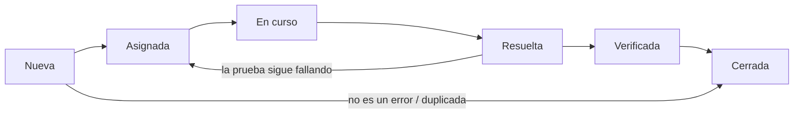

---
{"dg-publish":true,"dg-permalink":"/apuntes/1-dam-ed/unidad-04/11-documentacion-e-informes/","permalink":"/apuntes/1-dam-ed/unidad-04/11-documentacion-e-informes/","tags":["junit","pruebas","test"],"dg-note-properties":{"unidad":"[[Asignaturas/1DAM_ED/Unidades/Unidad 03/Unidad 03 - Pruebas y depuración]]","descripcion":"...","orden":12,"criterios":["RA3.g","RA3.h"],"tags":["junit","pruebas","test"],"estado":"revisar"}}
---


```table-of-contents
```

---

Como en otras etapas y tareas del desarrollo de aplicaciones, la documentación de las pruebas es un requisito indispensable para su correcta realización. Unas pruebas bien documentadas podrán también servir como base de conocimiento para futuras tareas de comprobación.

Hasta hace pocos años se usaban metodologías como **Métrica v.3** que proponían que las documentaciones de la fase de pruebas se basaran en los estándares ANSI / IEEE sobre verificación y validación de software. Con esta metodología había que generar mucho documentación y de forma manual: plan de pruebas, especificación del diseño de pruebas, especificación de un caso de prueba, especificación de procedimiento de prueba, registro de pruebas, informe de incidente de pruebas, informe sumario de pruebas... 

En la actualidad, **la documentación se ha automatizado**, convirtiéndose en documentación viva.

1. **Los test como primera fuente de documentación**   
   La primera fuente de documentación es el propio código y los **tests**. Si un test está bien escrito, sirve para explicarle a otro programador qué hace el sistema. Por eso en JUnit se recomienda usar la anotación **@DisplayName("...")** para escribir en lenguaje natural qué estamos probando (ej: "Debe rechazar correos sin @"), **eliminando la necesidad de tablas de casos de prueba externas**.

2. **Generación automática de informes (*Maven Surefire*)**  
   Ya no se hacen capturas de pantalla de los resultados y se pegan en documentos mastodónticos. **Maven** nos ofrece la herramienta **mvn test** que genera automáticamente informes profesionales en formato XML y HTML. Estos informes se guardan en la carpeta /target/surefire-reports.

   Los servidores de CI (como GitHub Actions) pueden consumir estos informes para mostrar gráficos de evolución de fallos a lo largo del tiempo.

3. **Informes de cobertura (JaCoCo)**  
   También conocido como *Code Coverage*. En la actualidad este es un documento vital. Herramientas como **JaCoCo** analizan qué líneas de código han sido ejecutadas por los tests y cuáles no. Genera un mapa de colores (Verde: probado / Rojo: no probado).

   Lo recomendable suele ser un mínimo del 80% de cobertura antes de permitir que el código pase a producción.

## 12.1. Documentación para Clientes - BDD y Gherkin

Para que la documentación también sea útil para el cliente o el jefe de proyecto (que no tienen porqué ser técnico ni saber de Java), usamos **<abbr title="Behavior Driven Development">BDD</abbr>**. En este caso se utiliza un lenguaje llamado [**Gherkin**](https://cucumber.io/docs/gherkin/), que permite escribir los requisitos en formato "*Dado que... Cuando... Entonces...*".

Ejemplo de documentación viva con Gherkin:  

```
Escenario: Cálculo de multa por retraso breve  
  Dado que un usuario tiene un libro hace 3 días  
  Cuando entrega el libro hoy  
  Entonces la multa calculada debe ser de 3 euros
```

Existen herramientas (como [**Cucumber**](https://cucumber.io/docs/cucumber/)) que conectan este texto directamente con los tests de JUnit, asegurando que la documentación y la realidad del programa coincidan siempre al 100%.

## 12.2. Documentar las incidencias

Cuando una prueba falla, o un usuario encuentra un error, hay que **documentar la incidencia** (*bug*, *issue* o defecto) para que alguien la corrija. Es el heredero del antiguo «informe de incidente de pruebas», pero ahora se registra en un **sistema de seguimiento de incidencias** (*issue tracker*), como [GitHub Issues](https://docs.github.com/es/issues), GitLab Issues o Jira.

### 12.2.1. Qué debe contener una incidencia

Una incidencia bien documentada permite a otra persona **reproducir el error** sin tener que preguntar nada:

| Campo | Contenido | Ejemplo |
|---|---|---|
| **Título** | Resumen breve y concreto | «Se puede reservar un aula ya ocupada si se cambia la hora» |
| **Entorno** | Versión del programa, sistema operativo, JDK, navegador… | v1.2.0, Windows 11, JDK 21 |
| **Pasos para reproducirlo** | Lista numerada de acciones | 1. Reservar A1 el 16/11 a las 10:00. 2. Reservar A1 el 16/11 a las 10:30. |
| **Resultado esperado** | Qué debería pasar | La segunda reserva se rechaza |
| **Resultado obtenido** | Qué pasa en realidad | Se aceptan las dos reservas |
| **Evidencias** | Mensaje de error, traza de la excepción, captura, prueba que falla | Salida de `mvn test` con el test `noReservaAulaSolapada` en rojo |
| **Gravedad** (*severity*) | Cuánto afecta al programa | Bloqueante, crítica, mayor, menor, trivial |
| **Prioridad** | Cuándo hay que corregirla | Alta, media, baja |

> [!TIP] Gravedad y prioridad no son lo mismo
> La **gravedad** la decide quien prueba, según el daño que hace el error. La **prioridad** la decide quien gestiona el proyecto, según la urgencia. Una errata en el nombre de la empresa en la pantalla de inicio tiene gravedad **trivial**, pero prioridad **alta**.

### 12.2.2. Ciclo de vida de una incidencia

Una incidencia pasa por varios estados hasta que se cierra:



En GitHub, los estados se representan con **etiquetas** (*labels*), como `bug`, `prioridad: alta` o `duplicate`, y moviendo la incidencia por las columnas de un tablero de GitHub Projects (ver [[Asignaturas/1DAM_ED/Apuntes/Unidad 01/7. Metodologías ágiles. Scrum y Kanban\|7. Metodologías ágiles. Scrum y Kanban]]).

### 12.2.3. Enlazar la incidencia con la corrección

Para que quede constancia de **qué cambio** corrigió cada incidencia, se enlazan:

1. Se escribe primero una **prueba que reproduce el error** y falla. Así se confirma el error y, después, la prueba sirve de **prueba de regresión** (ver [[Asignaturas/1DAM_ED/Apuntes/Unidad 03/6. Pruebas de regresión\|6. Pruebas de regresión]]).
2. Se corrige el código hasta que la prueba pasa.
3. El mensaje del *commit* o de la *pull request* hace referencia a la incidencia por su número. En GitHub, palabras como `Fixes` o `Closes` cierran la incidencia automáticamente al integrar el cambio en la rama principal:

   ```bash
   git commit -m "Rechaza reservas solapadas en la misma aula. Fixes #42"
   ```

> [!EXAMPLE] Plantillas de incidencias
> Los repositorios de GitHub pueden incluir **plantillas** en la carpeta `.github/ISSUE_TEMPLATE/`, para que quien abre una incidencia rellene siempre los mismos campos (pasos, resultado esperado, resultado obtenido…). Muchos proyectos de código abierto las usan: puedes verlas al abrir una incidencia nueva en [VS Code](https://github.com/microsoft/vscode/issues/new/choose).


---

<p><span>⬅️ <strong>Anterior:</strong> <a data-tooltip-position="top" aria-label="Asignaturas/1DAM_ED/Apuntes/Unidad 03/11. Automatización de pruebas.md" data-href="Asignaturas/1DAM_ED/Apuntes/Unidad 03/11. Automatización de pruebas.md" href="Asignaturas/1DAM_ED/Apuntes/Unidad 03/11. Automatización de pruebas.md" class="internal-link" target="_blank" rel="noopener nofollow">11. Automatización de pruebas</a> | 🏠 <strong>Unidad:</strong> <a data-tooltip-position="top" aria-label="Asignaturas/1DAM_ED/Unidades/Unidad 03/Unidad 03 - Pruebas y depuración.md" data-href="Asignaturas/1DAM_ED/Unidades/Unidad 03/Unidad 03 - Pruebas y depuración.md" href="Asignaturas/1DAM_ED/Unidades/Unidad 03/Unidad 03 - Pruebas y depuración.md" class="internal-link" target="_blank" rel="noopener nofollow">Unidad 03 - Pruebas y depuración</a> | <strong>Siguiente:</strong> <a data-tooltip-position="top" aria-label="Asignaturas/1DAM_ED/Apuntes/Unidad 03/13. Dobles de prueba.md" data-href="Asignaturas/1DAM_ED/Apuntes/Unidad 03/13. Dobles de prueba.md" href="Asignaturas/1DAM_ED/Apuntes/Unidad 03/13. Dobles de prueba.md" class="internal-link" target="_blank" rel="noopener nofollow">13. Dobles de prueba</a> ➡️</span></p>