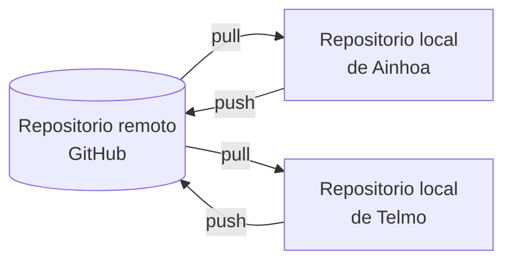
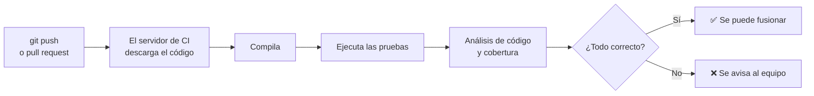

---
{"dg-publish":true,"dg-permalink":"/apuntes/1-dam-ed/unidad-04-optimizacion-control-de-versiones-e-integracion-continua/","permalink":"/apuntes/1-dam-ed/unidad-04-optimizacion-control-de-versiones-e-integracion-continua/","dg-note-properties":{"unidad":"[[Asignaturas/1DAM_ED/Unidades/Unidad 04/Unidad 04 - Optimización, control de versiones e integración continua]]","modulo":"[[Módulos/Entornos de desarrollo]]","libro":"[[Libros/Entornos de desarrollo (1º DAM, 1º DAW)]]"}}
---


Índice:
```table-of-contents
```

---
# 1. Control de versiones - repositorios

Cuando desarrollamos un proyecto software es habitual hacer pruebas y, en base a eso, modificar el código fuente continuamente, ya sea para arreglar errores o añadir funcionalidades, etc.

En muchas ocasiones, antes de abordar un cambio importante que requiera tocar mucho código, nos puede interesar guardarnos una versión de los fuentes que tenemos en ese momento: **una foto de la situación actual del proyecto**. Así podemos hacer cualquier cambio y, si fallan y necesitamos volver al código original, tenemos una versión que sabemos que funciona.

Durante muchos años esa versión original y las posteriores versiones que tenía visto bueno y se ponían en producción se iban guardando en distintos directorios con nombres a veces poco intuitivos:  

```
proyecto\_empresaX\_v1.0.zip  
proyecto\_empresaX\_v1.1.zip  
proyecto\_empresaX\_v1.2.zip  
proyecto\_empresaX\_v2.0.zip  
proyecto\_empresaX\_v2.1.zip  
proyecto\_empresaX\_v2.2.zip  
proyecto\_empresaX\_v2.3.zip
```

En este ejemplo anterior, se ve claramente que la última versión del proyecto es la 2.3, por lo que si queremos añadir nuevas funcionalidades tendremos que abrir ese código y trabajar a partir de él.

Si por el contrario hubiese algún error, sólo tendríamos que recuperar el de la versión 2.2 y ponerlo en producción.

Esta gestión manual de las versiones parece eficiente y sencilla, pero al trabajar en un equipo de desarrollo sobre el mismo código y donde cada desarrollador está añadiendo nuevas funcionalidades o reparando errores, ¿qué nombre le pone a la carpeta? Esto acaba siendo un **caos que deriva en dificultades**, **errores** y **plazos de entrega dilatados** en el tiempo innecesariamente.

Para evitarlo, desde hace ya muchos años se crearon los [**sistemas de control de versiones**](https://www.atlassian.com/es/git/tutorials/what-is-version-control), que nos ayudan a guardar las distintas versiones de los fuentes.

Un **Sistema de Control de Versiones** o **VCS** (*Version Control System*) es una herramienta que registra los cambios realizados en un fichero o conjunto de ficheros a lo largo del tiempo, de modo que sea posible recuperar versiones concretas en cualquier momento. Estos sistemas pueden ser:

* **Centralizados** (<abbr title="Centralized Version Control System">CVCS</abbr>)  
  Es el caso de [**Subversion**](https://subversion.apache.org/) (SVN), donde hay un único servidor que contiene todos los ficheros versionados. Los clientes (desarrolladores) pueden descargar una copia de la última versión y trabajar sobre ella. El inconveniente es que si el servidor cae, nadie puede acceder al código ni guardar cambios en el servidor.

* **Distribuidos** (<abbr title="Distributed Version Control System">DVCS</abbr>)  
  El máximo representante es [**Git**](https://git-scm.com/). Se dice que es distribuido porque cada usuario tiene una **copia completa** del repositorio en su equipo (incluido todo el historial). De esta forma **cada usuario puede trabajar sin conexión a internet** y se dispone de copias de seguridad **en el ordenador de cada miembro del equipo**.

> [!info] 
> Kishan Mashru explica la diferencia entre ambos sistemas en este vídeo:
>  
> * Kishan Mashru. (2019, 8 agosto). ***Centralized Version Control System (CVCs) and Distributed Version Control System (DVCs)*** [Vídeo]. YouTube. https://www.youtube.com/watch?v=EEmHBLkmQ9A


En cualquier caso, los VCS crean un directorio en el equipo local que suele estar oculto y que es controlado por el propio VCS. En él se van guardando las distintas versiones del código fuente que va realizando el desarrollador en su máquina.

Para empezar a trabajar, el VCS crea una copia del código fuente en un directorio de trabajo donde se hacen todos los cambios. Cuando validamos que los cambios funcionan, le decimos al VCS que lo guarde como una **nueva versión**.

> [!info] 
> Es conveniente acompañar la nueva versión con alguna descripción o comentario que describa de forma concisa qué cambios se han hecho en esa nueva versión.

Al mismo tiempo estos VCS nos permite obtener fácilmente cualquier versión del código fuente, ver los comentarios que describen dichas versiones e incluso comparar distintas versiones de un mismo código fuente para ver qué líneas se modificaron.

> [!info] 
> Aunque los VCS son esenciales en proyectos de cierta envergadura y con varios desarrolladores, también **puede ser útil para un único desarrollador**, ya que siempre tendrá todas las versiones de su programa controladas de forma fácil y eficiente.

## 1.1. Conceptos básicos

Como hemos visto antes, los VCS pueden seguir distintas arquitecturas, pero en todos los casos comparten conceptos comunes.

Aunque ahora mismo muchos no tienen sentido, más adelante se comprenderán cuando se hayan usado en la práctica. Veamos algunos de ellos:

* **Working directory**: es el directorio donde tenemos los ficheros con los que trabajamos.

* **Staging area**: zona previa al almacenamiento de una nueva versión. En ella se guardan los cambios que funcionen y que queramos "apartar" por si hemos de deshacer lo que estamos haciendo y queremos volver a esa versión.

* **Repository** o **inventario**: base de datos que guarda todas las versiones del proyecto (commits) que hayamos registrado.

* **Commit** o **revisión**: es una visión estática en el tiempo del estado de un grupo de ficheros y directorios. En otras palabras, una foto de un momento concreto del proyecto. **Cada commit un identificador único** que le diferencia del resto. También se le asocian datos descriptivos de quién lo ha hecho, cuándo...:

  * **Identidad** de quién ha hecho las modificaciones.

  * **Fecha y hora** en la que se almacenaron los cambios.

  * Comentario describiendo la razón para realizar dichos cambios.

  * De qué revisión y/o rama se deriva la revisión.

  * Palabras o términos clave asociados a la revisión.

* **Copia de trabajo**: también llamado "Árbol de trabajo", es el conjunto de directorios y ficheros controlados por el VCS. Está asociado a una rama de trabajo concreta.

* **Rama de trabajo** o **branch**: en el más sencillo de los casos, una rama es un conjunto ordenado de revisiones. La revisión más reciente se denomina principal (main) o cabeza. Las ramas se pueden separar y juntar según como sea necesario, formando un grafo de revisión.

  ¿A que no queda claro? Tranquilidad, lo veremos en la práctica.

* **Servidor**: máquina en la que se aloja el repositorio.

* **Repositorio**: lugar donde se almacenan las revisiones. Físicamente puede ser un fichero, colección de ficheros, base de datos, etc.; y puede estar almacenado en local o en remoto (servidor).

* Etiqueta (label):  identificación de un punto dentro del árbol del CVS.

* **Tag**: es una referencia o "puntero" que marca un punto específico en el historial de commits de un repositorio. Se usa para indicar hitos importantes como las versiones lanzadas (por ejemplo, **v1.0**, **v2.1**). A diferencia de las ramas, **los tags no cambian** y son útiles para consultar estados estables del código.

* **Cambio**: modificación en un fichero bajo control de revisiones. Cuando se unen los cambios en un fichero (o varios), generando una revisión unificada, se dice que se ha hecho una combinación o integración.

* **Conflicto**: ocurre cuando varias personas han hecho cambios en un mismo documento (o grupo de documentos) o en una misma funcionalidad de un código fuente. Los VCS alertan de la existencia del conflicto, pero la resolución de dicho conflicto lo decide el desarrollador.

## 1.2. VCS en el sector productivo

Entre los VCS más populares nos encontramos los siguientes:

* [**SourceSafe**](https://learn.microsoft.com/es-es/lifecycle/products/microsoft-visual-sourcesafe-2005): ha formado parte del entorno de desarrollo Microsoft durante muchos años. Cada desarrollador podía bloquear en el servidor uno o varios ficheros de código, de forma que hasta que no subiese su cambios, nadie más podía tocarlos ni ver qué se estaba haciendo en ellos. Este CVS hace tiempo que dejó de utilizarse.

* [**Visual Studio Team Foundation Server**](https://learn.microsoft.com/es-es/azure/devops/repos/tfvc/what-is-tfvc?view=azure-devops) fue el sucesor de Sourcesafe. Ofrece control de código fuente, recolección de datos, informes y seguimiento de proyectos.

* [**Subversion**](https://subversion.apache.org/): Apache Subversion es un VCS **open source** basado en un repositorio **centralizado** (CVCS) en un servidor central y cuyo funcionamiento se asemeja enormemente al de un sistema de ficheros. Durante muchos años fue el VCS más utilizado, aunque ya ha sido desbancado por los DVCS. En cualquier caso, sigue estando presente en muchas empresas. 

* [**Darcs**](https://darcs.net/) es un sistema de gestión de versiones distribuido (como Git) de código abierto y multiplataforma. Se enfoca en la **gestión de cambios** (parches) en lugar de instantáneas (snapshots) del código, como hace Git.

  Está hecho con Haskell, permite un desarrollo descentralizado, interactivo y eficiente, facilitando la selección de parches y la ramificación sin esfuerzo. 

* [**Mercurial**](https://www.mercurial-scm.org/) (Hg): es un VCS distribuido (DVCS) que gestiona los ficheros de texto y binarios de forma robusta. Tiene capacidades avanzadas de ramificación e integración. Es similar a Git, aunque es mucho más sencillo, con una interfaz más directa y menos comandos complicados. Es una excelente opción para empezar a usar VCS antes de pasar a otros más complejos como Git.

* [**Git**](https://git-scm.com/): es el DVCS más popular en la actualidad. Fue creado por [Linus Torvalds](https://es.wikipedia.org/wiki/Linus_Torvalds) para sus necesidades en el desarrollo del core de Linux, pero se ha convertido en el estándar de la industria.

  Es el más recomendable para proyectos grandes y colaboración compleja. Esto hace que su curva de aprendizaje sea bastante pronunciada.

  Utiliza **almacenamiento direccionable** por contenido.

Existen otros como el DVCS [**Bazaar**](https://launchpad.net/bzr), creado por Martin Pool y patrocinado por Canonical, de código abierto y diseñado para rastrear el historial de proyectos de software y facilitar la colaboración. Es capaz de interoperar con otros sistemas de control de versiones como Subversion, Git y CVS, facilitando la migración. Se caracteriza por tener una curva de aprendizaje baja para usuarios noveles en comparación con otros sistemas distribuidos, sin sacrificar potencia. Aunque ha perdido terreno frente a Git en estos últimos años, ha sido utilizado en proyectos importantes como **Ubuntu**, **MySQL**, **Inkscape** y **Mailman**.


# 2. Git

**Linus Torvalds** (el creador de Linux) creó Git en 2005 para tener un VCS que cubriese sus necesidades a la hora de gestionar un proyecto de envergadura mundial. Un fiestón de programadores, vamos...

La comunidad de desarrollo de Linux necesitaba una herramienta que fuera rápida, eficiente con grandes proyectos y, sobre todo, distribuida. Al no encontrar nada que les gustara, Linus decidió escribir Git en apenas unas semanas.

A diferencia de otros sistemas que guardan sólo qué líneas cambiaban (deltas), Git piensa en la información como un **conjunto de instantáneas** (*snapshots*). Cada vez que guardas tu trabajo (haces un commit), Git toma una "foto" de todos tus ficheros en ese momento. Si un fichero no ha cambiado, Git simplemente crea un enlace al fichero anterior para ahorrar espacio.

Git funciona **revisando las diferencias** de los ficheros en los que estamos trabajando con los que él tiene registrados. 

## 2.1. Los tres estados

Para entender Git, es fundamental comprender cómo maneja nuestro código y dónde lo coloca en cada momento:

* **Working directory** (directorio de trabajo)  
  Es la carpeta en tu ordenador donde estás editando los ficheros. Aquí residen todos los ficheros del proyecto, que podemos modificar. Al hacerlo, el estado de esos ficheros (modificado) indica que hemos hecho cambios pero aún no se han guardado en la base de datos de Git.

* **Staging area** (área de preparación o Índice)  
  Un fichero donde se preparan los cambios que irán en el próximo "guardado". Es como el carrito de la compra antes de pagar.

  Los ficheros modificados quedan marcados en su versión actual para ser incluirlos en la próxima confirmación (commit).

* **Repository/Commited** (directorio de Git)  
  Donde Git guarda permanentemente las instantáneas en la base de datos local (la carpeta oculta .git).

  Los datos están almacenados de manera segura en la base de datos local de Git.


> Directorio de trabajo (*working directory*), área de almacenamiento (*staging area*) y el directorio Git con el repositorio ( *git repository*).
> Git - Fundamentos de Git. (s. f.). [https://git-scm.com/book/es/v2/Inicio---Sobre-el-Control-de-Versiones-Fundamentos-de-Git](https://git-scm.com/book/es/v2/Inicio---Sobre-el-Control-de-Versiones-Fundamentos-de-Git) 


## 2.2. Flujo básico de Git

Git se usa en local. Cualquier cambio se registra en nuestra máquina y nada tiene que ver (por el momento) con repositorios en servidores remotos.

Aunque existen clientes de Git ([Sourcetree](https://www.sourcetreeapp.com/), [Gitkraken](https://www.gitkraken.com/), [Gitg](https://flathub.org/en/apps/org.gnome.gitg), [Gitforce](https://sites.google.com/site/gitforcetool/download), [cliente de GitHub](https://github.com/apps/desktop), etc.) que permiten manejarlo de forma visual, lo mejor para tener un control total es hacerlo a través de la terminal. Si, toca escribir comandos.

Todos los comandos de Git comienzan con la palabra git. Se expresan de la siguiente manera:

```bash
~$ git <verbo> [opcion 1] [opcion 2]... [opcion n]
```

Por lo que, en adelante, cuando se hable de un comando hay que tener presente que antes de él hay que escribir `git`.

### 2.2.1. Configuración inicial

Antes de usarlo, Git necesita tener algo de información sobre quién lo maneja para poder firmar los cambios. Como mínimo el **nombre** y la **dirección de correo**. Para ello se usa el comando **`config`**:

```bash
# Configurar nombre y correo (solo se hace una vez)
user@laptop:~$ git config --global user.name "Anselmo Pérez Socarrat"
user@laptop:~$ git config --global user.email "anselmo@psocarrat.com"
```

Hemos usado la opción **`--global`** para indicar a Git que aplique esos parámetros de configuración (`user.name` y `user.email`) al usuario del sistema operativo.

La configuración se puede hacer a distintos niveles: para un sólo repositorio (**`--local`**), para cualquier repositorio de un usuario del sistema operativo (**`--global`**) o para cualquier persona que use el equipo (**`--system`**).

En cada caso dicha información se guarda en un fichero distinto. A saber:

- Al usar  **`--local`** los datos de configuración se guardan en el fichero `.git/config`  
- Con **`--global`** la información se almacena en `~/.gitconfig` o `~/.config/git/config`  
- Con **`--system`** en cambio, el fichero que guarda los datos es `/etc/gitconfig`

Se pueden configurar muchos más datos y no sólo del usuario. Consulta las [[Asignaturas/1DAM_ED/Apuntes/Unidad 04/Referencias#Configuración\|referencias]].

La opción de nivel de aplicación (`local`, `global` o `system`) va seguida de una expresión formada por un conjunto de parámetros y el parámetro en cuestión. En el ejemplo anterior, los parámetros de usuario se engloban en el **conjunto `user`**, que contiene **`name`**, **`email`**, etc. Existen otros conjuntos de parámetros, como el del editor que queramos usar por defecto cuando necesitemos revisar un conflicto o cualquier otra operación de edición:

```bash
user@laptop:~$ git config --global core.editor code
```

> [!note] Nota 
> El parámetro `code` es el comando para abrir el editor VS Code. En su lugar se puede usar `gedit`, `nano` o cualquier otro editor que tengamos instalado en el sistema.

Incluso podemos indicar de forma global qué rama[^1] inicial queremos se adopte al iniciar cualquier repositorio. Por ejemplo, la rama `main`:

```bash
user@laptop:~$ git config --global init.defaultBranch main
```

Si queremos consultar alguno de los parámetros de configuración en concreto:

```bash
user@laptop:~$ git config user.email
anselmo@perezsocarrat.com
```

En cambio, si queremos mostrar todos:  

```bash
user@laptop:~$ git config --list

user.name=Anselmo Pérez Socarrat
user.email=anselmo@perezsocarrat.com
color.status=auto
color.branch=auto
color.interactive=auto
color.diff=auto
...
```

Es posible que algunos valores salgan repetidos. Esto se debe a que Git lee los distintos ficheros de configuración que se indicaban en párrafos anteriores. 

En cualquier caso, podemos consultar la configuración de nuestro git buscando el fichero oculto .gitconfig. En una distribución Linux suele estar en la **home** del usuario. Por ejemplo, para el usuario anselmo:

```bash
user@laptop:~$ pwd
/home/anselmo
user@laptop:~$ ls -a .git*
.gitconfig
user@laptop:~$ cat .gitconfig 
[user]
	name = anselmo
	email = anselmo@anselmo.es
[init]
	defaultBranch = main
[color]
	ui = true
user@laptop:~$ 
```

Si queremos borrar la configuración de git sólo hay que borrar dicho fichero.

> [!info]  
> Para más información, consulta las referencias sobre [**configuración de Git**](#configuración).


### 2.2.2. Crear un repositorio

Existen dos formas para empezar a trabajar con un repositorio de Git: **convertir un proyecto local** que no está bajo control de versiones o **clonar** un repositorio existente desde un servidor.

Veamos cada uno de ellos.

#### 2.2.2.1. Inicializar un repositorio en un directorio existente

Imaginemos que ya estamos trabajando en un proyecto de software que está guardado en un directorio determinado. En él están todos los ficheros de código fuente y de configuración del proyecto (p.e. el fichero `pom.xml`). Podemos empezar a usar Git para gestionar las distintas versiones de ese proyecto siguiendo estos pasos:

1. Entrar en la carpeta del proyecto desde la terminal.  
2. Ejecutar el comando de inicialización:
   ```bash
   user@laptop:~$ mkdir proyecto1  
   user@laptop:~$ cd proyecto1  
   user@laptop:~/proyecto1$ git init
   ```
   De esta forma hemos creado el directorio **proyecto1**, entramos e iniciamos un repositorio git en él.

   Esto se puede hacer en menos pasos de la siguiente manera:

   ```bash
   user@laptop:~$ git init proyecto1
   ```
   
   Así se crea el directorio **`proyecto1`** y a su vez se crea un repositorio dentro de él.

   O puedo indicar que se inicie con la rama inicial main:

   ```bash
   user@laptop:~$ git init proyecto1 --initial-branch=**main**
   ```

   Esta segundo opción la podemos ejecutar para ahorrarnos pasos posteriores, ya que al hacer un git init, el propio git nos dice que, si se ha creado el repositorio con la rama inicial **master** es conveniente cambiarla a la rama **main** con el comando:

   ```bash
   user@laptop:~$ git branch -m **main**
   ```

   En nuestro caso, si iniciamos el repo en la rama main, nos ahorramos este paso.

   > [!info]
   > Recuerda que [[Asignaturas/1DAM_ED/Apuntes/Unidad 04/2. Git#2.2.1. Configuración inicial\|puedes configurar git]] para que cree cualquier repositorio en la rama `main` por defecto.

   En ese momento se crea el **directorio oculto `.git`** donde Git guardará todo el historial y la base de datos del proyecto.

   

#### 2.2.2.2. Clonar un repositorio existente

Esta es la forma más común de trabajar en equipos. En lugar de empezar un repositorio de cero, hacemos una copia de un proyecto que ya existe y al que tenemos acceso a través de plataformas como [GitHub](https://github.com/), [GitLab](https://about.gitlab.com/) o [BitBucket](https://bitbucket.org/product/).

```bash
git clone <url>
```

Por ejemplo, para clonar en nuestro equipo el repositorio de ejemplos de clase, ejecutaremos el siguiente comando:  

```bash
user@laptop:~$ git clone https://github.com/dgaysae/Programacion_1DAMB_2024_25.git
```

A diferencia de otros sistemas de control de versiones (como SVN), Git no solo descarga la última versión del código; **descarga una copia completa de todo el historial** de cada fichero del proyecto.

ℹ️ Si el servidor se borrara, cualquier persona que haya clonado el repositorio podría restaurarlo por completo.

Al clonar un proyecto se crea una carpeta con ese nombre. En el ejemplo anterior, la carpeta que aparecería en nuestro equipo sería **Programacion_1DAMB_2024_25**.  Si queremos que lo haga en un directorio con un nombre distinto, podemos añadir el nombre del directorio al final:  

```bash
user@laptop:~$ git clone https://github.com/dgaysae/Programacion_1DAMB_2024_25.git programacion
```

> [!info]
> Para comprender mejor la dinámica del flujo de trabajo de git, vamos a centrarnos en un repositorio creado desde cero.

### 2.2.3. Usar el *Staging area*

Cuando hacemos cambios en nuestro *working directory* y vemos que funcionan bien, en ocasiones sabemos que si continuamos trabajando para hacer aún más modificaciones podemos echar a perder lo que ya hemos hecho. Si nos equivocamos podemos usar Ctrl-Z muchas veces, si... pero ni es elegante ni seguro (con cerrar ese fichero y volver a abrirlo ya no sirve).

Así que, cuando vemos que aún no hemos acabado pero lo que llevamos hecho va bien y queremos "apartarlo", usamos el ***staging area***. Si paso los cambios que llevo hechos al stage, puedo seguir modificando el código de forma que tenemos:


Siguiendo con el repositorio que hemos creado en **proyecto1** del apartado anterior, empezaremos con el cambio más obvio: crear nuevos ficheros.

Podemos crear ficheros en el **working directory** y trabajar con ellos hasta que lleguemos a un punto en el que **queramos mantener esos cambios parciales (no definitivos) para no perderlos**.


> [!info]
> Para estar al tanto en cualquier momento del **estado actual** de los cambios que git está observando en nuestro *working directory* y en el *staging area* podemos usar:
> ```bash
> git status
> ```

El **`status`** indica qué ficheros han sido **modificados** (`M`), cuáles están **preparados** para el siguiente commit (*staged*), cuáles no lo están (*unstaged*), y qué ficheros nuevos no están siendo rastreados (*untracked*).

Por ejemplo, si creo un fichero nuevo o hago un cambio en uno de los que tengo en el working directory y compruebo el estado ejecutando git status:

```bash
user@laptop:~$ git status
En la rama main
Cambios no rastreados para el commit:
  (usa "git add <fichero>..." para actualizar lo que será confirmado)
  (usa "git restore <fichero>..." para descartar los cambios en el directorio de trabajo)
	modificados:     index.md

Ficheros sin seguimiento:
  (usa "git add <fichero>..." para incluirlo a lo que será confirmado)
	nuevo.md

sin cambios agregados al commit (usa "git add" y/o "git commit -a")
```

Este ejemplo muestra cómo Git nos indica que ve ambos casos: ficheros nuevos o modificados añadidos a nuestro *working directory*.  

---

Así que los añadimos (`add`) al **staging area**, una zona donde dejamos los cambios que sean correctos y que no queramos perder antes de pasarlos al repositorio:  

```bash
# Prepara el fichero index.md
user@laptop:~$ git add index.md
```


> [!note] Nota
> Si tuviéramos más ficheros, podríamos pasarlos al *staging area* de distintas formas:
> ```bash
> # Prepara TODOS los ficheros del directorio
> user@laptop:~$ git add .
> 
> # Prepara un par de ficheros concretos
> user@laptop:~$ git add index.md cap01.md
> 
> # Prepara todos los ficheros de extensión .java
> user@laptop:~$ git add *.java
> 
> # Prepara todos los ficheros de extensiones .java y .md
> user@laptop:~$ git add *.java *.md
> ```

Ahora podemos seguir trabajando y modificando los ficheros como el `index.md` y volviendo a añadirlos al *staging area*, reemplazando así lo que hubiésemos guardado antes.

Observa el siguiente diagrama para seguir los pasos que hemos dado:


> Ciclo de vida del estado de tus ficheros.
> Git - ***Guardando cambios en el Repositorio***. (s. f.). https://git-scm.com/book/es/v2/Fundamentos-de-Git-Guardando-cambios-en-el-Repositorio

### 2.2.4. Registrar en el repositorio

Cuando vemos que los cambios almacenados en el **stage** son los suficientes y necesarios para que podamos consultarlos en un futuro, es el momento de guardarlos en el repositorio. en otras palabras, haremos la primera foto del proyecto (**commit**) para poder acceder a ella en un futuro si fuera necesario:

```bash
# Guarda la versión inicial
user@laptop:~$ git commit -m "Primer commit"
```


> [!warning] Insistimos...
> ...en que Git **evalúa las diferencias** que hay entre lo que tiene registrado en los repositorios y lo que hay en el working directory.

Al ejecutar el comando **`commit`** podemos ver la opción **`-m`** seguida de un texto. Esa opción permite introducir un **título** que describa ese commit.

Si queremos añadir, además del título, una descripción más detallada, podemos añadir un segundo texto de la misma forma que hemos hecho con el título:  

```bash
git commit -m "título del commit" -m "Descripción más detallada..."
```

> [!warning] Ojito
> Cuando el comentario de un commit es **impreciso**, **poco serio o profesional** o **indica que ese commit tiene código erróneo o inservible**, se dice que ese es un ***shit commit*** (si, la traducción es la que piensas).
> 
> Para un mensaje adecuado en un commit hay que tener en cuenta:
> 1) Utilizar una nomenclatura normalizada en el equipo o a nivel individual. Por ejemplo, comenzar cada comentario con **`feat:`** (=features, para nuevas funcionalidades), **`fix:`** (para arreglar algo),  **`docs:`** (para indica que se *commitea* documentación).
> 2) Escribir mensajes **concisos** y **descriptivos**. Por ejemplo: "fix: arreglada validación de email".
> 
> También se puede corregir un "shit commit" usando **`git commit --amend`**, que veremos más adelante.  

Ya hemos hecho un commit. Es decir, ya **tenemos una primera versión** de nuestro proyecto en el repositorio. 

## 2.3. Trabajando con repositorios locales

Ya hemos visto cómo añadir a Git los cambios que vamos realizando. Por un lado pasándolos al staging area para no perder algo que sabemos que está bien pero que no es el cambio definitivo que queremos guardar como versión. Por otro, tomando los cambios del staging area que creemos definitivos para esa versión y guardándolos en el historial de nuestro repositorio con un commit.

Este ciclo de vida es el ideal, pero no se corresponde con la vida real. En ocasiones pasamos al stage modificaciones que luego vemos que no son las que queríamos, o hacemos un commit y hemos olvidado añadir elementos imprescindibles o hemos incluido ficheros que no deberíamos (por ejemplo un fichero de configuración o un token de acceso).

Ante situaciones así, Git nos ofrece soluciones sencillas.

### 2.3.1. Eliminar los cambios del stage

Por ejemplo, supongamos que tenemos algún commit de unos ficheros del proyecto. Hemos estado trabajando sobre ellos y hemos puesto en el staging area algunos cambios que no queremos perder. Pero nos damos cuenta de que lo que acabamos de dejar en el stage no es Hemos seguido trabajando sobre dichos ficheros en nuestro working directory con la intención de hacer otro `git add` y unirlos a los que ya tenemos en el stage. Pero nos percatamos de que esos cambios no son correcto y los queremos eliminar del stage. Para eso usamos:

```bash
git reset <fichero1> <fichero2>:
```


Y como git no detecta diferencias entre el staging area y el repositorio, realmente sería así:


Ya que **si git no detecta cambios** entre lo que hay en el stage con respecto al último commit, git **lo ignora**.

Es posible que encuentre este comando de estas otras formas:  

```bash
# Borra ese fichero del stage y lo deja en el working directory:
git reset HEAD <fichero1> <fichero2>

# Borra todo el stage y lo deja en el working directory:
git reset HEAD .
```

### 2.3.2. Consultar el historial del repositorio

¿Cuántos commits hemos realizado en nuestro repositorio local? Para consultar las distintas versiones registradas en el repositorio (commits) usamos:  

```bash
git log
```

Este comando tiene el **puntero al último commit** realizado, que a su vez tiene un puntero al commit del que viene y así sucesivamente. Por ello, la forma correcta de representar gráficamente los commits es:


Este último comando tiene varias opciones para mostrar los commits de distintas formas:  

```bash
user@laptop:~$ git log --graph
* commit d75c7aa7a32b9889373f56c65893a1a4ab4fbf7c (HEAD -> main)
| Author: user <user@user.es>
| Date:   Mon Feb 16 16:03:45 2026 +0100
| 
|     Ficheros con texto
| 
* commit c840f6c1da0cff313e35c3e0938478d6c8856899
| Author: user <user@user.es>
| Date:   Mon Feb 16 14:58:58 2026 +0100
| 
|     Segundo commit
| 
* commit 719a5b24dfb55a0f4fa964cf38ef1dabafd2ae37
  Author: user <user@user.es>
  Date:   Mon Feb 16 14:15:17 2026 +0100
  
      Commit inicial
```

Observa que a la izquierda se ven unos asteriscos (`*`) y unos pipes(`|`) que dibujan una línea con ítems a modo de dibujo de los distintos commits.

También podemos agregar otras opciones como:  

```bash
user@laptop:~$ git log --pretty=short
* commit d75c7aa7a32b9889373f56c65893a1a4ab4fbf7c (HEAD -> main)
| Author: user <user@user.es>
| 
|     Ficheros con texto
| 
* commit c840f6c1da0cff313e35c3e0938478d6c8856899
| Author: user <user@user.es>
| 
|     Segundo commit
| 
* commit 719a5b24dfb55a0f4fa964cf38ef1dabafd2ae37
  Author: user <user@user.es>
  
      Commit inicial
```

> [!info]  
> **`--pretty`** admite otros muchos valores. Sólo hay que escribir **`--pretty=`** y darle a la tecla tabulador para ver las sugerencias de posibles valores.

> [!info]
> **`--decorate`** permite dar formato más agradable a nuestro **`git log`**. Funciona de forma similar al **`pretty`** (y pueden combinarse).

### 2.3.3. Restaurar los últimos cambios

Imaginemos que llevamos ya un rato modificando un fichero en nuestro *working directory* y nos damos cuenta de que queremos deshacer esos cambios y **volver a dejarlo como estaba en el último commit**. Para ello podemos hacer lo siguiente:   

```bash
user@laptop:~$ git checkout VerticalPanel.java
```

O, mejor aún, adaptándonos a las últimas versiones de git:  

```bash
user@laptop:~$ git restore VerticalPanel.java
```


Al hacerlo, si comprobamos el estado (git status) veremos que ese fichero ya no está contemplado porque git no encuentra diferencias entre él (en el working directory) y el que git tiene en el último repositorio *commiteado*.

En este punto es conveniente destacar que **`git restore`** **restaura** los últimos cambios realizados **siguiendo este orden**:

1. ¿Hay cambios de ese fichero en el *staging area*? Si los hay, los restaura en el working directory. Es decir, al editar ese fichero veríamos lo que hemos subido al *stage*.

2. Si no hay cambios del fichero en el *stage*, toma los que hay en el repositorio (como se puede ver en la figura anterior).

> [!warning] ¡Ojo! 
> Antes de restaurar ficheros **es conveniente comprobar las diferencias** entre lo que llevamos hecho y lo que hay en el último commit:  
> ```bash
> user@laptop:~$ git diff VerticalPanel.java
> ```

### 2.3.4. Diferencias con la última versión

El comando anterior nos devolverá algo parecido a esto:

```bash
user@laptop:~$ git diff VerticalPanel.java

diff --git a/VerticalPanel.java b/VerticalPanel.java
index 83db28f..6b1c342 100644
--- a/VerticalPanel.java
+++ b/VerticalPanel.java
@@ -10,4 +10,5 @@ public class VerticalPanel {
     private String title;
-    private JComponent componente; 
+    private List<JComponent> componentes;
+    private LayoutManager layout;
 }
```

Veamos cómo interpretar todo esto:

* Lo primero que nos muestra es qué ficheros se están comparando.  
  ```bash
  diff --git a/VerticalPanel.java b/VerticalPanel.java
  ```
  Git compara dos versiones: **`a/` y `b/`**. La **`a`** es la versión antigua (la que está en el HEAD) y la **`b`** es tu versión actual con cambios.

* Después vemos unos metadatos o información interna de Git sobre los objetos.    
  ```bash
  index 83db28f..6b1c342 100644
  ```

* Los símbolos `---` (versión anterior) y `+++` (nueva versión) son los marcadores de cambios.
  ```bash 
  --- a/VerticalPanel.java  
  +++ b/VerticalPanel.java
  ```
  
  **`---`** y **`+++`** sirven para indicar que lo que aparezca con **`-`** viene del fichero **`a`** (versión anterior) y lo que aparezca con **`+`** viene del fichero **`b`** (nuevo).

* *Chunks* o trozos del fichero donde el símbolo `@@` indica las líneas afectadas.  
  ```bash
  @@ -10,4 +10,5 @@ public class VerticalPanel {  
       private String title;  
  -    private JComponent componente;   
  +    private List<JComponent> componentes;  
  +    private LayoutManager layout;  
   }
  ```

¿Qué significa **`@@ -10,4 +10,5 @@`**?

Las primeras cifras **`-10,4`** corresponden al fichero **`a`** e indican que este fragmento empezaba en la **línea 10** y ocupaba **4 líneas**.

Las segundas cifras (**`+10,5`**) se refieren al fragmento que hay en la  nueva versión (**`b`**), que empieza en la **línea 10** y ocupa **5 líneas**.

Los signos `-` y `+` al inicio de las líneas indican respectivamente que se eliminan o se añaden en la nueva versión con respecto a la anterior.

> [!info]
> Si hemos modificado una línea, Git no indica que se ha modificado. En su lugar veremos una línea con **`-`** (la versión anterior) y **justo debajo la misma línea con `+`** (la nueva versión con la corrección).

### 2.3.5. Borrar ficheros

De la misma forma que el comando **`rm`** del terminal permite borrar ficheros de un directorio, Git ofrece el mismo comando para borrar elementos de nuestro proyecto.

**`git rm`** permite eliminar ficheros que ya están bajo el control de versiones (ya sea en el stage o el los commits del repositorio).

1) Si un fichero es totalmente nuevo en nuestro working directory (untracked) y nunca se ha hecho un **`git add`** ni un **`git commit`** sobre él, **`git rm`** no funcionará y dará un error. En estos casos sólo hay que borrar el fichero de forma habitual: con **`rm`**.

2) Si el fichero ha sido añadido al *staging area* con pero nunca se ha *commiteado*, a priori tampoco nos deja borrarlo por seguridad (por si estamos cometiendo un error). Para dejar claro que esa es nuestra intención, hemos de hacerlo con el parámetro **-f** (forzar):  
   ```bash
   git rm -f fichero.txt
   ```
  
3) Si el fichero ya existe en un commit anterior, podemos ejecutar el borrado con **git rm**:
   ```bash
   git rm fichero.txt
   ```

Esto borrará el fichero del working directory y lo marcará para ser borrado en el próximo commit. Cuando se haga commit de ese cambio, ese fichero no aparecerá en los commits posteriores pero **seguirá existiendo en los commits anteriores**.

### 2.3.6. Ignorar ficheros en nuestros repos

En muchos casos vamos a usar un IDE o cualquier programa que genera ficheros de forma automática y transparente para nosotros: ficheros .class cuando ejecutemos o compilemos nuestro proyecto de Java, ficheros de backup, etc.

Esos ficheros no tienen el menor interés para nuestro repositorio. No necesitamos ver su evolución. Pero git no lo sabe y los tendrá en cuenta como cualquier otro fichero en el directorio.

Si queremos decirle a git que no haga seguimiento a determinados ficheros, podemos hacerlo especificándolos dentro del fichero **`.gitignore`[^2]**. En él indicamos los patrones que queremos que git tenga en cuenta con los ficheros que encuentro en el directorio del proyecto. Esos patrones se corresponden con ficheros (o rutas de ficheros) dentro del proyecto, por lo que es importante **usar rutas relativas** a nuestro proyecto y que **partan de la misma ruta que el fichero `.gitignore`**. 

Veamos un ejemplo para entender su funcionamiento con el siguiente .gitignore:

```bash
# Esto es un comentario y no tiene efecto alguno

# -------------------------------------------------------
# FICHEROS DEL SISTEMA
# Generados automáticamente por el sistema operativo y que
# no tienen utilidad para el proyecto.
# -------------------------------------------------------

# Windows - Ficheros del sistema
**/Thumbs.db
**/Desktop.ini

# macOS - Ficheros del sistema
**/.DS_Store

# -------------------------------------------------------
# FICHEROS DEL IDE
# Generados automáticamente por el IDE
# -------------------------------------------------------

# VS Code -------------
.vscode/

# IntelliJ IDEA -------
.idea/
*.iml

# Eclipse -------------
.metadata/
.project
.classpath
.settings/

# -------------------------------------------------------
# LENGUAJES DE PROGRAMACIÓN
# -------------------------------------------------------
# Java - Ficheros compilados
*.class
*.jar
*.war

# -------------------------------------------------------
# DEPENDENCIAS
# -------------------------------------------------------
# Maven - Carpeta de salida
target/

# Node.js - Dependencias
node_modules/

# -------------------------------------------------------
# FICHEROS DE CONFIGURACIÓN
# -------------------------------------------------------

# Ficheros de variables de entorno
.env
.env.local

# Ficheros de Bases de datos locales
*.log
*.sqlite
```

Veamos algunos de estos patrones:

**nombre_carpeta/**  
Se indica con el nombre seguido de la barra `/`. Ignora la carpeta y su contenido.

**`.log`**  
Ignora cualquier fichero que termine en `.log` (recuerda que el asterisco es un comodín).

****`/Thumbs.db`**  
Ignora cualquier fichero **`Thumbs.db`** que se encuentre **en el directorio actual** (donde está .gitignore) o cualquier subdirectorio del proyecto. Aunque se ha especificado un fichero en concreto, también vale para directorios. Si se usa por ejemplo **`/object`** ignorará cualquier fichero o directorio que se llame **`object`**.

**`temp?`**  
Ignora `tempa`, `tempb`, etc. (recuerda que el signo de interrogación `?` sustituye a un solo carácter).

**`!importante.log`**  
El signo de exclamación `!` indica la negación. Es decir, que el patrón **no se ignore** aunque coincida con un patrón anterior. En este caso se indica que Git no ignorará el fichero `importante.log`.

> [!warning] Importante 
> Esto no se aplica a aquellos directorios que se hayan excluido. Si hay un directorio incluido en .gitignore y en él se encuentra este fichero, git lo ignorará ya que prevalece lo dispuesto para el directorio. 

## 2.4. Alias

Cuando los comandos se vuelven largos y engorrosos de escribir, podemos asignarles un **alias**.

Imaginemos que usamos el siguiente comando con mucha frecuencia:  

```bash
user@laptop:~$ git log --graph --decorate --all
```

Escribir esto es bastante engorroso (y podría ser aún más largo). Para ahorrarnos tanta verborrea podemos crear un alias sencillo que lo ejecute igualmente. Por ejemplo, podemos llamar a ese alias **milog**:

```bash
user@laptop:~$ git config --global alias.milog "log --graph --decorate --all"
```

Con esto hemos introducido el alias en nuestro fichero de configuración de Git. Además, el comando se ha puesto entre comillas y sin `git` como primera palabra.

Para ejecutar dicho alias sólo hay que llamarlo desde Git:  

```bash
user@laptop:~$ git milog
* commit d75c7aa7a32b9889373f56c65893a1a4ab4fbf7c (HEAD -> main)
| Author: user <user@user.es>
| Date:   Mon Feb 16 16:03:45 2026 +0100
| 
|     Ficheros con texto
| 
* commit c840f6c1da0cff313e35c3e0938478d6c8856899
| Author: user <user@user.es>
| Date:   Mon Feb 16 14:58:58 2026 +0100
| 
|     Segundo commit
| 
* commit 719a5b24dfb55a0f4fa964cf38ef1dabafd2ae37
  Author: user <user@user.es>
  Date:   Mon Feb 16 14:15:17 2026 +0100
  
      Commit inicial
```

Esto lo podemos hacer con todos los comandos que queramos para agilizar nuestro trabajo con Git.

## 2.5. Desplazamiento por los commits

> [!info]
> En las referencias tienes una herramienta visual que te permite estudiar los conceptos que vamos a estudiar a continuación ([[Asignaturas/1DAM_ED/Apuntes/Unidad 04/Referencias#Herramientas\|Visualizing Git, s. f.]])

En el `git log` anterior vemos que tenemos varios commits y que en el último se indica esta leyenda: **`HEAD -> main`**. Gráficamente podemos verlo de esta forma:


Pero ¿qué son ese **`HEAD`** y ese **`main`** y por qué el primero apunta al segundo con una flecha?

Como ya hemos dicho anteriormente, **cada commit que hacemos se hace porque hemos partido de un commit anterior** (salvo el primero), hemos hecho cambios y los hemos registrado en un nuevo commit. Es decir, que la última versión (el último commit) tiene un puntero que apunta al commit anterior, que a su vez tiene otro puntero que apunta al anterior y así sucesivamente hasta llegar al primer commit del repositorio.

> [!info]  
> Todos los commits almacenan los datos de los cambios realizados y tiene un puntero que apunta al commit anterior (salvo el primer commit, cuyo puntero es nulo).

En la figura anterior estamos en la rama **`main`**. Esta rama es en realidad un puntero al último commit que se ha hecho. Por ese motivo se ve al final: para tener acceso a todos los commits que contiene. Si te fijas, es una **lista enlazada** a la que se accede desde **`main`**.

Así, cuando creamos un nuevo commit, lo que ocurre realmente es que:

1. Se crea el commit y su puntero apunta al commit al que apunta **`main`**.  
   


2. **`main`** y **`HEAD`** pasan automáticamente a apuntar al nuevo commit, que se convierte en el último commit de la rama main.  
   
   
¿Y qué pinta el **`HEAD`** en todo esto?  
Es otro puntero, como **`main`**, pero **`HEAD`** indica en qué commit nos encontramos nosotros dentro de esa rama o lista enlazada. Y esto es esencial, porque main debe apuntar siempre al último commit para no perder la información de su rama, por lo que si queremos movernos a otros commits, debemos usar otro puntero: el **`HEAD`**.

Si movemos el **`HEAD`** al segundo commit...


nuestro *working directory* contendrá todo lo que había en ese segundo commit. Dicho de otra forma, hemos retrocedido al momento del proyecto de ese commit.

¿Y todo esto para qué sirve?  
Supongamos que queremos ver el estado del proyecto en el segundo commit para consultar algo, o partir desde ese estado para hacer una versión distinta a la actual, o simplemente porque en los últimos commits hemos hecho un trabajo que vemos que no es lo que queríamos.

¿Cómo movemos el **`HEAD`** a commits anteriores?  
Podemos hacerlo de dos formas: con **`git reset`** o con **`git checkout`**.

#### `git reset`

Ya hemos usado **git reset** para borrar los cambios que subimos al staging area. En esta ocasión lo vamos a usar para mover tanto el puntero **main** como el **HEAD**.

Si consultamos el log:  

```bash
user@laptop:~$ git milog
* commit d75c7aa7a32b9889373f56c65893a1a4ab4fbf7c (HEAD -> main)
| Author: user <user@user.es>
| Date:   Mon Feb 16 16:03:45 2026 +0100
| 
|     Ficheros con texto
| 
* commit c840f6c1da0cff313e35c3e0938478d6c8856899
| Author: user <user@user.es>
| Date:   Mon Feb 16 14:58:58 2026 +0100
| 
|     Segundo commit
| 
* commit 719a5b24dfb55a0f4fa964cf38ef1dabafd2ae37
  Author: user <user@user.es>
  Date:   Mon Feb 16 14:15:17 2026 +0100
  
      Commit inicial
```

Vemos que tenemos 3 commits y tanto el **main** como el **HEAD** están en el último de ellos.

Vamos a ejecutar lo siguiente:  

```bash
# Indicando el hash del commit al que queremos movernos:
git reset --soft c840f6c

# Indicando que queremos ir al commit anterior:
git reset --soft HEAD~1 
```

La opción **`--soft`** sirve para indicar que no se borren ni lo que ahora tenemos en el working directory ni lo que hemos apartado al staging area.

> [!warning]
> Además de `--soft` existen las opciones **`--mixed`** y **`--hard`**. La diferencia entre todas ellas es la forma en que **afectan al contenido del staging area** y del **working directory**.
> 
> **`--mixed`** no borra el working directory pero si el staging area. 
> 
> **`--hard`** borra todo (working directory y staging area), así que sólo debe usarse cuando se tenga la seguridad de querer deshacerse de todo lo que tenemos para sustituirlo por el contenido del commit al que vamos a movernos. 
> 
> **⚠️ IMPORTANTE ⚠️** Una vez deshechos los cambios en nuestro working directory no podemos volver atrás. **Se pierden para siempre**. 

Después podemos indicar cómo nos vamos a mover por la rama:

1. Directamente a un commit concreto, indicando su hash o sus 7 primeros caracteres (en el ejemplo: **`c840f6c`**).

2. Indicando cuántos commits vamos a retroceder desde el último. Esto lo hacemos con **`HEAD~1`**, donde el **`1`** significa que queremos que el puntero **HEAD** retroceda **1** commit. Si pusiéramos **`HEAD~2`**, moveríamos **HEAD** dos commits atrás.

> [!info]
> **No se han tocado los cambios** que estamos haciendo en el *working directory* ni en el *staging area*.

Si volvemos a ver el log:  

```bash
user@laptop:~$ git milog
* commit c840f6c1da0cff313e35c3e0938478d6c8856899 (HEAD -> main)
| Author: user <user@user.es>
| Date:   Mon Feb 16 14:58:58 2026 +0100
| 
|     Segundo commit
| 
* commit 719a5b24dfb55a0f4fa964cf38ef1dabafd2ae37
  Author: user <user@user.es>
  Date:   Mon Feb 16 14:15:17 2026 +0100
  
      Commit inicial
```

¡Vaya! Ha desaparecido el último commit de nuestro log. ¿Se ha borrado? No, pero hemos movido el **`main`** y el **`HEAD`** al commit anterior:


El tercer commit ha quedado **desreferenciado** o **detached** porque ninguna rama apunta a él. Tal y como ocurre en Java, cuando algún commit queda libre sin que nadie apunte a él, acabará siendo borrado por el **garbage collector**.

Si eso es lo que queremos, es decir, si queremos olvidar ese último commit como si no lo hubiéramos hecho, seguiremos trabajando desde aquí y el próximo commit será el siguiente de la lista, dejando al anterior descolgado y huérfano hasta que desaparezca.

Pero si nos hemos equivocado y necesitamos volver a ese commit que ahora no aparece en nuestro log podemos hacerlo. Afortunadamente, el garbage collector no actúa de inmediato.

> [!info] En conclusión, el `git reset` debe usarse si tenemos la seguridad de que queremos perder de vista el/los último/s commit/s y volver a empezar el trabajo desde un commit anterior.

#### git reflog

Para arreglarlo sólo tenemos que localizar el hash de ese commit perdido y movernos a él. Para ello usamos **reflog**. Este comando es la abreviatura de ***Reference Logs*** y se encarga de registrar **cualquier cambio de posición del puntero** **HEAD**.

A diferencia de git log, que solo muestra el historial de commits de la rama actual, reflog registra movimientos que normalmente no veríamos, como **cambios de rama**, **resets** (como el nuestro), **merges**, **commits** que han quedado desreferenciados (como el de nuestro ejemplo).

En nuestro ejemplo:

```bash
user@laptop:~$ git reflog
c840f6c (HEAD -> main) HEAD@{0}: reset: moving to HEAD~1
d75c7aa HEAD@{1}: checkout: moving from d75c7aa7a32b9889373f56c65893a1a4ab4fbf7c to main
...
```

Aquí podemos ver el último movimiento de **main** y **HEAD** (...reset: moving to HEAD~1...) y de dónde han venido con el reset (...moving from d75c7aa...): del commit **d75c7aa**. 

Así que podemos volver a dicho commit usando su hash:  

```bash
user@laptop:~$ git reset d75c7aa
```

¡Y listo! Hemos deshecho el entuerto.

#### `git checkout` / `git switch`

Si no queremos deshacernos de ningún commit de la rama main, pero queremos visitar otros commits, usaremos este comando que **moverá el** **HEAD** pero **no el** **main**.  

```bash
# Mueve el HEAD al commit indicado, pero no el main:
git checkout <hash>  # antes
git switch <hash>    # ahora
```

Para aplicarlo a nuestro ejemplo, primero veamos el `git log`:  

```bash
user@laptop:~$ git milog
* commit d75c7aa7a32b9889373f56c65893a1a4ab4fbf7c (HEAD -> main)
| Author: user <user@user.es>
| Date:   Mon Feb 16 16:03:45 2026 +0100
| 
|     Ficheros con texto
| 
* commit c840f6c1da0cff313e35c3e0938478d6c8856899
| Author: user <user@user.es>
| Date:   Mon Feb 16 14:58:58 2026 +0100
| 
|     Segundo commit
| 
* commit 719a5b24dfb55a0f4fa964cf38ef1dabafd2ae37
  Author: user <user@user.es>
  Date:   Mon Feb 16 14:15:17 2026 +0100
  
      Commit inicial
```

Y ahora vamos al commit anterior con:  

```bash
# Varias formas de hacerlo:
# Con checkout, como se hacía ANTES
git checkout HEAD~1     # Al commit anterior

git checkout c840f6c    # Al commit en concreto

# Con switch, como se hacía AHORA
git switch c840f6c      # Al commit en concreto
```

¿Qué ha ocurrido en esta ocasión? Veámoslo con el siguiente diagrama:


Ahora vemos que **ningún commit queda desreferenciado**. El puntero main sigue apuntando al último commit.

Pero al ejecutar el **`checkout`**, éste nos muestra el siguiente mensaje:  

```bash
user@laptop:~$ git checkout HEAD~1
Nota: cambiando a 'HEAD~1'.

Te encuentras en estado 'detached HEAD'. Puedes revisar por aquí, hacer cambios experimentales y hacer commits, y puedes descartar cualquier commit que hayas hecho en este estado sin impactar a tu rama realizando otro checkout.

Si quieres crear una nueva rama para mantener los commits que has creado, puedes hacerlo (ahora o después) usando -c con el comando checkout. Ejemplo:

  git switch -c <nombre-de-nueva-rama>

O deshacer la operación con:

  git switch -

Desactiva este aviso poniendo la variable de config advice.detachedHead en false

HEAD está ahora en c840f6c Otro commit
```

Cuando git indica que **HEAD** está "**detached**" lo que está diciéndonos es que **HEAD** **no está apuntando al mismo commit que la rama** **main**. Es decir, no se pierden commits en la rama main pero nosotros hemos retrocedido a otro commit.

Si consultamos el log:  

```bash
user@laptop:~$ git milog
* commit c840f6c1da0cff313e35c3e0938478d6c8856899 (HEAD)
| Author: user <user@user.es>
| Date:   Mon Feb 16 14:58:58 2026 +0100
| 
|     Segundo commit
| 
* commit 719a5b24dfb55a0f4fa964cf38ef1dabafd2ae37
  Author: user <user@user.es>
  Date:   Mon Feb 16 14:15:17 2026 +0100
  
      Commit inicial
```

Nótese que ahora no aparece (**HEAD** -> main) al lado del commit, sólo (**HEAD**).

Esto significa que ahora estamos en ese commit y su contenido está en nuestro working directory.

Si se nos ocurre hacer algún cambio y *commitearlo*, HEAD apuntará a dicho commit pero main sigue en el mismo commit en el que estaba anteriormente. Veámoslo en el log:  

```bash
user@laptop:~$ git milog
* commit 2c913a3c3ae29a460e2acae4ffd11d784b37cf15 (HEAD)
| Author: user <user@user.es>
| Date:   Fri Feb 20 10:50:07 2026 +0100
| 
|     Fuera de la rama main
| 
| * commit d75c7aa7a32b9889373f56c65893a1a4ab4fbf7c (main)
|/  Author: user <user@user.es>
| Date:   Mon Feb 16 16:03:45 2026 +0100
| 
|     Ficheros con texto
| 
* commit c840f6c1da0cff313e35c3e0938478d6c8856899
| Author: user <user@user.es>
| Date:   Mon Feb 16 14:58:58 2026 +0100
| 
|     Segundo commit
| 
* commit 719a5b24dfb55a0f4fa964cf38ef1dabafd2ae37
  Author: user <user@user.es>
  Date:   Mon Feb 16 14:15:17 2026 +0100
  
      Commit inicial
```

Aunque en el "dibujo" de la rama que se muestra como líneas (pipes) y commits (asteríscos) se puede ver una bifurcación, lo veremos más claro en el siguiente diagrama:


Si **HEAD** marca nuestra posición en el repositorio pero **no está en ninguna rama** (**main** en nuestro caso). Por eso está **detached**. Esto puede suponer un problema, pero puede resolverse creando una nueva rama justo donde está HEAD:

```bash
git switch -c nuevarrama
```

Ese switch `-c` crea una rama (`-c`) y cambia el puntero HEAD (`switch`) a dicha rama.

> [!info] ¡Tranquilidad! No tenemos claro qué es esto de las ramas, pero lo estudiaremos a continuación.

Si vuelvo a revisar el log:  

```bash
user@laptop:~$ git milog
* commit 2c913a3c3ae29a460e2acae4ffd11d784b37cf15 (HEAD -> nuevarrama)
| Author: user <user@user.es>
| Date:   Fri Feb 20 10:50:07 2026 +0100
| 
|     Fuera de la rama main
| 
| * commit d75c7aa7a32b9889373f56c65893a1a4ab4fbf7c (main)
|/  Author: user <user@user.es>
| Date:   Mon Feb 16 16:03:45 2026 +0100
| 
|     Ficheros con texto
| 
* commit c840f6c1da0cff313e35c3e0938478d6c8856899
| Author: user <user@user.es>
| Date:   Mon Feb 16 14:58:58 2026 +0100
| 
|     Segundo commit
| 
* commit 719a5b24dfb55a0f4fa964cf38ef1dabafd2ae37
  Author: user <user@user.es>
  Date:   Mon Feb 16 14:15:17 2026 +0100
  
      Commit inicial
```

Es decir:


En conclusión, **HEAD** marca nuestra posición en el repositorio, pero salvo raras excepciones (como las indicadas hasta ahora), **debe estar en una rama**. Si no es así, tendremos un **`detached HEAD`**.


## 2.6. Ramas (*branches*)

Ya hemos visto, de forma "accidentada", cómo crear una rama pero no hemos explicado lo que es una **rama** o **branch** en git.

Supongamos que queremos evolucionar un proyecto para resolver un *bug* o error detectado por los usuarios, pero otro miembro del equipo debe trabajar al mismo tiempo en una nueva *feature* o funcionalidad. ¿Cómo lo hacemos entonces? Porque si cada uno sube sus commits, cuando se encuentren en el repositorio remoto, vamos a tener un problema.

Para no tocar la rama principal **main** podemos hacer **ramificaciones**.


#### Crear ramas

Para crear una rama en Git:  

```bash
git branch "nombre-nueva-rama"
```

Si queremos ver todas las ramas activas en nuestro repositorio:  

```bash
git branch
  main
* nuevarrama
```


Podemos ver que tenemos las ramas **`main`** y **`nuevarrama`**. y que nuestro **`HEAD`** está situado en **`nuevarrama`** (marcada con un asterisco).

Para nuestro ejemplo, crearemos la rama `otrarrama` que apunta al mismo commit al que está apuntando HEAD:  

```bash
user@laptop:~$ git branch otrarrama
~$ git branch
  main
* nuevarrama
  otrarrama	<- nueva rama
```

En resumen, estamos ahora así:


Si, hemos creado una rama **otrarrama** en el mismo sitio que **nuevarrama**. De hecho, si vemos el log:  

```bash
user@laptop:~$ git milog
* commit 2c913a3c3ae29a460e2acae4ffd11d784b37cf15 (HEAD -> nuevarrama, otrarrama)
| Author: user <user@user.es>
| ...
```

#### Borrar ramas

Si queremos borrar una rama usamos la opción **`-d`**. Pero antes hemos de salir de la rama a borrar:  

```bash
user@laptop:~$ git switch otrarrama
user@laptop:~$ git branch
  main
  nuevarrama
* otrarrama
```

Recuerda que los commits que hagas a partir de ahora estará en otrarrama.

Para eliminar una rama:  

```bash
git branch -d "nombre-rama" 
```

Si intentamos borrar la rama en la que estamos, no dará el siguiente error:  

```bash
user@laptop:~$ git branch -d otrarrama
error: No se puede borrar rama 'otrarrama' que cuenta con checkout en '/home/.../.../proyecto1
```


Para borrarla, no moveremos (moveremos el HEAD) a otra rama:  

```bash
user@laptop:~$ git switch nuevarrama
Cambiado a rama 'nuevarrama' 

~$ git branch -d otrarrama
error: La rama 'otrarrama' no ha sido fusionada completamente.
Si estás seguro de querer borrarla, ejecuta
'git branch -D otrarrama'.
```

> [!info] Más adelante veremos a qué se refiere con eso de "fusionar ramas".

Por el momento, borramos dicha rama:  

```bash
user@laptop:~$ git branch -D otrarrama
Eliminada la rama otrarrama (era 39a116c).
```

Al borrar la rama, nuestro repositorio quedaría así:


En conclusión, podemos borrar ramas **siempre que HEAD no esté apuntando a ellas** (attached).

#### Fusionar ramas

Hasta ahora hemos visto cómo nuestro repositorio partía de una sola rama (main) y cómo se ha bifurcado, dando lugar a caminos donde se hacen cambios distintos en distintas ramas.

En el mundo real esto es muy útil. Imaginemos que en la figura anterior, en el commit 2, hemos cometido un error y no nos hemos dado cuenta, creando el commit 3.

Hemos movido el HEAD al commit 2 y lo hemos arreglado y *commiteado*, creando la rama nuevarrama para que HEAD no camine solo o detached por el repositorio (detached).

Nuestro log está de la forma siguiente:

```bash
user@laptop:~$ git milog 
* commit 89e6edd8321f482015f012f4fbabbd1949419092 (HEAD -> nuevarrama)
| Author: user <user@user.es>
| Date:   Sat Feb 21 11:44:48 2026 +0100
| 
|     Fuera de la rama main
|   
| * commit c616409e5767da322e9f7cde3b568dda56a71615 (main)
|/  Author: user <user@user.es>
|   Date:   Sat Feb 21 11:39:15 2026 +0100
|   
|       Tercer commit
| 
* commit ecf8ac22e8ef3afbf9b2b11d194db45514e3f11f
| Author: user <user@user.es>
| Date:   Sat Feb 21 11:38:13 2026 +0100
| 
|     Segundo commit
| 
* commit 49120026657ef3906b22b8503bb2e81e0ddd5aa1
  Author: user <user@user.es>
  Date:   Sat Feb 21 11:36:57 2026 +0100
  
      Commit inicial
```

Pero la rama `main` no sabe qué cambio he hecho porque dicho cambio se ha guardado en el commit de otra rama. Para fusionar los cambios de `nuevarrama` con los de `main` tenemos que fusionarlas, es decir, hacer un **`merge`**. 

Y para ello primero nos desplazamos a la rama que queremos que reciba los cambios (que en este caso es main) y luego le decimos que se mezcle con la otra rama (`nuevarrama`):  

```bash
user@laptop:~$ git switch main
Cambiado a rama 'main'

git merge nuevarrama
```

Este comando abrirá el siguiente fichero para que pongamos un mensaje indicando qué estamos haciendo con este *merge*:

```bash
Merge branch 'nuevarrama'
# Por favor ingresa un mensaje de commit que explique por qué es necesaria esta>
# especialmente si esto fusiona un upstream actualizado en una rama de tópico.
#
# Líneas comenzando con '#' serán ignoradas, y un mensaje vacío aborta
# el commit.
```

Así que sustituimos la primera línea `Merge branch 'nuevarrama'` por nuestro mensaje personalizado (p.e. "Arreglado bug del título"). Al hacerlo, git nos indica que se ha hecho y cómo: 

```bash
Merge made by the 'ort' strategy.
 segundo.md | 2 +-
 1 file changed, 1 insertion(+), 1 deletion(-)
```

Y si ahora volvemos a ver nuestro log:  

```bash
user@laptop:~$ git milog 
*   commit 117c2249c1eee7b5efe49867b2bb58dd4153ea40 (HEAD -> main)
|\  Merge: c616409 89e6edd
| | Author: user <user@user.es>
| | Date:   Sat Feb 21 12:05:58 2026 +0100
| | 
| |     Arreglado bug del título
| | 
| * commit 89e6edd8321f482015f012f4fbabbd1949419092 (nuevarrama)
| | Author: user <user@user.es>
| | Date:   Sat Feb 21 11:44:48 2026 +0100
| | 
| |     Fuera de la rama main
| | 
* | commit c616409e5767da322e9f7cde3b568dda56a71615
|/  Author: user <user@user.es>
|   Date:   Sat Feb 21 11:39:15 2026 +0100
|   
|       Tercer commit
| 
* commit ecf8ac22e8ef3afbf9b2b11d194db45514e3f11f
| Author: user <user@user.es>
| Date:   Sat Feb 21 11:38:13 2026 +0100
| 
|     Segundo commit
| 
* commit 49120026657ef3906b22b8503bb2e81e0ddd5aa1
  Author: user <user@user.es>
  Date:   Sat Feb 21 11:36:57 2026 +0100

      Commit inicial
```

Aunque sea en modo texto, el dibujo de líneas del log muestr cómo el commit **c616409** de la rama main y el **89e6edd** de nuevarrama se mezclan en el commit **117c224**. Además, se puede ver el mensaje "**Merge: c616409 89e6edd**" en dicho commit, indicando los hash de las dos ramas que se han mezclado.

#### Conflictos

Pero ¿qué ocurriría si se tocan las mismas líneas de un mismo fichero en commits distintos? ¿Qué hace Git para fusionarlas?

En estos casos Git no sabe qué hacer: las mismas líneas con contenidos distintos... mejor no tocar nada. ¡Que decida quien quiere hacer el merge!

Vamos a hacerlo con un ejemplo sencillo y desde cero. Supongamos que empezamos a hacer un nuevo proyecto y empezamos por lo básico: el fichero index.md (imagina que es un fichero de código). Sobre él haremos cambios en una rama:  

```bash
# Inicializamos el repositorio
~$ git init clase
Inicializado repositorio Git vacío en /home/user/clase/.git/
~$ cd clase

# Hacemos los primeros cambios
~/clase$ nano index.md

# Página inicial

Esta página sirve como referencia a otras páginas del proyecto.

# Commiteamos por primera vez
~/clase$ git add . && git commit -m "Primer commit"
[main (commit-raíz) f9b04e0] Primer commit
 1 file changed, 3 insertions(+)
 create mode 100644 index.md

# Hacemos una rama para hacer otros cambios
~/clase$ git switch -c feature01
Cambiado a nueva rama 'feature01'

# Simulamos la creación de nuevos ficheros del proyecto...
~/clase$ touch pagina01.md
~/clase$ touch pagina02.md

# y además modificamos el index.md
~/clase$ nano index.md

# Página inicial

Esta página sirve como índice a otras páginas del proyecto.

# y además modificamos el index.md
~/clase$ git commit -am "Nuevas páginas y cambio en index"
[feature01 0143986] Nuevas páginas y cambio en index
 1 file changed, 1 insertion(+), 1 deletion(-)

Esta página sirve como **índice** a otras páginas del proyecto.

# y además modificamos el index.md
~/clase$ git commit -am "Nuevas páginas y cambio en index"
[feature01 0143986] Nuevas páginas y cambio en index  
 1 file changed, 1 insertion(+), 1 deletion(-)
```

Hasta aquí hemos hecho algo básico que ya hemos visto antes. Supongamos ahora que nos indican que sobre el fichero inicial hemos de hacer otros cambios diferentes. Esto lo haremos en otra rama:  

```bash
# Hacemos rama para otros cambios sobre el primer commit en main
# Por tanto, PRIMERO NOS MOVEMOS A LA RAMA MAIN:
~/clase$ git switch main 
Cambiado a rama 'main'

# Y sobre ella creamos la nueva rama
~/clase$ git switch -c feature02
Cambiado a nueva rama 'feature02'

# Modificamos el index
~/clase$ nano index.md

# Página inicial

Esta página sirve como índice a otras páginas del proyecto.

# y además modificamos el index.md
~/clase$ git commit -am "Cambiado el índice"
[feature02 013cdd1] Cambiado el índice
 1 file changed, 1 insertion(+), 1 deletion(-)

# Y volvemos a la rama main para fusionar los cambios:
~/clase$ git switch main 
~/clase$ git merge feature02
Actualizando f9b04e0..013cdd1
Fast-forward
 index.md | 2 +-
 1 file changed, 1 insertion(+), 1 deletion(-) 

# Borramos la rama feature02 ya que hemos acabado con ella:
~/clase$ git branch -d feature02
Eliminada la rama feature02 (era 013cdd1).
```

Ya hemos cambiado lo que había en la rama main. El commit del que partimos al crear la rama feature01 ya ha quedado atrás y el último tiene cambios en la misma línea del mismo fichero que se ha cambiado en feature02 y fusionado en main.

Si ahora queremos fusionar también lo que hemos hecho en en feature01 tendremos lo que en Git se conoce como un **conflicto**:  

```bash
# Borramos la rama feature02 ya que hemos acabado con ella:
~/clase$ git merge feature01 
Auto-fusionando index.md
CONFLICTO (contenido): Conflicto de fusión en index.md
Fusión automática falló; arregle los conflictos y luego realice un commit con el resultado.
```

Y es aquí donde nos dice que esto lo tenemos que arreglar con nosotros. Así que vamos al fichero que nos indica (`index.md`) y nos encontramos esto:  

```bash
~/clase$ nano index.md

# Página inicial

<<<<<<< HEAD
Esta página sirve como referencia a otras páginas.
=======
Esta página sirve como índice a otras páginas del proyecto.
>>>>>>> feature01
```

Como se puede ver claramente, Git ha delimitado las líneas del fichero donde ha encontrado ese conflicto y las ha indicado con estos símbolos:  

```bash
<<<<<<< HEAD 
<línea que hay ahora mismo en el HEAD, que lo tenemos en main>
=======  separador
<línea que hay ahora mismo la rama feature01>
>>>>>>> feature01
```

Lo único que tenemos que hacer es decidir qué queremos dejar en el fichero y eliminar esas marcas. En nuestro caso podría quedar así:

```bash
# Página inicial

Esta página sirve como índice a otras páginas.

~/clase$ git commit -am "Merge: añadidas nuevas páginas y corregido el índice"
[main ab3b342] Merge: añadidas nuevas páginas y corregido el índice
```

## 2.7. Repositorios remotos

```bash
git push <remoto> <rama>
```
Sube al remoto los *commits* de una rama local. Si no tenemos permiso para escribir en el repositorio remoto, el propietario deberá aceptar el cambio mediante una ***pull request***.

```bash
git pull <remoto> <rama>
```
Descarga una rama del remoto y la fusiona con la rama local en la que estamos.

```bash
git fetch <remoto>
```
Descarga el contenido de todas las ramas del remoto sin fusionarlo.

El trabajo con repositorios remotos en equipo (GitHub, *pull requests*, revisiones) se desarrolla en [[Asignaturas/1DAM_ED/Apuntes/Unidad 04/6. Trabajo colaborativo con repositorios remotos\|6. Trabajo colaborativo con repositorios remotos]].

## 2.8. Git flow

Git flow es un modelo para organizar el trabajo en equipo y gestionar el ciclo de vida del software de forma profesional en repositorios compartidos por varios desarrolladores.

En proyectos reales, el uso de ramas sin una metodología clara puede llevar al caos. **git-flow** es un modelo de ramificación (*branching model*) diseñado por [**Vincent Driessen**](https://nvie.com/about/) que establece un flujo de trabajo estricto basado en la publicación de versiones del proyecto. Este flujo permite que varios desarrolladores trabajen simultáneamente en diferentes funcionalidades, corrijan errores críticos y preparen lanzamientos sin interferir unos con otros.

Aunque el propio [**Driessen**](#bookmark=id.xogd4zhq76f1) (s. f.) **en uno de sus posts** no lo recomienda para proyectos de desarrollo web, proponiendo en su lugar [**GitHub flow**](https://docs.github.com/es/get-started/using-github/github-flow). Aún así, es una buena forma de entender el funcionamiento de las ramas y cómo pueden utilizarse para organizar el desarrollo y los cambios de cualquier software.

### 2.8.1. Ramas principales

En git-flow existen dos ramas principales con "vida infinita" en el repositorio:

* La rama **`master`** (o **`main`**) que contiene exclusivamente el código de producción (software listo para el usuario final). Cada commit en esta rama debe llevar una etiqueta (tag) con el número de versión.

* La rama **`develop`** o rama principal de desarrollo. En ella se integran todas las **nuevas funcionalidades**.

### 2.8.2. Ramas de soporte

Son ramas **temporales**. A diferencia de las principales, estas ramas tienen un ciclo de vida limitado y **se borran tras cumplir su función**. Estas ramas son las siguientes:

* Ramas de funcionalidad (`feature/`)  
  Se usan para desarrollar nuevas características. Nacen o se crean desde la rama **`develop`** y, una vez finalizado el desarrollo, se fusionan de vuelta en **`develop`**.

* Ramas de versión (`release/`)  
  Sirven para preparar una nueva versión de producción, limpiando errores finales, metadatos, etc.

  Nacen de **`develop`** y se fusionan en **`master`** (donde se etiqueta la versión) y también en **`develop`** para no perder los ajustes finales.

* Ramas de parche (`hotfix/`)  
  Son las usadas cuando hay que corregir errores críticos encontrados en producción que no pueden esperar a la siguiente versión de desarrollo.

  Nacen directamente de **`master`** y se fusionan tanto en **`master`** como en **`develop`**.

### 2.8.3. Extensión git flow

Aunque se puede hacer de forma manual con comandos de **git branch** y **git merge**, existe una extensión que automatiza estas tareas.

Estos son algunos de los comandos de esta extensión:

| Acción | Comando Git Flow |
| ----- | :---: |
| **Inicializar** el flujo en un proyecto | `git flow init` |
| **Empezar** una nueva funcionalidad | `git flow feature start nombre_tarea |
| **Finalizar** la funcionalidad (fusiona en develop y borra rama) | `git flow feature finish nombre_tarea` |
| **Empezar** una nueva versión (v1.0) | `git flow release start 1.0` |
| **Finalizar** la versión (fusiona en master y develop) | `git flow release finish 1.0` |
| **Empezar** un parche de urgencia | `git flow hotfix start correccion_error` |

Cuando se trabaja con git flow hay que tener en cuenta que:

* Todo el desarrollo nuevo se hace en ramas **`feature`**.

* Al terminar, pasan a **`develop`**.

* Cuando **`develop`** tiene suficientes cambios, se crea una rama **`release`**.

* Una vez probada, la **`release`** se vuelca a **`master`** (producción) y se le pone un tag.

* Si hay un error grave en **`master`**, se usa un **`hotfix`**.

Este método garantiza que el código en la rama principal sea siempre estable y que el historial del proyecto sea legible y organizado.

A continuación tienes un ejemplo de este flujo de trabajo:


[^1]:  Ya veremos más adelante qué significa esto de las ramas.

[^2]:  Git - ***gitignore Documentation***. (s. f.). [https://git-scm.com/docs/gitignore](https://git-scm.com/docs/gitignore)

# 3. Refactorización

La refactorización es el proceso en que se modifica el código fuente de un software para mejorar su estructura interna **sin alterar su comportamiento externo**.

Su principal objetivo es mejorar la legibilidad, reduciendo la complejidad y facilitando el mantenimiento futuro del código.

Un código suele refactorizarse durante la fase de mantenimiento o tras superar las pruebas en un ciclo de desarrollo ágil.

Para refactorizar adecuadamente un código es **imprescindible** que antes se haya implementado una batería sólida de **pruebas unitarias**. No se puede refactorizar con seguridad sin una red de seguridad. Las pruebas unitarias son las que permiten al programador cambiar el código con la certeza de que no ha introducido errores nuevos (regresión).

> [!warning] Revisa las notas sobre **pruebas unitarias** de la unidad anterior.

En otras palabras, **un código bien testeado es un código fácil de refactorizar**. Recuerda el ciclo TDD (*Test Driven Development*) en el que la refactorización es el tercer paso del ciclo, donde se mejora la calidad del código **una vez que el test ha pasado a verde**.

## 3.1. Técnicas y patrones de refactorización

Cualquier IDE nos permite realizar algunos casos de refactorización de forma rápida, sencilla y muy eficiente, automatizando estos patrones para evitar errores manuales.

Veamos algunos de estos patrones.

### Rename 

Cambia el nombre de un elemento (clase, atributo o método) en todo el proyecto de forma consistente.

En el siguiente ejemplo vamos a renombrar el método **`tieneEdadParaConducir`**. Sólo hay que poner el cursor sobre el nombre del método (no tiene que ser en la cabecera de la definición) y elegir **Refactorizar > Renombrar**. Así, este código:

```java
public class Pruebas {
    public static void main(String[] args) {
        int edad = 4;
        System.out.println(tieneEdadParaConducir(edad));
    }

    public static boolean tieneEdadParaConducir(int edad) {
        return esMayorDeEdad(edad);
    }

    private static boolean esMayorDeEdad(int edad) {
        return edad >= 18;
    }
}
```

Pasa a ser este otro:  

```java
public class Pruebas {
    public static void main(String[] args) {
        int edad = 4;
        System.out.println(puedeConducir(edad));
    }

    public static boolean puedeConducir(int edad) {
        return esMayorDeEdad(edad);
    }

    private static boolean esMayorDeEdad(int edad) {
        return edad >= 18;
    }
}
```

### Variables auxiliares y autodescriptivas

Este caso no consiste en una refactorización automática del IDE, sino una elección de quien escribe el código.

En muchas ocasiones se declaran **variables auxiliares** sólo para devolverlas al finalizar un método:  

```java
public double calcularAreaCirculo(double radio) {
    double pi = 3.14159;
    double radioCuadrado = radio * radio;
    double area = pi * radioCuadrado;
    return area;
}
```

Es recomendable saltarse este paso que no ofrece mucha ayuda y desde luego no optimiza nuestro código ni es necesario en ningún caso. Este uso totalmente desaconsejado de variables auxiliares se conoce también como **antipatrón del intermediario** o **asignación innecesaria**, y ocurre cuando se crea una variable temporal para guardar un valor que podría usarse directamente, o cuando se declara una variable que nunca se usa realmente. Al hacerlo, nuestro código es innecesariamente más largo, más difícil de leer y puede consumir memoria innecesaria.

En su lugar:  

```java
public double calcularAreaCirculo(double radio) {
    return Math.PI * Math.pow(radio, 2);
}
```

Y si se trata de devolver uno u otro valor dependiendo de un criterio, se recomienda usar el operador ternario **`() ? :`**. Así, en lugar de esto:

```java
public String formatearNombre(String nombre) {
    String nombreFormateado = "";
    if (nombre != null) {
        nombreFormateado = nombre.trim().toUpperCase();
    }
    return nombreFormateado;
}
```

Podemos replantearlo eliminando la variable temporal `nombreFormateado` y usando el operador ternario de esta forma:  

```java
public String formatearNombre(String nombre) {
    return (nombre != null)
        ? nombre.trim().toUpperCase()
        : "";
}
```

O, si este operador no entra en los gustos de quien escribe el código, puede usar esto otro:  

```java
private static String getAdultez(int edad) {
    if (nombre != null) {
        return nombre.trim().toUpperCase();
    }
    return "";
}
```

En definitiva, las variables auxiliares innecesarias añaden líneas de código innecesarias que añaden carga computacional. Además, si la lógica cambiase, habría más variables que modificar. Y aunque el compilador JIT[^3] a menudo optimiza esto, crear variables innecesarias puede aumentar el uso de memoria en bucles críticos.

> [!warning] Importante 
> El único momento en que una variable auxiliar es buena es cuando **mejora la legibilidad** de una expresión matemática **extremadamente compleja**, o cuando se necesita guardar un valor que será **reutilizado múltiples veces** en el mismo método.

De la misma forma, es recomendable hacer más legible el código usando variables con nombres significativos que expliquen qué hacen y que hagan más fácil la lectura del código. Estas variables se conocen como **variables autodescriptivas**.

Por ejemplo, si comparamos esto:  

```java
String[] provincias = {"Jaén", "Granada", "Almería", "Cádiz"};
String[] nombres = {"Pepa", "Juan", "Telmo", "Ana"};
int[] edades = {19, 12, 22, 32};

for (int i = 0; i < nombres.length; i++) {
    if (provincias[i].equals("Almería")
            && edades[i] > 25 && edades[i] < 35) {
        System.out.println("Cumple los requisitos");
    }
}
```

Usamos variables autodescriptivas:  

```java
for(int i = 0; i < nombres.length; i++) {
    boolean esDeAlmeria = provincias[i].equals("Almería");
    boolean edadEnRango = edades[i] > 25 && edades[i] < 35;

    if (esDeAlmeria && edadEnRango) {
        System.out.println("Cumple los requisitos");
    }
}
```

El código prácticamente puede leerse como si fuese un texto en lenguaje natural. Pruébalo...

### Extract constant

Con este patrón de refactorización podemos reemplazar un valor literal codificado directamente en el código (*hard-coded*) por una constante con un **nombre significativo**.

De esta forma **mejora la legibilidad**, reduciendo la repetición y facilitando de esta forma el mantenimiento ya que, si el valor cambia, solo se actualiza en un lugar.

Es una refactorización clásica popularizada por Martin Fowler. Suele denominarse "**Extract Constant**", aunque se puede encontrar como "**Introduce Constant**" en IDEs como Netbeans.

Así, en el código anterior, al extraer el valor 18 a una constante, Netbeans nos pide el nombre y el nivel de acceso a ella (`private` si no se va a usar fuera de la clase):   


Y automáticamente declara la constante y con ella reemplaza dicho valor en todo el código:  

```java
public class Pruebas {
    private static final int EDAD_ADULTO = 18;

    ...

    private static boolean esMayorDeEdad(int edad) {
        return edad >= EDAD_ADULTO;
    }
}
```

### Extract method

Si vemos un patrón de código que se repite, podemos convertirlo en un método. Por ejemplo:  

```java
public class Persona {
    String nombre;
    String apodo;
    String dni;
    String direccion;

    public Persona(String nombre, String apodo,
            String dni, String direccion) {

        if (nombre == null || nombre.isBlank()) {
            throw new IllegalArgumentException("Error! Nombre nulo");
        }
        if (dni == null || dni.isBlank()) {
            throw new IllegalArgumentException("Error! Dni nulo");
        }
        if (direccion == null || direccion.isBlank()) {
            throw new IllegalArgumentException("Error! Sin dirección");
        }
        
        this.nombre = nombre;
        this.apodo = apodo;
        this.dni = dni;
        this.direccion = direccion;
    }  
}
```

Se comprueba **tres veces** y **de la misma forma** si son null o si están vacíos o con espacios en blanco. Para extraer esa comprobación a un método, seleccionamos por ejemplo la primera condición **`nombre == null || nombre.isBlank()`** y sobre ella ejecutamos el extract method, creando el método **`sinDatos`**:  


Observa en la figura cómo indican que hay 2 ocurrencias más del mismo patrón (para **dni** y **direccion**) y nos recomienda que las reemplacemos. Al hacerlo, el código queda así:  

```java
public class Persona {
    String nombre;
    String apodo;
    String dni;
    String direccion;

    public Persona(String nombre, String apodo,
            String dni, String direccion) {

        if (sinDatos(nombre)) {
            throw new IllegalArgumentException("Error! Nombre nulo");
        }
        if (sinDatos(dni)) {
            throw new IllegalArgumentException("Error! Dni nulo");
        }
        if (sinDatos(direccion)) {
            throw new IllegalArgumentException("Error! Sin dirección");
        }
        
        this.nombre = nombre;
        this.apodo = apodo;
        this.dni = dni;
        this.direccion = direccion;
    }  

    private static boolean sinDatos(String nombre1) {
        return nombre1 == null || nombre1.isBlank();
    }
}
```

La herramienta de refactorización ha detectado el tipo de dato que debe devolver el método (boolean) y que necesita un argumento por el que introducir el valor a validar.

> [!info] Obviamente el nombre del parámetro debería cambiarse por otro más significativo.

### Move

Mueve clases o métodos a otros paquetes para mejorar la organización. Esto se puede hacer simplemente moviendo el fichero en cuestión en el árbol de directorios del proyecto:  


### Encapsulate Field

Crea automáticamente métodos *getter* y *setter* para proteger el acceso a los atributos. Veámoslo con el ejemplo anterior de la clase Persona. Si seleccionamos las propiedades nombre, dni, apodo y direccion que no tenían modificador de acceso, podemos seleccionarlas y elegir el patrón *Encapsulate fields*:


Al pulsar sobre ella, el IDE te pide algunas aclaraciones sobre cómo hacerlo:  


En la figura puede verse cómo podemos indicar qué getters y setters queremos, dónde se ubicarán o el nivel de acceso tanto de las propiedades (Fields’ Visibility) como de los métodos de acceso (Accessors’ Visibility). Tras establecer nuestras elecciones, pulsamos el botón **Refactor** y ¡Voilá\! Nuestro código se ha modificado.

### Inline

Esta refactorización hace lo opuesto a **Extract method**. A veces sobrecargamos nuestro código creando demasiados métodos y fragmentándolo innecesariamente. Véase el siguiente ejemplo:  

```java
...
    public static boolean puedeConducir(int edad) {
        return esMayorDeEdad(edad);
    }

    private static boolean esMayorDeEdad(int edad) {
        return edad >= 18;
    }
...
```

¿Realmente es necesario el método **`esMayorDeEdad`**? Si no se va a usar en más sitios, realmente no lo es. Podemos hacer un refactor inline sobre el método, y aparecerá algo así:


Esto nos indica lo que sobra (el método esMayorDeEdad) en rojo y cómo quedaría el código sin él. Si pulsamos el botón **Do Refactoring** el código quedará finalmente como:

```java
    public static boolean puedeConducir(int edad) {
        return edad >= 18;
    }
```

### Change Method Signature

Permite cambiar parámetros y tipos de retorno, actualizando todas las llamadas al método.

### Extract Superclass

Esta refactorización se aplica cuando tenemos dos o más clases que comparten propiedades y métodos similares, y queremos mover ese comportamiento común a una clase padre para evitar la duplicidad.

A diferencia de [**Extract Interface**](#extract-interface), aquí no sólo extraemos la firma del método, sino también la implementación y el estado (las variables).

Veámoslo con un ejemplo. Imaginemos que tenemos una clase **`Empleado`** y una clase **`Cliente`** y en ambas se repite lógica para el nombre y el correo electrónico:  

```java
public class Empleado {
    private String nombre;
    private String email;
    private double salario;

    public String obtenerInfoContacto() {
        return nombre + " <" + email + ">";
    }

    public double getSalario() { return salario; }
}

public class Cliente {
    private String nombre;
    private String email;
    private String direccionEnvio;

    public String obtenerInfoContacto() {
        return nombre + " <" + email + ">";
    }

    public String getDireccionEnvio() { return direccionEnvio; }
}
```

Sobre una de las clases elegimos este patrón de refactorización:  


Y elegimos los métodos y propiedades que queremos trasladar a una superclase:


Y automáticamente creará la superclase:

```java
public class NewClass {
    protected String nombre;
    protected String email;

    public String obtenerInfoContacto() {
        return nombre + " <" + email + ">";
    }
}
```

Y gestionará la herencia de la clase de la que hemos partido:

```java
public class Cliente extends NewClass {
    private String direccionEnvio;

    public String getDireccionEnvio() {
        return direccionEnvio;
    }
}
```

### Pull up / Push down

Mueve métodos hacia arriba (a la superclase) o hacia abajo (a las subclases) en la jerarquía de herencia.

### Encapsulate collection

Este es el patrón estándar cuando tenemos un array (o cualquier otra colección) como atributo de una clase.

**El error común es crear un `get` y un `set` básico**, lo cual permite que cualquiera desde fuera modifique el contenido del array sin que la clase se entere.

Para arreglar esto hemos de **ocultar el array** (`private`) y **no proporcionamos un `set` para todo el array**. En su lugar creamos métodos específicos como **`addX()`** o **`removeX()`** para controlar los cambios.

En el `get`, **devolveremos una copia del array** o una vista no modificable para que nadie pueda alterar los datos internos accidentalmente.

```java
// 👎 Cualquiera puede vaciar la lista desde fuera
public String[] getCursos() { return cursos; }

// 👍 La clase mantiene el control
public String[] getCursos() {
    return cursos.clone(); // Devuelve una copia protegida
}

public void agregarCurso(String nuevo) {
    // Aquí podemos validar antes de añadir
    this.cursos = ... // lógica para añadir
}
```

### Replace array with object

Este patrón se aplica cuando usas un array como si fuera una estructura de datos, obligando a recordar que el índice 0 es una cosa y el 1 es otra. Cuando usamos un array para guardar datos distintos (por ejemplo: datos\[0\] es el nombre, datos\[1\] es la edad).

Esto es un "*code smell*" porque el array está actuando como un objeto pero sin la claridad de los nombres.

Podemos arreglarlo creando una nueva clase que represente esos datos. En ella convertimos cada índice del array en un campo con nombre (ej. `String nombre`, `int edad`). Así sustituimos el uso del array por una instancia de esta nueva clase.

Veamos un ejemplo. En el siguiente código, el array contiene datos de tipos distintos (aunque se guardan como `String` u `Object`) y el cliente **debe saber qué significa cada posición**. Esto es un cúmulo de errores en potencia:

```java
// El array guarda: [0] nombre, [1] victorias, [2] puntos
String[] equipo = new String[3];
equipo[0] = "Liverpool";
equipo[1] = "15";
equipo[2] = "45";


// El uso es confuso y requiere conversiones
int puntos = Integer.parseInt(equipo[2]);
```

Para arreglarlo creamos una clase que dé sentido semántico a esos datos. El código se vuelve autodocumentado:

```java
public class RendimientoEquipo {
    private String nombre;
    private int victorias;
    private int puntos;

    // Getters y Setters con nombres claros
    public String getNombre() { return nombre; }
    public void setNombre(String nombre) { this.nombre = nombre; }
    
    public int getPuntos() { return puntos; }
    public void setPuntos(int puntos) { this.puntos = puntos; }
    
    // ... resto de métodos
}
```

De esta forma ahora es seguro usarlo de esta forma:

```java
RendimientoEquipo liverpool = new RendimientoEquipo();
liverpool.setNombre("Liverpool");
liverpool.setPuntos(45);

// No hay dudas de qué dato estamos obteniendo
int puntos = liverpool.getPuntos();
```

De esta forma evitamos errores de conversión (como intentar parsear un nombre a entero). También podemos añadir lógica de validación (por ejemplo, que los puntos no sean negativos).

En definitiva, facilita el mantenimiento ya que si por ejemplo mañana necesitamos añadir el "nombre del estadio", solo añadimos un campo a la clase, no tenemos que redimensionar arrays en todo el proyecto.

### Extract Interface

Crea una interfaz a partir de los métodos de una clase existente para mejorar el desacoplamiento.

El **acoplamiento** es el **grado de dependencia** que existe entre distintas piezas de software. Por ejemplo, supongamos que tenemos la clase `GeneradorReporte` que **depende directamente** de la implementación de la clase `ServicioEmail`:

```java
public class ServicioEmail {
    public void enviar(String mensaje) {
        System.out.println("Enviando Email: " + mensaje);
    }
}

// Esta clase depende de la clase ServicioEmail
public class GeneradorReporte {
    private ServicioEmail email;

    public GeneradorReporte(ServicioEmail email) {
        this.email = email;
    }

    public void ejecutar() {
        email.enviar("Reporte listo");
    }
}
```

El acoplamiento puede ser:

* **Fuerte**: el `GeneradorReporte` está pegado directamente a `ServicioEmail`. Si queremos cambiar el correo por un SMS, un push o cualquier otro tipo de mensaje, tenemos que abrir el código del generador y modificarlo.

  Además, si `ServicioEmail` falla o cambia el nombre de sus métodos, el generador también deja de funcionar. Hay una gran dependencia entre ambas clases.

  Este acoplamiento es muy rígido. Es decir, un cambio en una clase provoca una reacción en cadena de cambios en otras, además de que es más fácil que el código se rompa al hacer modificaciones.

  Por otro lado, no podemos probar el `GeneradorReporte` de forma aislada sin cargar también el `ServicioEmail` (que podría intentar enviar correos de verdad durante el test).

* **Débil**: esto ocurre cuanto sigue habiendo relación entre ambos objetos, pero **podemos cambiar la implementación** sin tocar una sola línea del generador. Es decir, siguen conectados pero la dependencia no es tan estricta.

  Esto se consigue, por ejemplo, extrayendo una interfaz `Notificador` que la clase `ServicioEmail` implementará. Y el generador no tendrá una propiedad de tipo `ServicioEmail`, sino que será de tipo `Notificador`. Así el generador ya no sabe (ni le importa) quién envía el mensaje. Solo sabe que existe un "contrato" que dice "enviar".

En resumen, refactorizar para reducir el acoplamiento hace que el código sea modular: como piezas que podemos intercambiar fácilmente en lugar de una estructura fundida en una sola pieza.

Y para corregir un acoplamiento fuerte tenemos el patrón de refactorización **Extract Interface**, que se aplica cuando una clase tiene un conjunto de métodos que son utilizados por otros componentes y queremos desacoplar esa relación para permitir múltiples implementaciones o facilitar las pruebas unitarias.

Retomemos las dos clases anteriores, que ya hemos explicado que están **fuertemente acopladas**. Esto dificulta cambiar el medio de envío (por ejemplo, a push o SMS) o probar el generador sin enviar correos reales.

Aplicando el **Extract Interface** extraemos los métodos comunes a la interfaz `Notificador`:  

```java
public interface Notificador {
    void enviar(String mensaje);
}
```

Y la clase implementa esta interfaz:  

```java
public class ServicioEmail implements Notificador {
    @Override
    public void enviar(String mensaje) {
        System.out.println("Enviando Email: " + mensaje);
    }
}
```

De forma que ahora `GeneradorReporte` tiene una propiedad de tipo `Notificador`:  

```java
public class GeneradorReporte {
    private Notificador notificador;

    // El constructor ahora acepta cualquier objeto que
    // que implemente la interfaz Notificador
    public GeneradorReporte(Notificador notificador) {
        this.notificador = notificador;
    }

    public void ejecutar() {
        notificador.enviar("Reporte listo");
    }
}
```

En otras palabras, `GeneradorReporte` **depende de una abstracción** (cualquier objeto que implemente la interfaz `Notificador`) cumpliendo con el principio de inversión de dependencia.

Además permite que en producción le pasemos un `ServicioEmail`, `ServicioSMS`, `ServicioPush` o cualquier otro que implemente `Notificador`, pero en nuestras pruebas podemos pasarle un MockNotificador que no envíe nada realmente, permitiendo pruebas rápidas y seguras.

## 3.2. Refactorización con las herramientas del IDE

En el apartado anterior hemos visto los patrones uno a uno. Los IDE modernos (NetBeans, IntelliJ IDEA, Eclipse, VS Code) **automatizan** estos patrones desde el menú **Refactorizar** (*Refactor*) o con el botón derecho sobre el código. La ventaja frente a hacerlo a mano es que el IDE **propaga los cambios** (nombres, ubicaciones, firmas) a todo el proyecto y comprueba antes que el cambio no rompe nada. Muchos IDE muestran además una **vista previa** de todos los archivos afectados antes de aplicarlo.

Estas son las refactorizaciones automáticas más usadas:

| Refactorización | Qué hace el IDE | Propósito |
| ----- | ----- | ----- |
| **Renombrar** (*Rename*) | Cambia el nombre de una variable, método o clase y actualiza todas sus referencias | Nombres que expliquen qué es cada cosa |
| **Extraer método** (*Extract method*) | Convierte un bloque de código seleccionado en un método nuevo y pone en su lugar una llamada a ese método | Eliminar código duplicado y acortar métodos largos |
| **Extraer variable/constante** (*Extract variable/constant*) | Sustituye una expresión compleja o un valor mágico (un número o una cadena sin explicación) por una variable o constante con nombre | Mejorar la legibilidad de las expresiones |
| **Extraer clase/interfaz** (*Extract class/interface*) | Lleva un grupo de atributos y métodos de una clase muy grande a una clase o interfaz nueva | Aplicar el principio de responsabilidad única ([[Asignaturas/1DAM_ED/Apuntes/Unidad 04-Optimización, control de versiones e integración continua#3.3.1. S - Principio de responsabilidad única (SRP)\|SRP]]) |
| **Mover** (*Move*) | Traslada una clase, un método o un paquete a otro sitio y actualiza los `import` y las referencias | Organizar mejor el proyecto |
| **Cambiar firma** (*Change signature*) | Añade, quita o reordena parámetros de un método y actualiza todas las llamadas | Adaptar un método a nuevos requisitos sin romper el código |

### 3.2.1. Ejemplo: extraer método y extraer constante

Partimos de un método que hace varias tareas seguidas y es difícil de leer:

```java
// Código inicial (bastante malo)
public void procesarPedido(Pedido p) {
    // Tarea A: cálculo de impuestos
    double totalSinImpuestos = p.getPrecio() * p.getCantidad();
    double impuestos = totalSinImpuestos * 0.21;
    double totalFinal = totalSinImpuestos + impuestos;

    // Tarea B: validación de stock
    if (almacen.comprobarStock(p.getProducto()) < p.getCantidad()) {
        System.out.println("No hay suficiente stock.");
        return;
    }

    // Tarea C: actualización en la base de datos
    bd.guardarFactura(p, totalFinal);
}
```

**Paso 1. Extraer método.** Seleccionamos las tres líneas de la tarea A, elegimos **Refactorizar > Extraer > Método** y le damos el nombre `calcularPrecioFinal`. El IDE detecta que el bloque necesita `p` (lo convierte en parámetro) y que produce `totalFinal` (lo convierte en el valor devuelto):

```java
public void procesarPedido(Pedido p) {
    double totalFinal = calcularPrecioFinal(p); // ¡Mucho más claro!

    if (almacen.comprobarStock(p.getProducto()) < p.getCantidad()) {
        System.out.println("No hay suficiente stock.");
        return;
    }

    bd.guardarFactura(p, totalFinal);
}

// Método generado por el IDE
private double calcularPrecioFinal(Pedido p) {
    double totalSinImpuestos = p.getPrecio() * p.getCantidad();
    double impuestos = totalSinImpuestos * 0.21;
    return totalSinImpuestos + impuestos;
}
```

**Paso 2. Extraer constante.** El `0.21` es un valor mágico: quien lea el código tiene que adivinar que es el IVA. Lo seleccionamos y usamos **Refactorizar > Extraer > Constante** (en NetBeans, *Introduce Constant*) con el nombre `PORCENTAJE_IMPUESTOS`. El IDE crea una constante de la clase y sustituye el valor:

```java
private static final double PORCENTAJE_IMPUESTOS = 0.21;

private double calcularPrecioFinal(Pedido p) {
    double totalSinImpuestos = p.getPrecio() * p.getCantidad();
    double impuestos = totalSinImpuestos * PORCENTAJE_IMPUESTOS;
    return totalSinImpuestos + impuestos;
}
```

El comportamiento es exactamente el mismo, pero ahora cada método hace una sola cosa, se puede probar por separado y, si cambia el IVA, solo hay que tocar una línea.

> [!TIP] Refactoriza con las pruebas en verde
> Ejecuta las pruebas **antes** de refactorizar (deben pasar) y **después** de cada refactorización (deben seguir pasando). Si alguna falla, deshaz el cambio con `Ctrl+Z` o vuelve al último *commit*. Haz un *commit* después de cada refactorización que funcione: así cada paso queda registrado y es fácil volver atrás.

## 3.3. SOLID

**SOLID** es un acrónimo que aglutina **cinco principios fundamentales de diseño de software orientado a objetos**, propuestos por [**Robert C. Martin**](http://cleancoder.com/products) para hacer el código más legible, flexible, mantenible y escalable[^4]. Estos principios ayudan a **evitar código rígido** y **frágil** al promover la **alta cohesión** y **bajo acoplamiento**, facilitando la refactorización y el desarrollo ágil.

La **refactorización** y los **principios SOLID** están **intrínsecamente relacionados**, ya que SOLID actúa como la guía técnica que dicta cómo debe quedar el código tras el proceso de reestructuración. Mientras la refactorización mejora la estructura interna sin cambiar el comportamiento externo, **SOLID asegura** que dicha mejora resulte en un código más mantenible, escalable y robusto.

Las siglas tienen los siguientes significados:

### 3.3.1. S - Principio de responsabilidad única (SRP)

El principio de **responsabilidad única** o SRP (*Single Responsibility Principle*) establece que una clase, módulo o función **debe tener una, y solo una, responsabilidad o razón para cambiar**.

Por ejemplo, supongamos la clase Factura que se calcula a sí misma y también se guarda en la base de datos.

En esta situación habría que refactorizar para extraer la lógica de persistencia a otra clase:  

```java
// Factura sólo maneja datos de la factura
public class Factura {
    public double calcularTotal() {
        /* lógica */ 
        return 100.0;
    }
}

// Pasamos a FacturaRepository la responsabilidad para guardar
// facturas en la base de datos.
public class FacturaRepository {
    public void guardar(Factura factura) {
        /* lógica DB */ 
    }
}
```


### 3.3.2. O - Principio de abierto/cerrado (OCP)

El OCP (*Open/Closed Principle*) establece que las entidades de software (clases, módulos, funciones) deben estar **abiertas para la extensión**, pero **cerradas para la modificación**. Es decir, estarán implementadas de tal forma que **permitan añadir nuevas funcionalidades sin cambiar las que ya existen**.

La clave está en **evitar** el uso de bloques **if-else** o **switch** que puedan ir creciendo en el tiempo. En su lugar, usar **interfaces** o **clases abstractas**. Esto permite que el sistema sea flexible mediante el **polimorfismo**.

Por ejemplo, si implementamos lo siguiente, cada vez que aparezca una nueva figura, tendremos que abrir y modificar esta clase, lo cual es peligroso y **propenso a errores**:  

```java
// Cada vez que hay una forma nueva, hay que modificar esta clase.
public class CalculadorArea {
    public double calcular(Object figura) {
        if (figura instanceof Rectangulo) {
            Rectangulo r = (Rectangulo) figura;
            return r.ancho * r.alto;
        }
        else if (figura instanceof Circulo) {
            Circulo c = (Circulo) figura;
            return Math.PI * Math.pow(c.radio, 2);
        }
        return 0;
    }
}
```

Para evitarlo, abstraemos el cálculo del área para que cada figura se encargue de calcular la suya:  

```java
public interface Figura {  
    double calcularArea();  
}
```

E implementamos las extensiones:  

```java
public class Rectangulo implements Figura {
    private double ancho;
    private double alto;

    public Rectangulo(double ancho, double alto) {
        this.ancho = ancho;
        this.alto = alto;
    }

    @Override
    public double calcularArea() {
        return ancho * alto;
    }
}

public class Circulo implements Figura {
    private double radio;

    public Circulo(double radio) {
        this.radio = radio;
    }

    @Override
    public double calcularArea() {
        return Math.PI * Math.pow(radio, 2);
    }
}
```

Por último, cerramos la clase principal:  

```java
public class CalculadorArea {
    // Este método nunca más volverá a ser modificado.
    // Solo recibe "Figuras" y confía en su comportamiento.
    public double calcular(Figura figura) {
        return figura.calcularArea();
    }
}
```

Aquí, el CalculadorArea está cerrado a la modificación (no cambia si añadimos figuras) pero el sistema está abierto a la extensión (podemos crear figuras nuevas que implementen Figura y listo).

Esto garantiza un tipado fuerte, ya que el compilador obliga a implementar calcularArea() en cualquier figura nueva.


### 3.3.3. L - Principio de sustitución de Liskov (<abbr title="Liskov Substitution Principle">LSP</abbr>)

El Principio de Sustitución de Liskov (LSP) es el compañero perfecto del [**Abierto/Cerrado**](#o---principio-de-abierto/cerrado-\(ocp\)). Establece que una clase hija debe poder sustituir a su clase madre sin que el programa falle o se comporte de forma inesperada.

Si el principio [Abierto/Cerrado](#o---principio-de-abierto/cerrado-\(ocp\)) nos dice que usemos herencia/interfaces, el de Liskov nos dice cómo hacerlo bien para no romper la lógica del sistema.

Veamos el ejemplo clásico del error con el Rectángulo y el Cuadrado.

En geometría, un cuadrado es un rectángulo. Pero en programación, si heredamos uno de otro sin cuidado, rompemos el principio de Liskov. Si obligamos a un cuadrado a comportarse como un rectángulo, forzamos comportamientos extraños:  

```java
class Rectangulo {
    protected int ancho;
    protected int alto;

    public void setAncho(int ancho) { this.ancho = ancho; }
    public void setAlto(int alto) { this.alto = alto; }
    public int getArea() { return ancho * alto; }
}

class Cuadrado extends Rectangulo {
    // Al ser un cuadrado, si cambias el ancho, ¡debes
    // cambiar el alto!
    @Override
    public void setAncho(int ancho) {
        this.ancho = ancho;
        this.alto = ancho; 
    }

    @Override
    public void setAlto(int alto) {
        this.alto = alto;
        this.ancho = alto;
    }
}
```

Este planteamiento falla porque si un desarrollador usa la clase base Rectangulo, espera que al cambiar el ancho, el alto se quede igual. Con el Cuadrado, ese comportamiento "lógico" desaparece y el programa produce resultados inesperados. **Y recuerda que un objeto de la clase Cuadrado también se considera un Rectangulo**.

La clave es no heredar solo por "parecido", sino por **comportamiento**. Si un cuadrado no se comporta igual que un rectángulo al redimensionarlo, no deben compartir esa estructura de *setters*.  

```java
// Creamos una abstracción más general que solo garantiza el área
interface Forma {
    int getArea();
}

class Rectangulo implements Forma {
    private int ancho, alto;
    public Rectangulo(int ancho, int alto) {
        this.ancho = ancho; 
        this.alto = alto;
    }
    
    @Override
    public int getArea() { 
        return ancho * alto; 
    }
}

class Cuadrado implements Forma {
    private int lado;
    public Cuadrado(int lado) { 
        this.lado = lado; 
    }

    @Override
    public int getArea() { 
        return lado * lado; 
    }
}
```

Ahora, cualquier función que reciba una Forma funcionará correctamente ya sea un Cuadrado o un Rectangulo, sin sorpresas desagradables.

En resumen, el principio de [[Asignaturas/1DAM_ED/Apuntes/Unidad 04/3. Refactorización#3.3.2. O - Principio de abierto/cerrado (OCP)\|Abierto/Cerrado]] nos dice que usemos abstracciones para poder añadir funciones mientras que Liskov nos pide que nos aseguremos de que esas abstracciones sean coherentes y que las hijas no mientan sobre lo que hace la madre.


### 3.3.4. I - Principio de Segregación de Interfaces (ISP)

Este principio es muy directo: "**Ningún cliente debería ser forzado a depender de métodos que no utiliza**".

En lugar de tener una "*superinterfaz*" que haga de todo (*fat interface*), es mejor tener muchas interfaces pequeñas y específicas.

Supongamos la siguiente interfaz para trabajadores de una empresa:  

```java
// FAT INTERFACE: interfaz demasiado grande
public interface Trabajador {
    void programar();
    void diseñar();
    void gestionarEquipo();
}

class Programador implements Trabajador {
    public void programar() { 
        /* Escribe código */ 
    }
    
    // El programador NO diseña ni gestiona, pero Java le
    // obliga a implementar estos métodos
    public void diseñar() { 
        /* No aplica / Error */ 
    }
    public void gestionarEquipo() { 
        /* No aplica / Error */ 
    }
}
```

Si mañana añadimos un método pasarRevisionMedica() a Trabajador, tenemos que **actualizar al programador, al diseñador y al manager**, aunque a ellos no les afecte. Estamos creando un **código muy rígido**.

La solución para esto es la segregación de interfaces. Es decir, dividimos la interfaz grande en roles específicos. En Java, una clase puede implementar múltiples interfaces, así que esto es pan comido:  

```java
// Interfaces específicas
interface ProgramadorInterface {
    void programar();
}

interface DiseñadorInterface {
    void diseñar();
}

interface ManagerInterface {
    void gestionarEquipo();
}

// Ahora cada clase solo depende de lo que realmente hace
class DesarrolladorFullStack implements ProgramadorInterface, DiseñadorInterface {
    public void programar() { 
        System.out.println("Escribiendo Java..."); 
    }
    public void diseñar() { 
        System.out.println("Haciendo el mockup..."); 
    }
}

class ProjectManager implements ManagerInterface {
    public void gestionarEquipo() { 
        System.out.println("Organizando el sprint..."); 
    }
}
```

¿Por qué esto es mejor? Para empezar, hay un acoplamiento muy bajo, ya que si cambiamos algo en DiseñadorInterface, el ProjectManager ni se entera. Su código no necesita recompilarse ni probarse de nuevo.

Además el código gana en claridad. Al ver qué interfaces implementa una clase, sabes exactamente qué rol cumple.

En resumen, esta solución es muy flexible ya que es mucho más fácil crear nuevos perfiles combinando piezas pequeñas.

### 3.3.5. D - Principio de Inversión de Dependencias (DIP)

El principio de Inversión de Dependencias o DIP (*Dependency Inversion Principle*) nos dice que los módulos de alto nivel no deben depender de módulos de bajo nivel; **ambos deben depender de abstracciones**.

En otras palabras: "*No dependas de cosas concretas, depende de contratos (interfaces)*".

Veamos un caso de dependencia directa (acoplamiento fuerte) en este ejemplo de un sistema de notificaciones donde la clase principal está fuertemente acoplada a una clase específica de Email.  

```java
// Clase de bajo nivel (detalle)
class ServicioEmail {
    void enviarEmail(String msj) { 
        System.out.println("Email: " + msj); 
    }
}

// Clase de alto nivel (lógica de negocio)
class Notificador {
    // Este es el problema.
    // Notificador depende directamente de ServicioEmail
    private ServicioEmail email = new ServicioEmail();

    void avisar(String msj) {
        email.enviarEmail(msj);
    }
}
```

Si mañana queremos enviar SMS o notificaciones Push en lugar de emails, tenemos que abrir y modificar la clase Notificador. El módulo de negocio depende de la implementación del aviso.

Para solucionar esto hemos de invertir la dependencia. Es decir, introducimos una interfaz entre la clase de alto nivel y las de bajo nivel:  

```java
interface Mensajero {
    void enviar(String msj);
}

class ServicioEmail implements Mensajero {
    @Override
    public void enviar(String msj) { 
        System.out.println("Enviando Email: " + msj); 
    }
}

class ServicioSMS implements Mensajero {
    @Override
    public void enviar(String msj) { 
        System.out.println("Enviando SMS: " + msj); 
    }
}
```

Y ahora, el módulo de alto nivel no es esclavo de una funcionalidad concreta:  

```java
class Notificador {
    private Mensajero mensajero;

    // Inyección de dependencia: el mensajero viene de fuera
    public Notificador(Mensajero mensajero) {
        this.mensajero = mensajero;
    }

    void avisar(String msj) {
        mensajero.enviar(msj);
    }
}
```

Ahora Notificador no sabe (ni le importa) cómo se envía el mensaje, solo sabe que existe un "canal de comunicación".

Este principio es de gran utilidad, ya que ofrece una flexibilidad total: podemos cambiar de Email a SMS (o WhatsApp) **sin tocar una sola línea de la lógica de Notificador**.

Además hace que el código sea **fácilmente *testeable***: en los tests unitarios podemos pasarle un "Mensajero de mentira" (Mock) para probar el Notificador sin enviar correos reales.

### 3.3.6. Conexión de unos principios con otros

Estos principios no se aplican de forma aislada. Al contrario, se refuerzan entre sí:

* S e I (Responsabilidad y Segregación)  
  Tratan sobre la **cohesión**. Mantienen tus clases e interfaces pequeñas y enfocadas.

* O y D (Abierto/Cerrado e Inversión)  
  Tratan sobre el **desacoplamiento**. El secreto para extender código sin romperlo es depender de abstracciones.

* L (Liskov)  
  Es la regla de **calidad de la herencia**. Asegura que tus abstracciones (del punto anterior) sean confiables.

### 3.3.7. Ejemplo práctico

Imagina que debes crear un sistema que guarde documentos en un sistema de almacenamiento. Queremos que pueda guardar en **Local** o en **Cloud** (AWS).

Primero definimos la interfaz de almacenamiento, atendiendo así a los principios [[Asignaturas/1DAM_ED/Apuntes/Unidad 04/3. Refactorización#3.3.5. D - Principio de Inversión de Dependencias (DIP)\|DIP]] y [[Asignaturas/1DAM_ED/Apuntes/Unidad 04/3. Refactorización#3.3.2. O - Principio de abierto/cerrado (OCP)\|OCP]]:

```java
public interface Almacenamiento {
    void guardar(String nombreArchivo, String contenido);
}
```

Hacemos implementaciones específicas para los distintos sistemas de almacenamiento (observando [[Asignaturas/1DAM_ED/Apuntes/Unidad 04/3. Refactorización#3.3.4. I - Principio de Segregación de Interfaces (ISP)\|ISP]] y [[Asignaturas/1DAM_ED/Apuntes/Unidad 04/3. Refactorización#3.3.3. L - Principio de sustitución de Liskov (<abbr title="Liskov Substitution Principle">LSP</abbr>)\|LSP]].

> [!info]
> Si tuviéramos una interfaz "gorda" (*fat interface*) con generarTokenCloud(), romperíamos el principio **I** ya que el almacenamiento local no la usaría. Por eso, mantenemos la interfaz simple.

```java
public class AlmacenamientoLocal implements Almacenamiento {
    @Override
    public void guardar(String nombre, String contenido) {
        System.out.println("Guardando '"
                           + nombre
                           + "' en disco duro local...");
    }
}

public class AlmacenamientoS3 implements Almacenamiento {
    @Override
    public void guardar(String nombre, String contenido) {
        System.out.println("Subiendo '"
                           + nombre
                           + "' a Amazon S3...");
    }
}
```

Ahora vamos a la clase de alto nivel, la clase con la lógica de negocio, obedeciendo a los principios [[Asignaturas/1DAM_ED/Apuntes/Unidad 04/3. Refactorización#3.3.1. S - Principio de responsabilidad única (SRP)\|SRP]] y [[Asignaturas/1DAM_ED/Apuntes/Unidad 04/3. Refactorización#3.3.5. D - Principio de Inversión de Dependencias (DIP)\|DIP]]. La clase `GestorDocumentos` tiene una **única responsabilidad (S)**: gestionar el flujo del documento. No sabe **dónde** se guarda (DIP).

```java
public class GestorDocumentos {
    private final Almacenamiento almacenamiento;

    // Inyectamos la dependencia (DIP)
    public GestorDocumentos(Almacenamiento almacenamiento) {
        this.almacenamiento = almacenamiento;
    }

    public void procesarDocumento(String nombre, String texto) {
        // Lógica de negocio...
        String contenidoLimpio = texto.trim();
        
        // Uso de la abstracción
        almacenamiento.guardar(nombre, contenidoLimpio);
    }
}
```

Así, y gracias a **Liskov (L)**, podemos pasarle cualquier hijo de **Almacenamiento** y el gestor funcionará perfectamente:  

```java
public class Main {
    public static void main(String[] args) {
        // Podemos cambiar la estrategia de guardado sin
        // tocar el GestorDocumentos
        Almacenamiento storage = new AlmacenamientoS3(); 
        
        GestorDocumentos gestor = new GestorDocumentos(storage);
        gestor.procesarDocumento(
                "contrato.pdf", 
                "Contenido del contrato...");
    }
}
```

Veamos el repaso que hemos hecho a todos los principios y lo que ganamos con ello:

* **S:** el gestor **sólo gestiona**, el *storage* sólo guarda.

* **O:** si queremos guardar en Google Drive, creamos una clase nueva y listo.

* **L:** AlmacenamientoS3 se comporta exactamente como se espera de un Almacenamiento.

* **I:** no obligamos a Local a tener métodos de "Nube".

* **D:** GestorDocumentos no depende de clases concretas (como S3), sino de la interfaz.


[^3]:  Just-In-Time, es un componente de la Máquina Virtual Java (JVM) que optimiza el rendimiento de las aplicaciones al convertir el bytecode en código máquina nativo en tiempo de ejecución.

[^4]:  Permite modificar el código fuente sin necesidad de reescribir el código existente o haciendo modificaciones leves.

# 4. Optimización - Análisis estático y deuda técnica

Cuando escribimos código "rápido y sucio" para cumplir los plazos de una entrega, estamos contrayendo una **deuda técnica**. Si no se "paga" esa deuda mediante la **refactorización** y la **optimización**, cada vez será más difícil y caro añadir nuevas funciones al programa porque el código será cada vez más enrevesado.

Optimizar el código consiste en mejorar su **eficiencia** (consumo de memoria y tiempo de uso de CPU) y su **legibilidad** sin alterar su comportamiento. Hoy en día, no confiamos sólo en el ojo humano; usamos herramientas automáticas. Estas herramientas nos permiten revisar el código de dos formas:

* **Análisis estático**.  
  Analiza el código fuente **sin ejecutarlo**. Busca errores de sintaxis, variables sin uso, código demasiado complejo u operaciones ineficientes.

  Existen herramientas para realizar estos análisis: **SonarLint**, Checkstyle, PMD o FindBugs.

  Por ejemplo, si tenemos un bucle de 1.000 iteraciones o más y en él usamos `+` para concatenar Strings, estas herramientas nos pueden sugerir cambiar eso por el uso de StringBuilder para optimizar el uso de la memoria.

* **Análisis dinámico**.  
  Analiza el programa **durante su ejecución**. Mide cuánta memoria gasta o qué métodos tardan más en responder.

  **VisualVM**, JProfiler o el Profiler que se encuentra en Netbeans o VSCode permiten hacer este tipo de análisis.

  Si una aplicación Java va lenta, usamos un **Profiler**. Esta herramienta genera un gráfico (*Flame Graph*) que muestra en qué métodos está gastando más tiempo el procesador. Así, sólo optimizamos la parte del código que el Profiler nos indica que es lenta.

  > [!warning]  
  > Optimizar partes que no suponen un retraso real es una pérdida de tiempo innecesaria. A este tipo de optimización innecesaria se le conoce como "***optimización prematura***".

Veamos un ejemplo. Supongamos que tenemos el siguiente código para buscar un usuario en una lista de **1.000.000 de registros**:

```java
public boolean existeUsuario(String nombre) {
    for (Usuario u : listaUsuarios) {
        if (u.getNombre()
             .toLowerCase()
             .equals(nombre.toLowerCase())) {
            return true;
        }
    }
    return false;
}
```

Este código no está optimizado para un volumen tan grande de iteraciones. Llamar a `.toLowerCase()` en cada iteración es un gasto de CPU innecesario. Además, la estructura `List` es más lenta que un `HashSet`, que sería instantáneo.

Por tanto, lo más sensato sería refactorizar el código y optimizarlo de la siguiente manera:  

```java
// Pasamos el filtro a minúsculas una sola vez fuera del bucle
String busqueda = nombre.toLowerCase();
// Si usamos un Set en lugar de List, la búsqueda es O(1)
return setUsuariosEnMinusculas.contains(busqueda);
```

## 4.1. Revisar el código con un analizador

Vamos a usar dos analizadores estáticos muy extendidos en Java:

| Analizador | Qué revisa | Cómo se usa |
|---|---|---|
| [**SonarQube for IDE**](https://www.sonarsource.com/products/sonarqube/ide/) (antes **SonarLint**) | Errores probables (*bugs*), vulnerabilidades de seguridad y *code smells* («malos olores»: código que funciona, pero es difícil de mantener) | Extensión para VS Code, IntelliJ IDEA y Eclipse. Analiza el archivo **mientras escribimos** |
| [**Checkstyle**](https://checkstyle.org/) | **Estilo** del código: nombres, sangría, longitud de líneas, comentarios Javadoc… | Extensión del IDE o *plugin* de Maven, para analizar **todo el proyecto** |

> [!info]- Para Netbeans
> No hay plugin oficial de Sonar para NetBeans. Aún así, podemos usar SonarQube en este IDE, aunque **no la versión oficial**. En NetBeans tenemos dos opciones:
> 
> **Mediante un plugin**
> SonarLint for NetBeans, un plugin de la comunidad llamado **sonarlint4netbeans** (puedes buscarlo en [GitHub](https://github.com/philippefichet/sonarlint4netbeans)). Y está disponible en el portal de plugins de NetBeans. Lo podemos encontrar buscando «SonarLint». Si no aparece, podemos descargarlo desde GitHub e instalarlo en la pestaña Downloaded. 
> 
> Este plugin analiza el código mientras escribimos y marca los problemas en el editor. No se conecta a ningún servidor para ello. 
> 
> Podemos configurar las reglas en Tools → Options → Miscellaneous → SonarLint.
> 
> El problema es que la continuidad de este plugin depende de un desarrollador y puede que no avance al ritmo que lo hace Netbeans.
> 
> ---
> 
> Por esa razón, podemos hacerlo sin plugins. **Podemos lanzar un análisis completo contra un servidor SonarQube** en un contenedor.
>   1.  Levantamos el servidor Docker con el comando:
>     `docker run -d --name sonarqube -p 9000:9000 sonarqube:community`
>   2.  En http://localhost:9000, creamos un proyecto y generamos un token.
>   3.  En NetBeans hacemos clic derecho en el proyecto → Run Maven → Goals…, con el goal:
>     `clean verify sonar:sonar -Dsonar.host.url=http://localhost:9000 -Dsonar.token=<token>`
>      Y podemos guardarlo como acción personalizada (Properties → Actions) para no escribirlo cada vez.


### 4.1.1. Analizar mientras se escribe (SonarQube for IDE)

1. Instala la extensión **SonarQube for IDE** desde el gestor de extensiones del IDE (ver [[Asignaturas/1DAM_ED/Apuntes/Unidad 02/7. Entornos de desarrollo en la práctica#7.3. Añadir y eliminar módulos y extensiones\|7.3. Añadir y eliminar módulos y extensiones]]).
2. Abre un archivo Java. Los problemas aparecen **subrayados** en el código y listados en el panel **Problemas** (VS Code) o en la ventana de SonarQube (IntelliJ).
3. Al pasar el ratón por encima o seleccionar un problema, la extensión muestra **la regla** que se incumple, **por qué** es un problema y un ejemplo de código correcto.
4. Muchos problemas tienen una **corrección rápida** (*quick fix*, la bombilla 💡) que el IDE aplica automáticamente.

Por ejemplo, en este método SonarQube marca varios problemas:

```java
public String listar(List<String> nombres) {
    String resultado = "";
    int contador = 0;                       // ⚠️ variable que no se usa
    for (String n : nombres) {
        resultado = resultado + n + ", ";   // ⚠️ concatenar String dentro de un bucle
    }
    System.out.println(resultado);          // ⚠️ usar System.out en lugar de un logger
    return resultado;
}
```

| Problema | Tipo | Corrección |
|---|---|---|
| `contador` no se usa | *Code smell* | Borrar la variable |
| Concatenar `String` en un bucle | Rendimiento | Usar `StringBuilder` o `String.join(", ", nombres)` |
| `System.out.println` | *Code smell* | En una aplicación real, usar un *logger*; en un ejercicio de clase se puede ignorar |

> [!TIP] No todos los avisos tienen la misma importancia
> Los analizadores clasifican cada problema por **gravedad** (*blocker*, *critical*, *major*, *minor*, *info*). Empieza siempre por los más graves, y lee la explicación antes de corregir: a veces el aviso no aplica a tu caso.

### 4.1.2. Analizar todo el proyecto (Checkstyle con Maven)

Para revisar **todos** los archivos del proyecto, y no solo el que está abierto, se añade el *plugin* de Checkstyle al `pom.xml`:

```xml
<build>
    <plugins>
        <plugin>
            <groupId>org.apache.maven.plugins</groupId>
            <artifactId>maven-checkstyle-plugin</artifactId>
            <version>3.6.0</version>
            <configuration>
                <configLocation>google_checks.xml</configLocation>
            </configuration>
        </plugin>
    </plugins>
</build>
```

Y se ejecuta desde el terminal integrado del IDE:

```bash
mvn checkstyle:check
```

Maven muestra cada problema con el **archivo, la línea y la regla** incumplida, y genera un informe en `target/`.

> [!NOTE]
> Comprueba la última versión del *plugin* en la [documentación de Maven](https://maven.apache.org/plugins/maven-checkstyle-plugin/).

## 4.2. Configurar un analizador

Cada equipo tiene sus propias normas, así que los analizadores se pueden **configurar**: qué reglas se aplican, con qué gravedad y a qué archivos.

| Qué se puede configurar | SonarQube for IDE | Checkstyle |
|---|---|---|
| **Activar o desactivar reglas** | En los ajustes de la extensión (en VS Code, `sonarlint.rules` en `settings.json`) | Editando el archivo de reglas XML |
| **Parámetros de una regla** | Algunas reglas tienen parámetros, como la complejidad máxima de un método | Propiedades de cada módulo, como `max` en `LineLength` |
| **Conjunto de reglas de partida** | El perfil por defecto de Sonar (*Sonar way*) | `sun_checks.xml` o `google_checks.xml`, o uno propio |
| **Excluir archivos** | Ajustes de la extensión | Opciones `excludes` del *plugin* de Maven |
| **Compartir la configuración con el equipo** | Conectando el IDE a un servidor SonarQube (*Connected Mode*) | Guardando el XML de reglas en el repositorio |
| **Ignorar un aviso concreto** | Comentario `// NOSONAR` en la línea | Anotación `@SuppressWarnings("checkstyle:…")` |

Por ejemplo, para desactivar en VS Code la regla de SonarQube sobre `System.out` (útil en los ejercicios de clase) y limitar la complejidad de los métodos:

```json
{
  "sonarlint.rules": {
    "java:S106": { "level": "off" },
    "java:S3776": {
      "level": "on",
      "parameters": { "threshold": "10" }
    }
  }
}
```

Y en Checkstyle, un archivo de reglas propio (`checkstyle.xml`, referenciado en `configLocation`) que limita las líneas a 100 caracteres y exige Javadoc en los métodos públicos:

```xml
<?xml version="1.0"?>
<!DOCTYPE module PUBLIC
    "-//Checkstyle//DTD Checkstyle Configuration 1.3//EN"
    "https://checkstyle.org/dtds/configuration_1_3.dtd">
<module name="Checker">
    <module name="LineLength">
        <property name="max" value="100"/>
    </module>
    <module name="TreeWalker">
        <module name="MissingJavadocMethod">
            <property name="scope" value="public"/>
        </module>
        <module name="UnusedLocalVariable"/>
    </module>
</module>
```

> [!WARNING] Desactivar reglas no es arreglar el código
> Configurar el analizador sirve para adaptarlo a las normas del equipo, no para esconder problemas. Si desactivas una regla o usas `// NOSONAR`, debe haber una razón, y conviene dejarla escrita en un comentario.

> [!EXAMPLE] Analizadores en la integración continua
> Checkstyle se puede ejecutar también en el *pipeline* de integración continua, para que una *pull request* no se pueda fusionar si incumple las reglas del equipo (ver [[Asignaturas/1DAM_ED/Apuntes/Unidad 04/7. Integración continua#7.4. Ampliar el pipeline\|7.4. Ampliar el pipeline]]).


# 5. Documentación

En este apartado vamos a ver cómo generar la documentación en la fase de desarrollo.

Como ya hemos visto en unidades anteriores, todos los proyectos software deben disponer de una documentación consistente, de forma que **en cualquier etapa de su ciclo de vida**, empezando en su fase de análisis y diseño, pasando por su fase de codificación o en un lenguaje de programación determinado e, incluso, en la fase de explotación, debe haber una documentación robusta con la finalidad de suministrar información relevante acerca del código.

Uno de los elementos básicos para documentar código, es el uso de **comentarios**. Un comentario es una anotación que se realiza en el código, pero que el compilador va a ignorar, sirve para indicar a los desarrolladores de código diferentes aspectos del código que pueden ser útiles. En principio, los comentarios tienen dos propósitos diferentes:

* Explicar el objetivo de las sentencias. De forma que el programador o programadora, sepa en todo momento la función de esa sentencia, tanto si lo diseñaron como si son otros los que quieren entenderlo o modificarlo.

* Explicar qué realiza un método, o clase, no cómo lo realiza. En este caso, se trata de explicar los valores que va a devolver un método, pero no se trata de explicar cómo se ha diseñado. 

En el caso del lenguaje Java, C# y C, los comentarios, se implementan de forma similar. Cuando se trata de explicar la función de una sentencia, se usan los caracteres **`//`** seguidos del comentario, o con los caracteres **`/*`** y **`*/`**, situando el comentario entre ellos:

```java
/* comentario */
/*
comentario de
varias líneas
*/
```

Otro tipo de comentarios que se utilizan en Java, son los que se utilizan para explicar qué hace un código, se denominan comentarios **JavaDoc** y se escriben empezando por `/**` y terminando con `*/` , estos comentarios pueden ocupar varias líneas. Este tipo de comentarios tienen que seguir una estructura prefijada.

**Los comentarios son obligatorios con JavaDoc**, y se deben incorporar al principio de cada clase, al principio de cada método y al principio de cada variable de clase. No es obligatorio, pero en muchas situaciones es conveniente, poner los comentarios al principio de un fragmento de código que no resulta lo suficientemente claro, a la largo de bucles, o si hay alguna línea de código que no resulta evidente y pueda llevarnos a confusión.

Hay que tener en cuenta que, si el código es modificado, también se deberán modificar los comentarios.

## 5.1. Documentación con javadoc

Javadoc es una utilidad que ideó Sun Microsystems antes de pasar a propiedad de Oracle y se usa para generar <abbr title="Aplication Programing Interface">API</abbr> en **formato HTML** de un archivo de código fuente Java. Javadoc es el estándar de la industria para documentar clases de Java, la mayoría de los IDEs los generan automáticamente. Esto facilita la tarea de los desarrolladores, ya que, con sólo seguir una serie de reglas a la hora de generar los comentarios en su código, podrán obtener una buena documentación simplemente usando esta herramienta.

La finalidad de Javadoc es intentar evitar que la documentación se quede rápidamente obsoleta cuando el programa continúa su desarrollo y no se dispone del tiempo suficiente para mantener la documentación al día. Para ello, se pide a los programadores de Java que escriban la documentación básica (clases, métodos, etc.) en el propio código fuente (en comentarios en el propio código), con la esperanza de que esos comentarios sí se mantengan actualizados cuando se cambie el código. La herramienta Javadoc extrae dichos comentarios y genera con ellos un juego de documentación en formato HTML.

Básicamente Javadoc es un programa, que recoge los comentarios que se colocan en el código con marcas especiales y construye un archivo HTML con clases, métodos y la documentación que corresponde. Este HTML tiene el formato de toda la documentación estándar de Java provista por Sun.

Los comentarios JavaDoc están destinados a describir, principalmente, clases y métodos. Como están pensados para que otro programador los lea y utilice la clase (o método) correspondiente, se decidió fijar, al menos parcialmente, un formato común, de forma que los comentarios escritos por un programador resultaran legibles por otro. Para ello los comentarios JavaDoc deben incluir unos indicadores especiales, que comienzan siempre por **`@`** y se suelen colocar al comienzo de línea. Veamos cómo se introducen los comentarios para Javadoc en la siguiente clase de ejemplo:

```java
/**
* Una clase para empezar a programar en Java
* el típico ejemplo de HolaMundo
* @version 1.2.0, 24/07/11
* @author Paco Programador Java
*/
public class holamundo {
    /**
    * Muestra el mensaje de Hola Mundo
    */
    public static void main(String[] args) {
        // Mostramos el mensaje en el terminal.
        System.out.println("Hola mundo!");
    }
}
```

Como puede verse, y esto es usual en JavaDoc, la descripción de la clase o del método no va precedida de ningún indicador. Se usan indicadores para el número de versión (**@version**), el autor (**@author**) y otros. 

Es importante observar que los indicadores no son obligatorios; por ejemplo, en un método sin parámetros no se incluye obviamente el indicador **@param**. También puede darse que un comentario incluya un indicador más de una vez, por ejemplo, varios indicadores **@param** porque el método tiene varios parámetros.  Resumiendo, los indicadores más usuales:

**`@author <nombreDelAutor> <descripción>`**
Indica quién escribió el código al que se refiere el comentario. Si son varias personas se escriben los nombres separados por comas o se repite el indicador, según se prefiera. Es normal incluir este indicador en el comentario de la clase y no repetirlo para cada método, a no ser que algún método haya sido escrito por otra persona.

**`@version <númeroVersión> <descripción>`**  
Si se quiere indicar la versión. Normalmente se usa para clases, pero en ocasiones también para métodos.

**`@param <nombreParámetro> <descripción>`**  
Para describir un parámetro de un método.

**`@return <descripción>`**  
Describe el valor de salida de un método.

**`@see <nombre> <descripción>`**  
Cuando el trozo de código comentado se encuentra relacionada con otra clase o método, cuyo nombre se indica en nombre.

**`@throws <nombreClaseExcepción> <descripción>`**  
Cuando un método puede lanzar una excepción ("romperse" si se da alguna circunstancia) se indica así.

## 5.2. Uso de plantillas javadoc

Si se usan ciertas convenciones en el código fuente Java (como comenzar un comentario con `/**` y terminarlo con `*/`), javadoc puede fácilmente generar páginas HTML con el contenido de esos comentarios, que pueden visualizarse en cualquier navegador. La documentación del API de Java ha sido creada de este modo. Esto hace que el trabajo de documentar el código de nuevas clases Java sea trivial.

Las plantillas:

* Son sugerencias de código asociadas a palabras clave.

* Es aconsejable examinar todas, ya que pueden ahorrar mucho trabajo.

* Muchas de ellas utilizan nombres similares a las construcciones Java que encapsulan (`try`, `for`, `while`, `if`,...).

* Podemos definir y crear nuestras propias plantillas o utilizar las plantillas predefinidas.

Una plantilla se compone de:

* Nombre
* Descripción
* Contexto en función del lenguaje (en java, si estamos en el código, en el javadoc,...) 
* **`Pattern`**, que es el código de la plantilla. Dentro del código de la plantilla podemos usar texto fijo o una serie de variables predefinidas, por ejemplo:
  * `${cursor}`: posición en la que se establecerá el cursor de texto tras desplegar el código de la plantilla.

  * `${enclosing_type}`: tipo de la clase en la que nos encontramos.

  * `${enclosing_method}`: nombre del método en el que nos encontramos.

  * `${year}`: año en curso.

  * `${time}`: hora en curso.

## 5.3. Generación de javadoc

Para generar la documentación desde el terminal, debemos configurar el sistema. Para ello, seguiremos los siguientes pasos:

### 5.3.1. Desde terminal OpenSUSE

1. Si el terminal no reconoce la orden javadoc, debemos configurar el terminal de la siguiente forma:

   * Localizar donde tenemos instalado jdk:

     ```bash
	 rpm -ql java-11-openjdk
     ```
     
     (en nuestro caso `/usr/lib64/jvm/java-11-openjdk-11/lib`).

   * Situarnos en esa carpeta y modificar el archivo `.bashrc` de forma que el terminal reconozca la orden javadoc 
     
     ```bash
     nano ~/.bashrc
     ```
     
   * Incluir la dirección de la carpeta **`bin`** de nuestro jdk al final del fichero, es decir, incluir la siguiente línea:

     ```bash
     export PATH=$PATH:/usr/lib64/jvm/java-openjdk/bin
     ```
     Para guardar en nano hacemos Ctrl+X

2. Una vez que tenemos configurado el terminal, nos situamos en la carpeta donde tenemos alojados los .java que queremos documentar y escribimos la siguiente orden:

   ```bash
   javadoc -d docs *.java
   ```

3. Esto generará una nueva carpeta **`/docs`** que contendrán la documentación **`.html`** de los ficheros de código fuente.

### 5.3.2. Desde el terminal de Windows

Si el terminal no reconoce el comando javadoc, debemos configurarlo siguiendo estos pasos:

1. Localizamos donde tenemos jdk instalado (escribiendo en el terminal **where java**).

2. Buscamos "**Editar variables**" en el panel de control y accedemos.

   
   
   

3. Hacemos click en **path** y añadimos la dirección **/bin** de nuestro directorio de jdk.

   

### 5.3.3. Desde VSCode

Para generar documentación desde VSCode, en el propio terminal del entorno escribimos la misma orden que indicaríamos en el terminal de Windows. Para que esto funcione, debemos configurar previamente el terminal tal y como se indicaba en el apartado anterior.


### 5.3.4. En Eclipse

Eclipse trae configurado por defecto la generación de Javadoc, para generar el fichero html, solamente tendremos que ir al fuente o paquete que queremos documentar, hacer click derecho sobre él y pulsar en EXPORT.

Se abrirá el siguiente cuadro de diálogo, seleccionamos Javadoc y seguimos los pasos del asistente para su generación.


## 5.4. Documentación "*Living Docs*"

Es recomendable completar la documentación generada por Javadoc con **documentación de repositorio** (el famoso **README** de los repositorios de código escrito en [markdown](https://daringfireball.net/projects/markdown/syntax)) para el contexto del proyecto, ya que da una idea a grandes rasgos de la arquitectura y de "cómo empezar", con instrucciones de arranque para otros desarrolladores.

Por ejemplo:

```
# Proyecto Calculadora Pro
Este proyecto implementa una calculadora avanzada en Java.

## Instalación
1. Clona el repositorio: `git clone ...`
2. Compila con Maven: `mvn install`

## Uso
Ejecuta la clase `Main` para iniciar la interfaz gráfica.
```

## 5.5. Documentación del comportamiento

Aquí se usan los tests como documentación. Recordemos la **fuerte vinculación de la refactorización con las pruebas unitarias**. Podemos llevar esto más allá usando los tests para documentar qué debe hacer el software.

Por eso es recomendable usar **nombres de métodos de prueba** que describan comportamientos, de modo que el informe de tests sirva como manual de requisitos técnicos.

Por ejemplo:

```java
@Test
@DisplayName("Debería lanzar una excepción cuando el divisor es cero")
void testDivisionPorCero() {
    assertThrows(
        ArithmeticException.class,
        () -> calc.dividir(10, 0));
}
```

Al ejecutar las pruebas, el informe dirá: "*Debería lanzar una excepción cuando el divisor es cero*", documentando una regla de negocio.

# 6. Trabajo colaborativo con repositorios remotos

En [[Asignaturas/1DAM_ED/Apuntes/Unidad 04/2. Git\|2. Git]] hemos trabajado con un **repositorio local**. Es decir, todo el historial estaba en nuestro ordenador. Pero el software se desarrolla **en equipo**, y para eso hace falta un repositorio **remoto** que compartan todos los miembros. En este apartado vamos a trabajar con [**GitHub**](https://github.com/), el servicio más usado, aunque [**GitLab**](https://gitlab.com/) o [**Codeberg**](https://codeberg.org/) funcionan de forma muy parecida.

Lo haremos de dos formas: con **comandos** en el terminal, para entender lo que ocurre, y con las herramientas de **control de versiones integradas en el IDE**, que es como se trabaja en el día a día.

## 6.1. Repositorio local y repositorio remoto

Cada miembro del equipo tiene una **copia completa** del repositorio en su ordenador (recordemos que [[Asignaturas/1DAM_ED/Apuntes/Unidad 04/1. Control de versiones - repositorios\|Git es un sistema distribuido]]). El repositorio remoto es el punto de encuentro donde se **suben** y se **descargan** los cambios:



| Comando | Qué hace |
|---|---|
| `git clone <url>` | Descarga una copia completa del repositorio remoto y la conecta con él |
| `git remote -v` | Muestra los remotos configurados. El remoto principal se llama `origin` por convenio |
| `git push` | Sube los *commits* locales al remoto |
| `git fetch` | Descarga los cambios del remoto **sin** aplicarlos a nuestra rama |
| `git pull` | Descarga los cambios y los **fusiona** con nuestra rama (`fetch` + `merge`) |

## 6.2. Conectarse a GitHub

### 6.2.1. Autenticación

GitHub **no admite la contraseña de la cuenta** para trabajar con Git desde el terminal. Hay que usar uno de estos métodos:

- **Desde el IDE**: VS Code, IntelliJ IDEA y NetBeans permiten iniciar sesión en GitHub desde el navegador. Es la opción más sencilla.
- **GitHub CLI**: el comando `gh auth login` configura el acceso de forma guiada.
- **Token de acceso personal** (*Personal Access Token*): se genera en *Settings → Developer settings* de GitHub y se usa en lugar de la contraseña.
- **Claves SSH**: se genera un par de claves con `ssh-keygen` y se añade la pública a la cuenta de GitHub.

### 6.2.2. Subir un repositorio local a GitHub

Si ya tenemos un repositorio local, como el de [[Asignaturas/1DAM_ED/Apuntes/Unidad 04/2. Git\|2. Git]]:

1. En GitHub, crea un repositorio **vacío** (sin `README` ni `.gitignore`, para que no haya conflictos con el local).
2. Conecta el repositorio local con el remoto y sube la rama principal:

   ```bash
   git remote add origin https://github.com/<usuario>/<repositorio>.git
   git push -u origin main
   ```

   La opción `-u` deja **enlazada** la rama local `main` con la remota `origin/main`. A partir de ahí, basta con escribir `git push` y `git pull`.

### 6.2.3. Clonar un repositorio existente

Si el repositorio ya existe en GitHub (por ejemplo, porque lo ha creado un compañero y nos ha invitado como colaboradores en *Settings → Collaborators*):

```bash
git clone https://github.com/<usuario>/<repositorio>.git
```

## 6.3. Flujo de trabajo en equipo

El flujo más extendido para trabajar en equipo con GitHub es el ***GitHub flow***: la rama `main` contiene siempre código que funciona, y **cada cambio se hace en una rama propia** que se integra mediante una *pull request*.

### 6.3.1. Paso a paso

1. **Actualizar `main`** antes de empezar, para partir de la última versión:

   ```bash
   git switch main
   git pull
   ```

2. **Crear una rama** para la tarea, con un nombre que la describa:

   ```bash
   git switch -c feature/reserva-por-horas
   ```

3. **Trabajar y hacer *commits*** pequeños, con mensajes claros (ver [[Asignaturas/1DAM_ED/Apuntes/Unidad 04/2. Git#2.2.4. Registrar en el repositorio\|2.2.4. Registrar en el repositorio]]).
4. **Subir la rama** al remoto:

   ```bash
   git push -u origin feature/reserva-por-horas
   ```

5. **Abrir una *pull request*** (PR) en GitHub: es una petición para fusionar nuestra rama con `main`. GitHub muestra un enlace para crearla al hacer el `push`. En la descripción se explica qué se ha cambiado y por qué, y se puede enlazar la incidencia que resuelve con `Closes #12` (ver [[Asignaturas/1DAM_ED/Apuntes/Unidad 03/12. Documentación e informes#12.2. Documentar las incidencias\|12.2. Documentar las incidencias]]).
6. **Revisión de código** (*code review*): otro miembro del equipo revisa los cambios, comenta líneas concretas y aprueba la PR o pide cambios. Si pide cambios, se hacen nuevos *commits* en la misma rama y la PR se actualiza sola.
7. **Fusionar** (*merge*) la PR en `main` desde GitHub y **borrar la rama**, que ya no hace falta.
8. Todos los miembros **actualizan su `main`** con `git pull`.

> [!TIP] Por qué no trabajar directamente en `main`
> Si todos suben sus cambios directamente a `main`, un error de una persona rompe el programa a todo el equipo. Con ramas y *pull requests*, cada cambio se **revisa** (y, como veremos en [[Asignaturas/1DAM_ED/Apuntes/Unidad 04/7. Integración continua\|7. Integración continua]], se **prueba automáticamente**) antes de llegar a `main`. Muchos equipos **protegen** la rama `main` en GitHub (*Settings → Branches*) para que nadie pueda subir cambios sin una PR aprobada.

### 6.3.2. Cuando el remoto ha cambiado

Si intentamos hacer `push` y un compañero ha subido cambios antes, Git lo **rechaza**:

```
! [rejected]        main -> main (fetch first)
error: failed to push some refs to 'https://github.com/...'
```

Git no deja sobrescribir el trabajo de los demás. La solución es **traer primero** sus cambios con `git pull`, resolver los conflictos si los hay (ver [[Asignaturas/1DAM_ED/Apuntes/Unidad 04/2. Git#Conflictos\|Conflictos]]) y volver a hacer `push`.

### 6.3.3. Contribuir a un proyecto ajeno: *fork*

Si no somos colaboradores de un repositorio (por ejemplo, un proyecto de código abierto), no podemos subir ramas a él. En ese caso:

1. Hacemos un ***fork***: una copia del repositorio en nuestra cuenta de GitHub.
2. Clonamos nuestro *fork*, creamos una rama, hacemos los cambios y los subimos a nuestro *fork*.
3. Abrimos una *pull request* desde nuestro *fork* hacia el repositorio original. Sus responsables decidirán si la aceptan.

## 6.4. Control de versiones integrado en el IDE

Los IDE incluyen herramientas gráficas que ejecutan los comandos de Git por nosotros. Permiten ver de un vistazo qué archivos han cambiado, comparar versiones y resolver conflictos con más comodidad que en el terminal.

| Operación | VS Code | NetBeans | IntelliJ IDEA |
|---|---|---|---|
| Panel de control de versiones | Vista **Control de código fuente** (`Ctrl+Mayús+G`) | Menú ***Team*** y ventana ***Git Repository Browser*** | Ventana ***Commit*** y ventana ***Git*** (`Alt+9`) |
| Clonar | Paleta de comandos → *Git: Clone* | *Team → Git → Clone* | *File → New → Project from Version Control* |
| Añadir al *stage* y hacer *commit* | Botón **+** en cada archivo, mensaje y botón ***Commit*** | Botón derecho → *Git → Commit* | Marcar archivos en la ventana *Commit*, mensaje y ***Commit*** |
| *Push* y *pull* | Botón ***Sincronizar cambios*** o menú `…` → *Push* / *Pull* | *Team → Remote → Push / Pull* | *Git → Push* (`Ctrl+Mayús+K`) / *Git → Pull* |
| Ramas | Nombre de la rama en la barra de estado (abajo a la izquierda) | *Team → Branch/Tag* | Widget de ramas en la barra superior |
| Ver diferencias | Clic en un archivo modificado | Botón derecho → *Git → Diff* | Doble clic en un archivo de la ventana *Commit* |
| Historial | Vista *Línea de tiempo* o extensión *Git Graph* | Botón derecho → *Git → Show History* | Pestaña *Log* de la ventana *Git* |
| Resolver conflictos | Editor de fusión con *Aceptar cambio actual / entrante / ambos* | *Team → Resolve Conflicts* | Diálogo *Merge* con tres paneles |

> [!WARNING] Versiones
> Los nombres de los menús cambian de una versión a otra. Si no encuentras una opción, búscala con el buscador de acciones del IDE (`Ctrl+Mayús+P` en VS Code, `Ctrl+Mayús+A` en IntelliJ).

Además, el editor marca en el **margen** las líneas añadidas, modificadas o borradas desde el último *commit*, y algunos IDE muestran junto a cada línea **quién la escribió y cuándo** (*blame* o *annotate*).

> [!NOTE] El IDE no sustituye a Git
> El IDE solo ejecuta comandos de Git con botones. Por eso es importante saber qué hace cada comando: cuando algo va mal (un conflicto, un `push` rechazado), entender lo que está pasando es lo que permite arreglarlo. En caso de duda, `git status` en el terminal integrado del IDE dice siempre en qué situación está el repositorio.

## 6.5. Otras herramientas de GitHub para el trabajo en equipo

| Herramienta | Para qué sirve |
|---|---|
| ***Issues*** | Registrar incidencias y tareas (ver el apartado [[Asignaturas/1DAM_ED/Apuntes/Unidad 03/12. Documentación e informes#12.2. Documentar las incidencias\|12.2. Documentar las incidencias]] en la unidada 02) |
| ***Projects*** | Tablero Kanban con las *issues* y las PR (ver [[Asignaturas/1DAM_ED/Apuntes/Unidad 01/7. Metodologías ágiles. Scrum y Kanban\|7. Metodologías ágiles. Scrum y Kanban]]) |
| ***Actions*** | Integración continua: compilar y probar el código en cada *push* o PR (ver [[Asignaturas/1DAM_ED/Apuntes/Unidad 04/7. Integración continua\|7. Integración continua]]) |
| **`README.md`** | Página de presentación del repositorio, en Markdown |
| ***Releases*** | Publicar versiones del programa, con sus ejecutables |

> [!EXAMPLE] Para practicar
> En parejas: una persona crea un repositorio en GitHub e invita a la otra como colaboradora. Cada una crea una rama, modifica **la misma línea** de un archivo y abre una *pull request*. Revisad y fusionad la primera; la segunda tendrá un conflicto. Resolvedlo desde el IDE.

# 7. Integración continua

En el apartado [[Asignaturas/1DAM_ED/Apuntes/Unidad 04/6. Trabajo colaborativo con repositorios remotos\|6. Trabajo colaborativo con repositorios remotos]] hemos visto cómo varias personas integran su trabajo en la rama `main` mediante *pull requests*. Pero ¿cómo sabemos que un cambio no rompe el programa? Revisar el código a ojo no basta: hay que **compilarlo y ejecutar las pruebas**. Si cada persona tiene que acordarse de hacerlo, tarde o temprano alguien lo olvidará.

La **integración continua** (*Continuous Integration*, **CI**) es la práctica de integrar los cambios en el repositorio común **con frecuencia** (varias veces al día) y de **comprobar automáticamente** cada integración: un servidor descarga el código, lo compila y ejecuta las pruebas cada vez que alguien sube un cambio. Si algo falla, el equipo se entera en minutos, cuando el error todavía es pequeño y es fácil saber qué cambio lo ha provocado.

> [!NOTE] CI y CD
> En [[Asignaturas/1DAM_ED/Apuntes/Unidad 02/6. Otras herramientas#6.1.3. Integración y Entrega Continua (CI/CD)\|6.1.3. Integración y Entrega Continua (CI/CD)]] (Unidad 02) vimos que la integración continua suele ir acompañada de la **entrega continua** (*Continuous Delivery*, CD), que prepara automáticamente el programa para publicarlo. En este apartado nos centramos en la **CI**.

## 7.1. Cómo funciona



A esta secuencia de pasos automáticos se le llama ***pipeline*** (o *workflow*). Se describe en un **archivo de configuración** que se guarda **en el propio repositorio**, junto al código, así que también queda bajo control de versiones.

Hay muchas herramientas de CI: [GitHub Actions](https://docs.github.com/es/actions), [GitLab CI/CD](https://docs.gitlab.com/ee/ci/), [Jenkins](https://www.jenkins.io/)… Todas siguen la misma idea. Usaremos **GitHub Actions**, porque está integrada en GitHub y es gratuita para repositorios públicos.

## 7.2. Conceptos de GitHub Actions

| Concepto | Qué es |
|---|---|
| ***Workflow*** | El *pipeline* completo. Es un archivo YAML en la carpeta `.github/workflows/` del repositorio |
| **Evento** (`on`) | Lo que pone en marcha el *workflow*: un `push`, una `pull_request`, una hora programada… |
| ***Job*** | Un conjunto de pasos que se ejecutan en la misma máquina |
| ***Runner*** (`runs-on`) | La máquina virtual en la que se ejecuta el *job* (Ubuntu, Windows o macOS), que proporciona GitHub |
| ***Step*** | Cada paso del *job*: un comando (`run`) o una acción ya hecha (`uses`) |
| **Acción** (`uses`) | Un paso reutilizable publicado por otros, como `actions/checkout` (descargar el código) o `actions/setup-java` (instalar el JDK) |

> [!WARNING] YAML y la sangría
> En YAML, la **sangría** (con espacios, nunca con tabuladores) indica qué elemento pertenece a cuál. Un espacio de más o de menos hace que el *workflow* no funcione. VS Code e IntelliJ marcan estos errores si se instala la extensión de GitHub Actions.

## 7.3. Paso a paso: CI para un proyecto Maven

Vamos a añadir integración continua a un proyecto Java con Maven y pruebas JUnit, como los de la [[Asignaturas/1DAM_ED/Unidades/Unidad 03/Unidad 03 - Pruebas y depuración\|Unidad 03]], alojado en GitHub.

### 7.3.1. Paso 1: comprobar que funciona en local

El servidor de CI va a hacer lo mismo que podemos hacer nosotros en el terminal. Antes de nada, comprueba que el proyecto compila y pasa las pruebas:

```bash
mvn -B verify
```

`verify` recorre las fases de Maven hasta la verificación: compila, ejecuta las pruebas, empaqueta el `.jar` y hace las comprobaciones configuradas. La opción `-B` (*batch mode*) evita mensajes interactivos, como en un servidor.

### 7.3.2. Paso 2: crear el workflow

Crea el archivo `.github/workflows/ci.yml` en la raíz del repositorio:

```yaml
name: CI

# Cuándo se ejecuta: en cada push a main y en cada pull request hacia main
on:
  push:
    branches: [ "main" ]
  pull_request:
    branches: [ "main" ]

jobs:
  build:
    runs-on: ubuntu-latest            # máquina virtual Linux de GitHub

    steps:
      - name: Descargar el código
        uses: actions/checkout@v4

      - name: Instalar el JDK 21
        uses: actions/setup-java@v4
        with:
          distribution: temurin
          java-version: "21"
          cache: maven                # reutiliza las dependencias descargadas

      - name: Compilar y ejecutar las pruebas
        run: mvn -B verify
```

Cada paso hace en la máquina virtual lo mismo que haríamos en un ordenador recién instalado: descargar el código, instalar el JDK y ejecutar Maven.

> [!TIP] Usa la misma versión de Java
> La `java-version` del *workflow* debe coincidir con la del `pom.xml` (`maven.compiler.release`). Si no, el proyecto puede compilar en tu equipo y fallar en el servidor, o al revés.

### 7.3.3. Paso 3: subirlo y ver el resultado

```bash
git add .github/workflows/ci.yml
git commit -m "Añade integración continua con GitHub Actions"
git push
```

En la pestaña ***Actions*** del repositorio aparece la ejecución. Al entrar en ella se ve cada paso con su salida, igual que en el terminal. Si todo va bien, aparece una marca verde ✅ junto al *commit*; si falla, una cruz roja ❌, y GitHub envía un correo a quien hizo el `push`.

### 7.3.4. Paso 4: provocar un fallo

Para comprobar que la CI sirve para algo, **rompe una prueba a propósito** en una rama nueva y abre una *pull request*:

1. Crea una rama y cambia el código para que una prueba falle.
2. Sube la rama y abre la PR.
3. En la PR, GitHub muestra el resultado de la CI. Al entrar en el detalle, el registro de Maven indica **qué prueba ha fallado y por qué**, igual que en el IDE.
4. Corrige el error, haz otro *commit* y súbelo: la CI se vuelve a ejecutar sola y la marca pasa a verde.

> [!TIP] Proteger `main`
> En *Settings → Branches* (o *Rules*) se puede exigir que la CI pase antes de fusionar una PR. Así, ningún cambio que rompa la compilación o las pruebas puede llegar a `main`.

## 7.4. Ampliar el pipeline

Una vez funciona lo básico, el *pipeline* se puede ampliar con más comprobaciones:

| Comprobación | Cómo | Relación con la unidad |
|---|---|---|
| **Cobertura de código** | Añadir el *plugin* JaCoCo al `pom.xml`: `mvn verify` genera el informe | [[Asignaturas/1DAM_ED/Apuntes/Unidad 03/12. Documentación e informes\|12. Documentación e informes]] (Unidad 03) |
| **Análisis estático** | Ejecutar un analizador (Checkstyle, PMD, SpotBugs, SonarQube Cloud) y hacer fallar el *pipeline* si encuentra problemas graves | [[Asignaturas/1DAM_ED/Apuntes/Unidad 04/4. Optimización - Análisis estático y deuda técnica\|4. Optimización - Análisis estático y deuda técnica]] |
| **Documentación** | Generar el Javadoc con `mvn javadoc:javadoc` y publicarlo | [[Asignaturas/1DAM_ED/Apuntes/Unidad 04/5. Documentación\|5. Documentación]] |
| **Guardar el ejecutable** | Subir el `.jar` como artefacto con la acción `actions/upload-artifact` | [[Asignaturas/1DAM_ED/Apuntes/Unidad 02/7. Entornos de desarrollo en la práctica\|7. Entornos de desarrollo en la práctica]] (Unidad 02) |
| **Varias versiones o sistemas** | Usar una matriz (`strategy.matrix`) para probar con varias versiones de Java o en Windows y Linux | |

> [!NOTE] Integración continua y refactorización
> La integración continua es la red de seguridad de la [[Asignaturas/1DAM_ED/Apuntes/Unidad 04/3. Refactorización\|refactorización]]: si cada cambio en el diseño se comprueba automáticamente con las pruebas, se puede refactorizar con la confianza de que el comportamiento no ha cambiado.

## 7.5. Buenas prácticas

- **Integra a menudo**: ramas cortas y PR pequeñas. Cuanto más tiempo pasa una rama separada de `main`, más conflictos y errores acumula.
- **Arregla la CI rota de inmediato**: si `main` está en rojo, arreglarla es la prioridad del equipo. Si se acostumbra a convivir con fallos, nadie se fía de la CI.
- **Mantén el *pipeline* rápido**: si tarda mucho, el equipo deja de esperar al resultado.
- **No guardes contraseñas en el *workflow***: GitHub tiene ***secrets*** (*Settings → Secrets and variables → Actions*) para guardar claves y usarlas en el *pipeline* sin que se vean en el código.

> [!EXAMPLE] Para practicar
> Añade el *workflow* de este apartado al repositorio de prácticas de la [[Asignaturas/1DAM_ED/Unidades/Unidad 03/Unidad 03 - Pruebas y depuración\|Unidad 03]] y amplíalo para que genere el informe de cobertura de JaCoCo y lo guarde como artefacto.

# Anexos

## Anexo i - Ejemplos de `.gitignore` en proyecto Maven

Este fichero .gitignore debe estar en la carpeta raíz del proyecto, donde está el fichero pom.xml. Se ha creado para trabajar con él desde Eclipse, Netbeans y VSCode.

```bash
# ==========================================
# GITIGNORE PARA PROYECTO MAVEN (DAM)
# Compatible con Eclipse y NetBeans
# ==========================================

### --- MAVEN ---
# Ignora la carpeta donde se guarda el código compilado y los .jar/.war
target/
pom.xml.tag
pom.xml.releaseBackup
pom.xml.versionsBackup
pom.xml.next
release.properties
dependency-reduced-pom.xml
buildNumber.properties
.mvn/timing.properties
# Evita subir el "wrapper" de maven si no es necesario
.mvn/wrapper/maven-wrapper.jar

### --- ECLIPSE ---
# Ficheros de metadatos y configuración del proyecto en Eclipse
.metadata/
.project
.classpath
.settings/
*.launch
bin/
.externalToolBuilders/

# Específico de plugins de Eclipse (como el de Maven)
.m2e/
.factorypath

### --- NETBEANS ---
# Carpeta donde NetBeans guarda la configuración local del usuario
nbproject/private/
nbbuild/
dist/
nbdist/
.nb-gradle/
# Si usas el sistema de compilación propio de NetBeans (no Maven)
build/

### --- VISUAL STUDIO CODE ---
# Configuraciones del espacio de trabajo
.vscode/
# Historial local de VS Code (evita basura innecesaria)
.history/
# Ficheros de extensiones y workspace
*.code-workspace
# Diccionario de usuario para el corrector
.vscode/spellright.dict

### --- SISTEMA OPERATIVO ---
# Ficheros temporales de Windows
Thumbs.db
Desktop.ini
$RECYCLE.BIN/

# Ficheros temporales de macOS
.DS_Store
.AppleDouble
.LSOverride

### --- LOGS Y TEMPORALES ---
*.log
temp/
tmp/
```


# Referencias

## Control de versiones

* Soare, S., & Soare, S. (2025, 26 noviembre). **¿Por qué deberías usar un sistema de control de versiones si eres desarrollador?** Opentix: Consultora Informática Partner Platinum de Sage. [https://www.opentix.es/sistema-de-control-de-versiones/](https://www.opentix.es/sistema-de-control-de-versiones/)

* Atlassian. (s. f.-b). **Qué es el control de versiones | Atlassian Git Tutorial**. [https://www.atlassian.com/es/git/tutorials/what-is-version-control](https://www.atlassian.com/es/git/tutorials/what-is-version-control)

## Git

* **Git**. (s. f.). [https://git-scm.com/](https://git-scm.com/)

* Atlassian. (s. f.-d). **Qué es Git** | Atlassian Git Tutorial. [https://www.atlassian.com/es/git/tutorials/what-is-git](https://www.atlassian.com/es/git/tutorials/what-is-git)

* 🎦 HolaMundo. (2022, 18 febrero). **Aprende GIT ahora! curso completo GRATIS desde cero** [Vídeo]. YouTube. https://www.youtube.com/watch?v=VdGzPZ31ts8

* 🎦 makigas. (s. f.). **Tutorial de Git**. YouTube. [https://youtube.com/playlist?list=PLTd5ehIj0goMCnj6V5NdzSIHBgrIXckGU\&si=rcQ5VQMAJc\_pm8Fz](https://youtube.com/playlist?list=PLTd5ehIj0goMCnj6V5NdzSIHBgrIXckGU&si=rcQ5VQMAJc_pm8Fz)

* Makigas. (2025b, noviembre 5). **Tutorial de Git** – makigas. [https://www.makigas.es/series/tutorial-de-git](https://www.makigas.es/series/tutorial-de-git)

### Herramientas

* Herramienta visual para entender cómo se distribuyen los commits:  
  ***Visualizing Git***. (s. f.). [https://git-school.github.io/visualizing-git/](https://git-school.github.io/visualizing-git/)

* Clientes Git con interfaz gráfica:  
  Git \- ***GUI Clients***. (s. f.). [https://git-scm.com/tools/guis](https://git-scm.com/tools/guis)

* Open Git GUI:  
  ***Introduction to Git Gui** \- ./gibson.sh \--blog*. (2025, 7 febrero). [https://blog.gibson.sh/2025/02/07/git-gui-introduction/](https://blog.gibson.sh/2025/02/07/git-gui-introduction/)

* Git Bash:  
  Atlassian. (2026, 2 marzo). ***Git bash: definición, comandos y primeros pasos*** | Atlassian. [https://www.atlassian.com/es/git/tutorials/git-bash](https://www.atlassian.com/es/git/tutorials/git-bash)

* ***GitHub Desktop | Simple collaboration from your desktop***. (2026). GitHub. [https://github.com/apps/desktop](https://github.com/apps/desktop)

### Configuración

* Git \- **Configurando Git por primera vez**. (s. f.). [https://git-scm.com/book/es/v2/Inicio---Sobre-el-Control-de-Versiones-Configurando-Git-por-primera-vez](https://git-scm.com/book/es/v2/Inicio---Sobre-el-Control-de-Versiones-Configurando-Git-por-primera-vez)

* Atlassian. (s. f.-a). **¿Cómo configurar Git?** | Tutorial de Atlassian sobre Git. [https://www.atlassian.com/es/git/tutorials/setting-up-a-repository/git-config](https://www.atlassian.com/es/git/tutorials/setting-up-a-repository/git-config)

### Estados

* Martínez, G. A. (2023, 10 agosto). **Entendiendo los estados de Git**. Brave Developer. [https://bravedeveloper.com/2023/08/10/entendiendo-los-estados-de-git/](https://bravedeveloper.com/2023/08/10/entendiendo-los-estados-de-git/)

### Git flow

* Driessen, V. (s. f.). **A successful Git branching model**. nvie.com. [https://nvie.com/posts/a-successful-git-branching-model/](https://nvie.com/posts/a-successful-git-branching-model/)

## Refactoring

* Refactoring.Guru. (s. f.). **Refactoring: clean your code**. [https://refactoring.guru/refactoring](https://refactoring.guru/refactoring)

* **Code refactoring** | IntelliJ IDEA. (s. f.). IntelliJ IDEA Help. [https://www.jetbrains.com/help/idea/refactoring-source-code.html](https://www.jetbrains.com/help/idea/refactoring-source-code.html)

### SOLID

* Rodriguez, D. S. (2022, 28 noviembre). **Los principios SOLID de programación orientada a objetos explicados en Español sencillo**. freeCodeCamp.org. [https://www.freecodecamp.org/espanol/news/los-principios-solid-explicados-en-espanol/](https://www.freecodecamp.org/espanol/news/los-principios-solid-explicados-en-espanol/)

## Javadoc

* Oracle. javadoc. (2025, 20 octubre). [https://docs.oracle.com/javase/8/docs/technotes/tools/windows/javadoc.html](https://docs.oracle.com/javase/8/docs/technotes/tools/windows/javadoc.html)
