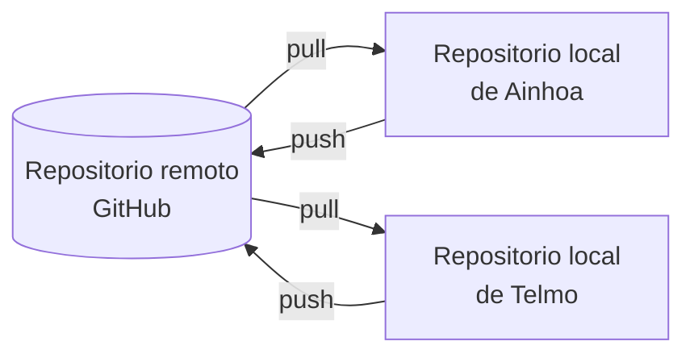

```table-of-contents
```

---

En [[Asignaturas/1DAM_ED/Apuntes/Unidad 04/2. Git\|2. Git]] hemos trabajado con un **repositorio local**. Es decir, todo el historial estaba en nuestro ordenador. Pero el software se desarrolla **en equipo**, y para eso hace falta un repositorio **remoto** que compartan todos los miembros. En este apartado vamos a trabajar con [**GitHub**](https://github.com/), el servicio más usado, aunque [**GitLab**](https://gitlab.com/) o [**Codeberg**](https://codeberg.org/) funcionan de forma muy parecida.

Lo haremos de dos formas: con **comandos** en el terminal, para entender lo que ocurre, y con las herramientas de **control de versiones integradas en el IDE**, que es como se trabaja en el día a día.

## 6.1. Repositorio local y repositorio remoto

Cada miembro del equipo tiene una **copia completa** del repositorio en su ordenador (recordemos que [[Asignaturas/1DAM_ED/Apuntes/Unidad 04/1. Control de versiones - repositorios\|Git es un sistema distribuido]]). El repositorio remoto es el punto de encuentro donde se **suben** y se **descargan** los cambios:



| Comando | Qué hace |
|---|---|
| `git clone <url>` | Descarga una copia completa del repositorio remoto y la conecta con él |
| `git remote -v` | Muestra los remotos configurados. El remoto principal se llama `origin` por convenio |
| `git push` | Sube los *commits* locales al remoto |
| `git fetch` | Descarga los cambios del remoto **sin** aplicarlos a nuestra rama |
| `git pull` | Descarga los cambios y los **fusiona** con nuestra rama (`fetch` + `merge`) |

## 6.2. Conectarse a GitHub

### 6.2.1. Autenticación

GitHub **no admite la contraseña de la cuenta** para trabajar con Git desde el terminal. Hay que usar uno de estos métodos:

- **Desde el IDE**: VS Code, IntelliJ IDEA y NetBeans permiten iniciar sesión en GitHub desde el navegador. Es la opción más sencilla.
- **GitHub CLI**: el comando `gh auth login` configura el acceso de forma guiada.
- **Token de acceso personal** (*Personal Access Token*): se genera en *Settings → Developer settings* de GitHub y se usa en lugar de la contraseña.
- **Claves SSH**: se genera un par de claves con `ssh-keygen` y se añade la pública a la cuenta de GitHub.

### 6.2.2. Subir un repositorio local a GitHub

Si ya tenemos un repositorio local, como el de [[Asignaturas/1DAM_ED/Apuntes/Unidad 04/2. Git\|2. Git]]:

1. En GitHub, crea un repositorio **vacío** (sin `README` ni `.gitignore`, para que no haya conflictos con el local).
2. Conecta el repositorio local con el remoto y sube la rama principal:

   ```bash
   git remote add origin https://github.com/<usuario>/<repositorio>.git
   git push -u origin main
   ```

   La opción `-u` deja **enlazada** la rama local `main` con la remota `origin/main`. A partir de ahí, basta con escribir `git push` y `git pull`.

### 6.2.3. Clonar un repositorio existente

Si el repositorio ya existe en GitHub (por ejemplo, porque lo ha creado un compañero y nos ha invitado como colaboradores en *Settings → Collaborators*):

```bash
git clone https://github.com/<usuario>/<repositorio>.git
```

## 6.3. Flujo de trabajo en equipo

El flujo más extendido para trabajar en equipo con GitHub es el ***GitHub flow***: la rama `main` contiene siempre código que funciona, y **cada cambio se hace en una rama propia** que se integra mediante una *pull request*.

### 6.3.1. Paso a paso

1. **Actualizar `main`** antes de empezar, para partir de la última versión:

   ```bash
   git switch main
   git pull
   ```

2. **Crear una rama** para la tarea, con un nombre que la describa:

   ```bash
   git switch -c feature/reserva-por-horas
   ```

3. **Trabajar y hacer *commits*** pequeños, con mensajes claros (ver [[Asignaturas/1DAM_ED/Apuntes/Unidad 04/2. Git#2.2.4. Registrar en el repositorio\|2.2.4. Registrar en el repositorio]]).
4. **Subir la rama** al remoto:

   ```bash
   git push -u origin feature/reserva-por-horas
   ```

5. **Abrir una *pull request*** (PR) en GitHub: es una petición para fusionar nuestra rama con `main`. GitHub muestra un enlace para crearla al hacer el `push`. En la descripción se explica qué se ha cambiado y por qué, y se puede enlazar la incidencia que resuelve con `Closes #12` (ver [[Asignaturas/1DAM_ED/Apuntes/Unidad 03/12. Documentación e informes#12.2. Documentar las incidencias\|12.2. Documentar las incidencias]]).
6. **Revisión de código** (*code review*): otro miembro del equipo revisa los cambios, comenta líneas concretas y aprueba la PR o pide cambios. Si pide cambios, se hacen nuevos *commits* en la misma rama y la PR se actualiza sola.
7. **Fusionar** (*merge*) la PR en `main` desde GitHub y **borrar la rama**, que ya no hace falta.
8. Todos los miembros **actualizan su `main`** con `git pull`.

> [!TIP] Por qué no trabajar directamente en `main`
> Si todos suben sus cambios directamente a `main`, un error de una persona rompe el programa a todo el equipo. Con ramas y *pull requests*, cada cambio se **revisa** (y, como veremos en [[Asignaturas/1DAM_ED/Apuntes/Unidad 04/7. Integración continua\|7. Integración continua]], se **prueba automáticamente**) antes de llegar a `main`. Muchos equipos **protegen** la rama `main` en GitHub (*Settings → Branches*) para que nadie pueda subir cambios sin una PR aprobada.

### 6.3.2. Cuando el remoto ha cambiado

Si intentamos hacer `push` y un compañero ha subido cambios antes, Git lo **rechaza**:

```
! [rejected]        main -> main (fetch first)
error: failed to push some refs to 'https://github.com/...'
```

Git no deja sobrescribir el trabajo de los demás. La solución es **traer primero** sus cambios con `git pull`, resolver los conflictos si los hay (ver [[Asignaturas/1DAM_ED/Apuntes/Unidad 04/2. Git#Conflictos\|Conflictos]]) y volver a hacer `push`.

### 6.3.3. Contribuir a un proyecto ajeno: *fork*

Si no somos colaboradores de un repositorio (por ejemplo, un proyecto de código abierto), no podemos subir ramas a él. En ese caso:

1. Hacemos un ***fork***: una copia del repositorio en nuestra cuenta de GitHub.
2. Clonamos nuestro *fork*, creamos una rama, hacemos los cambios y los subimos a nuestro *fork*.
3. Abrimos una *pull request* desde nuestro *fork* hacia el repositorio original. Sus responsables decidirán si la aceptan.

## 6.4. Control de versiones integrado en el IDE

Los IDE incluyen herramientas gráficas que ejecutan los comandos de Git por nosotros. Permiten ver de un vistazo qué archivos han cambiado, comparar versiones y resolver conflictos con más comodidad que en el terminal.

| Operación | VS Code | NetBeans | IntelliJ IDEA |
|---|---|---|---|
| Panel de control de versiones | Vista **Control de código fuente** (`Ctrl+Mayús+G`) | Menú ***Team*** y ventana ***Git Repository Browser*** | Ventana ***Commit*** y ventana ***Git*** (`Alt+9`) |
| Clonar | Paleta de comandos → *Git: Clone* | *Team → Git → Clone* | *File → New → Project from Version Control* |
| Añadir al *stage* y hacer *commit* | Botón **+** en cada archivo, mensaje y botón ***Commit*** | Botón derecho → *Git → Commit* | Marcar archivos en la ventana *Commit*, mensaje y ***Commit*** |
| *Push* y *pull* | Botón ***Sincronizar cambios*** o menú `…` → *Push* / *Pull* | *Team → Remote → Push / Pull* | *Git → Push* (`Ctrl+Mayús+K`) / *Git → Pull* |
| Ramas | Nombre de la rama en la barra de estado (abajo a la izquierda) | *Team → Branch/Tag* | Widget de ramas en la barra superior |
| Ver diferencias | Clic en un archivo modificado | Botón derecho → *Git → Diff* | Doble clic en un archivo de la ventana *Commit* |
| Historial | Vista *Línea de tiempo* o extensión *Git Graph* | Botón derecho → *Git → Show History* | Pestaña *Log* de la ventana *Git* |
| Resolver conflictos | Editor de fusión con *Aceptar cambio actual / entrante / ambos* | *Team → Resolve Conflicts* | Diálogo *Merge* con tres paneles |

> [!WARNING] Versiones
> Los nombres de los menús cambian de una versión a otra. Si no encuentras una opción, búscala con el buscador de acciones del IDE (`Ctrl+Mayús+P` en VS Code, `Ctrl+Mayús+A` en IntelliJ).

Además, el editor marca en el **margen** las líneas añadidas, modificadas o borradas desde el último *commit*, y algunos IDE muestran junto a cada línea **quién la escribió y cuándo** (*blame* o *annotate*).

> [!NOTE] El IDE no sustituye a Git
> El IDE solo ejecuta comandos de Git con botones. Por eso es importante saber qué hace cada comando: cuando algo va mal (un conflicto, un `push` rechazado), entender lo que está pasando es lo que permite arreglarlo. En caso de duda, `git status` en el terminal integrado del IDE dice siempre en qué situación está el repositorio.

## 6.5. Otras herramientas de GitHub para el trabajo en equipo

| Herramienta | Para qué sirve |
|---|---|
| ***Issues*** | Registrar incidencias y tareas (ver el apartado [[Asignaturas/1DAM_ED/Apuntes/Unidad 03/12. Documentación e informes#12.2. Documentar las incidencias\|12.2. Documentar las incidencias]] en la unidada 02) |
| ***Projects*** | Tablero Kanban con las *issues* y las PR (ver [[Asignaturas/1DAM_ED/Apuntes/Unidad 01/7. Metodologías ágiles. Scrum y Kanban\|7. Metodologías ágiles. Scrum y Kanban]]) |
| ***Actions*** | Integración continua: compilar y probar el código en cada *push* o PR (ver [[Asignaturas/1DAM_ED/Apuntes/Unidad 04/7. Integración continua\|7. Integración continua]]) |
| **`README.md`** | Página de presentación del repositorio, en Markdown |
| ***Releases*** | Publicar versiones del programa, con sus ejecutables |

> [!EXAMPLE] Para practicar
> En parejas: una persona crea un repositorio en GitHub e invita a la otra como colaboradora. Cada una crea una rama, modifica **la misma línea** de un archivo y abre una *pull request*. Revisad y fusionad la primera; la segunda tendrá un conflicto. Resolvedlo desde el IDE.

---

<p><span>⬅️ <strong>Anterior:</strong> <a data-tooltip-position="top" aria-label="Asignaturas/1DAM_ED/Apuntes/Unidad 04/5. Documentación.md" data-href="Asignaturas/1DAM_ED/Apuntes/Unidad 04/5. Documentación.md" href="Asignaturas/1DAM_ED/Apuntes/Unidad 04/5. Documentación.md" class="internal-link" target="_blank" rel="noopener nofollow">5. Documentación</a> | 🏠 <strong>Unidad:</strong> <a data-tooltip-position="top" aria-label="Asignaturas/1DAM_ED/Unidades/Unidad 04/Unidad 04 - Optimización, control de versiones e integración continua.md" data-href="Asignaturas/1DAM_ED/Unidades/Unidad 04/Unidad 04 - Optimización, control de versiones e integración continua.md" href="Asignaturas/1DAM_ED/Unidades/Unidad 04/Unidad 04 - Optimización, control de versiones e integración continua.md" class="internal-link" target="_blank" rel="noopener nofollow">Unidad 04 - Optimización, control de versiones e integración continua</a> | <strong>Siguiente:</strong> <a data-tooltip-position="top" aria-label="Asignaturas/1DAM_ED/Apuntes/Unidad 04/7. Integración continua.md" data-href="Asignaturas/1DAM_ED/Apuntes/Unidad 04/7. Integración continua.md" href="Asignaturas/1DAM_ED/Apuntes/Unidad 04/7. Integración continua.md" class="internal-link" target="_blank" rel="noopener nofollow">7. Integración continua</a> ➡️</span></p>
