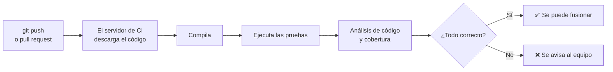

---
{"dg-publish":true,"permalink":"/asignaturas/1-dam-ed/apuntes/unidad-04/7-integracion-continua/","tags":["git","ci"],"dg-note-properties":{"unidad":"[[Asignaturas/1DAM_ED/Unidades/Unidad 04/Unidad 04 - Optimización, control de versiones e integración continua]]","descripcion":"Qué es la integración continua y cómo configurar con GitHub Actions un flujo que compila, prueba y analiza un proyecto Maven en cada push y pull request.","orden":7,"criterios":["RA4.i","RA4.b"],"tags":["git","ci"],"estado":"revisar"}}
---


```table-of-contents
```

---

En el apartado [[Asignaturas/1DAM_ED/Apuntes/Unidad 04/6. Trabajo colaborativo con repositorios remotos\|6. Trabajo colaborativo con repositorios remotos]] hemos visto cómo varias personas integran su trabajo en la rama `main` mediante *pull requests*. Pero ¿cómo sabemos que un cambio no rompe el programa? Revisar el código a ojo no basta: hay que **compilarlo y ejecutar las pruebas**. Si cada persona tiene que acordarse de hacerlo, tarde o temprano alguien lo olvidará.

La **integración continua** (*Continuous Integration*, **CI**) es la práctica de integrar los cambios en el repositorio común **con frecuencia** (varias veces al día) y de **comprobar automáticamente** cada integración: un servidor descarga el código, lo compila y ejecuta las pruebas cada vez que alguien sube un cambio. Si algo falla, el equipo se entera en minutos, cuando el error todavía es pequeño y es fácil saber qué cambio lo ha provocado.

> [!NOTE] CI y CD
> En [[Asignaturas/1DAM_ED/Apuntes/Unidad 02/6. Otras herramientas#6.1.3. Integración y Entrega Continua (CI/CD)\|6.1.3. Integración y Entrega Continua (CI/CD)]] (Unidad 02) vimos que la integración continua suele ir acompañada de la **entrega continua** (*Continuous Delivery*, CD), que prepara automáticamente el programa para publicarlo. En este apartado nos centramos en la **CI**.

## 7.1. Cómo funciona



A esta secuencia de pasos automáticos se le llama ***pipeline*** (o *workflow*). Se describe en un **archivo de configuración** que se guarda **en el propio repositorio**, junto al código, así que también queda bajo control de versiones.

Hay muchas herramientas de CI: [GitHub Actions](https://docs.github.com/es/actions), [GitLab CI/CD](https://docs.gitlab.com/ee/ci/), [Jenkins](https://www.jenkins.io/)… Todas siguen la misma idea. Usaremos **GitHub Actions**, porque está integrada en GitHub y es gratuita para repositorios públicos.

## 7.2. Conceptos de GitHub Actions

| Concepto | Qué es |
|---|---|
| ***Workflow*** | El *pipeline* completo. Es un archivo YAML en la carpeta `.github/workflows/` del repositorio |
| **Evento** (`on`) | Lo que pone en marcha el *workflow*: un `push`, una `pull_request`, una hora programada… |
| ***Job*** | Un conjunto de pasos que se ejecutan en la misma máquina |
| ***Runner*** (`runs-on`) | La máquina virtual en la que se ejecuta el *job* (Ubuntu, Windows o macOS), que proporciona GitHub |
| ***Step*** | Cada paso del *job*: un comando (`run`) o una acción ya hecha (`uses`) |
| **Acción** (`uses`) | Un paso reutilizable publicado por otros, como `actions/checkout` (descargar el código) o `actions/setup-java` (instalar el JDK) |

> [!WARNING] YAML y la sangría
> En YAML, la **sangría** (con espacios, nunca con tabuladores) indica qué elemento pertenece a cuál. Un espacio de más o de menos hace que el *workflow* no funcione. VS Code e IntelliJ marcan estos errores si se instala la extensión de GitHub Actions.

## 7.3. Paso a paso: CI para un proyecto Maven

Vamos a añadir integración continua a un proyecto Java con Maven y pruebas JUnit, como los de la [[Asignaturas/1DAM_ED/Unidades/Unidad 03/Unidad 03 - Pruebas y depuración\|Unidad 03]], alojado en GitHub.

### 7.3.1. Paso 1: comprobar que funciona en local

El servidor de CI va a hacer lo mismo que podemos hacer nosotros en el terminal. Antes de nada, comprueba que el proyecto compila y pasa las pruebas:

```bash
mvn -B verify
```

`verify` recorre las fases de Maven hasta la verificación: compila, ejecuta las pruebas, empaqueta el `.jar` y hace las comprobaciones configuradas. La opción `-B` (*batch mode*) evita mensajes interactivos, como en un servidor.

### 7.3.2. Paso 2: crear el workflow

Crea el archivo `.github/workflows/ci.yml` en la raíz del repositorio:

```yaml
name: CI

# Cuándo se ejecuta: en cada push a main y en cada pull request hacia main
on:
  push:
    branches: [ "main" ]
  pull_request:
    branches: [ "main" ]

jobs:
  build:
    runs-on: ubuntu-latest            # máquina virtual Linux de GitHub

    steps:
      - name: Descargar el código
        uses: actions/checkout@v4

      - name: Instalar el JDK 21
        uses: actions/setup-java@v4
        with:
          distribution: temurin
          java-version: "21"
          cache: maven                # reutiliza las dependencias descargadas

      - name: Compilar y ejecutar las pruebas
        run: mvn -B verify
```

Cada paso hace en la máquina virtual lo mismo que haríamos en un ordenador recién instalado: descargar el código, instalar el JDK y ejecutar Maven.

> [!TIP] Usa la misma versión de Java
> La `java-version` del *workflow* debe coincidir con la del `pom.xml` (`maven.compiler.release`). Si no, el proyecto puede compilar en tu equipo y fallar en el servidor, o al revés.

### 7.3.3. Paso 3: subirlo y ver el resultado

```bash
git add .github/workflows/ci.yml
git commit -m "Añade integración continua con GitHub Actions"
git push
```

En la pestaña ***Actions*** del repositorio aparece la ejecución. Al entrar en ella se ve cada paso con su salida, igual que en el terminal. Si todo va bien, aparece una marca verde ✅ junto al *commit*; si falla, una cruz roja ❌, y GitHub envía un correo a quien hizo el `push`.

### 7.3.4. Paso 4: provocar un fallo

Para comprobar que la CI sirve para algo, **rompe una prueba a propósito** en una rama nueva y abre una *pull request*:

1. Crea una rama y cambia el código para que una prueba falle.
2. Sube la rama y abre la PR.
3. En la PR, GitHub muestra el resultado de la CI. Al entrar en el detalle, el registro de Maven indica **qué prueba ha fallado y por qué**, igual que en el IDE.
4. Corrige el error, haz otro *commit* y súbelo: la CI se vuelve a ejecutar sola y la marca pasa a verde.

> [!TIP] Proteger `main`
> En *Settings → Branches* (o *Rules*) se puede exigir que la CI pase antes de fusionar una PR. Así, ningún cambio que rompa la compilación o las pruebas puede llegar a `main`.

## 7.4. Ampliar el pipeline

Una vez funciona lo básico, el *pipeline* se puede ampliar con más comprobaciones:

| Comprobación | Cómo | Relación con la unidad |
|---|---|---|
| **Cobertura de código** | Añadir el *plugin* JaCoCo al `pom.xml`: `mvn verify` genera el informe | [[Asignaturas/1DAM_ED/Apuntes/Unidad 03/12. Documentación e informes\|12. Documentación e informes]] (Unidad 03) |
| **Análisis estático** | Ejecutar un analizador (Checkstyle, PMD, SpotBugs, SonarQube Cloud) y hacer fallar el *pipeline* si encuentra problemas graves | [[Asignaturas/1DAM_ED/Apuntes/Unidad 04/4. Optimización - Análisis estático y deuda técnica\|4. Optimización - Análisis estático y deuda técnica]] |
| **Documentación** | Generar el Javadoc con `mvn javadoc:javadoc` y publicarlo | [[Asignaturas/1DAM_ED/Apuntes/Unidad 04/5. Documentación\|5. Documentación]] |
| **Guardar el ejecutable** | Subir el `.jar` como artefacto con la acción `actions/upload-artifact` | [[Asignaturas/1DAM_ED/Apuntes/Unidad 02/7. Entornos de desarrollo en la práctica\|7. Entornos de desarrollo en la práctica]] (Unidad 02) |
| **Varias versiones o sistemas** | Usar una matriz (`strategy.matrix`) para probar con varias versiones de Java o en Windows y Linux | |

> [!NOTE] Integración continua y refactorización
> La integración continua es la red de seguridad de la [[Asignaturas/1DAM_ED/Apuntes/Unidad 04/3. Refactorización\|refactorización]]: si cada cambio en el diseño se comprueba automáticamente con las pruebas, se puede refactorizar con la confianza de que el comportamiento no ha cambiado.

## 7.5. Buenas prácticas

- **Integra a menudo**: ramas cortas y PR pequeñas. Cuanto más tiempo pasa una rama separada de `main`, más conflictos y errores acumula.
- **Arregla la CI rota de inmediato**: si `main` está en rojo, arreglarla es la prioridad del equipo. Si se acostumbra a convivir con fallos, nadie se fía de la CI.
- **Mantén el *pipeline* rápido**: si tarda mucho, el equipo deja de esperar al resultado.
- **No guardes contraseñas en el *workflow***: GitHub tiene ***secrets*** (*Settings → Secrets and variables → Actions*) para guardar claves y usarlas en el *pipeline* sin que se vean en el código.

> [!EXAMPLE] Para practicar
> Añade el *workflow* de este apartado al repositorio de prácticas de la [[Asignaturas/1DAM_ED/Unidades/Unidad 03/Unidad 03 - Pruebas y depuración\|Unidad 03]] y amplíalo para que genere el informe de cobertura de JaCoCo y lo guarde como artefacto.

---

<p><span>⬅️ <strong>Anterior:</strong> <a data-tooltip-position="top" aria-label="Asignaturas/1DAM_ED/Apuntes/Unidad 04/6. Trabajo colaborativo con repositorios remotos.md" data-href="Asignaturas/1DAM_ED/Apuntes/Unidad 04/6. Trabajo colaborativo con repositorios remotos.md" href="Asignaturas/1DAM_ED/Apuntes/Unidad 04/6. Trabajo colaborativo con repositorios remotos.md" class="internal-link" target="_blank" rel="noopener nofollow">6. Trabajo colaborativo con repositorios remotos</a> | 🏠 <strong>Unidad:</strong> <a data-tooltip-position="top" aria-label="Asignaturas/1DAM_ED/Unidades/Unidad 04/Unidad 04 - Optimización, control de versiones e integración continua.md" data-href="Asignaturas/1DAM_ED/Unidades/Unidad 04/Unidad 04 - Optimización, control de versiones e integración continua.md" href="Asignaturas/1DAM_ED/Unidades/Unidad 04/Unidad 04 - Optimización, control de versiones e integración continua.md" class="internal-link" target="_blank" rel="noopener nofollow">Unidad 04 - Optimización, control de versiones e integración continua</a> | <strong>Siguiente:</strong> <a data-tooltip-position="top" aria-label="Asignaturas/1DAM_ED/Apuntes/Unidad 04/Anexos.md" data-href="Asignaturas/1DAM_ED/Apuntes/Unidad 04/Anexos.md" href="Asignaturas/1DAM_ED/Apuntes/Unidad 04/Anexos.md" class="internal-link" target="_blank" rel="noopener nofollow">Anexos</a> ➡️</span></p>
