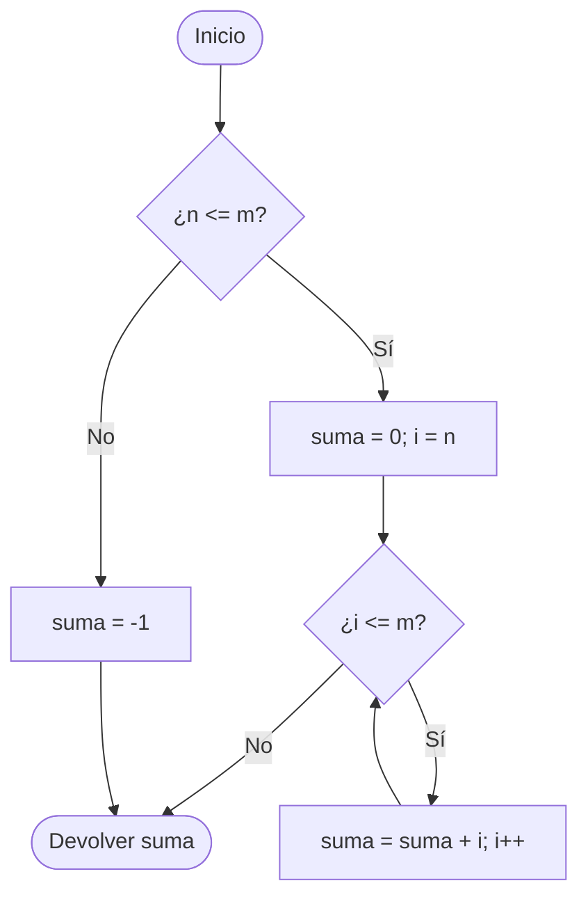

---
{"dg-publish":true,"dg-permalink":"/apuntes/1-dam-programacion/unidad-02/1-la-programacion-estructurada/","permalink":"/apuntes/1-dam-programacion/unidad-02/1-la-programacion-estructurada/","dg-note-properties":{"unidad":"[[Asignaturas/1DAM_Programación/Unidades/Unidad 02/Unidad 02 - Estructuras de control. Calidad del software]]","modulo":"[[Módulos/Programación]]","libro":"[[Libros/Programación (1º DAM, 1º DAW)]]"}}
---


```table-of-contents
maxLevel: 3
```

---

[[Asignaturas/1DAM_Programación/Unidades/Unidad 02/Unidad 02 - Estructuras de control. Calidad del software#Datos de la unidad\|Unidad 02 - Estructuras de control. Calidad del software#Datos de la unidad]]

---

# 1. La programación estructurada

El término **programación estructurada** se refiere a un conjunto de técnicas que han ido evolucionando desde los primeros trabajos del holandés E. Dijkstra[^1]. Estas técnicas aumentan la productividad del programador, reduciendo el tiempo requerido para escribir, verificar, depurar y mantener los programas. 

Allá por mayo de 1966, Böhm y Jacopini[^2] demostraron que se puede escribir cualquier ***programa propio*** utilizando solo **tres tipos de estructuras de control**: la secuencial, la selectiva (o condicional) y la repetitiva. A esto se le llama *Teorema de la programación estructurada*, y define un *programa propio* como un programa que cumple tres características: 

* *Posee un sólo punto de inicio y un sólo punto de fin* 
* *Existe al menos un camino que parte del inicio y llega hasta el fin pasando por todas las partes del programa* 
* *No existen bucles infinitos* 

Realmente, el trabajo de Dijkstra basado en este teorema fue revolucionario, porque lo que venía a decir es que, para construir programas más potentes y en menos tiempo, lo que había que hacer era simplificar las herramientas que se utilizaban para hacerlos, en lugar de complicarlas más. Este regreso a la simplicidad, unido a las técnicas de ingeniería del software, ayudó a superar la llamada *crisis del software*, término acuñado a finales de los años 60. 

Por lo tanto, **los programas estructurados deben limitarse a usar tres estructuras**:

* **Secuencial**
* **Selectiva (o condicional)**
* **Repetitiva**

La programación orientada a objetos, como vimos en [[Asignaturas/1DAM_Programación/Apuntes/Unidad 01/4. Estilos y Paradigmas\|la Unidad 01]], es una evolución de la programación estructurada clásica en la que los algoritmos y los datos se encapsulan en clases que más tarde se instancia en objetos que interactúan entre sí. Pero lo que hay dentro de esos algoritmos siguen siendo programas estructurados. Es decir, la POO es un superconjunto de la programación estructurada clásica, y por eso es pertinente que, en este punto estudiemos esas estructuras detenidamente.


[^1]: Dijkstra, pese a ser físico, se convirtió en uno de los más importantes científicos de la computación hasta su muerte en 2002. Una de sus frases más famosas es: "la pregunta de si un computador puede pensar no es más interesante que la pregunta de si un submarino puede nadar"

[^2]: Böhm, C. y Jacopini, G. (1966). Flow diagrams, Turing machines and languages with only two formation rules. *Communications of the ACM, 9*(5), 366-371. https://doi.org/10.1145/355592.365646


# 2. Estructura secuencial

La estructura secuencial es aquélla en la que **una acción sigue a otra** (en secuencia). Esta es la estructura algorítmica básica, en la que las instrucciones se ejecutan una tras otra, en el mismo orden en el que fueron escritas.

La estructura secuencial, por lo tanto, es la más simple de las tres estructuras permitidas. A continuación vemos su representación mediante diagrama de flujo y Java:

```java
{ 
    acción 1 
    acción 2 
    ...  
    acción N 
}
```


> Estructura secuencial. Las instrucciones se ejecutan en un orden y una no comienza hasta que la anterior haya terminado.

<iframe src="https://docs.google.com/presentation/d/e/2PACX-1vSWD6B5TX_rV2VFfSLDy1GabxTpElz9lbKycflgrfTtPJ-Vt6Xr3UiMFLfxnZ6E70GuQzSTl7UhaVgL/pubembed?start=true&loop=true&delayms=3000" frameborder="0" width="100%" height="569" allowfullscreen="true" mozallowfullscreen="true" webkitallowfullscreen="true"></iframe>

> [!example] Ejemplo
> Vamos a escribir un algoritmo completamente secuencial que calcule la suma de dos números, a y b.

```java
// Algoritmo suma 
{
    int a, b, suma; 
    a = Integer.parseInt(
        System.console().readLine()
    );

    b = Integer.parseInt( 
       System.console().readLine()
    );
    suma = a + b; 
    System.out.println(suma); 
}
```

Lo que hace este algoritmo es:
1. Leer `a` y `b`
2. Sumar ambos.
3. Escribir por pantalla la suma resultante.

# 3. Estructura selectiva (condicional)

Los algoritmos que usan únicamente estructuras secuenciales están muy limitados y no tienen ninguna utilidad real. Esa utilidad aparece cuando existe la posibilidad de **ejecutar una de entre varias** secuencias de instrucciones dependiendo de alguna condición asociada a los datos del programa. 

Las estructuras selectivas pueden ser de tres tipos: 

* *simples* 
* *dobles*
* *múltiples* 

## 3.1. Condicional simple

La estructura condicional **simple** se escribe así:

```java
if (condición) {
    acciones
}
```


> Estructura condicional simple

<iframe src="https://docs.google.com/presentation/d/e/2PACX-1vShs9hNZNKTaYzBg3e3ZGSPwrxylHBQM8IFrsfTcAI17tnNcWJO6hvA_kgcPuKeXm18My9bBzjk84O2/pubembed?start=true&loop=true&delayms=3000" frameborder="0" width="100%" height="569" allowfullscreen="true" mozallowfullscreen="true" webkitallowfullscreen="true"></iframe>

La condición que aparece detrás de "if" es siempre una **expresión lógica**, es decir, una expresión cuyo resultado es "verdadero" o "falso". Si el resultado es verdadero, entonces se ejecutan las acciones situadas entre { y }. Si es falso, se saltan las acciones y se prosigue por la siguiente instrucción (lo que haya debajo de la llave de cierre)

### Ejemplo 1
Hagamos un código que indique si un **número es positivo**, **negativo** o **cero** usando instrucciones condicionales simples:
```java
{   
    int numero;   
    System.out.println("Introduce un número:");
    ednumeroad = Integer.parseInt(System.console.readLine());

    if (numero > 0) {
        System.out.println("El número es positivo");
    }

    if (numero < 0) {
        System.out.println("El número es negativo");
    }
    
    if (numero == 0) {
        System.out.println("El número es cero");
    }    
}
```

Al introducir el número por teclado, la primera instrucción condicional `if (numero > 0)` comprueba si es positivo y, en tal caso, lo indica por pantalla. La siguiente condicional simple `if (numero < 0)` indica en cambio si es negativo. Y la última `if (numero == 0)` dice si es `0`. 

De esta forma **el programa muestra uno y sólo uno de los tres mensajes** según sea el valor introducidos.


### Ejemplo 2
Este código indica si una persona es mayor de edad:
```java
{   
    int edad;   
    System.out.println("Introduce tu edad:");
    edad = Integer.parseInt(System.console.readLine());

    if (edad >= 18) {
        System.out.println("Eres mayor de edad");
    }

    if (edad < 18) {   
        System.out.println("Eres menor de edad");   
    }   
}
```
Al introducir la edad, la primera instrucción condicional `if (edad >= 18)` comprueba que si la edad es o supera los 18 años. Si es así, ejecuta su bloque de código (las instrucciones que hay entre las llaves `{` y `}`) que en este caso muestra el mensaje `Eres mayor de edad`. Justo después vemos otra condicional `if (edad <= 18)` que evalúa si es menor de edad, en cuyo caso se imprimirá en la pantalla el mensaje pertinente.


### Ejemplo 3
El siguiente código calcula el área y el perímetro de un rectángulo usando un condicional simple:
```java
{  
    double base, altura, área, perimetro;
    base = Integer.parseInt(System.console.readLine());
    altura = Integer.parseInt(System.console.readLine());
    if ((area > 0) && (altura > 0)) {
        area = base * altura;
        perimetro = 2 * base + 2 * altura;
        System.out.println("Area = " + area);
        System.out.println("Perimetro = " + perimetro);
    }

    if ((area <= 0) || (altura <= 0)) {
        System.out.println("Los datos son incorrectos");
    }
}
```

Observa que, en la primera instrucción condicional `if ((área > 0) && (altura > 0))` se comprueba que los dos datos sean positivos; en caso de serlo, se procede al cálculo del área y el perímetro mediante las acciones situadas entre { y }. Más abajo hay otra condicional `if ((área <= 0) || (altura <=0))` para el caso de que alguno de los datos sea negativo o cero: en esta ocasión, se imprime en la pantalla un mensaje de error.

## 3.2. Condicional doble

La **forma doble** de la instrucción condicional es:

```java
if (condicion) {
    acciones01 
}
else {
    acciones02
}
```


> Estructura condicional doble

<iframe src="https://docs.google.com/presentation/d/e/2PACX-1vT6LIU-Dqx9yAOm93zEaaQirCxH2RIzsegQuf2vUGNw7EnHjDub-FelT4n7QIViGGIh6CY6VxeJkdaa/pubembed?start=true&loop=true&delayms=3000" frameborder="0" width="100%" height="569" allowfullscreen="true" mozallowfullscreen="true" webkitallowfullscreen="true"></iframe>

En esta forma, la instrucción funciona del siguiente modo: si el resultado de la **`condición`** es **verdadero**, entonces se ejecutan las acciones de la primera parte, es decir, las **`acciones01`**. Si es **falso**, se ejecutan las acciones de la parte `else`, es decir, las **`acciones02`**. 


### Ejemplos  
Podemos reescribir algunos de los programas anteriores usando una alternativa doble:

```java
{
    int edad;   
    System.out.println("Introduce tu edad:");
    edad = Integer.parseInt(System.console.readLine());

    if (edad >= 18) {
        System.out.println("Eres mayor de edad");
    }
    else {   
        System.out.println("Eres menor de edad");   
    }
}
```

```java
{
    double base, altura, area, perimetro;  
    base = Integer.parseInt(System.console.readLine());  
    altura = Integer.parseInt(System.console.readLine());

    if ((area > 0) && (altura > 0)) {  
        area = base * altura;  
        perimetro = 2 * base + 2 * altura;  
        System.out.println("Area = " + area);  
        System.out.println("Perimetro = " + perimetro);  
    }  
    else {  
        System.out.println("Los datos son incorrectos");  
    }
}
```

Lo más interesante de estos algoritmos es compararlos con sus versiones anteriores, ya que **hacen exactamente lo mismo**. ¡Siempre hay varias maneras de resolver el mismo problema! Pero esta solución es un poco más sencilla, **al ahorrarse la segunda condición**, que va implícita en el **`else`**. 


## 3.3. Condicional múltiple

En algunas ocasiones nos encontraremos con **selecciones en las que hay más de dos alternativas** (es decir, en las que no basta con los valores "verdadero" y "falso"). Siempre es posible plasmar estas selecciones complejas usando varias estructuras if-else if-else if-else if... anidadas, es decir, unas dentro de otras, pero, cuando el número de alternativas es grande, esta solución puede plantear grandes problemas de escritura y legibilidad del algoritmo. 

Sin embargo, hay que dejar clara una cosa: cualquier instrucción condicional múltiple puede ser sustituida por un conjunto de instrucciones condicionales simples y dobles totalmente equivalentes. 

La **estructura condicional múltiple** sirve, por tanto, para simplificar estos casos de condiciones con muchas alternativas. Su sintaxis general es:

```java
switch (expresión) { 
  valor1:
      acciones01;
      break;
  valor2: 
      acciones02;
      break;
  valor3:
      acciones03;
      break;
  ...
  valorN: accionesN; break; 
  default: acciones-default;
}
```

> [!info] Importante 
> Fíjate en la instrucción **`break`**. Se utiliza para indicar que una vez realizadas las acciones de un `case`concreto, debe salir del `switch`.
> 
> Tanto `break` como otras instrucciones de salto se verán en el apartado [[Asignaturas/1DAM_Programación/Apuntes/Unidad 02/5. Instrucciones de salto\|5. Instrucciones de salto]]


> Estructura condicional múltiple

<iframe src="https://docs.google.com/presentation/d/e/2PACX-1vT6jREoInqzH1jhoPqU0YZlDZKSqvxClC5Spiio1XaTV5TcMfIU_glZkGxldq9WoSSF1hk7Tzne-_9V/pubembed?start=true&loop=true&delayms=3000" frameborder="0" width="100%" height="569" allowfullscreen="true" mozallowfullscreen="true" webkitallowfullscreen="true"></iframe>

Su funcionamiento es el siguiente: se evalúa **expresión**, que en esta ocasión no tiene que ser de tipo lógico, sino que puede ser entero, carácter, etc[^1]. El resultado de **expresión** se compara con cada uno de los valores **valor1, valor2... valorN**. Si coincide con alguno de ellas, se ejecutan únicamente las acciones situadas a la derecha del valor coincidente (**acciones01, acciones02... accionesN**). Si se diera el caso de que ningún valor fuera coincidente, entonces se ejecutan las **acciones-default** ubicadas al final de la estructura. Esta última parte de la estructura no es obligatorio que aparezca. 

> [!example] Ejemplo 1
> Construyamos un algoritmo que escriba los nombres de los días de la semana en función del valor de una variable entera llamada "día". Su valor se introducirá por teclado. Los valores posibles de la variable "día" serán del 1 al 7: cualquier otro valor debe producir un error.
```java
int dia = 3;
switch (dia) {
    case 1:
        System.out.println("lunes");
        break;
    case 2:
        System.out.println("martes");
        break;
    case 3:
        System.out.println("miércoles");
        break;
    case 4:
        System.out.println("jueves");
        break;
    case 5:
        System.out.println("viernes");
        break;
    case 6:
        System.out.println("sábado");
        break;
    case 7:
        System.out.println("domingo");
        break;
    default:
        System.out.println("El número no es correcto");
}
```


En este programa, la variable **`dia`**, una vez leída, se compara con los siete valores posibles. Si vale 1, se realizará la acción **`System.out.println("lunes");`** si vale 2, se realiza **`System.out.println("martes");`** y así sucesivamente. Por último, si no coincide con ninguno de los siete valores, se ejecuta la parte **`default`**.

En esta caso, mostrará `miércoles`.

¿Y si por despiste olvidamos algún `break`? En tal caso, podemos tener una situación como la siguiente:

```java
int dia = 3;
switch (dia) {
    case 1:
        System.out.println("lunes");
        break;
    case 2:
        System.out.println("martes");
        break;
    case 3:
        System.out.println("miércoles");
        // break; // Supongamos que lo hemos olvidado.
    case 4:
        System.out.println("jueves");
        // break; // Supongamos que lo hemos olvidado.
    case 5:
        System.out.println("viernes");
        break;
    case 6:
        System.out.println("sábado");
        break;
    case 7:
        System.out.println("domingo");
        break;
    default:
        System.out.println("El número no es correcto");
}
```

El código de arriba mostraría lo siguiente por consola:

```
miércoles
jueves
viernes
```

Esto se debe a que va pasando por los distintos `case` hasta que encuentra el suyo (`case 3`), ejecuta ese bloque de código (muestra `miércoles`) pero como **no hay una instrucción `break`** que le indique que debe salir del `switch` y como **el valor ya ha sido evaluado en `case 3`**, dicho valor no se va a volver a evaluar en los demás `case`. Así que pasa al siguiente (`case 4`) y como `dia` ya ha sido evaluado antes, directamente entra a ejecutar el bloque de código de dicho `case`, mostrando `jueves` por consola. Y repite el proceso hasta que se encuentre con un `break` que le diga "sal de este switch" o, si no encuentras ningún `break` en su camino, hasta que ejecute todas las instrucciones posteriores.

Por eso plantearon otra forma de escribir el `switch` y evitar así estos problemas:

```java
switch (expresión) { 
  valor1 -> {
      acciones01;
  }
  valor2 -> {
      acciones02;
  }
  valor3 -> {
      acciones03;
  }
  ...
  valorN -> {
      accionesN;
  }
  default -> {
      acciones_default;
  }
}
```

> [!note] Nota 
> En este último caso, las llaves no son necesarias si el case abarca una única instrucción.
> 
> Nótese también que aquí **no es necesaria usar la instrucción de salto `break`**.

> [!question] ¿Cómo lo harías? 🤔
> ¿Cómo se podría resolver el mismo problema sin recurrir a la alternativa múltiple, es decir, **utilizando sólo alternativas simples y dobles**

`switch` admite la ejecución de un mismo bloque de código para distintos valores. Por ejemplo, si para el ejemplo anterior quisiéramos saber si el día es laborable (de lunes a viernes) :

```java
{
    {
        int dia;
        dia = Integer.parseInt(System.console.readLine());
        
        switch(dia) {
            case 1, 2, 3, 4, 5:
                System.out.println("Es laborable");
                break;    
            case 6, 7:
                System.out.println("Fin de semana! No es laborable");
                break;
            default:
                System.out.println("Día incorrecto");
        }
    }
}
```

O su equivalente:

```java
{
    {
        int dia;
        dia = Integer.parseInt(System.console.readLine());
        
        switch(dia) {
            case 1:
            case 2:
            case 3:
            case 4:
            case 5:
                System.out.println("Es laborable");
                break;    
            case 6:
            case 7:
                System.out.println("Fin de semana! No es laborable");
                break;
            default:
                System.out.println("Día incorrecto");
        }
    }
}
```

Aunque el más correcto (y elegante) sería:

```java
{
    {
        int dia;
        dia = Integer.parseInt(System.console.readLine());
        
        switch(dia) {
            case 1, 2, 3, 4, 5 -> System.out.println("Es laborable");
            case 6, 7 -> System.out.println("Fin de semana! No es laborable");
            default -> System.out.println("Día incorrecto");
        }
    }
}
```

Como podemos ver en el código anterior, el `dia` se evalúa en una sola línea (`case 1, 2, 3, 4, 5:`) para comprobar si es uno de esos valores (de lunes a viernes). Si coincide con alguno, indicará que "_Es laborable_".

En el siguiente caso ocurre lo mismo para los días del fin de semana (`case 6, 7:`). Si fuera uno de ellos, mostrará por consola que"_Fin de semana! No es laborable_".

En cualquier otro caso, indicará que el día no es correcto.

> [!example] Material de apoyo 
> * [[Asignaturas/1DAM_Programación/Apuntes/Unidad 02/Referencias#Condiciones en pseudocódigo SI - IF\|Asignaturas/1DAM_Programación/Apuntes/Unidad 02/Referencias#Condiciones en pseudocódigo SI - IF]]


[^1]: Sin embargo, no suele admitirse una expresión de tipo real por motivos en los que ahora no nos vamos a detener. Lo más habitual es que sea de tipo entero.


# 4. Estructura repetitiva (bucles)

Los ordenadores se diseñaron inicialmente para **realizar tareas sencillas y repetitivas**. El ser humano es de lo más torpe acometiendo tareas repetitivas: pronto le falla la concentración y comienza a tener descuidos. Los ordenadores programables, en cambio, pueden realizar la misma tarea muchas veces por segundo durante años y nunca se aburren (o, al menos, hasta hoy no se ha tenido constancia de ello) 

La **estructura repetitiva**, por tanto, reside en la naturaleza misma de los ordenadores y consiste, simplemente, en **repetir varias veces un conjunto de instrucciones**. Las estructuras repetitivas también se llaman **bucles, lazos o iteraciones**. Nosotros preferiremos la denominación "bucle". 

Los bucles tienen que repetir un conjunto de instrucciones **un número finito de veces**. Si no, nos encontraremos con un **bucle infinito** y el algoritmo no funcionará. En rigor, ni siquiera será un algoritmo, ya que no cumplirá la condición de finitud. 

El **bucle infinito** es un peligro que acecha constantemente a los programadores y nos toparemos con él muchas veces a lo largo de este curso. Para conseguir que el bucle se repita sólo un número finito de veces, tiene que existir una **condición de salida** del mismo, es decir, una situación en la que ya no sea necesario seguir repitiendo las instrucciones. 

Por tanto, los bucles se componen, básicamente, de dos elementos:

* *un **cuerpo del bucle** o conjunto de instrucciones que se ejecutan repetidamente*

* *una **condición de salida** para dejar de repetir las instrucciones y continuar con el resto del algoritmo* 

Dependiendo de dónde se coloque la condición de salida (al principio o al final del conjunto de instrucciones repetidas), y de la forma de realizarla, existen tres tipos de bucles, aunque hay que resaltar que, con el primer tipo, se puede programar cualquier estructura iterativa. Pero con los otros dos, a veces el programa resulta más claro y legible. Los tres tipos de bucle se denominan: 

* ***Bucle "mientras... hacer"**: la condición de salida está al principio del bucle.* 

* ***Bucle "hacer... mientras"**: la condición de salida está al final del bucle.* 

* ***Bucle "para"**: la condición de salida está al principio y se realiza con un contador automático.*

## 4.1. Bucle "mientras... hacer" (WHILE)

El bucle "mientras... hacer" o, simplemente, "mientras", es una estructura que se repite **mientras una condición sea verdadera**. La condición, en forma de expresión lógica, se escribe en la cabecera del bucle, y a continuación aparecen las acciones que se repiten (cuerpo del bucle):

```java
while (condición) { 
    acciones (cuerpo del bucle) 
}
```


> Estructura repetitiva "Mientras... hacer" o while

<iframe src="https://docs.google.com/presentation/d/e/2PACX-1vQpWzCkbP8ETX3q2fo8Zr6MS3hs1GuzwPorDG37ksIcwqF-IxdkbRa3UAJ1jtcxc4OwNJbN8aynFUtI/pubembed?start=true&loop=true&delayms=3000" frameborder="0" width="100%" height="569" allowfullscreen="true" mozallowfullscreen="true" webkitallowfullscreen="true"></iframe>

Cuando se llega a una instrucción **mientras**, se evalúa la condición. Si es verdadera, se realizan las acciones y, al terminar el bloque de acciones, se regresa a la instrucción **mientras** (he aquí el bucle o lazo). Se vuelve a evaluar la condición y, si sigue siendo verdadera, vuelve a repetirse el bloque de acciones. Y así, sin parar, hasta que la condición se haga falsa. 

### Ejemplo
Escribir un algoritmo que muestre en la pantalla todos los números enteros entre 1 y 100:
```java
{   
    int cont = 0;   
    while (cont < 100) {
        cont = cont + 1;  
        System.out.println(cont);   
    }    
}
```
Aquí observamos el uso de ** un contador (`cont`) en la condición de salida** de un bucle, un elemento muy común en estas estructuras. Observa la evolución del algoritmo: 
* **`int cont = 0`**. Se declara y se le asigna el valor 0 a la variable **`cont`** (contador) 
* **`while (cont <= 100)`**. Condición de salida del bucle. Es verdadera porque **`cont`** vale 0, y por lo tanto es menor o igual que 100. 
* **`cont = cont + 1`**. Se incrementa el valor de **`cont`** en una unidad. Como valía 0, ahora vale 1.
* **`println(cont)`**. Se escribe por pantalla el valor de **`cont`**, que será 1. 

Después, el flujo del programa regresa a la instrucción **mientras**, ya que estamos en un bucle, y se vuelve a evaluar la condición. Ahora **`cont`** vale 1, luego sigue siendo verdadera. Se repiten las instrucciones del bucle, y **`cont`** se incrementa de nuevo, pasando a valer 2. Luego valdrá 3, luego 4, y así sucesivamente. 

La condición de salida del bucle hace que éste se repita mientras **`cont`** valga menos de 100. De este modo nos aseguramos de escribir todos los números hasta el 100. 

Lo más problemático a la hora de diseñar un bucle es, por lo tanto, **pensar bien su condición de salida**, porque si la condición de salida nunca se hiciera falsa, caeríamos en un bucle infinito. Por lo tanto, **la variable implicada en la condición de salida debe sufrir alguna modificación en el interior del bucle**; si no, la condición siempre sería verdadera. En nuestro ejemplo, la variable **`cont`** se modifica en el interior del bucle: por eso llega un momento, después de 100 repeticiones, en el que la condición se hace falsa y el bucle termina. 

> [!example] Material de apoyo 
> 
<div class="transclusion internal-embed is-loaded"><a class="markdown-embed-link" href="/apuntes/1-dam-programacion/unidad-02/referencias/#tipos-de-bucles-en-pseudocodigo-mientras-while" aria-label="Open link"><svg xmlns="http://www.w3.org/2000/svg" width="24" height="24" viewBox="0 0 24 24" fill="none" stroke="currentColor" stroke-width="2" stroke-linecap="round" stroke-linejoin="round" class="svg-icon lucide-link"><path d="M10 13a5 5 0 0 0 7.54.54l3-3a5 5 0 0 0-7.07-7.07l-1.72 1.71"></path><path d="M14 11a5 5 0 0 0-7.54-.54l-3 3a5 5 0 0 0 7.07 7.07l1.71-1.71"></path></svg></a><div class="markdown-embed">


## Tipos de bucles en pseudocódigo (MIENTRAS - WHILE)

<iframe width="560" height="315" src="https://www.youtube.com/embed/gWYWRs9d_ZI?si=5FlWF54S-e3EyKAO" title="YouTube video player" frameborder="0" allow="accelerometer; autoplay; clipboard-write; encrypted-media; gyroscope; picture-in-picture; web-share" referrerpolicy="strict-origin-when-cross-origin" allowfullscreen></iframe>

> Aula en la nube. (3 de octubre de 2021). _1.8 Tipos de bucles en pseudocódigo (MIENTRAS - WHILE)_ [Vídeo]. YouTube. https://youtu.be/gWYWRs9d_ZI?si=0LrZKFKynyP-o0Er


</div></div>


## 4.2. Bucle "Hacer... mientras" (DO-WHILE)

El bucle de tipo "Hacer... mientras" es muy similar al bucle "mientras", con la salvedad de que **la condición de salida se evalúa al final del bucle**, y no al principio, como a continuación veremos. Todo bucle "Hacer... mientras" puede escribirse como un bucle "mientras", pero al revés no siempre sucede.  

La forma de la estructura "hacer... mientras" es la que sigue:

```java
do {
    acciones (cuerpo del bucle)
}  while (condicion);
```


> Estructura repetitiva "Hacer... mientras" o **`do-while`**

<iframe src="https://docs.google.com/presentation/d/e/2PACX-1vSXlEFX2_hlRPMDfqSSBPnxy2CSTgRs6IkrmtNPhJagM2wLZXEWudIkcq9FinbnrHu4Xrh6E9HuFmLM/pubembed?start=true&loop=true&delayms=3000" frameborder="0" width="100%" height="569" allowfullscreen="true" mozallowfullscreen="true" webkitallowfullscreen="true"></iframe>

Cuando el ordenador encuentra un bucle de este tipo, ejecuta las acciones escritas entre **{** y **}** y, después, evalúa la **condición**, que debe ser de tipo lógico. Si el resultado es falso, se vuelven a repetir las acciones. Si el resultado es verdadero, el bucle se repite. Si es falso, se sale del bucle y se continúa ejecutando la siguiente instrucción.  

Existe, pues, una diferencia fundamental con respecto al bucle "mientras": **la condición se evalúa al final**. Por lo tanto, las acciones del cuerpo de un bucle "hacer... mientras" se ejecutan **al menos una vez**, cuando en un bucle "mientras" es posible que no se ejecuten ninguna (si la condición de salida es falsa desde el principio) 

### Ejemplo
Diseñar un algoritmo que escriba todos los números enteros entre 1 y 100, pero esta vez utilizando un bucle "hacer... mientras" en lugar de un bucle "mientras":
```java
{   
    int cont = 0;   
    do {
        cont = cont + 1;  
        System.out.println(cont);   
    } while (cont < 100);
}
```

Observa que el algoritmo es básicamente el mismo que en el ejemplo anterior, pero hemos cambiado el lugar de la condición de salida. 

> [!example] Material de apoyo 
> * [[Asignaturas/1DAM_Programación/Apuntes/Unidad 02/Referencias#Bucle DO - WHILE pseudocódigo\|Asignaturas/1DAM_Programación/Apuntes/Unidad 02/Referencias#Bucle DO - WHILE pseudocódigo]]

## 4.3. Bucle "para" (FOR)

En muchas ocasiones se conoce de antemano el número de veces que se desean ejecutar las acciones del cuerpo del bucle. Cuando el número de repeticiones es fijo, lo más cómodo es usar un bucle "para", aunque sería perfectamente posible sustituirlo por uno "mientras". 

La estructura "para" **repite las acciones del bucle un número prefijado de veces e incrementa automáticamente una variable contador** en cada repetición. Su forma general es:

```java
for (inicialización; condición; incremento)
{
    acciones
}
```


> Estructura repetitiva "Para" o  **`for`**

<iframe src="https://docs.google.com/presentation/d/e/2PACX-1vQJdQBitzt_BxFWxrQWqdEkfst_LCkMlLJ32jrGeVn2tXcBhCXHDgYyORAit_L5XA3XPCIZvGNuRLZY/pubembed?start=true&loop=true&delayms=3000" frameborder="0" width="100%" height="569" allowfullscreen="true" mozallowfullscreen="true" webkitallowfullscreen="true"></iframe>

La **inicialización** consiste en la asignación del valor inicial a una variable contador (por ejemplo, cont). La primera vez que se ejecutan las acciones del cuerpo del bucle, la variable cont tendrá el valor especificado en la **inicialización**. En la siguiente repetición, la variable contador se incrementará según lo expresado en la sección **incremento** (por ejemplo, `cont = cont + 1`, o bien `cont++`), y así sucesivamente. El bucle se repetirá mientras que se cumpla la **condición**.

### Ejemplo 1
Diseñar un algoritmo que escriba todos los números enteros entre 1 y 100, utilizando un bucle "para":
```java
{   
    int cont = 0;   
    for (cont = 1; cont <= 100; cont = cont + 1) {
        System.out.println(cont);
    }
}
```

De nuevo, lo más interesante es observar las diferencias de este algoritmo con los dos ejemplos anteriores. Advierte que ahora no es necesario asignar un valor inicial a la variable cont antes de entrar al bucle, ya que se hace en la misma declaración del bucle; y tampoco es necesario incrementar el valor de cont en el cuerpo del bucle (**`cont = cont + 1`**), ya que de eso se encarga el propio bucle "para". Por último, la condición de repetición (cont <= 100) se expresa también en la declaración del bucle. 

### Ejemplo 2
Diseñar un algoritmo que escriba todos los números enteros **impares** entre 1 y 100, utilizando un bucle "para":
```java
{   
    int cont = 0;   
    for (cont = 1; cont <= 100; cont = cont + 2) {
        System.out.println(cont);
    }
}
```
Este ejemplo, similar al anterior, sirve para ilustrar la gran flexibilidad del bucle "para" cuando se conocen bien los límites iniciales y finales del bucle. La variable **`cont`** se incrementará en 2 unidades en cada repetición del bucle, por lo que tomará los valores 1, 3, 5, 7, y así sucesivamente hasta 99.

> [!example] Material de apoyo 
> * [[Asignaturas/1DAM_Programación/Apuntes/Unidad 02/Referencias#Bucle PARA pseudocódigo (FOR)\|Asignaturas/1DAM_Programación/Apuntes/Unidad 02/Referencias#Bucle PARA pseudocódigo (FOR)]]

## 4.4. Contadores, acumuladores, conmutadores

Asociadas a los bucles se encuentran a menudo algunas variables auxiliares. Como siempre se utilizan de la misma manera, las llamamos con un nombre propio (contador, acumulador, etc.), pero hay que dejar claro que no son más que **variables comunes, aunque se usan de un modo especial**.  

### 4.4.1. Contadores

Un contador es una variable (casi siempre de **tipo entero**) cuyo valor **se incrementa o decrementa en cada repetición** de un bucle. Es habitual llamar a esta variable "cont" (de contador) o, con más frecuencia, "i" (de índice). A partir de ahora nosotros la llamaremos de este último modo. 

El **contador** suele usarse de este modo: 

1. **Se inicializa antes de que comience el bucle**. Es decir, se le da un valor inicial. Por ejemplo:  
   `i = 5;`

2. **Se modifica dentro del cuerpo del bucle**. Lo más habitual es que se **incremente** su valor en una unidad. Por ejemplo:  
   `i = i + 1;`

   Esto quiere decir que el valor de la variable "i" se incrementa en una unidad y es asignado de nuevo a la variable contador. Es decir, si i valía 5 antes de esta instrucción, i valdrá 6 después.
   

   Otra forma típica del contador es:
   
   `i = i – 1;`

   En este caso, la variable se **decrementa** en una unidad; si cont valía 5 antes de la instrucción, tendremos que cont valdrá 4 después de su ejecución.
   

   El incremento o decremento no tiene por qué ser de una unidad. La cantidad que haya que incrementar o decrementar vendrá dada por la naturaleza del problema.
   

   Ten en cuenta que en Java, y en todos los lenguajes herederos de C, existe la sintaxis alternativa `i++` e `i--` para representar estos incrementos y decrementos.
   

   ```java
   i++; // Equivalente a i = i + 1

   i--; // Equivalente a i = i - 1
   ```

3. **Se utiliza en la condición de salida del bucle**. Normalmente, se compara con el valor máximo (o mínimo) que debe alcanzar el contador para dejar de repetir las instrucciones del bucle. 

> [!example] Ejemplo 
> Escribir un algoritmo que escriba la tabla de multiplicar hasta el 100 de un número N introducido por el usuario:
> ```java
> {
>     int i, n
>     n = Integer.parseInt(System.console().readLine());
>     i = 1;
>     while (i <= 10) {
>         System.out.println(n * i);
>         i++;
>     }
> }
> ```

El uso de contadores es casi omnipresente en bucles "mientras" y "repetir", aunque es posible crear bucles que funcionen sin contadores. Recuerda que siempre hay que asignar al contador un **valor inicial** para la primera ejecución del bucle (**i = 1** en nuestro ejemplo) e ir **incrementándolo** (o decrementándolo, según el algoritmo) en cada repetición con una instrucción del tipo **i = i + 1** o **i++** en el cuerpo del bucle. De lo contrario habremos escrito un bucle infinito. 

Por último, hay que prestar atención a la **condición de salida**, que debe estar asociada al valor del contador en la última repetición del bucle (en nuestro caso, 100). Mucho cuidado con el operador relacional (\<, \>, \<=, \>=, etc) que usemos, porque el bucle se puede ejecutar más o menos veces de lo previsto[^1].  

### 4.4.2. Acumuladores

Las variables acumuladoras tienen la misión de **almacenar resultados sucesivos**, es decir, de *acumular* resultados, de ahí su nombre. 

Las variables acumuladores también deben ser **inicializadas**. Si llamamos `acum` a un acumulador, escribiremos antes de iniciar el bucle algo como esto:

```java
acum = 0;
```

Por supuesto, el valor inicial puede cambiar, dependiendo de la naturaleza del problema. Más tarde, en el **cuerpo del bucle**, la forma en la que nos la solemos encontrar es:

```java
acum = acum + n;
```

...siendo `n` otra variable. Si esta instrucción va seguida de otras:

```java
acum = acum + m;   
acum = acum + p;
```

... estaremos acumulando en la variable **`acum`** los valores de las variables `n`, `m`, `p`, etc, lo cual resulta a veces muy útil para resolver ciertos problemas repetitivos.

> [!example] Ejemplo 
> Escribir un algoritmo que pida 10 números por el teclado y los sume, escribiendo el resultado:
> ```java
> {  
>     int i, n, suma;  
>     suma = 0;  
>     for (i = 1; i <= 10; i++) {  
>         n = Integer.parseInt(System.console.readLine());  
>         suma = suma + n;  
>     }  
>     System.out.println(suma);  
> }
> ```

En este algoritmo, **i** es una variable contador típica de bucle. Se ha usado un bucle "para", que es lo más sencillo cuando conocemos previamente el número de repeticiones (10 en este caso). La variable **n** se usa para cada uno de los números introducidos por el teclado, y la variable **suma** es el **acumulador**, donde se van sumando los diferentes valores que toma **n** en cada repetición. 

Observa como, al principio del algoritmo, se le asigna al acumulador el valor 0. Esta es una precaución importante que se debe tomar siempre porque el valor que tenga una variable que no haya sido usada antes es **desconocido** (no tiene por qué ser 0) 

### 4.4.3. Conmutadores

Un **conmutador** (o **interruptor**) es una variable que sólo puede tomar **dos valores**. Pueden ser, por tanto, de tipo booleano, aunque también pueden usarse variables enteras o de tipo carácter. 

La variable conmutador recibirá uno de los dos valores posibles **antes de entrar en el bucle**. Dentro del **cuerpo** del bucle, debe **cambiarse ese valor** bajo ciertas condiciones. Utilizando el conmutador en la **condición de salida** del bucle, puede controlarse el número de repeticiones.

> [!example] Ejemplo 1
> Escribir un algoritmo que sume todos los números positivos introducidos por el usuario a través del teclado. Para terminar de introducir números, el usuario tecleará un número negativo.
> ```java
> {  
>     int n, suma;  
>     boolean terminar;  
>     suma = 0;  
>     terminar = false;  
>     while (terminar == false) {  
>         System.out.println("Introduce un número (negativo para terminar)");  
>         n = Integer.parseInt(System.console.readLine());  
>         if (n >= 0) {  
>         suma = suma + n;  
>         }  
>         else {  
>         terminar = true;  
>         }  
>     }  
>     System.out.println(suma);  
> }
> ```

Este algoritmo es una variación del ejemplo con acumuladores (página 12). Entonces el usuario introducía 10 números, y ahora puede ir introduciendo números indefinidamente, hasta que se canse. ¿Cómo indica al ordenador que ha terminado de introducir números? Simplemente, tecleando un número negativo.

El bucle se controla por medio de la variable "terminar": es el **conmutador**. Sólo puede tomar dos valores: "verdadero", cuando el bucle debe terminar, y "falso", cuando el bucle debe repetirse una vez más. Por lo tanto, "terminar" valdrá "falso" al principio, y sólo cambiará a "verdadero" cuando el usuario introduzca un número negativo.

A veces, el conmutador puede tomar más de dos valores. Entonces ya no se le debe llamar, estrictamente hablando, conmutador. Cuando la variable toma un determinado valor especial, el bucle termina. A ese "valor especial" se le suele denominar valor **centinela**.

> [!example] Ejemplo 2
> Escribir un algoritmo que sume todos los números positivos introducidos por el usuario a través del teclado. Para terminar de introducir números, el usuario tecleará un número negativo.
> ```java
> {  
>     int n, suma;  
>     suma = 0;  
>     terminar = false;  
>     do {  
>         System.out.println("Introduce un número (negativo para terminar)");  
>         n = Integer.parseInt(System.console.readLine());  
>         if (n >= 0) {  
>         suma = suma + n;  
>         }  
>     }
>     while (n >= 0);  
>     System.out.println(suma);  
> }
> ```

En esta ocasión, las repeticiones se controlan con la variable n, de modo que el bucle termina cuando `n < 0`. Por lo tanto, n se utiliza para ir asignando valores al acumulador suma, y también para salir del bucle: es el valor **centinela**. 

Observa que, en esta ocasión, ha sido más sencillo resolver el problema con un bucle "do... while" y un centinela que con un bucle "while" y un conmutador, porque nos ha quedado una solución más corta.

[^1]: Hay que evitar el operador "==" en las condiciones de salida de los bucles, sobre todo si estamos trabajando con números reales.


# 5. Instrucciones de salto

¡Aviso! ¡No haga esto en sus casas sin ayuda de un profesional\! El uso inadecuado de estas técnicas puede acarrear el malfuncionamiento del sistema y la pérdida de miles de euros. 

No es broma. Las instrucciones de salto están prohibidas. Todo aquel que las use injustificadamente será suspendido. 

¿Que por qué existen entonces? Porque a veces, MUY POCAS VECES, son necesarias.  No daremos mucha información sobre ellas porque el objetivo es que las usemos lo menos posible.

Veamos algunos ejemplos.

## 5.1. `break`

La sentencia `break` sale abruptamente del bloque de código actual. No importa si estás en un `if`, en un `switch` o en un `for`. Sales afuera, rompiendo con ello la estructura del programa.

El único uso racional de esta instrucción es dentro de un `switch`. Cada case del `switch` debe terminar con un `break` o, de lo contrario, el `switch` se ejecutará desde el case actual hasta el final (o hasta que encuentre otro `break`).

> [!example] Ejemplo 1 - break 
> Escribir un programa que recorra los primeros 10 números (del 1 al 10) y los muestra por consola. 
> Esto lo hará mientras no llegue al 5. Al alcanzar este número, debe salir del bucle.
> ```java
> public class EjemploBreak {
>     public static void main(String[] args) {
>         // El bucle está programado para contar del 1 al 10
>         for (int i = 1; i <= 10; i++) {
>             if (i == 5) {
>                 System.out.println("Se alcanzó el 5. Rompiendo el bucle...");
>                 break; // Sale del bucle for
>             }
>             System.out.println("Número: " + i);
>         }
>         System.out.println("Bucle finalizado.");
>     }
> }
> ```
> El bucle está planteado para recorrer desde el 1 al 10 (ambos incluidos) uno a uno y los muestra por pantalla (`System.out.println("Número: " + i);`). Pero dentro se indica que, si el número es 5, lo indica por consola y sale del bucle.


El resultado será el siguiente:

```
Número: 1
Número: 2
Número: 3
Número: 4
Se alcanzó el 5. Rompiendo el bucle...
Bucle finalizado.
```

## 5.2. `continue`

La sentencia `continue` fuerza la finalización prematura de la iteración de un bucle. No se nos ocurre ninguna razón por la que debas usar una sentencia `continue`. Si te ves en la obligación de usarla, es que tu bucle está mal planteado, y punto.

> [!example] Ejemplo 2 - continue
> Escribir un programa que recorra los primeros 20 números (del 0 al 19) y muestre por pantalla solo los impares.
> ```java
> public class EjemploContinue
> {
>     public static void main(String[] args) {
>         // De los 20 primeros números, muestra solo los impares
>         for (int i = 0; i < 20; i++) {
>             if (i % 2 == 0) {
>                 continue;
>             }
> 
>             // Si no es par, muestra el número por consola:
>             System.out.println(i);
>         }
>     }
> }
> ```
> El bucle recorre todos los números desde el 0 hasta el 19. En cada iteración comprueba si el número es par. Si lo es, finaliza la iteración con `continue` y pasa a la iteración siguiente. En caso contrario (es impar) no entra al bloque de código del `if` y muestra el número por consola.

El programa mostrará lo siguiente:

```
1
3
5
7
9
11
13
15
17
19
```

## 5.3. `return`

Teóricamente, `return` debería ser la última instrucción de un método que devuelve algún valor. LA ÚLTIMA. Por tanto, es recomendable usar `return` con cuidado. Si te tienta ponerlo en mitad del código, varias veces y con distintos valores según determinadas condiciones, puedes hacerlo pero con mucho cuidado. Generalmente se solía asumir que cada algoritmo debería tener un único punto de entrada y un único punto de salida.

> [!note] Nota 
> En la actualidad se utiliza mucho en **cláusulas guardián** (como veremos más adelante), para validar determinadas condiciones al principio de un bloque de código y, de no cumplirlas, se hace un `return` y el bloque de código finaliza.

Esta instrucción de salto se verá más adelante con más detalle, ya que es la que permite finalizar la ejecución de una **función**, que aún no hemos visto. 

# 6. Reglas de estilo

La escritura de un algoritmo debe ser siempre lo más clara posible, ya se esté escribiendo en Java, en ensamblador o en C. La razón es evidente: los programas pueden llegar a ser muy complejos, y, si a su complejidad le añadimos una escritura sucia y desordenada, se volverán ininteligibles.

> [!tip] 
> En todos los lenguajes, por bien organizados y estructurados que estén, es posible escribir código sucio e ilegible.

Esto es un aviso para navegantes. Todos los programadores han experimentado la frustración que se siente al ir a **revisar un algoritmo redactado pocos días antes y no entender ni una palabra** de lo que uno mismo escribió. Multiplíquese esto por mil en el caso de revisión de algoritmos escritos por otras personas. 

Por esta razón, y ya desde el principio, debemos acostumbrarnos a **respetar ciertas reglas básicas de estilo**. Cierto que cada programador puede luego desarrollar su estilo propio, y en las organizaciones (empresas) dedicadas al desarrollo de software tienen sus propias "normas de la casa" que hay que respetar cuando uno trabaja para ellos, pero todo esto siempre debe de estar dentro de un marco aceptado por la mayoría. 

> [!example] Material de apoyo 
> * [[Asignaturas/1DAM_Programación/Apuntes/Unidad 02/Referencias#JAVA Recomendaciones al declarar variables\|Asignaturas/1DAM_Programación/Apuntes/Unidad 02/Referencias#JAVA Recomendaciones al declarar variables]]


## 6.1. Partes de un algoritmo

Los algoritmos deberían tener siempre una **estructura en tres partes**:

1. Cabecera  
2. Declaraciones  
3. Acciones

Algunos lenguajes, Java entre ellos, son lo bastante flexibles como para permitir saltarse a la torera esta estructura, pero es una buena costumbre respetarla siempre: 

* *La **cabecera**: contiene el nombre del método, sus parámetros de entrada y los tipos que devuelve. Esto es obligatorio en Java.* 

* *Las **declaraciones**: contiene las declaraciones de variables y constantes que se usan en el algoritmo. En Java la declaración puede hacerse en cualquier sitio (siempre antes del primer uso de la variable).* 

* *Las **acciones**: son el cuerpo en sí del algoritmo, es decir, las instrucciones.* 

## 6.2. Documentación

La documentación del programa comprende el conjunto de **información interna y externa** que facilita su posterior mantenimiento. 

* *La **documentación externa** la forman todos los documentos ajenos al programa: guías de instalación, guías de usuario, etc.* 

* *La **documentación interna** es la que acompaña al programa: los comentarios del propio código.* 

Empezaremos por la documentación interna y, en el apartado 6.2.2, veremos qué documentos externos acompañan a un programa.

La forma más habitual de plasmar la **documentación interna** es por medio de **comentarios** significativos que acompañen a las instrucciones del algoritmo o programa. Los comentarios son **líneas de texto** insertadas entre las instrucciones, o bien al lado, que se ignoran durante la ejecución del programa y aclaran el funcionamiento del algoritmo a cualquier programador que pueda leerlo en el futuro. 

Para que el ordenador sepa qué debe ignorar y qué debe ejecutar, **los comentarios se escriben precedidos de determinados símbolos** que la máquina interpreta como "principio de comentario" o "fin de comentario". 

Los símbolos que marcan las zonas de comentario dependen del lenguaje de programación, como es lógico. Así, por ejemplo, en Pascal se escriben encerrados entre los símbolos (**`*`** y **`*`**):

```Pascal
(* Esto es un comentario en Pascal *)
```

El **lenguaje Java**, sin embargo, utiliza los símbolos `/*` y `*/` para marcar los comentarios. También se puede emplear la doble barra (`//`) para comentarios que ocupen sólo una línea. Nosotros usaremos indistintamente estos dos métodos:

```java
/* Esto es un comentario en Java. Puede ocupar varias líneas */

/*
   Por ejemplo:
   Esto sería un comentario multilínea.
*/

// Esto es un comentario de una sola línea en Java
```

### 6.2.1. javadoc

Bajo el auspicio primero de Sun Microsystems y ahora de Oracle, junto con el lenguaje Java se desarrolló una forma específica de redactar los comentarios del programa (documentación interna) de manera que más tarde, con el programa terminado, se pudiera generar documentación externa de forma automática. En concreto, javadoc está pensado para generar la documentación de la <abbr title="Application Program Interface">API</abbr>. 

A este formato se le denomina **Javadoc**, porque es el nombre de la utilidad que genera la documentación de forma automática. 

Javadoc se ha extendido de tal modo que es un estándar de facto en la industria, utilizándose en la actualidad en desarrollos llevados a cabo con otros muchos lenguajes de programación, no solo Java. 

Para generar la documentación de APIs con Javadoc han de usarse etiquetas (tags) precedidas por el carácter `@`. Estas etiquetas han de escribirse al principio de cada clase, atributo o método mediante un comentario iniciado con `/**` y acabado con `*/`. Tan sencillo como eso. Después, la aplicación javadoc las reconocerá y generará un documento HTML con la documentación de la API completa. 

A continuación se muestran algunos de los tags más comunes[^1]:

| Tag | Aplicable a… | Descripción |
| :---: | :---: | :---- |
| [@author](https://www.oracle.com/es/technical-resources/articles/java/javadoc-tool.html#@author) | clases interfaces | Nombre del desarrollador. |
| [@version](https://www.oracle.com/es/technical-resources/articles/java/javadoc-tool.html#@version) | clases interfaces | Indica la versión del método o de la clase. |
| [@deprecated](https://www.oracle.com/es/technical-resources/articles/java/javadoc-tool.html#@deprecated) |  | Indica que el método o clase es antigua y que no se recomienda su uso porque posiblemente desaparecerá en versiones posteriores. |
| [@param](https://www.oracle.com/es/technical-resources/articles/java/javadoc-tool.html#@param) | métodos constructores | Definición de un parámetro de un método, es requerido para todos los parámetros del método. |
| [@return](https://www.oracle.com/es/technical-resources/articles/java/javadoc-tool.html#@return) | métodos | Informa de lo que devuelve el método, no se puede usar en constructores o métodos "void". |
| [@see](https://www.oracle.com/es/technical-resources/articles/java/javadoc-tool.html#@see) |  | Asocia con otro método o clase, creando un enlace a su javadoc. |
| @exception o [@throws](https://www.oracle.com/es/technical-resources/articles/java/javadoc-tool.html#@exception) | métodos constructores | Excepción lanzada por el método |

#### Ejemplo  
Escribir un algoritmo que sume todos los números naturales de `n` hasta `m`, siendo `n` y `m` números recibidos como parámetros. Devuelve la suma si todo ha ido bien o `-1` en caso de error.

```java
/**
 * Suma todos los números naturales entre n y m, ambos incluidos.
 *
 * @param n número inicial de la secuencia
 * @param m número final de la secuencia
 * @return la suma si todo funciona bien, -1 en caso de fallo (n > m)
 */
public int sumarNumeros(int n, int m) {
    int i; 
    int suma; 	// Variable acumulador 
    if (n <= m) { // Comprobamos los límites
        suma = 0;
        for (i = n; i <= m; i++) {
            suma = suma + i;
        }
    }
    else { 		// Si n > m, tenemos un error
        suma = -1; 	// En caso de error, devolveremos -1
    }
    return suma;
}
```

Este es un ejemplo de **algoritmo comentado usando el estándar javadoc**. Observa el comentario al principio del método. Además, en el interior del método, aparecen comentarios adicionales destinados a un futuro lector humano. Se han escrito a la derecha de las instrucciones. A efectos de ejecución, se ignora todo lo que haya escrito entre los símbolos `/*` y `*/` o a la derecha de los símbolos `//`, pero a efectos de documentación y mantenimiento, lo que haya escrito en los comentarios puede ser importantísimo[^2]. 

Pero, ¡cuidado\! Comentar un programa en exceso no sólo es tedioso para el programador, sino contraproducente, porque un **exceso de documentación** lo puede hacer más ilegible. Sólo hay que insertar comentarios en los puntos que se considere que necesitan una explicación. Ya decía Aristóteles que "*La virtud está en el punto medio entre dos extremos viciosos*". Bien es cierto que el macedonio no tenía ni idea de programación, pero, ¿a que mola citar a los sabios de la antigüedad? 

### 6.2.2. Documentación externa

La documentación interna explica **cómo** está hecho el código, y la lee quien lo programa o lo mantiene. Pero un programa necesita también documentos que expliquen **qué** debe hacer, **cómo está organizado** y **cómo se usa**. Esa es la documentación externa, y se elabora a lo largo de todo el ciclo de vida del software:

| Documento | Cuándo se elabora | Para quién | Contenido |
|---|---|---|---|
| **Especificación de requisitos** | Análisis | Cliente y equipo de desarrollo | Qué debe hacer el programa: requisitos funcionales y no funcionales |
| **Diagramas** (de flujo, de clases UML…) | Análisis y diseño | Equipo de desarrollo | Cómo se organiza el programa: algoritmos, clases y relaciones entre ellas |
| **Documentación de la API** (Javadoc) | Codificación | Otros programadores | Qué hace cada clase y método, y cómo se usan. Se genera desde los comentarios `/** */` |
| **Guía de instalación** | Explotación | Administradores de sistemas | Requisitos del equipo, instalación y configuración |
| **Manual o guía de usuario** | Explotación | Usuarios finales | Cómo se usa el programa, con capturas y ejemplos |

> [!EXAMPLE] Requisitos y diagrama de flujo del ejemplo anterior
> Para el método `sumarNumeros`, la documentación externa podría empezar así:
>
> - **RF1.** El método recibe dos números naturales, `n` y `m`, y devuelve la suma de todos los naturales entre ambos, incluidos.
> - **RF2.** Si `n > m`, devuelve `-1`.

El algoritmo del método, como diagrama de flujo:



> [!TIP] Diagramas de clases
> Los diagramas de clases los veremos al estudiar la programación orientada a objetos (Unidades 03 y 04). La elaboración de requisitos, diagramas y manuales se trata en detalle en el módulo de Entornos de desarrollo: [[Asignaturas/1DAM_ED/Apuntes/Unidad 02/2. Análisis\|Análisis]], [[Asignaturas/1DAM_ED/Apuntes/Unidad 02/3. Diseño\|Diseño]] y [[Asignaturas/1DAM_ED/Apuntes/Unidad 02/6. Documentación\|Documentación]].

## 6.3. Estilo de escritura

A lo largo de esta unidad has podido ver diversos ejemplos de algoritmos. Si te fijas en ellos, todos siguen ciertas convenciones en el uso de la tipografía, las sangrías, los espacios, etc. Escribir los algoritmos cumpliendo estas reglas es una sana costumbre. 

### 6.3.1. Sangrías

Las instrucciones que aparezcan **debajo de la llave de apertura** deben tener una **sangría mayor** que dicha instrucción. Ésta sangría se mantendrá hasta la aparición de la llave de cierre correspondiente. Esto es particularmente importante cumplirlo si existen varios bloques anidados. Asimismo, un algoritmo es más fácil de leer si los **comentarios** tienen todos la misma sangría.

### 6.3.2. Llaves de apertura y cierre de bloques

Existen **dos estilos de escritura de la llave de apertura:** inmediatamente a la derecha de la instrucción que genera el bloque, o debajo de la misma. Puedes ver las diferencias en este ejemplo:

```java
while (condicion) {  
  // Este bucle tiene la llave de apertura a la derecha del while
}

while (condicion)  
{  
  // Este bucle tiene la llave de apertura debajo del while
}
```

En ambos casos, la llave de cierre debería ir alineada con la instrucción de apertura del bloque y, en el primero, también con la llave de apertura.

Ningún estilo de apertura de bloques es mejor que el otro, y, si piensas un minuto, encontrarás ventajas e inconvenientes a ambos. En general, lo más importante no es el estilo que uses, sino que **seas consistente**, es decir, que utilices siempre estilo de escritura. 

**En Java, por convenio, suele utilizarse más la llave de apertura en la misma línea**, es decir, el primero de los estilos del ejemplo anterior. En todos los códigos de ejemplo que hemos puesto hasta ahora hemos intentado utilizar esa forma de abrir los bloques. 

Las llaves de inicio y cierre pueden llegar a ser una pesadilla cuando los algoritmos crecen y existen muchos bloques anidados. Ya lo verás, ya. Así que más te vale ser organizado con ellas desde el principio. 

Una aclaración al respecto: cuando un bloque de instrucciones **sólo contiene una instrucción**, podemos escribirla directamente, sin necesidad de encerrarla entre { y }. Esto suele redundar en una mayor facilidad de lectura. 

Por supuesto, esta y las siguientes reglas **solo son convenciones** y, de hecho, puedes saltártelas. Pero no se considera ni elegante ni práctico, y te mirarán mal a cualquier sitio al que vayas. Sí que se permiten ciertas **excepciones**. Por ejemplo, en la sección `catch` de un bloque `try-catch`, si no vas a manejar la excepción de ningún modo especial, se considera admisible saltarse la regla de las llaves de apertura y cierre, como ves en el siguiente ejemplo. Eso sí: ¡no conviene abusar de estas licencias!

```java
try {
    ... sección try ...
}  
catch (IOException e) {
    e.printStackTrace();
}  // Licencia poética
```

### 6.3.3. Tipografías

Los editores de texto usados por los programadores deben resaltar las palabras reservadas y distinguir los literales, cadenas, y otros elementos del lenguaje con colores diferentes. Esto aumenta enormemente la legibilidad. También pueden ayudarte con las aperturas y cierres de llaves resaltándote la pareja de una determinada llave, o permitiéndote ocultar o mostrar bloques enteros. 

Si vas a escribir un algoritmo con un procesador de texto normal (por ejemplo, para presentarlo como parte de una documentación impresa), es conveniente que uses una **fuente de tamaño fijo** (el tipo **Courier** va bastante bien, aunque nosotros hemos usado Andale Mono, que nos gusta más). 

### 6.3.4. ¡Sólo una instrucción por línea, por favor!

Una regla de estilo básica es utilizar sólo una instrucción por línea. Por ejemplo:

```java
int salarioMinimo, salarioMaximo;    // Maaaaaaal 

int salarioMinimo,  
    salarioMaximo;                   // Bien

int salarioMinimo;  
int salarioMaximo;                   // También bien
```

Aquí tienes otro ejemplo:

```java
for (i = 1; i < LIMITE; i++) {  
    x = v[i] / z; System.out.println(x);  // ¡¡ Mal !!
}

for (i = 1; i < LIMITE; i++) {  
    x = v[i] / z;  
    System.out.println(x);  // Bien
}
```

Por supuesto, también aquí pueden hacerse **excepciones** y considerar admisible definir diversas variables, o incluso escribir varias instrucciones, en la misma línea. Pero solo cuando te parezca suficientemente justificado y no abuses de ello. Recuerda que **pulsar la tecla Intro es gratis.**

### 6.3.5. Espacios

Otro elemento que aumenta la legibilidad es **espaciar** suficientemente (pero no demasiado) los distintos elementos de cada instrucción. Por ejemplo, esta instrucción ya es bastante complicada y difícil de leer:

```java
if (a > b) y (c > d * Math.sqrt(k) ) a = k + 5.7 * b
```

Pero se lee mucho mejor que esta otra, en la que se han suprimido los espacios (excepto los imprescindibles):

```java
if (a>b)y(c>d*Math.sqrt(k)) a=k+5.7*b
```

Al ordenador le dará igual si escribimos (a > b) o (a>b), pero a cualquier programador que deba leer nuestro código le resultará mucho más cómoda la primera forma. 

Por la misma razón, también es conveniente dejar **líneas en blanco** entre determinadas instrucciones del algoritmo cuando se considere que mejora la legibilidad. Te lo recordamos de nuevo: sé generoso/a con el Intro, que pulsarlo es gratis, al menos de momento. 

### 6.3.6. Elección de los identificadores

A la hora de elegir identificadores de variables (o de constantes) es muy importante **utilizar nombres que sean significativos**, es decir, que den una idea de la información que almacena esa variable. Por ejemplo, si en un programa de nóminas vamos a guardar en una variable la edad de los empleados, es una buena ocurrencia llamar a esa variable `edad`, pero no llamarla `X`, `A` o `cosa`. 

Ahora bien, dentro de esta política de elegir identificadores significativos, es conveniente optar por aquellos que sean **lo más cortos posible**, siempre que sean descifrables. Así, un identificador llamado `edad_de_los_empleados` es engorroso de escribir y leer, sobre todo si aparece muchas veces en el algoritmo, cuando probablemente `edad_empl` o `edadEmpleado` proporciona la misma información. Sin embargo, si lo acortamos demasiado (por ejemplo `ed_em`) llegará un momento en el quede claro lo que significa.

Toda esta idea de significación de los identificadores es **extensible** a los nombres de las clases, de los métodos y, en general, de **todos los objetos** relacionados con un programa.

Para construir los identificadores que consten de varias palabras, hay una divertida y en general absurda controversia entre los profesionales. Básicamente, hay dos formas de construir los identificadores:

* **camelCase**: si un identificador tiene varias palabras, la primera letra de cada palabra se escribe con mayúscula y el resto en minúscula. Por ejemplo: edadEmpleado, vidasRestantes, puntosCocheRojo, etc. Existe la variedad *lowerCamelCase* (el identificador empieza por minúscula, como en edadEmpleado) y la *UpperCamelCase* (como en EdadEmplead) 

* **snake_case**: se separan las palabras con un signo de subrayado (de ahí lo de "snake", ¿lo pillas?). Por ejemplo: edad_empleado, vidas_restantes, puntos_coche_rojo, y así todo. 

La gente se insulta en las redes sociales a cuenta de si es mejor uno u otro. En el fondo, todo es una cuestión de convenciones y no conviene dejarse llevar por el lado derecho del cerebro en estas cuestiones. Más importante que utilizar uno u otro estilo, es: 

* **Ser consistentes**. Es decir, si usamos camelCase, usarlo SIEMPRE. Y si usamos **snake_case**, lo mismo. 

* **Respetar el estilo** que usen en el sitio en el que vayamos a trabajar (si lo tienen) y, si no, sugerir la conveniencia de establecer uno. 

**Por convenio, en la programación en Java suele preferirse:**

* Usar **UpperCamelCase** en los identificadores de **clase** y de **paquete**. 

* Usar MAYÚSCULAS para las constantes. 

* Usar lowerCamelCase para el resto de identificadores. 

Como esto es lo más extendido, será lo que hagamos a lo largo del curso, pero recuerda que se trata de una **pura convención**. Realmente, el lenguaje no obliga a usar uno u otro estilo de identificadores. 

Por último, señalar que Java **distingue entre mayúsculas y minúsculas**, es decir, que para ellos no es lo mismo el identificador `edad` que `Edad` o `EDAD`. Esto es común en casi todos los lenguajes, pero hay excepciones molestas.

[^1]: La API (*Application Program Interface* = Interfaz de Programación de Aplicación) es el conjunto de métodos públicos que ofrece una biblioteca para ser usados por otro programa. Es decir, es una lista exhaustiva de todas las funciones de una biblioteca con sus nombres, parámetros, tipos devueltos y tareas que realizan. Es una documentación imprescindible para que otros programadores puedan hacer uso de esa biblioteca, como comprobarás en tu práctica profesional. Recuérdalo cuando tengas que pelearte, por ejemplo, con jQuery y recurras continuamente a la web oficial, donde está recogida la API completa de esta biblioteca JavaScript.

[^2]: Santander, B. T. W. (2024, enero 8). 5 consejos de programación para escribir mejor código. Medium. <https://medium.com/be-tech-with-santander/5-consejos-de-programaci%C3%B3n-para-escribir-mejor-c%C3%B3digo-3ea7414fefc8>


# 7. Excepciones

La mejor forma de entender qué es una excepción es que una nos explote en la cara. Intenta ejecutar el siguiente código:

```java
public class Main {
	public static void main(String[] args) {   
	    int dividendo = 4;
	    int divisor = 0;
	    
	    int cociente = dividendo / divisor;
	    
		System.out.println(dividendo + " / " + divisor + " = " + cociente);
	}
}
```

Al hacerlo la consola mostrará algo así:

```
Exception in thread "main" java.lang.ArithmeticException: / by zero
	at Main.main(Main.java:11)
```

Antes de hacerlo podríamos habernos percatado de que algo no iba a ir bien porque **una división entre 0 no es posible**. Por eso muestra ese error tan raro que intuitivamente nos dice que ha habido un error al intentar hacer una operación aritmética (`ArithmeticException`).

Las excepciones en Java (y en cualquier lenguaje de programación que las contemple) son **sucesos inesperados** que ocurren durante la ejecución de un programa. El resultado es que la ejecución se interrumpe. Lo que comunmente se conoce como un ***crash***.

Esto ocurre cuando se hace una operación que no es correcta y obtiene resultados no controlados y la JVM prefiere no seguir ejecutando el programa porque al operar con esos "datos raros" podría romperse algo importante: corromper un fichero, invadir espacios de memoria de otros procesos, etc.

Entonces, ¿cuándo puede saltar una excepción? En algunos casos podemos predecirlo (evitando que un divisor sea 0, por ejemplo) pero, como ya hemos dicho, suelen ser inesperados. El tiempo y la experiencia te harán ver algunos casos con antelación: dividir un número entre cero, acceder a un objeto nulo (`null`), abrir un fichero que no existe, etc.

> [!info] 
> Veremos y comprenderemos mejor esto de las excepcioens en [[Asignaturas/1DAM_Programación/Apuntes/Unidad 07/2. Excepciones\|unidades posteriores]].

Por el momento, vamos a aprender las bases para:

* Controlar la situación, **manejando esas excepciones** y evitar que el programa haga *crash*.
* **Crear nuestras propias excepciones** personalizadas.

## 7.1. Control de excepciones

El control de excepciones permite al programador controlar la ejecución del programa evitando que este **falle en tiempo de ejecución** de forma inesperada. Bueno, mejor dicho: no evita que el programa falle, pero sí que explote.

Nos explicamos. El manejo de excepciones consiste en **prever y capturar los posibles errores de ejecución** para redirigirlos a un bloque de código que diga qué hacer en esos casos, de manera que el programa pueda recuperarse del error. Se suele usar, por lo tanto, en lugares sensibles donde podría ocurrir un error de ejecución. Normalmente, en entradas de datos del usuario o en operaciones aritméticas con valores impredecibles.

El control de excepciones en Java se programa mediante un **bloque `try-catch`**, que tiene esta sintaxis:

```java
try {
    /*
     Sentencias que pueden fallar.
     
     De ahí el nombre try, ya que en dicho bloque se "intentarán" ejecutar
     determinadas instrucciones.
     */
}  
catch (Excepcion01Exception e1) {
    /*
     Bloque que se ejecuta si en el try ocurre una Excepcion01Exception
     
     De esa forma controlamos qué ocurre ante ese tipo de excepción.
     */
}  
catch (Excepcion02Exception e2) {
    /*
     Bloque que se ejecuta si en el try ocurre una Excepcion02Exception
     
     De esa forma controlamos qué ocurre ante ese tipo de excepción.
     */
}
...  
finally {
    // se ejecuta SIEMPRE, haya o no haya error  
}
/*
 Código fuera de este try-catch, se ejecutará después de todo lo anterior.
 */
```

La JVM intentará ejecutar las instrucciones del bloque **`try`**. En caso de que ocurra un error de ejecución, buscará si ese error (o "excepción", en jerga informática) está recogido en un bloque **`catch`**. En tal caso, ejecuta el bloque `catch` y luego sigue ejecutando el programa como si tal cosa. 

El bloque **`finally` es opcional**. Si existe, **se ejecutará siempre**, sea cual sea la excepción.

El código que venga después de todo esto seguirá su ejecución.

Volvamos al ejemplo inicial y replanteémoslo de la siguiente forma:

```java
class Test {  
    public static void main(String[] args) {  
        int dividendo = 4;
	    int divisor = 0;
	    boolean error = false;
        try {  
	        int cociente = dividendo / divisor;
	    
    		System.out.println(dividendo + " / " + divisor + " = " + cociente);  
        }  
        catch (ArithmeticExcepcion e) {  
            System.out.println("Se ha producido un error al hacer la división");  
            error = true;
        }
        finally {
            if (error) {
                System.out.println("No hay cociente para esta operación");
            }
            else {
                System.out.println("Cociente de la división: " + cociente);  
            }
         }
    }  
}
```

Ahora **intentará** (`try`) siempre hacer la división y guardar el resultado en `cociente`. Si se intenta hacer una división entre 0, saltará la excepción en la línea `int cociente = dividendo / divisor;` y se irá directamente al bloque `catch` (capturar). Ahí comprueba si la excepción es la **`ArithmeticException`** y, como se trata de esa excepción, se ejecuta ese bloque de código para tomar las riendas de la situación para que el programa pueda seguir ejecutándose y salir airoso del brete.

> [!info] Consejo... 
> En algunas ocasiones puedes provocar algunas excepciones para ver cómo saltan en consola y poder incluirlas en los `catch` de tu código. Eso es lo que hemos hecho desde el principio de este apartado con la excepción `ArithmeticExcepcion`.

Pero, ¿y si la excepción no es la `ArithmeticException`? ¿Qué ocurre entonces? Nuestro código está preparado para esa excepción en concreto, pero no para otras. Esto podemos resolverlo encadenando excepciones. Y es lo que se ve en el código anterior con `Excepcion01Exception` y `Excepcion02Exception`. Estas dos son excepciones inexistentes, se han hecho para el ejemplo, pero es importante que se vea que son diferentes. Si capturas la línea de ejecución del programa con un `catch` lo haces para un tipo de excepción concreto. **No se pueden encadenar varios `catch` que admitan el mismo tipo de excepción**.

Otra regla, más intuitiva, es que la secuencia de `catch` debe hacerse empezando por las excepciones más específicas y acabando por las más genéricas. Así, para el ejemplo anterior, podríamos decir que primero capturamos una `ArithmeticExcepcion` y, si ocurre otra distinta que ahora mismo desconocemos, capturamos cualquier excepción (sea la que sea) indicando que será la genérica `Exception`:

```java
class Test {  
    public static void main(String[] args) {  
        int dividendo = 4;
	    int divisor = 0;
	    boolean error = false;
        try {  
	        int cociente = dividendo / divisor;
	    
    		System.out.println(dividendo + " / " + divisor + " = " + cociente);  
        }  
        catch (ArithmeticExcepcion e) {  
            System.out.println("Se ha producido un error al hacer la división"); 
            error = true;
        }
        catch (Excepcion e) {  
            System.out.println("Se ha producido un error inesperado");  
            error = true;
        }
        finally {
            if (error) {
                System.out.println("La operación no se ha realizado.");
            }
            else {
                System.out.println("Cociente de la división: " + cociente);  
            }
         }
    }  
}
```

> [!question] ¿Qué ocurriría si...? 🤔
> Cambia el orden de los `catch` y comprueba qué ocurre. Contrasta tu opinión con el resto de la clase y el profesorado.

> [!warning] Muy importante
> El uso de las excepciones debe hacerse con mesura y planificación. No se deben usar a la ligera ni para cualquier circunstancia. Te insistimos en ello en el apartado  [[Asignaturas/1DAM_Programación/Apuntes/Unidad 02/7. Excepciones#7.3. Excepciones poco excepcionales un uso incorrecto de las excepciones\|7. Excepciones#7.3. Excepciones poco excepcionales un uso incorrecto de las excepciones]]

### 7.1.1. Control de excepciones en instrucciones de entrada

Una de las partes del programa más difíciles de controlar es la entrada de datos externa (desde un fichero, desde consola...). La razón es sencilla: cuando un usuario (u otro sistema) puede introducir datos en nuestro programa, por definición estamos creando **un "coladero"** por donde pueden entrar toda clase de cosas desagradables: errores tipográficos (una letra cuando el programa esperaba un número, por ejemplo), código malicioso, cadenas vacías y vaya usted a saber qué.  

Por eso, encontrarás **la entrada de datos frecuentemente encerrada en un `try-catch` que la proteja**. Obsérvalo a continuación, donde el código pide dos números por teclado y los suma:

```java
public class Suma {  
    public static void main (String [] args) {  
        InputStreamReader isr = new InputStreamReader(System.in);  
        BufferedReader br = new BufferedReader(isr);  
        int s1, s2, suma;  
        try {  
            System.out.print("Sumando 1 : ");  
            s1 = Integer.parseInt(br.readLine());  
            System.out.print("Sumando 2 : ");  
            s2 = Integer.parseInt(br.readLine());  
        }  
        catch (Exception e) {  
            System.out.println("Se ha producido un error. Asegúrese de haber introducido dos números");  
            s1 = 0;  
            s2 = 0;  
            e.printStackTrace();  
        }  
        suma = s1 + s2;  
        System.out.println ("La suma es " + s1 + "+" + s2 +"="+ suma);  
    }  
}
```

Se ha encerrado toda la parte de entrada de datos en un bloque **`try`**. ¿Por qué? Porque las dos entradas de datos se tienen que convertir a números enteros (**`parseInt`**) antes de procesarlas como sumandos, ya que las entradas de datos siempre son cadenas de caracteres. *Y es ése proceso de conversión el que puede fallar*.

¿No te lo crees? Prueba a ejecutar el método anterior sin `try-catch` y, cuando el programa te pida un número, teclea una letra. El `parseInt()` se pegará un zurriagazo[^1]. 

¿Que te parece muy raro que un usuario teclee un carácter cuando el programa le pide un número? Eso es porque aún no has tratado con muchos usuarios. Los usuarios *siempre* hacen lo que menos se espera de ellos. 

Como sabemos que la forma más probable de fallo de este código es la conversión a entero, podemos capturar ese error de ejecución y tratarlo con nuestro propio código, en lugar de dejar a la JVM que se encargue ello y emita esos mensajes de error tan poco recomendables para el usuario final. 

Una última nota: observa como, en el bloque `catch`, hemos colocado un **`printStackTrace()`**. Eso nos muestra información sobre la excepción, y puede ser muy útil a la hora de depurar el programa porque nos dirá exactamente qué excepción se ha producido, y así podremos contemplar nuevas excepciones que se nos hubieran escapado. Pero, en la versión definitiva del programa, esa línea debería desaparecer para evitar, de nuevo, mensajes de error incomprensibles al usuario final. 

## 7.2. Creación de excepciones

Podemos personalizar excepciones de dos formas:

1. Usando una excepción existente y dándole nuestro mensaje personalizado.
2. Crear una excepción, en una clase propia.

Es posible que este apartado resulte algo confuso, pero se irán aclarando con el paso del tiempo.

### 7.2.1. Personalizar mensajes de excepciones existentes

Vamos a hacer una función que simule el registro de un usuario, con la condición de que debe ser mayor de edad:

```java
import java.util.*;

public class Main
{
	public static void registrarUsuario(int edad) {
        if (edad < 18) {
            System.out.println("ERROR! Es menor de edad.");
        }
        else {
            System.out.println("Usuario registrado.");
        }
    }

	public static void main(String[] args) {
	    // Ejecutamos la función anterior para ambos casos:
        registrarUsuario(33);
        registrarUsuario(3);
	}
}
```

Pero en un programa real no basta con mostrar un mensaje por pantalla diciendo si todo ha ido bien o no. El programa principal (`main`) debe saber si ha habido algún problema para reaccionar en consecuencia. Esto podemos hacerlo **obligando a nuestra función a lanzar una excepción usando `throw` y creando un objeto de dicha excepción**: 

```java
import java.util.*;

public class Main
{
	public static void registrarUsuario(int edad) {
        if (edad < 18) {
            // Usamos una excepción existente, pero el motivo es 100% nuestro
            throw new IllegalArgumentException("ERROR! Es menor de edad.");
        }
        System.out.println("Usuario registrado");
    }
	
	public static void main(String[] args) {
        registrarUsuario(33);
        registrarUsuario(3);
	}
}
```

La palabra `throw` en inglés significa "lanzar". Y `new` (que veremos en adelante) crea una nueva excepción `IllegalArgumentException` (de las predefinidas en la API de Java). A esa excepción le pasamos nuestro **mensaje personalizado "ERROR! Es menor de edad."**.

La función `main`, como vemos, no ha cambiado. Al ejecutar, la aplicación *crasheará* mostrando por consola el mensaje personalizado que hemos indicado. Así que, **si hay excepción, podemos capturarla**: 

```java
import java.util.*;

public class Main
{
	public static void registrarUsuario(int edad) {
        if (edad < 18) {
            // Usamos una excepción existente, pero el motivo es 100% nuestro
            throw new IllegalArgumentException("ERROR! Es menor de edad.");
        }
        System.out.println("Usuario registrado");
    }

	public static void main(String[] args) {
        try {
            registrarUsuario(33);
            registrarUsuario(3);
            System.out.println("Se han registrado los dos usuarios");
        }
        catch(IllegalArgumentException e) {
            System.out.println("El proceso de registro se ha cancelado.");
            System.out.println("El motivo: " + e.getMessage());
        }
	}
}
```

### 7.2.2. Crear excepciones

Aunque para entender este apartado es necesario saber cómo crear una clase (y no se verá hasta la [[Asignaturas/1DAM_Programación/Apuntes/Unidad 03/4. Declaración de clases e instanciación de objetos en Java\|siguiente unidad]]) y cómo funciona la herencia (la estudiaremos en la [[Asignaturas/1DAM_Programación/Apuntes/Unidad 04/8. Herencia\|unidad 4]]), vamos a dar unas nociones básicas y esperamos que las apliques como si fuese una **plantilla**.

Una excepción en Java se expresa, como todo en Java, con una clase. Un bloque de código encapsulado con un nombre que representa algo (una persona, un producto alimentario o, en este caso, una excepción). Pero **para que una clase sea tratada como tal** por la JVM, **hay que indicarlo en la definición de dicha clase**.

Esta clase no sería una excepción:

```java
public class ExcepcionFake {  
    /*
     Bloque de código de la clase
     */
}
```

Esta si lo sería:

```java
public class ExcepcionValidaException extends Exception {  
    /*
     Bloque de código de la clase
     */
}
```

Hay que indicar que **la clase extiende de `Exception`**. No te preocupes, acabarás entendiéndolo más adelante.

> [!warning] Importante 
> Cualquier clase que vaya a ser una excepción debe tener, por convención, un nombre acabado en `-Exception`, como `ExcepcionValidaException`.

Para continuar con el ejemplo de la mayoría de edad, crea un nuevo fichero `MenorEdadException.java` como el siguiente:

```java
public class MenorEdadException extends Exception {  
    public MenorEdadException(String mensaje) {
        // Esto "guarda" el mensaje en el error
        super(mensaje);
    }
}
```

Observa varias cosas en la excepción que has creado:

1. La clase **debe extender de `Exception`** (aunque más adelante veremos que puede hacerlo de otras).
2. Dentro de la clase, debe haber un **constructor** o método especial público con el mismo nombre que la clase (sin tipo de dato de retorno) y admite como parámetro una cadena de texto (el mensaje que queremos que muestre la excepción).
3. Dentro del constructor se contagiará el mensaje a la excepción báse usando la línea de código `super(mensaje);`.

¡Y ya está! Ya tenemos nuestra excepción propia.

Si volvemos al ejemplo anterior, sustituye `IllegalArgumentException` por `MenorEdadException` y añade `throws MenorEdadException` a la cabecera de `registrarUsuario`:

```java
import java.util.*;

public class Main
{
	public static void registrarUsuario(int edad) throws MenorEdadException {
        if (edad < 18) {
            // Ahora la excepción también es nuestra
            throw new MenorEdadException("ERROR! Es menor de edad.");
        }
        System.out.println("Usuario registrado");
    }

	public static void main(String[] args) {
        try {
            registrarUsuario(33);
            registrarUsuario(3);
            System.out.println("Se han registrado los dos usuarios");
        }
        catch(MenorEdadException e) {
            System.out.println("El proceso de registro se ha cancelado.");
            System.out.println("El motivo: " + e.getMessage());
        }
	}
}
```

> [!warning] ¿Por qué hace falta `throws`?
> `IllegalArgumentException` extiende de `RuntimeException`: es una excepción **no comprobada** (*unchecked*), y el compilador no obliga a declararla. En cambio, `MenorEdadException` extiende de `Exception`, así que es **comprobada** (*checked*): el método que la lanza debe **declararla con `throws`** en su cabecera, o el programa **no compila**. A su vez, quien llama al método (aquí, `main`) debe capturarla con `try-catch` o declararla también.

## 7.3. Excepciones poco excepcionales: un uso incorrecto de las excepciones

Algunos programadores usan las excepciones para situaciones “poco excepcionales” (¡Ojo!, incluso algunas IAs lo hacen a veces). Esto es una mala práctica de programación y deberías evitarla.

¿Que a qué me refiero? Te lo explico mejor con un ejemplo. Mira la excepción de este código:

```java
// *** ¡¡OJO!! ¡¡CÓDIGO DE MALA CALIDAD!! ¡¡NO USAR!! ***

Scanner sc = new Scanner(System.in);
while (true) {
    try {
         System.out.print("Introduce un número: ");
         int num = sc.nextInt(); // si no es número → excepción
         System.out.println("Has introducido: " + num);
    } catch (Exception e) {
         System.out.println("Fin de la lectura (dato no válido)");
         break; // salimos del bucle gracias a la excepción
    }
}
```

Este bucle de lectura de datos funciona, es decir, lee números hasta que se introduce una letra, pero utiliza un mecanismo excepcional (el manejador de excepciones) para controlar algo que es “normal” según la propia naturaleza del bucle (que el usuario teclee una letra).

Este código se considera de mala calidad porque:
* Usa excepciones para controlar el flujo normal, no los errores (error grave de diseño)
* Las excepciones son costosas en tiempo de ejecución.
* El código es menos claro que si se hubiera planteado un bucle `while()` como es debido.

Por tanto, recuerda: **las excepciones deben reservarse para casos excepcionales**. De ahí su nombre. Solo para errores excepcionales, por favor. La ejecución normal de un algoritmo jamás debería pasar por una excepción, o el diseño de algoritmos se convertirá en un infierno peor que el código espagueti de los tiempos prehistóricos.


[^1]: El zurriagazo (derivado de zurriago, un tipo de látigo) es un golpe dado con un látigo o correa. En el lenguaje coloquial, también se utiliza de forma figurada para describir una desgracia imprevista o un desprecio profundo.


# 8. Pruebas

Escribir un programa es solo la primera parte de un largo proceso. **¡Jamás confíes en que el código que has escrito va a funcionar como crees!** Debes comprobar que funciona como debe. Y para eso hay que realizar las pruebas necesarias que verifiquen que el programa:

* **No tiene errores de ejecución**.
* **Hace lo que se espera de él**.
* **Es eficiente**, es decir, no tarda una barbaridad ni consume más recursos de los necesarios.

> [!NOTE] Calidad del software
> El objetivo de las pruebas es conseguir **software de calidad**: fácil de usar y de mantener, eficiente, fiable, correcto y portable. La calidad del software, sus estándares (como ISO 9001 o la familia ISO/IEC 25000[^1]) y la planificación de las pruebas en un proyecto se estudian con detalle en el módulo de **Entornos de desarrollo**. Aquí nos centramos en cómo probar nuestros propios programas.

## 8.1. Verificación y validación

Las pruebas persiguen dos objetivos complementarios:

* **Verificación**: comprobar que el programa funciona y no produce errores de ejecución. *¿Estamos construyendo bien el producto?*
* **Validación**: comprobar que el programa hace lo que pide el cliente (sus requisitos). *¿Estamos construyendo el producto correcto?*

Las pruebas no se dejan para el final: se hacen **a lo largo de todo el desarrollo**, y sus resultados sirven para corregir el programa sobre la marcha.

## 8.2. Tipos de pruebas según el momento

| Tipo | Qué se prueba | Cuándo |
|---|---|---|
| **Unitarias** | Un componente aislado (un método, una clase) | Al terminar cada componente |
| **De integración** | Varios componentes trabajando juntos | Cuando hay varios componentes ya probados |
| **De sistema** | El programa completo | Al final del desarrollo |
| **De carga** | El programa con un volumen de datos real | Después de las de sistema |
| **De aceptación** | El programa ante el cliente, para que dé su visto bueno | Al final de todo |

> [!EXAMPLE] ¿Por qué hacen falta las pruebas de carga?
> Un programa que funciona estupendamente con una tabla de 20 registros de prueba puede volverse lentísimo, o fallar, con una tabla real de 200 000.

En esta unidad haremos sobre todo **pruebas unitarias**: probaremos cada programa, o cada parte de él, por separado.

## 8.3. Pruebas de caja negra y de caja blanca

Según cómo se diseñen, las pruebas pueden ser:

* De **caja negra**: se prueba un componente a través de sus entradas y salidas, sin mirar cómo funciona por dentro.
* De **caja blanca**: se prueba un componente estudiando su código, para recorrer todos sus caminos.

### 8.3.1. Pruebas de caja negra

Se le dan al componente distintos juegos de datos y se comprueba si responde correctamente, **sin mirar el código**. Como no se pueden probar todos los valores posibles, se agrupan en **clases de equivalencia**: conjuntos de datos que el programa debería tratar igual. Basta con probar **un valor de cada clase**.

Por ejemplo, supón que probamos un método que calcula la edad de una persona a partir de su fecha de nacimiento:

```java
int calcularEdad(int diaNac, int mesNac, int anyoNac);
```

| Dato | Clase válida | Clases no válidas |
|---|---|---|
| `diaNac` | De 1 a 31 | Menor que 1 · Mayor que 31 |
| `mesNac` | De 1 a 12 | Menor que 1 · Mayor que 12 |
| `anyoNac` | De 1900 al año actual | Menor que 1900 · Mayor que el año actual |

Con esta tabla se diseñan los casos de prueba: uno con todos los datos válidos (por ejemplo, 10/5/2008) y, después, uno por cada clase no válida, dejando válidos los demás datos (0/5/2008, 32/5/2008, 10/13/2008…).

Además, conviene añadir casos para:

* **Valores límite**: justo en el borde de cada clase (1 y 31 para el día; 0 y 32 justo fuera).
* **Errores típicos de los usuarios**, como escribir el año con dos cifras.
* **Valores imposibles**, como texto donde se espera un número.

> [!WARNING] Las clases de equivalencia no lo detectan todo
> La fecha 30/02/2008 pertenece a las clases válidas de las tres columnas, pero no existe. Diseñar buenas clases de equivalencia exige pensar bien en el problema.

### 8.3.2. Pruebas de caja blanca

Se estudia el código y se diseñan casos de prueba que hagan que **cada camino se ejecute al menos una vez**. Por ejemplo, en este fragmento:


> Pruebas de caja blanca - Algoritmo a probar

…habrá que probar con un valor `a > 10` y otro `a <= 10`, para pasar por los dos caminos.

Al diseñar pruebas de caja blanca hay que fijarse en:

* Las **condiciones**, simples y múltiples: cada una debe ser verdadera y falsa en algún caso.
* Los **bucles**: hay que probarlos cuando se ejecutan 0 veces, 1 vez y varias veces.
* Las **llamadas** a otros bloques de código.

## 8.4. Versiones de prueba

Antes de publicar un programa, es habitual distribuir versiones de prueba:

* **Alfa**: completa pero inestable; la prueba un grupo reducido de usuarios.
* **Beta**: más estable, pero no del todo probada; se ofrece a muchos usuarios (a veces, a cualquiera) para que comuniquen los errores que encuentren.
* **Release candidate (RC)**: terminada y probada, a falta de correcciones de última hora.
* **Versión final** (o estable): la que se publica.

## 8.5. Recomendaciones para las pruebas

* Lo ideal es que las pruebas las haga **alguien distinto** de quien ha escrito el código: el autor tiende a probar solo lo que sabe que funciona.
* **Diseña y apunta los casos de prueba** antes de ejecutarlos, con el resultado que esperas.
* Donde aparece un error, suele haber más: revisa con especial cuidado esa parte del código.
* Si las pruebas no encuentran ningún error, desconfía: probablemente las pruebas no son buenas.
* Las pruebas nunca demuestran que **no** hay errores; solo que no los hemos encontrado.

## 8.6. Pruebas en la práctica: Aserciones

Hasta ahora, para probar nuestro código y ver si hace lo que queremos, hemos estado usando los mensajes de consola con `System.out.println`.

Pero eso es una línea de código más y, por tanto, puede ayudar a confundirnos más que a ayudarnos a detectar errores. Para eso están las **aserciones**.

Una aserción afirma algo que el programador afirma que SIEMPRE debe suceder en un punto exacto del programa. Si resulta ser falso, el programa se detiene inmediatamente porque significa que hay un error de lógica grave en el diseño.

Antes de usarlas es necesario activarlas en nuestro IDE. Para ello hay que añadir el argumento `-ea` (*enable assertions*) a la máquina virtual de Java (VM) en la configuración de ejecución de nuestro proyecto. Veámoslo para **NetBeans** e **IntelliJ IDEA**.

> [!warning] Ojo... 
> La versión de estos IDE puede cambiar la disposición de estas opciones. Es recomendable consultar la web de cada uno de estos IDE para ver una versión actualizada.

### 8.6.1. Activación del `assert`

#### En IntelliJ IDEA

Podemos activarlo de forma **global** para futuros proyectos **o solo para el archivo/proyecto actual**.

##### Para el archivo o configuración de ejecución actual

- Hacer clic en el menú desplegable de configuraciones de ejecución en la parte superior derecha (junto al botón verde de _Play_) y seleccionar **Edit Configurations...** (Editar configuraciones).

- Si usamos una versión reciente de IntelliJ y no vemos el campo **VM options**, hacer clic en el enlace azul **Modify options** (Modificar opciones) y seleccionar **Add VM options**.

- En el cuadro de texto **VM options**, escribimos: `-ea`

- Hacemos clic en **Apply** (Aplicar) y luego en **OK**.

##### Para que se aplique automáticamente a todos los proyectos futuros

- Ir a **File** > **New Projects Setup** > **Run Configuration Templates...**

- Seleccionar **Application** en la lista de la izquierda.

- Hacer clic en **Modify options** > **Add VM options** y escribir `-ea`.

- Guardar los cambios.

####  En NetBeans

Aquí la configuración se aplica directamente por proyecto.

- Hacer clic derecho sobre el nombre de tu proyecto en el panel izquierdo y selecciona **Properties** (Propiedades).

- En la ventana que se abre, seleccionamos la categoría **Run** (Ejecutar) en la lista de la izquierda.

- Buscamos el campo llamado **VM Options** (Opciones de VM).

- Escribimos exactamente: `-ea`

- Hacemos clic en **OK** para guardar los cambios.

#### ¿Cómo comprobar si funcionan?

Para asegurarnos de que las aserciones están activas, añadimos este código rápido en un `main` y ejecutamos el programa:

```java
try {
    assert false : "Las aserciones están ACTIVADAS";
    System.out.println("Las aserciones están DESACTIVADAS");
} catch (AssertionError e) {
    System.out.println(e.getMessage());
}
```

Es importante entender que hay que usar este código con precaución.

- Si en la consola se imprime _"Las aserciones están ACTIVADAS"_, lo has configurado correctamente.

- Si se imprime _"Las aserciones están DESACTIVADAS"_, revisa los pasos anteriores porque el argumento `-ea` no se está aplicando.

### 8.6.2. Uso del `assert`

La sintaxis básica del `assert` es la siguiente:

```java
// Sintaxis simple
assert condicion;

// Sintaxis con mensaje de error descriptivo (recomendada)
assert condicion : "Mensaje de error si la condición falla";
```

Para entenderlo basta con leerlo. Un `assert` o aserción asegura que se cumpla una condición. Si es así, no pasa nada. El código sigue ejecutándose ya que se cumple lo que se ha prometido que ocurre (la condición indicada). Pero si dicha condición no se cumple, el programa se detiene y, si lo indicamos, muestra un mensaje por consola.

```java
public static void main(String[] args) {
    int edad = -5; // Un valor erróneo que vino de una mala lógica previa

    // El programador afirma que la edad no puede ser negativa aquí
    assert edad >= 0 : "Error de lógica: ¡La edad es negativa! (" + edad + ")";

    System.out.println("La edad procesada es: " + edad);
}
```

Aquí podríamos preguntarnos _"¿Por qué no seguimos usando el `if`?"_. El **`if-else` es para un flujo normal**, para la lógica de nuestro algoritmo. Como hemos dicho antes, usarlo para imprimir trazas o logs puede añadir más problemas y errores. Es cambio, el **`assert` es para dejar claro lo que, como programadores, queremos que ocurra sin lugar a errores**. No añadimos lógica, solo expresamos lo que queremos que ocurra y, de no ser así, nuestro programa explotará y habremos encontrado un *bug*.

Como siempre, un código vale más que mil palabras:

```java
public class ControlCalificaciones {
    public static void main(String[] args) {
        // Hay un -2 por error en el array
        int[] notas = {5, 8, -2, 10};
        int suma = 0;

        for (int nota : notas) {
            // Aserción: asegura que cada nota está entre 0 y 10
            // Si alguna nota no lo cumple, el programa para y muestra el mensaje
            assert nota >= 0 && nota <= 10 : "Nota inválida detectada en el array: " + nota;
            
            suma += nota;
        }

        System.out.println("La suma de las notas válidas es: " + suma);
    }
}

```

### 8.6.3. `assert` y tipos de pruebas

Las aserciones nativas de Java (`assert`) se engloban principalmente dentro del **desarrollo defensivo**, la **depuración (debugging)** y las **pruebas unitarias de caja blanca** (que puedes ver en detalle en [[Asignaturas/1DAM_ED/Apuntes/Unidad 04/4. Pruebas de caja blanca - análisis estructural\|las notas del módulo de Entornos de desarrollo]]), aunque con matices muy importantes respecto a dónde _no_ deben usarse.

Dónde situarlas:

#### En pruebas unitarias (caja blanca)

Las aserciones de Java se encuadran dentro de las **pruebas unitarias dinámicas de caja blanca**, ya que el propio programador escribe los `assert` dentro de sus métodos mientras desarrolla el código para asegurarse de que los componentes individuales (funciones, algoritmos de filtrado, etc.) se comportan exactamente como espera.

> [!info] Ejemplo 
> No debemos confundir el `assert` nativo de Java con las aserciones de frameworks de pruebas como **JUnit** (`assertEquals`, `assertTrue`).
> 
> El `assert` de Java va **dentro** del código fuente principal de la aplicación, mientras que las aserciones de **JUnit** van en archivos separados dedicados exclusivamente a pruebas.
    
#### Programación Defensiva (fase de desarrollo)

Más que en una fase de "testing" externa, las aserciones forman parte de la arquitectura del código. Se engloban en lo que se conoce como **programación defensiva** y sirven para comprobar **invariantes de código** (cosas que nunca deberían cambiar) y **postcondiciones** (por ejemplo, asegurarse de que tras procesar un JSON, el resultado no es incoherente). Aquí se usan masivamente durante la codificación y la **depuración**.

#### Dónde no se usan

Los `assert` no se usan nunca en pruebas de integración o de sistema:

|Tipo de Control|¿Se usan aserciones nativas (`assert`)?|Razón|
|---|---|---|
|**Prueba Unitaria**|**SÍ**|Verifica la lógica interna del algoritmo que acaba de escribir el programador.|
|**Prueba de Integración**|**NO**|En integración probamos cómo se comunican varios módulos (ej. nuestra app con la base de datos). Si la base de datos falla o devuelve un nulo, eso es un error de entorno/comunicación que debe gestionarse con **Excepciones** (`try-catch`), no con un `assert` que rompa el programa.|
|**Validación de Usuario / Sistema**|**NO**|Si el usuario introduce mal un JSON en producción, la máquina virtual de Java tendrá las aserciones desactivadas (`-ea` apagado) por rendimiento. El error pasaría de largo. Ahí se usan condicionales tradicionales.|

En conclusión, los `assert` (aserciones nativas) permiten al programador indicar sin complicaciones qué condiciones quieren que su código cumpla. Lo hacen en su rincón de trabajo (fase unitaria) y sirve para que su propio código le avise si han metido la pata en la lógica, antes de juntar su pieza de código con el resto del sistema.

Veamos otro ejemplo que muestra cuándo un error debe manejarse con una excepción (integración/sistema) y cuándo con una aserción (unitaria/lógica). Simula la lectura de un **documento JSON de una API externa** (lo que toca los criterios de evaluación de intercambio de datos). Muestra perfectamente la frontera: el fallo de comunicación se gestiona con **excepciones** (Integración/Entorno), mientras que el error de lógica propia se gestiona con **aserciones** (Unitaria/Interna).

```java
import java.io.IOException;

public class GestionInventario {

    public static void main(String[] args) {
        // --- ESCENARIO 1: Error de Integración/Sistema (El archivo JSON no existe) ---
        try {
            System.out.println("Intentando conectar con el servidor API...");
            String jsonRecibido = simularDescargaJson(false); // Forzamos fallo de red
            
        } catch (IOException e) {
            // EXCEPCIÓN: El entorno ha fallado. El programa NO debe morir, debe avisar al usuario.
            System.out.println("[Control de Integración] No se pudo obtener el JSON: " + e.getMessage());
            System.out.println("Acción: Reintentando conexión en 5 segundos...\n");
        }

        // --- ESCENARIO 2: Error Unitario/Lógica (El programador calcula mal un descuento) ---
        try {
            String jsonCorrecto = simularDescargaJson(true); // La red funciona bien
            System.out.println("JSON recibido con éxito. Procesando datos...");
            
            // Simulamos que el JSON nos da el precio de un artículo: 100€
            double precioOriginal = 100.0; 
            
            // El programador aplica un algoritmo de descuento, pero comete un error matemático
            double precioFinal = aplicarDescuentoErroneo(precioOriginal);
            
            // ASERCIÓN: El programador jura que un descuento nunca puede hacer que el producto valga más
            assert precioFinal <= precioOriginal : "¡BUG DE LÓGICA! El precio final (" 
                    + precioFinal + ") es mayor que el original (" + precioOriginal + ")";
            
            System.out.println("Precio final a cobrar: " + precioFinal);
            
        } catch (IOException e) {
            System.out.println("Este catch no se ejecutará hoy.");
        }
    }

    // Método que simula la conexión externa (Fase de Integración)
    public static String simularDescargaJson(boolean exitoConexion) throws IOException {
        if (!exitoConexion) {
            // Las excepciones controlan imprevistos del mundo real
            throw new IOException("Error 404: Servidor JSON no encontrado.");
        }
        return "{ 'producto': 'Teclado', 'precio': 100 }";
    }

    // Método con un "bug" del programador (Fase Unitaria)
    public static double aplicarDescuentoErroneo(double precio) {
        // El programador se equivocó de signo (+) en vez de (-) al calcular el 10%
        return precio + (precio * 0.10); 
    }
}
```

Ejecuta el código **dos veces**: una sin el parámetro `-ea` y otra con él activado. Fíjate en lo siguiente:

1. **El bloque `try-catch` (mundo real / integración):** Cuando `simularDescargaJson(false)` falla, el programa no se rompe bruscamente. Entra en el `catch`, muestra un mensaje limpio ("Reintentando conexión...") y **la aplicación sigue viva**. Es un error de **integración** con sistemas externos.

2. **El `assert` sin `-ea` (producción):** si ejecutan el código de forma normal, verán que la consola imprime: `Precio final a cobrar: 110.0`. El bug pasa desapercibido.

3. **El `assert` con `-ea` (prueba unitaria de caja blanca):** al activar `-ea`, el programa estallará inmediatamente en la línea del `assert` lanzando un `AssertionError`. **Aquí el programa sí debe romperse**, porque el desarrollador ha descubierto, en su fase de pruebas unitarias, que su algoritmo matemático está mal diseñado. No es culpa de la red, es culpa de su código.

[^1]:  Certificación de Calidad de Software. (s/f). AENOR. Recuperado el 28 de agosto de 2025, de [https://www.aenor.com/certificacion/empresas/tecnologias-de-la-informacion/producto-software](https://www.aenor.com/certificacion/empresas/tecnologias-de-la-informacion/producto-software)


# 9. Depuración de programas

## 9.1. ¿Qué es depurar?

Un programa puede tener tres tipos de errores:

| Tipo | Cuándo aparece | Quién lo detecta | Ejemplo |
|---|---|---|---|
| **De compilación** | Al compilar | El compilador (el IDE lo subraya en rojo) | Falta un `;` o una variable no está declarada |
| **De ejecución** | Al ejecutar | La JVM, que lanza una **excepción** | División entera entre cero, `NumberFormatException`… (ver [[Asignaturas/1DAM_Programación/Apuntes/Unidad 02/7. Excepciones\|7. Excepciones]]) |
| **Lógicos** | Al ejecutar | **Nadie**: el programa funciona, pero da un resultado incorrecto | Un bucle que da una vuelta de menos |

Los errores lógicos son los más difíciles de encontrar, porque el programa no se queja. Las [[Asignaturas/1DAM_Programación/Apuntes/Unidad 02/8. Pruebas\|pruebas]] nos dicen **que** hay un error; **depurar** (*debugging*) es averiguar **dónde** está y por qué se produce, para corregirlo.

La forma más rudimentaria de depurar es llenar el código de `System.out.println()` para ver qué valor tienen las variables. Funciona, pero hay que añadirlos, recompilar y acordarse de quitarlos después. La herramienta adecuada es el **depurador** (*debugger*) del IDE.

## 9.2. El depurador

El depurador ejecuta el programa bajo nuestro control. Nos permite:

- **Detener** la ejecución en una línea concreta.
- **Avanzar instrucción a instrucción**, viendo qué camino sigue el programa (qué rama de un `if` se ejecuta, cuántas vueltas da un bucle…).
- **Consultar y modificar** el valor de las variables en cada momento.
- Ver la **pila de llamadas**: qué método ha llamado al método en el que estamos.

En los ejemplos usaremos **NetBeans**, el IDE que configuramos en la Unidad 01, pero todos los IDE (IntelliJ IDEA, Eclipse, VS Code…) ofrecen las mismas operaciones, con atajos de teclado distintos.

### 9.2.1. Puntos de ruptura

Un **punto de ruptura** (*breakpoint*) es una marca en una línea de código: cuando la ejecución llega a ella, el programa **se detiene antes de ejecutarla**.

En NetBeans se pone o se quita haciendo clic en el **número de la línea** (o con `Ctrl + F8`). La línea queda resaltada en rojo.


> [!TIP] Ojito...
> Pon el punto de ruptura **un poco antes** de donde sospechas que está el error, por ejemplo, al comienzo del bucle que no da el resultado esperado.

Los puntos de ruptura solo tienen efecto si ejecutamos el programa **en modo depuración**: en NetBeans, **Debug → Debug Project** (`Ctrl + F5`), en lugar de *Run*. O click derecho de ratón sobre el código y seleccionamos la opción **Debug File** (`Ctrl + Mayús + F5`), que depura solo el archivo abierto.


> [!warning] Cuidado
> Si lo ejecutamos de forma normal, se ignoran.


### 9.2.2. Avanzar paso a paso

Con el programa detenido, la línea que se va a ejecutar aparece resaltada en verde. Desde ahí podemos avanzar de varias formas:

| Operación | NetBeans | Qué hace |
|---|---|---|
| **Step Over** (paso por encima) | `F8` | Ejecuta la línea actual. Si contiene una llamada a un método, lo ejecuta entero, sin entrar en él |
| **Step Into** (paso a paso por dentro) | `F7` | Si la línea llama a un método, entra en él y se detiene en su primera línea |
| **Step Out** (salir) | `Ctrl + F7` | Termina de ejecutar el método actual y se detiene al volver al que lo llamó |
| **Run to Cursor** (ejecutar hasta el cursor) | `F4` | Continúa hasta la línea en la que está el cursor |
| **Continue** (continuar) | `F5` | Continúa hasta el siguiente punto de ruptura (o hasta el final) |
| **Finish** (terminar) | `Mayús + F5` | Detiene la depuración |

En Netbeans todas estas opciones aparecen en el momento que corremos el código en modo debug en la siguiente barra de herramientas:


De izquierda a derecha: **Finish**, **Pause**, **Continue**, **Step Over**, **Step Over Expression** (avanza por partes dentro de una expresión con varias llamadas), **Step Into**, **Step Out** y **Run to Cursor**.

> [!NOTE]
> Por ahora casi todos nuestros programas están en el `main`, así que usaremos sobre todo **Step Over** y **Continue**. *Step Into* y *Step Out* cobran sentido cuando escribamos nuestros propios métodos (Unidad 03 y siguientes).

### 9.2.3. Inspeccionar variables

Mientras el programa está detenido, la ventana **Variables** (`Alt + Mayús + 1`) muestra todas las variables visibles en ese punto y su valor actual. Al avanzar, las que cambian se resaltan.


> [!info] 
> Nótese en la imagen anterior cómo se pueden ver los valores de las variables tanto en la ventana de variables (abajo) como en el código, al lado de cada una de ellas cada vez que aparecen en el código.

También podemos:

- **Pasar el ratón** por encima de una variable en el código para ver su valor.
- Añadir una **expresión vigilada** (*watch*), por ejemplo `suma / contador` o `i < numeros.length`, en la ventana **Watches**: el depurador la evalúa en cada paso.
- **Cambiar el valor** de una variable desde la ventana Variables, para probar qué pasaría con otro valor sin modificar el código.

### 9.2.4. La pila de llamadas

La ventana **Call Stack** (`Alt + Mayús + 3`) muestra la cadena de métodos que nos ha llevado hasta la línea actual: el de arriba es el método en ejecución y, debajo, el que lo llamó, y así hasta el `main`.

La pestaña **Debugging** resume esa misma información por hilos: en la imagen, el hilo `main` está detenido en el punto de ruptura de la línea 14 y, debajo, aparece su pila, que de momento solo contiene `Programacion1DAM.main`.


Es la misma información que aparece en la traza de una excepción (`printStackTrace()`, ver [[Asignaturas/1DAM_Programación/Apuntes/Unidad 02/7. Excepciones\|7. Excepciones]]).

### 9.2.5. Puntos de ruptura condicionales

Si el error aparece en la vuelta 500 de un bucle, avanzar paso a paso es inviable. Un **punto de ruptura condicional** solo detiene el programa cuando se cumple una condición. En NetBeans: clic derecho sobre el punto de ruptura → **Breakpoint → Properties** → marcar **Condition** y escribir, por ejemplo, `b == 0`.


De esa forma, el debugger parará en ese punto de ruptura solamente si `b` es 0 (división entre 0). Es lo que ocurre en la captura del apartado 9.2.4: con `int b = 0;`, el programa se detiene en la línea 14, justo antes de que `a / b` lance una `ArithmeticException`.

> [!info] Haz la prueba...
> Cambia el valor de la variable `b` a otro distinto de cero. Verás que la ejecución no se detiene en el punto de ruptura.

## 9.3. Ejemplo: un error lógico en un bucle

Este programa debería calcular la media de los números del 1 al 10, que es 5,5:

```java
public class Media {
    public static void main(String[] args) {
        int suma = 0;
        int contador = 0;

        for (int i = 1; i < 10; i++) {
            suma += i;
            contador++;
        }

        double media = suma / contador;
        System.out.println("La media es " + media);
    }
}
```

Sin embargo, muestra `La media es 5.0`. No hay errores de compilación ni excepciones: es un **error lógico**. Vamos a depurarlo:

1. Ponemos un punto de ruptura en la línea `suma += i;` y lanzamos **Debug Project**.
2. Pulsamos **Continue** (`F5`) varias veces mientras observamos `i`, `suma` y `contador` en la ventana Variables. En la última parada, `i` vale **9**: el bucle no llega al 10. **Primer error**: la condición debería ser `i <= 10`.
3. Corregimos la condición, quitamos el punto de ruptura, ponemos otro en la línea de `media` y volvemos a depurar. Al llegar, `suma` vale 55 y `contador` 10, correctos. Avanzamos con **Step Over** (`F8`) y `media` vale **5.0**, no 5.5.
4. **Segundo error**: `suma / contador` es una **división entera** (ambos son `int`), y el resultado se convierte a `double` *después* de dividir. La solución es convertir uno de los operandos: `(double) suma / contador`.

> [!EXAMPLE] Versión corregida
> ```java
> for (int i = 1; i <= 10; i++) {
>     suma += i;
>     contador++;
> }
>
> double media = (double) suma / contador;
> ```

Fíjate en que el segundo error estaba oculto por el primero: con `i < 10`, la media correcta sería 5, y el programa mostraba justo 5.0. Por eso conviene comprobar **cada variable**, no solo el resultado final.

> [!note] Es recomendable... 
> - **Reproducir el error** antes de depurar. Averigua qué datos de entrada lo provocan.
> - **Formular una hipótesis** («creo que el bucle da una vuelta de menos») y usa el depurador para confirmarla o descartarla, en lugar de avanzar sin rumbo.
> - **Acotar**. Pon el punto de ruptura cerca del error y ve moviéndolo hasta encontrar la primera línea en la que una variable toma un valor incorrecto.
> - **Corregir un error cada vez** y volver a probar.
> - Cuando lo corrijas, **añadir una prueba** o una aserción (ver [[Asignaturas/1DAM_Programación/Apuntes/Unidad 02/8. Pruebas#8.6. Pruebas en la práctica: Aserciones\|8.6. Aserciones]]) que detecte ese error si vuelve a aparecer.


# 10. Ejemplo integrador

Hasta ahora hemos visto cada estructura por separado. En la práctica, cualquier programa real las **combina**: un bucle dentro de otro, una condición dentro de un bucle, un `try-catch` alrededor de una lectura… En este apartado vamos a construir un programa completo paso a paso, como lo haríamos en un proyecto.

## 10.1. El enunciado

> [!EXAMPLE] Adivina el número
> El programa elige un número al azar entre 1 y 100. El usuario tiene **7 intentos** para adivinarlo. Tras cada intento, el programa le dice si el número secreto es mayor o menor. Si el usuario escribe algo que no es un número, se le avisa y **no se le descuenta el intento**. Al acabar, el programa pregunta si se quiere jugar otra vez.

## 10.2. Análisis: ¿qué estructuras necesitamos?

Antes de escribir código, identificamos qué estructura resuelve cada parte del problema:

| Parte del problema | Estructura | Apartado |
|---|---|---|
| Elegir el número, mostrar mensajes | Secuencial | [[Asignaturas/1DAM_Programación/Apuntes/Unidad 02/2. Estructura secuencial\|2. Estructura secuencial]] |
| Repetir partidas mientras el usuario quiera (al menos una) | Bucle `do-while` | [[Asignaturas/1DAM_Programación/Apuntes/Unidad 02/4. Estructura repetitiva (bucles)\|4. Estructura repetitiva (bucles)]] |
| Pedir intentos mientras queden y no se haya acertado | Bucle `while` con contador y conmutador | [[Asignaturas/1DAM_Programación/Apuntes/Unidad 02/4. Estructura repetitiva (bucles)\|4. Estructura repetitiva (bucles)]] |
| Decir si es mayor, menor o se ha acertado | Condicional múltiple (`if-else if-else`) | [[Asignaturas/1DAM_Programación/Apuntes/Unidad 02/3. Estructura selectiva (condicional)\|3. Estructura selectiva (condicional)]] |
| Entrada no numérica | `try-catch` | [[Asignaturas/1DAM_Programación/Apuntes/Unidad 02/7. Excepciones\|7. Excepciones]] |

> [!NOTE]
> Fíjate en que **no hace falta ningún `break`**: el bucle de intentos termina por su propia condición, gracias al conmutador `acertado`. Así lo recomendamos en [[Asignaturas/1DAM_Programación/Apuntes/Unidad 02/5. Instrucciones de salto\|5. Instrucciones de salto]].

## 10.3. El programa

```java
import java.util.Scanner;

/**
 * Juego de adivinar un número entre 1 y 100 en un número limitado de intentos.
 *
 * @author Alumnado de 1º DAM
 * @version 1.0
 */
public class AdivinaNumero {

    public static void main(String[] args) {
        // Declaraciones
        final int MAX_INTENTOS = 7;
        Scanner teclado = new Scanner(System.in);
        String respuesta;

        // Acciones
        do {                                            // Una partida por vuelta
            int secreto = (int) (Math.random() * 100) + 1;
            int intentos = 0;                           // Contador
            boolean acertado = false;                   // Conmutador

            System.out.println("He pensado un número entre 1 y 100. Tienes " + MAX_INTENTOS + " intentos.");

            while (!acertado && intentos < MAX_INTENTOS) {
                System.out.print("Intento " + (intentos + 1) + ": ");
                try {
                    int numero = Integer.parseInt(teclado.nextLine());
                    intentos++;                         // Solo cuenta si es un número

                    if (numero < secreto) {
                        System.out.println("El número secreto es MAYOR.");
                    } else if (numero > secreto) {
                        System.out.println("El número secreto es MENOR.");
                    } else {
                        acertado = true;
                    }
                } catch (NumberFormatException e) {
                    System.out.println("Eso no es un número entero. Prueba otra vez.");
                }
            }

            if (acertado) {
                System.out.println("¡Enhorabuena! Lo has adivinado en " + intentos + " intentos.");
            } else {
                System.out.println("Se acabaron los intentos. El número era " + secreto + ".");
            }

            System.out.print("¿Otra partida? (s/n): ");
            respuesta = teclado.nextLine();
        } while (respuesta.equalsIgnoreCase("s"));

        System.out.println("¡Hasta la próxima!");
        teclado.close();
    }
}
```

Observa cómo se reflejan las [[Asignaturas/1DAM_Programación/Apuntes/Unidad 02/6. Reglas de estilo\|6. Reglas de estilo]]: el programa tiene cabecera, declaraciones y acciones; un comentario Javadoc al principio; comentarios solo donde aportan algo; una constante en mayúsculas en lugar de un «número mágico» (`7`), y sangrías que muestran qué estructura está dentro de cuál.

> [!TIP]
> Leemos la línea entera con `nextLine()` y la convertimos con `Integer.parseInt()`. Si usáramos `nextInt()` y el usuario escribiera texto, el texto se quedaría en el búfer de entrada y el bucle mostraría el error una y otra vez sin dejarle escribir. La conversión con `parseInt()` dentro de un `try` es la misma que en [[Asignaturas/1DAM_Programación/Apuntes/Unidad 02/7. Excepciones#7.1.1. Control de excepciones en instrucciones de entrada\|7.1.1]].

## 10.4. Pruebas

Antes de dar el programa por terminado, lo probamos con **casos de caja negra** (ver [[Asignaturas/1DAM_Programación/Apuntes/Unidad 02/8. Pruebas#8.3.1. Pruebas de caja negra\|8.3.1. Pruebas de caja negra]]), uno por cada situación del enunciado:

| Caso | Entrada | Resultado esperado |
|---|---|---|
| Acierto | El número secreto | «¡Enhorabuena!…» con el número de intentos |
| Número menor / mayor | Un número por debajo / por encima | «El número secreto es MAYOR / MENOR» |
| Entrada no válida | `hola`, `3.5`, línea vacía | Aviso, y el contador de intentos **no** avanza |
| Agotar intentos | 7 números incorrectos | «Se acabaron los intentos…» y el número secreto |
| Valores límite | `1`, `100`, `0`, `101` | Pistas coherentes (`0` y `101` cuentan como intento) |
| Repetir partida | `s`, `S`, `n`, otra cosa | Nueva partida solo con `s` o `S` |

Como el número es aleatorio, para probar con comodidad puedes fijarlo temporalmente (`int secreto = 42;`) o consultarlo en el **depurador** con un punto de ruptura tras generarlo (ver [[Asignaturas/1DAM_Programación/Apuntes/Unidad 02/9. Depuración de programas\|9. Depuración de programas]]).

> [!WARNING]
> La tabla deja al descubierto un comportamiento discutible: `0` y `101` se aceptan como intentos aunque estén fuera del rango. ¿Cómo lo modificarías para que no cuenten? Las pruebas sirven precisamente para descubrir estos casos.


# Referencias - Material de apoyo

## Representación de algoritmos

<iframe width="560" height="315" src="https://www.youtube.com/embed/b003s0CJ2KU?si=84d5FJf_tg_MMS2f" title="YouTube video player" frameborder="0" allow="accelerometer; autoplay; clipboard-write; encrypted-media; gyroscope; picture-in-picture; web-share" referrerpolicy="strict-origin-when-cross-origin" allowfullscreen></iframe>

> Aula en la nube. (2022b, septiembre 19). _Representación de algoritmos  ☕ DAM - DAW_ [Vídeo]. YouTube. https://www.youtube.com/watch?v=b003s0CJ2KU


## Condiciones en pseudocódigo SI - IF

<iframe width="560" height="315" src="https://www.youtube.com/embed/tldDbZ9MSoA?si=nZt5E9WmpR6-7kcN" title="YouTube video player" frameborder="0" allow="accelerometer; autoplay; clipboard-write; encrypted-media; gyroscope; picture-in-picture; web-share" referrerpolicy="strict-origin-when-cross-origin" allowfullscreen></iframe>

> Aula en la nube. (3 de octubre de 2021). _1.7 Condiciones en pseudocódigo SI - IF_ [Vídeo]. YouTube. https://youtu.be/tldDbZ9MSoA?si=NYICjUm8hSUW0Vcx

## Tipos de bucles en pseudocódigo (MIENTRAS - WHILE)

<iframe width="560" height="315" src="https://www.youtube.com/embed/gWYWRs9d_ZI?si=5FlWF54S-e3EyKAO" title="YouTube video player" frameborder="0" allow="accelerometer; autoplay; clipboard-write; encrypted-media; gyroscope; picture-in-picture; web-share" referrerpolicy="strict-origin-when-cross-origin" allowfullscreen></iframe>

> Aula en la nube. (3 de octubre de 2021). _1.8 Tipos de bucles en pseudocódigo (MIENTRAS - WHILE)_ [Vídeo]. YouTube. https://youtu.be/gWYWRs9d_ZI?si=0LrZKFKynyP-o0Er

## Bucle DO - WHILE pseudocódigo

<iframe width="560" height="315" src="https://www.youtube.com/embed/bRwz1J9hxEg?si=gUE4vKu5mN1TfpT3" title="YouTube video player" frameborder="0" allow="accelerometer; autoplay; clipboard-write; encrypted-media; gyroscope; picture-in-picture; web-share" referrerpolicy="strict-origin-when-cross-origin" allowfullscreen></iframe>

> Aula en la nube. (3 de octubre de 2021). _1.10 Bucle DO - WHILE pseudocódigo_ [Vídeo]. YouTube. https://youtu.be/bRwz1J9hxEg?si=2GHjLB4XMAt-tXc4

## Bucle PARA pseudocódigo (FOR)

<iframe width="560" height="315" src="https://www.youtube.com/embed/ijz6rAu5Trw?si=vafgXbnJYXDkcVDj" title="YouTube video player" frameborder="0" allow="accelerometer; autoplay; clipboard-write; encrypted-media; gyroscope; picture-in-picture; web-share" referrerpolicy="strict-origin-when-cross-origin" allowfullscreen></iframe>

> Aula en la nube. (3 de octubre de 2021). _1.11 Bucle PARA pseudocódigo (FOR)_ [Vídeo]. YouTube. https://youtu.be/ijz6rAu5Trw?si=4D86M9L6lcAvYOOf

## Seguimiento de algoritmos

<iframe width="560" height="315" src="https://www.youtube.com/embed/rH60985e4PM?si=yXtdK50FcA6885L3" title="YouTube video player" frameborder="0" allow="accelerometer; autoplay; clipboard-write; encrypted-media; gyroscope; picture-in-picture; web-share" referrerpolicy="strict-origin-when-cross-origin" allowfullscreen></iframe>

> Aula en la nube. (3 de octubre de 2021). _1.13 Seguimiento de algoritmos_ [Vídeo]. YouTube. https://youtu.be/rH60985e4PM?si=cfBrCKsSnKGRZv2w

## Seguimiento de algoritmos con bucles aninados pseudocódigo

<iframe width="560" height="315" src="https://www.youtube.com/embed/V-WDyYJqPnY?si=xXJeX6aZJhlI4rdY" title="YouTube video player" frameborder="0" allow="accelerometer; autoplay; clipboard-write; encrypted-media; gyroscope; picture-in-picture; web-share" referrerpolicy="strict-origin-when-cross-origin" allowfullscreen></iframe>

> Aula en la nube. (3 de octubre de 2021). _1.14 Seguimiento de algoritmos con bucles aninados pseudocódigo_ [Vídeo]. YouTube. https://youtu.be/V-WDyYJqPnY?si=Yh2SnDCsBCHbJ1Wo

## JAVA: Recomendaciones al declarar variables

<iframe width="560" height="315" src="https://www.youtube.com/embed/5EaHrvmoLEk?si=GNYKJ8_sK-Yow8k0" title="YouTube video player" frameborder="0" allow="accelerometer; autoplay; clipboard-write; encrypted-media; gyroscope; picture-in-picture; web-share" referrerpolicy="strict-origin-when-cross-origin" allowfullscreen></iframe>

> Aula en la nube. (2022r, octubre 14). _JAVA: Recomendaciones al declarar variables ☕ DAM - DAW_ [Vídeo]. YouTube. https://www.youtube.com/watch?v=5EaHrvmoLEk


# Ejercicios resueltos

## Ejercicio bucle MIENTRAS pseudocódigo

<iframe width="560" height="315" src="https://www.youtube.com/embed/P73Sa4dzvoc?si=liQ-6pP2HBwESUue" title="YouTube video player" frameborder="0" allow="accelerometer; autoplay; clipboard-write; encrypted-media; gyroscope; picture-in-picture; web-share" referrerpolicy="strict-origin-when-cross-origin" allowfullscreen></iframe>

> Aula en la nube. (24 de septiembre de 2022). _1.9 Ejercicio bucle MIENTRAS pseudocódigo_ [Vídeo]. YouTube. https://www.youtube.com/watch?v=P73Sa4dzvoc

## Ejercicio resueltos pseudocódigo

<iframe width="560" height="315" src="https://www.youtube.com/embed/3FIomL6wFFM?si=gJgqlkyVrKwBtx_n" title="YouTube video player" frameborder="0" allow="accelerometer; autoplay; clipboard-write; encrypted-media; gyroscope; picture-in-picture; web-share" referrerpolicy="strict-origin-when-cross-origin" allowfullscreen></iframe>

> Aula en la nube. (26 de septiembre de 2022). _1.12 Ejercicios resueltos pseudocódigo_ [Vídeo]. YouTube. https://www.youtube.com/watch?v=3FIomL6wFFM

## PSEUDOCÓDIGO: Ejercicios resueltos pseudocódigo II

<iframe width="560" height="315" src="https://www.youtube.com/embed/ZzFF_aXLO5g?si=B1ZWhiatiMJY0B_i" title="YouTube video player" frameborder="0" allow="accelerometer; autoplay; clipboard-write; encrypted-media; gyroscope; picture-in-picture; web-share" referrerpolicy="strict-origin-when-cross-origin" allowfullscreen></iframe>

> Aula en la nube. (3 de octubre de 2021). _1.15 PSEUDOCÓDIGO: Ejercicios resueltos pseudocódigo II_ [Vídeo]. YouTube. https://www.youtube.com/watch?v=ZzFF_aXLO5g

---

<p><span>🏠 <strong>Unidad:</strong> <a data-tooltip-position="top" aria-label="Asignaturas/1DAM_Programación/Unidades/Unidad 02/Unidad 02 - Estructuras de control. Calidad del software.md" data-href="Asignaturas/1DAM_Programación/Unidades/Unidad 02/Unidad 02 - Estructuras de control. Calidad del software.md" href="Asignaturas/1DAM_Programación/Unidades/Unidad 02/Unidad 02 - Estructuras de control. Calidad del software.md" class="internal-link" target="_blank" rel="noopener nofollow">Unidad 02 - Estructuras de control. Calidad del software</a></span></p>

