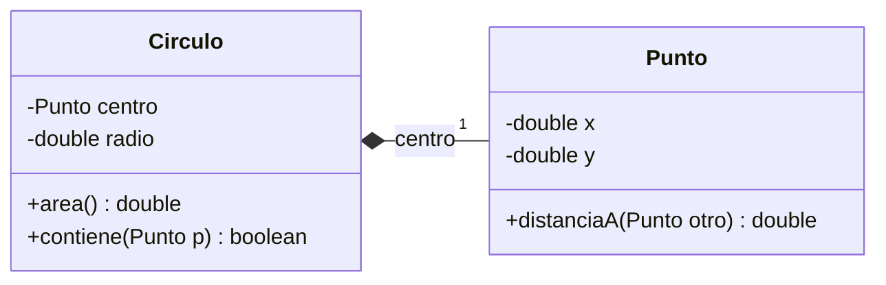

---
{"dg-publish":true,"dg-permalink":"/apuntes/1-dam-programacion/unidad-03-poo-los-objetos/","permalink":"/apuntes/1-dam-programacion/unidad-03-poo-los-objetos/","dg-note-properties":{"unidad":"[[Asignaturas/1DAM_Programación/Unidades/Unidad 03/Unidad 03 - POO. Los objetos]]","modulo":"[[Módulos/Programación]]","libro":"[[Libros/Programación (1º DAM, 1º DAW)]]"}}
---


```table-of-contents
maxLevel: 3
```

# 1. Entendiendo la programación orientada a objetos

## 1.1 Pensamiento orientado a objetos

(Tanto esta sección como la siguiente han sido adaptadas de la "Guía del usuario de Ruby" escrita por Yukihiro "Matz" Matsumoto, creador del lenguaje Ruby) 

La orientación a objetos es una palabra con gancho. Llamar a cualquier cosa “orientada a objetos” puede hacerla parecer más elegante. Java reclama ser un lenguaje orientado a objetos: pero, ¿qué significa exactamente “orientado a objetos”?  

Existe una gran variedad de respuestas a esta pregunta, y probablemente todas ellas se pueden reducir a la misma cosa.  

En vez de recapitular demasiado deprisa, pensemos un momento en el paradigma de la programación tradicional. Tradicionalmente, un problema informático se ataca produciendo algún tipo de representación de datos y procedimientos que operan sobre esos datos. Bajo este modelo, los datos son inertes, pasivos e incapaces. Están a la completa merced de un gran cuerpo procedimental, que es activo, lógico y todopoderoso.  

El problema con esta aproximación es, que los programas los escriben programadores, que son humanos, que sólo pueden retener cierto número de detalles en sus cabezas en un momento determinado. A medida que crece el proyecto, el núcleo procedimental crece hasta un punto que se hace difícil recordar cómo funciona todo el conjunto. Pequeños lapsos de pensamiento o errores tipográficos llegan a ser errores muy ocultos. Empiezan a surgir interacciones complejas e inintencionadas dentro de este núcleo y el mantenimiento se convierte en algo parecido a transportar un calamar gigante intentando que ninguno de sus tentáculos te alcance la cara. Existen políticas de programación que ayudan a minimizar y localizar errores dentro de este paradigma tradicional pero existe una solución mejor que pasa fundamentalmente por cambiar la forma de trabajar.  

Lo que hace la programación orientada a objetos es, delegar la mayoría del trabajo mundano y repetitivo a los propios datos; modifica el concepto de los datos que pasan de pasivos a activos. Dicho de otra forma.  

* Dejamos de tratar cada pieza de dato como una caja en la que se puede abrir su tapa y arrojar cosas en ella.

* Empezamos a tratar cada pieza de dato como una máquina funcional cerrada con unos pocos interruptores y diales bien definidos.  

Lo que se define anteriormente como una “máquina” puede ser, en su interior, algo muy simple o muy complejo. No se puede saber desde el exterior y no se nos permite abrir la máquina (excepto cuando estamos completamente seguros de que algo está mal en su diseño), por lo que se nos obliga a conmutar interruptores y leer los diales para interactuar con los datos. Una vez construida, no queremos tener que pensar en cómo funciona internamente.  

Se podría pensar que estamos haciendo más trabajo nosotros mismos, pero esta forma de trabajo tiende a ser un buen método para evitar que vayan mal todo tipo de cosas.

Comencemos con un ejemplo que es demasiado simple para tener algún valor práctico pero que al menos muestra parte del concepto. Nuestro coche consta de un cuentakilómetros. Su trabajo consiste en llevar un registro de la distancia recorrida desde la última vez que se pulsó el botón de reinicialización. ¿Cómo podríamos representar esto en un lenguaje de programación? En C, por ejemplo, el cuentakilómetros sería, simplemente, una variable numérica de tipo float. El programa manipularía esa variable aumentando el valor en pequeños incrementos y ocasionalmente la reinicializaría a cero cuando fuese apropiado. ¿Qué hay de malo en esto?

Un error en el programa podría asignar un valor falso a la variable, por cualquier número de razones inesperadas. Cualquiera que haya programado en C sabe que se pueden perder horas o días tratando de encontrar ese error que una vez encontrado parece absurdamente simple. El momento de encontrar el error es indicado por una sonora palmada en la frente.

En un contexto orientado a objetos, el mismo problema se puede atacar desde un ángulo completamente diferente. La primera cosa que se pregunta un programador al diseñar el cuentakilómetros no es “¿qué tipos de datos son los más cercanos para representar esta cosa?” sino “¿cómo se supone que actúa esta cosa?”. La diferencia termina siendo profunda.

Es necesario dedicar cierto tiempo a decidir para qué es exactamente un cuentakilómetros y cómo se espera que el mundo exterior interactúe con él. Se decide entonces construir una pequeña máquina con controles que permitan incrementar, reinicializar y leer su valor y nada más.

El cuentakilómetros se crea sin un mecanismo para asignarle un valor arbitrario. ¿Por qué? Porque es de todos sabido que los cuentakilómetros no trabajan de esa forma. Existen sólo unas cuantas cosas que un cuentakilómetros puede hacer, y sólo permitimos esas cosas. Así, si alguien desde un programa trata de asignar algún otro valor (por ejemplo, la temperatura límite del sistema de control de climatización del vehículo) al cuentakilómetros, aparece de inmediato una indicación de lo que va mal. Al ejecutar el programa se nos dice (o posiblemente, al compilarlo dependiendo de la naturaleza del lenguaje) que NO se nos permite asignar valores arbitrarios al objeto Cuentakilómetros. El mensaje podría ser menos preciso, pero sí razonablemente próximo al problema. Esto no evita el error, ¿verdad? pero apunta rápidamente en la dirección de la causa. Esta es sólo alguna de las múltiples formas en las que la programación OO nos puede evitar muchas pérdidas de tiempo.  

Existe, normalmente, un nivel de abstracción superior a éste porque resulta que es igual de fácil construir una factoría que hace máquinas como hacer una máquina individual. Es poco probable que construyamos un único cuentakilómetros, sino que nos preparamos para construir cualquier cantidad de cuentakilómetros a partir de un único patrón. El patrón (o, si lo prefieres, la factoría de cuentakilómetros) es lo que se conoce como clase, y el cuentakilómetros individual sacado del patrón (o construido en la línea de montaje de la factoría) se conoce como objeto.  

Conviene resaltar aquí que la utilización de un lenguaje OO no obliga a un diseño OO válido. Es posible, en cualquier lenguaje, escribir código poco claro, descuidado, mal concebido, erróneo e inestable. Lo que permite Java (en oposición, especialmente, a C++) es que la práctica de la programación OO sea lo suficientemente natural para que, incluso, trabajando a pequeña escala no se sienta la necesidad de recurrir a un código mal estructurado por evitar esfuerzo.  

A continuación hablaremos de los “interruptores y diales” (métodos del objeto) y en próximos capítulos pasaremos a las "factorías" (clases) 

## 1.2 Métodos

¿Qué es un método? En la <abbr title="Programación Orientada a Objetos">POO</abbr> no se piensa en operar sobre los datos directamente desde el exterior de un objeto, sino que los objetos tienen algún conocimiento de cómo se debe operar sobre ellos (cuando se les pide amablemente). Podríamos decir que se pasa un mensaje al objeto y este mensaje obtiene algún tipo de acción o respuesta significativa. Esto debe ocurrir sin que tengamos necesariamente algún tipo de conocimiento o nos importe como realiza el objeto, interiormente, el trabajo. Las tareas que podemos pedir que un objeto realice (o lo que es lo mismo, los mensajes que comprende) son los métodos.

En Ruby, se llama a un método con la notación punto (como en C++ o Java). El objeto con el que nos comunicamos se nombra a la izquierda del punto. Por ejemplo:

```java
String mi_cadena = "Esto es una cadena de caracteres";   
System.out.println("La longitud de la cadena es: " + mi_cadena.length());
```

La salida por pantalla será:

```
La longitud de la cadena es: 32
```

Intuitivamente, a este objeto cadena se le está pidiendo que diga la longitud que tiene (y, como es una cadena de caracteres, nos responde con la cantidad total de letras de que consta). Técnicamente, lo que hemos hecho se llama "invocar el método `length()` del objeto mi_cadena". 

Otros objetos pueden hacer una interpretación un poco diferente de length. La decisión sobre cómo responder a un mensaje se hace al vuelo, durante la ejecución del programa, y la acción a tomar puede cambiar dependiendo de la variable a que se haga referencia.

```java
String mi_cadena = "Esto es una cadena de caracteres";   
String[] mi_array = {mi_cadena, "Otra cadena"};   
System.out.println("La longitud de la cadena es: " + mi_cadena.length());
System.out.println("La longitud del array es: " + mi_array.length);
```

La salida por pantalla será:

```
La longitud de la cadena es: 32
La longitud del array es: 2
```

> [!note] `length()` y `length`
> Fíjate en que a la cadena le pedimos su longitud con el **método** `length()`, con paréntesis, y al array con su **atributo** `length`, sin paréntesis. Si escribes `mi_array.length()`, el programa no compila. Veremos los arrays en la Unidad 05.

Lo que indicamos con length puede variar dependiendo del objeto con el que nos comunicamos. En el primer caso, le pedimos a mi_cadena su longitud. Como se trata de una cadena de caracteres, solo hay una respuesta posible. En el segundo caso, se lo pedimos a mi_array. Podríamos pensar que el método length pudiera contar todos los caracteres en total almacenados en el objeto (43 en total). Pero lo más plausible es que nos devuelva 2, que es el número de elementos del array. 

No importa si por el momento no entiendes bien lo que son los strings o los arrays. Lo que hay que tener en cuenta ahora es que el objeto array conoce lo que significa ser un array, y el string, lo que significa ser string, y ambos saben exactamente lo que tienen que hacer si les pedimos que nos calculen su propia longitud (length).

En Java, las piezas de datos llevan consigo ese *conocimiento,* por lo que las solicitudes que se les hace se pueden satisfacer en las formas adecuadas para el tipo de dato. Esto libera al programador de la carga de memorizar una gran cantidad de nombres de funciones, ya que una cantidad relativamente pequeña de nombres de métodos, que corresponden a conceptos que sabemos como expresar en lenguaje natural, se pueden aplicar a diferentes tipos de datos siendo el resultado el que lógicamente cabría esperar. Esta característica de los lenguajes OO se conoce como polimorfismo[^1].

Cuando un objeto recibe un mensaje que no conoce, se produce un error. Por lo tanto, hay que conocer qué métodos son aceptables para un objeto, aunque no se necesita saber cómo están programados por dentro.

## 1.3 Atributos

Los atributos de un objeto definen las características del mismo. Por ejemplo, un atributo del cuentakilómetros es el contador del número de kilómetros, o un atributo de un String debe de ser el número de caracteres de que consta la cadena.

Al programador que usa un objeto deberían importarle un bledo los atributos del mismo. Él (o ella) se encargará de usar el objeto a través de sus métodos, y éstos operarán con los atributos, si ello es necesario, de forma totalmente transparente al programador. Es decir, los atributos raramente son accesibles desde el exterior del objeto, salvo que, por razones de diseño, el programador del objeto haya decidido lo contrario.


[^1]:   El polimorfismo es una característica muy interesante de los <abbr title="Object Oriented Language">OOL</abbr> que, lamentablemente, Java no explota en toda sus posibilidades, cosa que si hacen lenguajes posteriores como Ruby.

# 2. Definiciones formales

Una vez vista de manera informal la filosofía que subyace en el paradigma de orientación a objetos, pasamos a enumerar de manera más formal los diferentes conceptos que aparecerán de ahora en adelante de manera insistente. Como hemos dicho muchas veces, no te preocupes (aún) si no entiendes todo lo que aquí se dice. Preocúpate solo si, al finalizar el curso, sigues sin saber qué son algunos de los siguientes conceptos.

## 2.1. Objetos

Un objeto es una unidad que engloba dentro de sí un conjunto de datos y las funciones necesarias para el tratamiento de esos datos.

Un objeto se caracteriza por:

* **Su identidad**: cada objeto es único y diferente del resto. Internamente se le asigna un ID para diferenciarlo de otros objetos, aunque pertenezcan a la misma clase y tengan todos sus valores internos con el mismo valor. 

* **Su estado**: el estado de un objeto viene dado por el valor de sus atributos o variables internas. 

* **Su comportamiento**: el comportamiento de un objeto se define mediante los métodos o fragmentos de código que operan con los atributos internos del objeto e interactúan, si es necesario, con otros objetos.  

## 2.2. Atributos

Los atributos son los **datos incluidos en un objeto**. Son como las variables en los lenguajes de programación clásicos, pero están encapsuladas dentro de un objeto y, salvo que se indique lo contrario, son invisibles desde el exterior. 

También se les conoce como **propiedades** del objeto, y sirven para representar el **estado del objeto** en cada momento.

## 2.3. Métodos

Se llaman métodos a las funciones que pertenecen a un objeto. Es decir: son fragmentos de código con un nombre que permite invocarlos y ejecutarlos, pero están encapsulados dentro del objeto. Tienen acceso a los atributos del mismo y son la forma de operar con los atributos desde el exterior del objeto. Son, en definitiva, los "diales" de la caja negra.

En otras palabras, los métodos **establecen las acciones que puede realizar** el objeto.

## 2.4. Clases

Una clase es un patrón para construir objetos. Por tanto, un objeto es una variable perteneciente a una clase determinada. Es importante distinguir entre objetos y clases: la clase es simplemente una declaración, no tiene asociado ningún objeto. Y todo objeto debe pertenecer a una clase. 

## 2.5. Mensajes

El mensaje es el modo en que se comunican los objetos entre sí. Un mensaje no es más que una llamada a un método de un determinado objeto. Cuando llamemos a un método de un objeto, a menudo diremos que estamos enviando un mensaje a ese objeto, y el objeto reaccionará ejecutando el código asociado a ese mensaje.  

## 2.6. Interfaz

Las clases (y, por lo tanto, también los objetos) tienen partes públicas y partes privadas. La parte pública es visible para el resto de los objetos, mientras que la privada sólo es visible para el propio objeto. A la parte pública de un objeto se le denomina interfaz.  

## 2.7. Características de la OOP

### 2.7.1. Abstracción

Cuando se programa con OOP, se intentan abstraer las características de los objetos del problema que estamos tratando de informatizar, para crear a partir de ello las clases y sus métodos. 

### 2.7.2. Encapsulamiento

Como ya hemos dicho varias veces, los miembros privados de una clase no son accesibles desde otras clases. Es decir, desde una clase no se puede invocar un método de otra clase a menos que se indique lo contrario. 

Se denomina encapsulamiento al hecho de que cada objeto se comporte de modo autónomo, de manera que lo que pase en su interior sea invisible para el resto de objetos. Cada objeto sólo responde a ciertos mensajes (llamadas a sus métodos) y proporciona determinadas salidas. Los procesos que lleve a cabo para obtener esas están totalmente ocultos al resto de objetos. 

El concepto de encapsulamiento ya estaba presente en la programación modular, donde se perseguía maximizar la cohesión y minimizar el acoplamiento de los módulos. Esa idea es llevada a sus últimos términos por la programación orientada a objetos. 

### 2.7.3. Herencia

Es posible diseñar nuevas clases basándose en clases ya existentes. Esto se llama *herencia*. Cuando una clase hereda de otra, toma todos los atributos y todos los métodos de su clase “madre”, y puede añadir los suyos propios. A veces, algunos de los métodos o datos heredados no son útiles, por lo que pueden ser enmascarados, redefinidos o simplemente eliminados en la nueva clase. 

> [!question] Para saber más...
> El tema de la herancia lo veremos **[[Asignaturas/1DAM_Programación/Apuntes/Unidad 04/8. Herencia\|más adelante]]**.


### 2.7.4. Polimorfismo

Este "*palabro*" se refiere a la posibilidad de crear **varias versiones del mismo método**, de forma que se comporte de maneras diferentes dependiendo del estado del objeto o de los parámetros de entrada.

## 2.8. Ventajas de la OOP

La OOP se ha impuesto con fuerza en las dos últimas décadas, y no ha sido por casualidad. De hecho, proporciona varias ventajas importantes a la hora de desarrollar y mantener aplicaciones software, que se traducen, en definitiva, en un ahorro de tiempo y esfuerzo. Y, en consecuencia, de dinero. 

Estas ventajas son: 

* **Modularidad**: el código de un objeto puede modificarse, mantenerse o mejorarse sin que ello afecte al resto del sistema, siempre que respetemos su interfaz (así, los demás objetos del programa se seguirán comunicando con el objeto modificado sin que sepan que éste ha cambiado) 

* **Reutilización de código**: es muy sencillo utilizar clases y objetos de terceras partes. Solo tienen que publicar el interfaz de sus clases, y podemos empezar a usarlas en muy poco tiempo, sin preocuparnos de cómo funcionan por dentro, igual que el técnico de la lavadora sustituye una pieza electrónica por otra sin saber exactamente cómo están hechas. 

* **Facilidad de prueba y mantenimiento**: si tenemos un objeto que está dando problemas, es fácil aislar el elemento que falla y modificarlo sin que ello afecte al resto del código de la aplicación. 

* **Ocultación de información**: como cada objeto oculta los detalles de su implementación al resto, es virtualmente imposible que un mal funcionamiento en una parte del sistema pueda afectar a otras. 

# 3. Ejemplos de la API - Math y String

Teniendo claras estas definiciones, volvamos a recordar la clase **[`Math`](https://docs.oracle.com/javase/8/docs/api/java/lang/Math.html)** que vimos en la [[Asignaturas/1DAM_Programación/Unidades/Unidad 01/Unidad 01 - Introducción a la programación con Java\|unidad 1]], en el apartado donde hablábamos de [[8. Tipos de datos simples#8.3.5. ¿Y las operaciones más complejas?\|operaciones más complejas]].

La clase `Math` **[[Asignaturas/1DAM_Programación/Apuntes/Unidad 03/2. Definiciones formales#2.7.1. Abstracción\|abstrae]]** una serie de conceptos matemáticos y los **[[Asignaturas/1DAM_Programación/Apuntes/Unidad 03/2. Definiciones formales#2.7.2. Encapsulamiento\|encapsula]]** para ofrecer desde un solo sitio una variedad de operaciones y propiedades relacionados.

Para usar los miembros encapsulados en ella, llamábamos a `Math` seguida de un punto y:

- El nombre de alguna función: `abs`, `round`, etc.
- O el nombre de un atributo o propiedad, como `Math.PI`.

Y si consultamos la documentación de la API de [`Math`](https://docs.oracle.com/javase/8/docs/api/java/lang/Math.html) veremos que tiene varios métodos `abs`:

- `static double abs(double a)`
- `static float abs(float a)`
- `static int abs(int a)`

A esto se refería el **[[Asignaturas/1DAM_Programación/Apuntes/Unidad 03/2. Definiciones formales#2.7.4. Polimorfismo\|polimorfismo]]** del apartado anterior, a varias **funciones que tienen el mismo nombre porque hacen los mismo pero con datos de distinto tipo**.

Esos miembros (métodos y propiedades) públicos son las [[Asignaturas/1DAM_Programación/Apuntes/Unidad 03/2. Definiciones formales#2.6. Interfaz\|interfaces]] que `Math` nos ofrece para comunicarnos con ella.

> [!note] Nota 
> Esto se conoce también como **sobrecarga de un método**. Definir **varios métodos con el mismo nombre** pero **con distintos parámetros formales** (ya sea en número o en tipo).

Veamos otra clase de la API de Java que llevamos usando desde el principio y que puede ofrecernos muchas funcionalidades útiles para nuestro trabajo: las **cadenas de texto con la clase `String`**. 

## 3.1. La clase `String`

La clase `String` en Java representa una cadena de caracteres **inmutable** (no puede modificarse una vez creada).

Podemos guardar y manipular un texto guardándolo en un (objeto) `String`. Realmente se trata de una serie de caracteres, por lo que cada uno tiene ocupa una posición fija llamada **índice**, siendo 0 el del primer carácter.

### 3.1.1. Declaración y manipulación de cadenas

Hasta ahora hemos declarado una cadena de la siguiente forma:

```java
String saludo = "Hola, gente!";
```

> [!note] Nota
> Esta forma nos permite ahorrar memoria, ya que si encuentra otra cadena igual, no la creará en memoria. Usará la misma.

También podemos hacerlo así:
```java
String saludo = new String("Hola, gente!");

String despedida = "Adiós";
String despedida2 = new String(despedida);
```

> [!note] Nota
> En este caso, al ejecutar `new` **estamos forzando a que se cree otro objeto** de tipo `String` en memoria, aunque previamente haya otra cadena igual.


Y si queremos declarar un texto de varias línes podemos hacerlo usando las triples comillas `"""`:

```java
        String verso = """
                Ola ke ase,
                ola ke mira,
                ola ke kiere,
                ola mi vida.
                """;
```


### 3.1.2. Métodos más utilizados de `String`
Al igual que la clase `Math`, `String` **[[Asignaturas/1DAM_Programación/Apuntes/Unidad 03/2. Definiciones formales#2.7.2. Encapsulamiento\|encapsula]]** un conjunto de **propiedades y métodos útiles** para ahorrarnos trabajo a la hora de tratar con textos. Ahí van unos cuantos:

* **`length()`**: devuelve la longitud de la cadena, es decir, su número de caracteres (incluidos los espacios).
  
  ```java
  String saludo = "Hola, gente!";
  
  System.out.println("Longitud del saludo: " + saludo.length());
  // Longitud del saludo: 12
  ```

* **`concat(String s)`**: concatena (une) una cadena con otra.
  
  ```java
  String saludo = "Hola";
  String nombre = "Telmo";
  
  System.out.println(saludo.concat(", ").concat(nombre).concat("!"));
  // Hola, Telmo!
  ```

* **`compareTo(String s)`**: compara una cadena con otra. Devuelve un número entero con el número de diferencias alfabéticas encontradas. Si este número es 0, significa que las cadenas son idénticas.
  Esto lo estudiaremos con más detenimiento en unidades posteriores.


* **`equals()`**: este es un viejo conocido. Devolverá `true` si las cadenas contienen el mismo texto y `false` en caso contrario.
  
  ```java
  String nombre1 = "Anselmo";
  String nombre2 = "Telmo";
  
  if (nombre1.equals(nombre2)) {
      System.out.println(nombre1 + " y " + nombre2
              + " tienen el mismo nombre! :-)");
  }
  else {
      System.out.println(nombre1 + " y " + nombre2
              + " no tienen el mismo nombre :-(");
  }
  // Anselmo y Telmo no tienen el mismo nombre :-(
  ```

  > [!warning] Mucho cuidado...
  > Una duda habitual es: ¿y si comparo cadenas con ==?
  > Pues bien, el operador de comparación se limitará a mirar las **referencias** o **posiciones de memoria** de los objetos `String`. Es decir, devolverá `true` solo si ambas cadenas **son el mismo objeto**, **no si su contenido es el mismo**.

* **`trim()`**: elimina los **espacios en blanco** que pudieran existir al principio y al final.
  
  ```java
  String nombre1 = "Telmo          ";
  String nombre2 = "      Telmo";
  
  if (nombre1.equals(nombre2)) {
      System.out.println(nombre1 + " y " + nombre2
              + " tienen el mismo nombre! :-)");
  }
  else {
      System.out.println(nombre1 + " y " + nombre2
              + " no tienen el mismo nombre :-(");
  }
  // Telmo           y       Telmo no tienen el mismo nombre :-(
  
  // Quitamos los espacios en blanco en ambos nombres:
  nombre1 = nombre1.trim();
  nombre2 = nombre2.trim();
  
  if (nombre1.equals(nombre2)) {
      System.out.println(nombre1 + " y " + nombre2
              + " tienen el mismo nombre! :-)");
  }
  else {
      System.out.println(nombre1 + " y " + nombre2
              + " no tienen el mismo nombre :-(");
  }
  // Telmo y Telmo tienen el mismo nombre! :-)  
  
  ```

* **`toLowerCase()`**: convierte a minúscula.
  
  ```java
  String saludo = "OIGA USTED!";
  
  System.out.println(saludo);
  // OIGA USTED!
  
  System.out.println(saludo.toLowerCase());
  // oiga usted!
  
  System.out.println(saludo);
  // OIGA USTED!  
  ```

  No. No se me ha escapado el último saludo ni lo he repetido por despiste. Esto sirve para indicar qué significa eso de **inmutabilidad** de los textos `String`. Al ejecutar el método `.toLowerCase()` **no estoy almacenando el resultado en la variable `saludo`** porque es inmutable. Simplemente estoy devolviendo el valor de otra cadena `String` con el texto de la primera cadena en minúsculas. Es decir, que mantengo la cadena original y genero otra nueva.

* **`toUpperCase()`**: convierte a mayúscula.
  
  El funcionamiento, salvo por las mayúsculas, es idéntico al anterior.

* **`replace(char c, char newc)`**: reemplaza cada ocurrencia del carácter `c` por `newc`.
  
  ```java
  String texto = "trasgo";
  
  System.out.println(texto);
  // trasgo
  
  System.out.println(texto.replace('g', 't'));
  // trasto
  
  System.out.println(texto);
  // trasgo, ¡recuerda que String es inmutable!
  ```

* **`substring(int i, int f)`**: devuelve un nuevo `String` que será la subcadena que comienza en el carácter número `i` y termina **justo antes** del `f` de la cadena original: el carácter de la posición `f` no se incluye.
  
  ```java
  String texto = "trasgo";
  
  System.out.println(texto);
  // trasgo
  
  System.out.println(texto.substring(0, 4));
  // tras (posiciones 0, 1, 2 y 3; la 4, 'g', no se incluye)
  
  System.out.println(texto);
  // trasgo, ¡recuerda que String es inmutable!
  ```

* **`charAt(int i)`**: devuelve el carácter (de tipo `char`, no `String`) que ocupa la posición `i` de la cadena.
  
  ```java
  String texto = "trasgo";
  
  System.out.println(texto);
  // trasgo
  
  System.out.println(texto.charAt(4));
  // g
  
  System.out.println(texto);
  // trasgo, ¡recuerda que String es inmutable!
  ```

* **`indexOf(char c)`**: devuelve la posición en la que se encuentra el carácter c por primera vez. Si el carácter no está en la cadena, devuelve -1.
  
  ```java
  String texto = "carcasa";
  
  System.out.println(texto.indexOf('c'));
  // 0

  System.out.println(texto.indexOf('a'));
  // 1

  System.out.println(texto.indexOf('r'));
  // 2
  
  System.out.println(texto.indexOf('c'));
  // 0, ¡ojo! Devuelve la primera posición en la que encuentra 'c'
  ```

* **`lastIndexOf(char c)`**: como `indexOf()`, pero devuelve la posición en la que se encuentra el carácter **por última vez**. Si no está, devuelve -1. Tanto `indexOf()` como `lastIndexOf()` admiten también una cadena en lugar de un carácter.
  
  ```java
  String texto = "carcasa";
  
  System.out.println(texto.lastIndexOf('c'));
  // 3
  
  System.out.println(texto.indexOf("sa"));
  // 5
  ```

* **`isEmpty()`**: devuelve `true` si la cadena está **vacía**, es decir, si su longitud es 0. Es lo mismo que comprobar si `length()` devuelve 0, pero más fácil de leer.
  
  ```java
  String vacia = "";
  String espacios = "   ";
  
  System.out.println(vacia.isEmpty());
  // true
  
  System.out.println(espacios.isEmpty());
  // false, ¡los espacios también son caracteres!
  ```

* **`isBlank()`**: devuelve `true` si la cadena está vacía **o solo contiene espacios en blanco** (espacios, tabuladores, saltos de línea…). Es muy útil para comprobar si el usuario ha dejado un campo sin rellenar, aunque haya pulsado la barra espaciadora.
  
  ```java
  Scanner teclado = new Scanner(System.in);
  
  System.out.print("Nombre: ");
  String nombre = teclado.nextLine();
  
  if (nombre.isBlank()) {
      System.out.println("No has escrito ningún nombre");
  } else {
      System.out.println("Hola, " + nombre.trim());
  }
  ```

  > [!tip] `isEmpty()` o `isBlank()`
  > Para validar lo que escribe el usuario, casi siempre interesa `isBlank()`: un nombre formado solo por espacios no es un nombre.

* **`strip()`**: como `trim()`, elimina los espacios en blanco del principio y del final, pero reconoce también otros espacios especiales de Unicode (como el espacio de no separación que a veces aparece al copiar texto de una web). Si solo quieres quitarlos de un lado, tienes **`stripLeading()`** (principio) y **`stripTrailing()`** (final).
  
  ```java
  String texto = "   Telmo   ";
  
  System.out.println("[" + texto.strip() + "]");
  // [Telmo]
  
  System.out.println("[" + texto.stripLeading() + "]");
  // [Telmo   ]
  
  System.out.println("[" + texto.stripTrailing() + "]");
  // [   Telmo]
  ```

* **`repeat(int n)`**: devuelve una cadena con el texto original repetido `n` veces. Nos ahorra escribir un bucle para cosas como dibujar líneas o figuras con caracteres.
  
  ```java
  System.out.println("-".repeat(20));
  // --------------------
  
  System.out.println("ja".repeat(3));
  // jajaja
  
  for (int i = 1; i <= 4; i++) {
      System.out.println("*".repeat(i));
  }
  // *
  // **
  // ***
  // ****
  ```

* **`equalsIgnoreCase(String s)`**: como `equals()`, pero **sin distinguir mayúsculas de minúsculas**. Es muy útil para comparar lo que escribe el usuario, que puede contestar «SI», «Si» o «si».
  
  ```java
  String respuesta = "SI";
  
  System.out.println(respuesta.equals("si"));
  // false
  
  System.out.println(respuesta.equalsIgnoreCase("si"));
  // true
  ```

* **`contains(String s)`**: devuelve `true` si la cadena **contiene** el texto `s` en cualquier posición.
  
  ```java
  String correo = "alumno@iesejemplo.es";
  
  System.out.println(correo.contains("@"));
  // true
  
  System.out.println(correo.contains("gmail"));
  // false
  ```

* **`startsWith(String s)`** y **`endsWith(String s)`**: devuelven `true` si la cadena **empieza** o **termina**, respectivamente, por el texto `s`.
  
  ```java
  String fichero = "Persona.java";
  
  System.out.println(fichero.endsWith(".java"));
  // true
  
  System.out.println(fichero.startsWith("Per"));
  // true
  
  System.out.println(fichero.startsWith("per"));
  // false, distingue mayúsculas de minúsculas
  ```

> [!example] Combinando métodos
> Como muchos de estos métodos devuelven otra cadena, se pueden **encadenar**. Por ejemplo, para comprobar si un usuario ha contestado que sí, admitiendo espacios y cualquier combinación de mayúsculas y minúsculas:
> 
> ```java
> String respuesta = "   Sí ";
> 
> if (respuesta.strip().equalsIgnoreCase("sí")) {
>     System.out.println("Has contestado que sí");
> }
> // Has contestado que sí
> ```

* **`valueOf(int i)`**: convierte el número `int` en un `String`. También funciona con `long`, `float` y `double`. Esto es solo una muestra. Hay muchos más métodos que encontrarás en: [Java SE 8 API Docs](http://docs.oracle.com/javase/8/docs/api/index.html)

Vemos a continuación un pequeño ejemplo de uso de algunos de estos métodos:

```java
String cad1 = "Hola";  
String cad2 = new String("Mundo");  
String cad3 = new String(cad2);  
System.out.println("¿Son cad2 y cad3 iguales? " + cad2.compareTo(cad3));  
System.out.println("Longitud de cad1 = " + cad1.length());  
System.out.println(cad1.concat(cad2));

String cad4 = new String(cad1.concat(", ").concat(cad2));  
System.out.println(cad4);  
System.out.println(cad4.toUpperCase());  
System.out.println(cad4.substring(0,3));
```

La salida por pantalla de este programa será la siguiente:  

```
¿Son cad2 y cad3 iguales? 0
Longitud de cad1 = 4
HolaMundo
Hola, Mundo
HOLA, MUNDO
Hol
```

Fíjate en la primera línea: `compareTo()` no devuelve `true` o `false`, sino un número, y 0 significa que las cadenas son iguales.

> [!note] Nota 
> Existen otros métodos extremadamente útiles, como es el caso de `split()`, que veremos en la [[Unidad 5\|Unidad 5]], en el apartado de [[Asignaturas/1DAM_Programación/Apuntes/Unidad 05/4. Cadenas o strings\|4. Cadenas o strings]].
> 
> En cualquier caso, **te animo a que te pases por la documentación de la API de la clase [`String`](https://docs.oracle.com/javase/8/docs/api/java/lang/String.html)** y juegues con algunos de los métodos que allí se explican. Te va a resultar de gran interés.


## 3.2. La clase `Math`

Como ya indicamos [[Asignaturas/1DAM_Programación/Apuntes/Unidad 01/9. Tipos de datos simples#9.3.5. ¿Y las operaciones más complejas?\|unidad 1]], Java incorpora en sus librerías clases que implementan mecanismos de cálculos complejos.

A diferencia de la clase `String`, no podemos crear objetos a partir de la clase `Math`. El motivo lo veremos más adelante.

Entonces, ¿cómo puedo utilizar sus funcionalidades. Simplemente indicando que "de la clase `Math`, quiero usar el método que sea con estos parámetros".

Dicho de otra forma:

```java
int numeroNegativo = -20;
int numeroPositivo = Math.abs(numeroNegativo); // 20
```

En este ejemplo, indico que "de la clase `Math`, quiero usar el método `abs` (valor absoluto) para el número guardado en `numeroNegativo`". Este método me devolverá el valor positivo del valor introducido.

Estas son algunos de los métodos que nos pueden resultar muy útiles hasta que veamos en profundidad la biblioteca de clases:

| Método | Descripción | Tipo de dato | Tipo de resultado |
| --- | --- | :---: | :---: |
| `Math.abs(x)` | valor absoluto de x | Real o Entero | Real o Entero |
| `Math.sin(x)` | seno de x (en radianes) | Real | Real |
| `Math.cos(x)` | coseno de x (en radianes) | Real | Real |
| `Math.log(x)` | logaritmo neperiano de x | Real | Real |
| `Math.log10(x)` | logaritmo decimal de x | Real | Real |
| `Math.round(x)` | redondea el número x al valor entero más próximo | Real | Entero |
| `Math.random()` | genera un número al azar entre 0 y 1 | -- | Real |

Y aquí tienes algunos ejemplos de aplicación de estas funciones sobre datos reales:

| Operación | Resultado |
| --- | :---: |
| `Math.abs(-5)` | 5 |
| `Math.abs(6)` | 6 |
| `Math.round(5.7)` | 6 |
| `Math.round(5.2)` | 5 |
| `Math.pow(2, 8)` | 64 |
| `Math.sqrt(64)` | 8 |

> [!example] Material de apoyo 
> En las referencias de la unidad 1 tienes la sección dedicada a [[Asignaturas/1DAM_Programación/Apuntes/Unidad 01/Referencias#Java\|Java]], donde encontrarás vídeos sobre la clase `Math`.

# 4. Declaración de clases e instanciación de objetos en Java

Para crear un objeto y empezar a usarlo, es necesario que antes exista una clase (el molde, o la línea de producción de la factoría, en las metáforas que antes proponíamos). Dicho de otra forma, un objeto es una variable que almacena varios datos (y métodos) cuyo tipo de dato es la clase desde la que se instancia.

> [!info] 
> Los nombres de las clases deben comenzar con mayúscula y aplican la mayúscula a la primera letra de cada palabra.
> 
> Ejemplos: `Persona`, `FacturaDetalle`, `ServicioUsuario`.
> 
> Se diferencian así de los identificadores de las variables, cuya primera letra debe ser minúscula.
> Esto forma parte de la convención de nombres indicada en la [[Asignaturas/1DAM_Programación/Apuntes/Unidad 01/9. Tipos de datos simples#9.4.1. Identificadores\|unidad 1]].


> [!warning] Diferencia entre clase y objeto
> Una clase es un diseño, un plano. Es el código fuente, es decir, una descripción de cómo serán los objetos (propiedades) y lo que podrán hacer (métodos).
> 
> Al pedir la creación de robots a partir de la clase se dice que estamos instanciando los objetos de tipo robot. Todos tienen los mismos atributos o propiedades, pero cada con sus propios valores (que definen su estado).

Veremos más detalles sobre cómo crear clases en temas posteriores, pero ahora aprenderemos a declarar clases simples. En Java, la forma más simple de declarar una clase es ésta:

```java
class MiClase {  
    private static int miAtributo1;  
    private float miAtributo2;

    public void mensaje() {  
        System.out.println("Esta es la ejecución del método mensaje()");  
    }

    public int resto(int a, int b) {  
        int r;  
        r = a % b;  
        return r;  
    }  
} 
```

En este ejemplo, hemos declarado una clase llamada **`MiClase`** (que debemos guardar en un archivo llamado **`MiClase.java`**). La clase tiene dos **atributos o propiedades**, `miAtributo1` y `miAtributo2`, uno de tipo `int` y otro de tipo `float`. Ambos son `private`, lo que significa que **no son accesibles desde fuera** de la clase (típico de los atributos).

Además, uno de ellos es `static`, es decir, **solo se creará una vez aunque se definan varios objetos de esta clase**. 

Después, aparece la definición de dos **métodos**. Ambos son `public`, esto es, pueden ser usados por otros objetos externos a esta clase. El primero **no devuelve ningún resultado** (`void`), y el segundo devuelve un valor entero (`int`). Este último, además, tiene una variable local de tipo `int` llamada `r`. 

Recuerda que la clase solo es un molde, un patrón. Cuando escribimos una clase, lo hacemos en fase de codificación y sólo se trata de un bloque de código. Si queremos ver ese código en funcionamiento, hemos de crear o instanciar objetos de dicha clase. La forma de crear y usar un objeto usando este molde es esta:

```java
// Creamos o instanciamos un objeto a partir de esa clase:
MiClase miObjeto = new MiClase();
```

A partir de este momento existirá una variable en el programa llamada `miObjeto` en cuyo interior existirán todos los elementos de `MiClase`: los atributos y los métodos. Y **podemos crear todos los objetos que necesitemos** a partir de ese molde. Por ejemplo, para el objeto anterior:

```java
// Creamos o instanciamos un objeto a partir de esa clase:
MiClase miObjeto = new MiClase();

miObjeto.miAtributo1 = 7; // ❌ Error! miAtributo1 es private
miObjeto.miAtributo2 = 7; // ❌ Error! miAtributo2 es private

miObjeto.mensaje(); // puede ejecutar mensaje(), ya que es público

int resto = miObjeto.resto(7, 3); // puede ejecutar resto(a,b), ya que es público
System.out.println("El resto es: " + resto);  
```


## 4.1 Un ejemplo más realista

Supongamos que estamos desarrollando una aplicación para administrar los datos personales y académicos del alumnado de un instituto. Dentro de la aplicación, hemos detectado que existe un tipo de dato llamado "persona" (también podría haber sido "alumno"), que tiene ciertas *características* (nombre, edad, sexo, etc) y con el que se pueden llevar a cabo ciertas *operaciones* (asignarle un nombre, preguntarle cuál es su edad, etc) 

Esas *características* son los **atributos**. Esas *operaciones* son los **métodos**. Así, el aspecto de la clase Persona sería, más o menos, este:

```java
class Persona {  
    private String nombre;  
    private String apellido;  
    private int edad;  
    private char sexo;

    public String getNombre() {  
        return nombre;  
    }

    public void setNombre(String txt) {  
        nombre = txt;  
    }

    public String getApellido() {  
        return apellido;  
    }

    public void setApellido(String txt) {  
        apellido = txt;  
    }

    public int getEdad() {  
        return edad;  
    }

    public void setEdad(int n) {  
        edad = n;  
    }

    public String getSexo() {  
        String s;  
        if (sexo == 'H' || sexo == 'h') s = "Hombre";  
        else if (sexo == 'M' || sexo == 'm') s = "Mujer";  
        else s = "Desconocido";

        return s;  
    }

    public void setSexo(char s) {  
        sexo = s;  
    }  
}
```

Observa como los atributos son privados, y hemos definido un método público para consultar y modificar cada uno de ellos. Los métodos saben cómo deben proceder con los atributos, y el programador que usa la clase no deben preocuparle esos detalles: una vez escrita y probada la clase, podemos olvidarnos de ella y usarla sin tener en cuenta su implementación. Solo tenemos que conocer cuáles son sus métodos públicos y para qué sirve cada uno. 

Este es un ejemplo de cómo podríamos usar esta clase para crear una persona llamada _Miguel Pérez_, de 23 años de edad y sexo masculino:

```java
class ProbarPersona {   
    public static void main(String[] args)   
    {   
        Persona a = new Persona();   
        a.setNombre("Miguel");   
        a.setApellido("Pérez");   
        a.setEdad(23);   
        a.setSexo('H');   
        // Ahora vamos a mostrar por pantalla la información del objeto
        // para asegurarnos que todo se ha almacenado correctamente
        System.out.println("Nombre: " + a.getNombre() + " " + a.getApellido());  
        System.out.println("Edad: " + a.getEdad());   
        System.out.println("Sexo: " + a.getSexo());   
    }  
}
```

Si compilamos y ejecutamos el programa `ProbarPersona`, la salida por pantalla debería ser esta:

```
Nombre: Miguel Pérez   
Edad: 23   
Sexo: Hombre
```

Si te fijas, aunque en el interior del objeto el sexo se almacena como un carácter `H`, al recuperarlo con `getSexo()` se nos devuelve el string "Hombre". Ese es el comportamiento del objeto y, como usuarios del mismo, no nos importa cuál es el procedimiento interno por el que se ha obtenido ese resultado. Lo usamos y punto. 

> [!note] Por cierto...
> Si la clase `Persona` y la clase `ProbarPersona` están en el mismo paquete de nuestro proyecto, **NO es necesario hacer `import Persona`** ni nada parecido. El `import` se usa solo cuando se encuentran en paquetes distintos. 

### 4.1.1 Setters con sentido

Si obsevamos los `setters` de la clase `Persona` del apartado anterior, como es el caso de `setEdad(int n)`, no aportan mucho a nivel funcional. Es decir, ¿qué diferencia hay entre un `setter` así y poner la propiedad `edad` como `public`? **Ninguna**. Entonces, ¿lo de la encapsulación es un sinsentido? Para nada.

En general, cuando se consultan manuales o tutoriales de iniciación a la programación, se suele poner el `setter` estándar que introduce el valor que se pasa como argumento, tal cual. Pero hay que recordar que **los setters** son la puerta de entrada de datos a los objetos de nuestras clases y, por tanto, **deben establecer qué datos se permiten y cuáles no**.

En el ejemplo anterior, podríamos decir (porque los requisitos así nos lo exigen) que no admitimos **nombres y apellidos nulos**. Si así fuese, el nombre debería automáticamente ser un guión (`-`) y el apellido debería tener el valor por `Expósito` por defecto. Tampoco se deben admitir **edades negativas** (aunque es obvio), en cuyo caso debe ponerse por defecto, por ejemplo, un 0. De esta forma, los setters de la clase anterior quedarían así:

```java
class Persona {  
    private String nombre;  
    private String apellido;  
    private int edad;  
    private char sexo;

    public String getNombre() {  
        return nombre;  
    }

    /**
     * Si se introduce un valor null para el atributo nombre, se le asignará
     * automáticamente el texto "-".
     */
    public void setNombre(String txt) {  
        if (txt == null) nombre = "-";
        else nombre = txt;  
    }

    public String getApellido() {  
        return apellido;  
    }

    /**
     * Si se introduce un valor null para el atributo apellido, se asignará
     * automáticamente el texto "Expósito".
     */
    public void setApellido(String txt) {  
        apellido = (txt == null || txt.isEmpty())
	        ? "Expósito"
	        : txt;  
    }

    public int getEdad() {  
        return edad;  
    }

    /**
     * Si se introduce un número negativo, se desprecia.
     * En su lugar se pone un 0 en el atributo edad.
     */
    public void setEdad(int n) {  
        edad = (n < 0) ? 0 : n;  
    }
	
    public void setSexo(char s) {  
        sexo = s;  
    }
	
    public String getSexo() {  
        String s;
        if (sexo == 'H' || sexo == 'h') s = "Hombre";  
        else if (sexo == 'M' || sexo == 'm') s = "Mujer";  
        else s = "Desconocido";
		
        return s;  
    }
}
```

Sobre el código anterior hemos de recalcar varias cosas:

**Solo los objetos pueden ser `null`**

 Los tipos de datos primitivos nunca será `null`, pero los objetos si. Cuando declaras una variable cuyo tipo de dato es `int`, `byte`, `boolean`... y no se inicializa, generalmente el compilador te invita a que le des un valor inicial, pero si no, se le asignará uno por defecto (el 0 para los `int`, por ejemplo).
  Pero si declaramos un objeto de tipo `Persona` y no lo inicializamos, ese objeto no se instancia, no se crea y, por tanto, no apunta a ninguna dirección de memoria. Ese objeto es `null`.

**El orden de las validaciones de objetos es importante**

En métodos como `setApellido`, donde se valida que un objeto `txt` no sea nulo ni una cadena vacía, hay que tener en cuenta que **el orden aquí es muy importante**. Si se validase primero si es cadena vacía...

```java
apellido = (txt.isEmpty() || txt == null)
	? "Expósito"
	: txt;
```

cuando se introduzca un `null` el código intentería hacer lo siguiente:

```java
apellido = (null.isEmpty() || null == null)
	? "Expósito"
	: null;  
```

  `null` no tiene ningún método `.isEmpty()`. Realmente **no tiene nada porque no es nada**. Por tanto, si intento ejecutar el método `.isEmpty()` de `null`, saltaría una excepción `NullPointerException`.

**El `setter` es el guardián de la frontera**

Los `setter`, que actúan como interfaz o punto de entrada de datos al objeto, **deben velar para que los datos sean válidos**.

> [!example] Cambia el código 
> 1. Si los `setter` deben ser los guardianes de la entrada de datos, el `setSexo` debe cambiar.
>   Refactoriza ese método para que:
>    - Si se introduce una **h** mayúscula o minúscula, se guarde la `'h'` en el atributo `sexo`.
>    - Si es una **m** mayúscula o minúscula, se guarde una `'m'`.
>    - Si es cualquier otra letra, se guarde una `'x'`.
> 
>   Obviamente también habrá que modificar el método `getSexo`.
> 
> 1. Haz lo mismo con `setEdad`. Cámbialo para que sólo admita edades positivas y que no superen los 120 años, de forma que si sobrepasan uno de esos límites, se queden el él. Por ejemplo:
>    - Si la edad es negativa, que se quede en 0.
>    - Si supera los 120, que se quede en 120.
>   De esa forma, forzamos a que el objeto admita solo las edades que son válidas para nuestro programa.


# 5. Más sobre métodos

## 5.1 Paso de parámetros

Los métodos pueden recibir una serie de valores denominados parámetros. En la clase `Persona` del ejemplo anterior, el método `setEdad()`, por ejemplo, recibía un parámetro de tipo `int` llamado `n`. En ese parámetro se especifica cuál es la edad que debe almacenarse en el estado del objeto.

Por lo tanto, los parámetros son imprescindibles para que el objeto reciba los mensajes correctamente. Si no, ¿cómo le indicaríamos al objeto de tipo `Persona` cuál es la edad que tiene que almacenar?


Un método puede tener una lista larguísima de parámetros, o ninguno. Lo más habitual es que tenga entre cero y unos pocos.

> [!warning] Consejo
> Cuando declares métodos, procura que no tengan un número excesivo de parámetros. Eso los hace difíciles de usar y mantener y da pie a errores.

En la declaración del método **hay que indicar el tipo de cada parámetro**, como se muestra en este ejemplo:

```java
public void setDatos(String nombre, String apellido, int edad, char sexo)
```

Este hipotético método `setDatos()` podría servir para asignar valor a todos los atributos de la clase `Persona` del ejemplo anterior. Por supuesto, cuando llamemos al método `setDatos()` para que se ejecute, será necesario pasarle cuatro datos que coincidan en tipo con los cuatro parámetros. Por ejemplo:

```java
p = new Persona();
p.setDatos("Miguel", "Pérez", 23, 'H');
```

## 5.2 Valores devueltos

Probablemente habrás observado que algunos métodos terminan con un `return` y otros no. Los que sí lo hacen **devuelven un resultado al código que los llamó**. Ese resultado puede ser de cualquier tipo y también hay que indicarlo en la declaración del método.  

El método `setDatos()` anterior no devuelve nada, por lo que, en la declaración, se usa la palabra **`void`** (vacío). Pero el método `getEdad()`, por ejemplo, devuelve un valor entero (la edad de la persona), y por eso se indica `int` en la declaración:

```java
public int getEdad() {
    return edad;
}
```

## 5.3 Métodos y atributos estáticos

Algunos métodos, como algunos atributos, pueden estar precedidos de la palabra `static`.

Esto quiere decir que **pertenecen a la clase, no a cada objeto**:

- Un **atributo `static`** existe una sola vez. No importa si se crean 800 objetos de tipo `Persona`: el atributo `static` solo se creará una vez, y los 800 objetos lo compartirán.
- Un **método `static`** se llama con el nombre de la clase delante y **no necesita ningún objeto**. Es lo que hacemos con `Math.sqrt(64)`: no creamos ningún objeto `Math`.

Esto no solo permite ahorrar recursos en términos de memoria, sino que a veces resulta muy útil (si no, ¡no lo habrían inventado!). Por ejemplo, podemos usar un atributo static para llevar la cuenta del número de personas que se han creado:  

```java
class Persona {
    // Al crear la primera persona, esta variable se pondrá a 0
    private static int numPersonas = 0;

    static void nuevaPersona()
    {
        numPersonas++; // Se incrementa cada vez que se crea una persona
    }

    static int getNumPersonas() {
        return numPersonas;
    }
    // El resto de la clase sería igual que antes
}
```

Si cada vez que creamos un objeto de la clase persona llamamos al método `nuevaPersona()`, el atributo `numPersonas` se incrementará en una unidad y contendrá el número total de objetos de esa clase que existen. En cambio, si no fuera un atributo `static`, cada objeto `Persona` tendría su propio atributo puesto a 0 en el momento de su creación, y la llamada a `nuevaPersona()` establecería su valor a 1.

Para consultar el contador desde otra clase, llamamos al método `static` `getNumPersonas()` **con el nombre de la clase**, igual que hacemos con `Math`:

```java
System.out.println("Personas creadas: " + Persona.getNumPersonas());
System.out.println("Raíz de 64: " + Math.sqrt(64));
```

> [!warning] Un método `static` no conoce los objetos
> Como un método `static` no pertenece a ningún objeto, **no puede usar los atributos ni los métodos que no son `static`**. Si en `getNumPersonas()` intentáramos devolver `nombre`, el compilador daría el error `non-static variable nombre cannot be referenced from a static context`: ¿el nombre de qué persona, si no hay ninguna?

## 5.4 Métodos constructores: una primera visión

En Java existen dos tipos de métodos especiales llamados **constructores** y **destructores** de objetos. No es obligatorio programarlos para cada clase, pero sí que aparecen con frecuencia, sobre todo los constructores (de los destructores hablaremos más adelante)  

El **constructor** es un método que *es invocado automáticamente al crear un objeto de la clase*. Su función suele ser inicializar el estado del objeto.

Por ejemplo, en la clase `Persona` de los ejemplos anteriores un posible constructor sería este:

```java
class Persona {
    Persona() {
        nombre = "";
        apellido = "";
        edad = 0;
        sexo = 'X';
        nuevaPersona();
    }
    // El resto de la clase quedaría igual
}
```

Observa varias cosas importantes:

* El nombre del constructor **debe coincidir con el de la clase**.
* El constructor se ha usado para inicializar con valores vacíos todos los atributos de la clase.
* También se ha aprovechado para invocar el método `nuevaPersona()`, que contabiliza todos los objetos `Persona` creados por el programa. Así, esa contabilización se automatiza, porque `nuevaPersona()` será invocado siempre que se cree un objeto `Persona`.
* El constructor no devuelve nada, y por eso no se indica ningún tipo de retorno (ni siquiera `void`).
* Como cualquier método, puede llevar un modificador de visibilidad. Si no lleva ninguno, como aquí, solo pueden usarlo las clases del mismo paquete. Lo habitual es declararlo `public`, para poder crear objetos desde cualquier sitio.
* Los constructores pueden parametrizarse y, de hecho, sobrecargarse. Observa como en la siguiente variación de la clase `Persona` hay dos constructores, uno con parámetros y otro sin ellos:

```java
class Persona {
    Persona() {
        nombre = "";
        apellido = "";
        edad = 0;
        sexo = 'X';
        nuevaPersona();
    }

    Persona(String n, String a, int e, char s)
    {
        nombre = n;
        apellido = a;
        edad = e;
        sexo = s;
        nuevaPersona();
    }
    // El resto de la clase quedaría igual
}
```

Aunque hay algo que no gusta mucho en este código... **se repite la misma tarea en ambos constructores**. ¿Cómo puedo optimizarlo? Así:

```java
class Persona {
    Persona() {
        this("", "", 0, 'X');
    }

    Persona(String n, String a, int e, char s)
    {
        nombre = n;
        apellido = a;
        edad = e;
        sexo = s;
        nuevaPersona();
    }
    // El resto de la clase quedaría igual
}
```

¿Qué hemos hecho en el primer constructor? Llamar al segundo usando `this(...)`. Con `this(...)`, **un constructor llama a otro constructor de la misma clase**: el objeto se está creando en ese momento, y es el segundo constructor, `Persona(String n, String a, int e, char s)`, el que le da su estado inicial con los valores que le pasamos.

Con esto conseguimos ahorrar código: el constructor `Persona()` llama al otro pasándole los valores iniciales. Y tras actualizar el estado, se ejecutará `nuevaPersona();`.

Fíjate, además, en que `nuevaPersona()` solo se llama una vez, en el segundo constructor. Si `Persona()` también la llamara después de `this(...)`, cada persona creada sin parámetros **se contaría dos veces**. Repetir código no solo es más largo: también facilita este tipo de errores.

> [!warning] `this(...)` va siempre primero
> En Java 21, la versión que usamos en el curso, la llamada a `this(...)` tiene que ser la **primera instrucción** del constructor: si escribimos algo antes, el programa no compila. Desde Java 25 se admiten algunas instrucciones antes, siempre que no usen el objeto que se está creando, pero lo más claro sigue siendo ponerla al principio.

### 5.4.1 `this` para referirse al propio objeto

`this` tiene otro uso, aún más frecuente: **dentro de un método o un constructor, `this` es el propio objeto**. Sirve, sobre todo, para distinguir un atributo de un parámetro que se llama igual:

```java
Persona(String nombre, String apellido, int edad, char sexo) {
    this.nombre = nombre;     // atributo nombre = parámetro nombre
    this.apellido = apellido;
    this.edad = edad;
    this.sexo = sexo;
    nuevaPersona();
}
```

Sin `this`, la línea `nombre = nombre;` asignaría el parámetro a sí mismo y el atributo se quedaría sin valor. Es la forma en que NetBeans genera los constructores y los *setters* con `Alt + Insert` (lo veremos en [[Asignaturas/1DAM_Programación/Apuntes/Unidad 03/7. Proyectos con varias clases en NetBeans#7.1.3. Que el IDE escriba por nosotros\|7.1.3]]), así que la verás constantemente.

### 5.4.2 Dos formas de crear un objeto

Tener dos constructores es una excelente idea, porque ahora podemos crear personas por dos vías con el mismo resultado:

```java
// Creamos una persona con el constructor sin parámetros
// y luego le asignamos los valores
Persona p1 = new Persona();
p1.setNombre("Miguel");
p1.setApellido("Pérez");
p1.setEdad(23);
p1.setSexo('H');

// Ahora creamos otra persona con el constructor parametrizado
Persona p2 = new Persona("Luisa", "Martínez", 21, 'M');
```

Presentamos por último la versión "todo junto" de la clase `Persona`, con todos los elementos que hemos ido añadiendo (métodos `static` y constructor sobrecargado):

```java
// Versión definitiva de la clase Persona
class Persona {
    private String nombre;
    private String apellido;
    private int edad;
    private char sexo;

    // Al crear la primera persona esta variable se pondrá a 0
    private static int numPersonas = 0;

    // Constructor sin parámetros: llama al otro con valores vacíos
    Persona() {
        this("", "", 0, 'X');
    }

    // Constructor con parámetros
    Persona(String nombre, String apellido, int edad, char sexo) {
        this.nombre = nombre;
        this.apellido = apellido;
        this.edad = edad;
        this.sexo = sexo;
        nuevaPersona();
    }

    // Método estático para contar el número de personas creadas
    static void nuevaPersona() {
        numPersonas++; // Se incrementa cada vez que se crea una persona
    }

    // Método estático para consultar el contador: Persona.getNumPersonas()
    static int getNumPersonas() {
        return numPersonas;
    }

    public String getNombre() {
        return nombre;
    }

    public void setNombre(String txt) {
        nombre = txt;
    }

    public String getApellido() {
        return apellido;
    }

    public void setApellido(String txt) {
        apellido = txt;
    }

    public int getEdad() {
        return edad;
    }

    public void setEdad(int n) {
        edad = n;
    }

    public String getSexo() {
        String s;
        if (sexo == 'H') s = "Hombre";
        else if (sexo == 'M') s = "Mujer";
        else s = "Desconocido"; 
        
        return s;
    }
 
    public void setSexo(char s) {
        sexo = s;
    }
}
```

## 5.5 Destrucción de objetos y liberación de memoria

Cada vez que escribimos `new`, Java reserva un trozo de **memoria** para guardar el nuevo objeto con todos sus atributos. Esa memoria no es infinita: si un programa crea objetos sin parar y nunca los libera, acabaría agotándola. Entonces, ¿quién **destruye** los objetos que ya no necesitamos?

### 5.5.1 Variables y objetos: las referencias

Para entenderlo, recuerda que una variable de tipo objeto **no contiene el objeto**, sino una **referencia** a él: algo así como su dirección en memoria.

```java
Persona p1 = new Persona("Ana", "Ruiz", 20, 'M');
Persona p2 = p1;   // p2 apunta al MISMO objeto que p1: no se crea otra persona
```

Aquí hay **un solo objeto** `Persona` y **dos variables** que lo referencian. Si cambiamos el nombre con `p2.setNombre("Eva")`, `p1.getNombre()` también devolverá `"Eva"`.

### 5.5.2 ¿Cuándo deja de usarse un objeto?

Un objeto se puede eliminar cuando **ninguna variable lo referencia**, porque ya no hay forma de llegar a él desde el programa. Esto ocurre, por ejemplo:

- Cuando a la variable se le asigna `null`, que significa «no apunta a ningún objeto»:

  ```java
  Persona p = new Persona();
  p = null;   // el objeto Persona ya no es accesible
  ```

- Cuando a la variable se le asigna **otro objeto**:

  ```java
  String texto = new String("primero");
  texto = new String("segundo");   // "primero" ya no es accesible
  ```

- Cuando termina el **bloque** o el **método** en el que se declaró la variable local:

  ```java
  public static void saludar() {
      Scanner sc = new Scanner(System.in);
      // ...
  }   // al salir del método, la variable sc desaparece
  ```

> [!WARNING] `null` y `NullPointerException`
> Si intentamos usar una variable que vale `null`, por ejemplo `p.getNombre()`, el programa se detiene con una **`NullPointerException`**: estamos pidiendo algo a un objeto que no existe.
> Es como si ejecutáramos `null.getNombre()`. Y `null` no tiene métodos, porque no es nada.

### 5.5.3 El recolector de basura

En lenguajes como C o C++, el programador debe liberar a mano la memoria de cada objeto (con `free` o `delete`). Si se le olvida, el programa va perdiendo memoria; si la libera antes de tiempo, el programa falla.

En Java **no existe una instrucción para destruir objetos**. De eso se encarga el **recolector de basura** (*garbage collector*), una parte de la máquina virtual (JVM) que se ejecuta **automáticamente** cuando la JVM lo considera necesario (por ejemplo, cuando queda poca memoria libre). El recolector busca los objetos a los que **ya no llega ninguna referencia** y **libera** la memoria que ocupaban, para que pueda usarse con objetos nuevos.

```java
for (int i = 0; i < 1_000_000; i++) {
    Persona temporal = new Persona();   // en cada vuelta se crea un objeto nuevo...
}   // ...y el de la vuelta anterior queda sin referencias: el recolector lo eliminará
```

> [!NOTE] `System.gc()`
> El método estático `System.gc()` **sugiere** a la JVM que ejecute el recolector, pero no lo garantiza: es la JVM quien decide cuándo hacerlo. En la práctica, esto no suele usarse. La JVM está tan optimizada que decide mejor que nosotros cuándo lanzar el recolector de basura.

> [!TIP] Buenas prácticas
> - No necesitas destruir los objetos: basta con dejar de usarlos.
> - Declara las variables en el bloque más pequeño en el que se usan; así sus objetos quedan libres antes.
> - Algunos objetos usan **recursos externos** (ficheros, conexiones a bases de datos…). El recolector libera su memoria, pero no cierra esos recursos: **hay que cerrarlos explícitamente con su método `close()`**. Lo veremos en las unidades de ficheros y bases de datos.

# 6. Paquetes

Un paquete o ***package*** es un conjunto de clases relacionadas entre sí empaquetadas en un archivo. En el JDK existen multitud de paquetes estándar que usarás continuamente, y, además, puedes encontrar paquetes de terceros para hacer todo tipo de cosas. Y tú mismo aprenderás a hacer tus propios paquetes. 

Por ejemplo, en el JDK existe un paquete llamado java.io, donde se agrupan todas las clases que permiten hacer la entrada/salida de datos (por consola y teclado, pero también escribir en archivos de disco, por ejemplo). 

El uso de paquetes permite agrupar las clases relacionadas en un solo lugar y, además, evitar posibles conflictos con nombres de clases y métodos que se repitan. Al estar en paquetes separados, ya no es posible la confusión. 

Para usar un paquete se utiliza la sentencia **`import`**. En este ejemplo puedes ver su uso:

```java
import java.util.Scanner;  // Importa la clase Scanner del paquete java.util
import java.util.*;        // Importa todas las clases del paquete java.util
```

Una vez importada una clase, podemos usarla sin indicar el nombre completo de su paquete. Por ejemplo, sin `import` tendríamos que escribir esto:

```java
java.util.Scanner teclado = new java.util.Scanner(System.in);
```

Y con `import java.util.Scanner;` al principio del fichero, basta con esto:

```java
Scanner teclado = new Scanner(System.in);
```

> [!note] ¿Y `String`, `Math` o `System`?
> Son clases del paquete **`java.lang`**, que Java **importa siempre de forma automática**. Por eso las hemos usado desde el principio sin escribir ningún `import`.

Existe también el **`import static`**, que permite usar los miembros `static` de una clase (sus métodos y atributos estáticos) sin escribir el nombre de la clase delante:

```java
import static java.lang.Math.sqrt;
import static java.lang.Math.PI;

double raiz = sqrt(81);   // en lugar de Math.sqrt(81)
double area = PI * 2 * 2; // en lugar de Math.PI * 2 * 2
```

> [!warning] Úsalo con moderación
> Con `import static`, al leer `sqrt(81)` no se ve a qué clase pertenece el método. Por eso, salvo casos muy claros, es preferible escribir `Math.sqrt(81)`.

Para acceder correctamente a los paquetes, el compilador de Java necesita saber dónde están los archivos de la biblioteca de clases, es decir, tienes que configurar adecuadamente la variable de entorno `CLASSPATH`.

```bash
$ CLASSPATH = <ruta a la biblioteca de clases>:<ruta 2>:<ruta 3>:etc $ export CLASSPATH  
```
> (sustituye el carácter `:` por `;` si estás trabajando en un sistema Windows) 

Recuerda que, como vimos en el tema 1, también puedes compilar el programa con la opcion `-cp`, indicando a continuación el *classpath* de tu aplicación:

```bash
$ javac -cp /ruta/a/mis/clases nombre.java
```


<iframe width="560" height="315" src="https://www.youtube.com/embed/J1PmA7J3aUA?si=dOiuuwCU8-mIBH2N" title="YouTube video player" frameborder="0" allow="accelerometer; autoplay; clipboard-write; encrypted-media; gyroscope; picture-in-picture; web-share" referrerpolicy="strict-origin-when-cross-origin" allowfullscreen></iframe>

# 7. Proyectos con varias clases en NetBeans

En la Unidad 01 vimos qué es un proyecto Maven y cómo se crea en NetBeans ([[Asignaturas/1DAM_Programación/Apuntes/Unidad 01/6. Herramientas para desarrollar con Java#6.4.4. Crear un proyecto en NetBeans\|6.4.4. Crear un proyecto en NetBeans]]). Entonces nuestros programas tenían una sola clase. Ahora que escribimos nuestras propias clases (como `Persona` en [[Asignaturas/1DAM_Programación/Apuntes/Unidad 03/4. Declaración de clases e instanciación de objetos en Java\|4. Declaración de clases e instanciación de objetos en Java]]) y las organizamos en paquetes ([[Asignaturas/1DAM_Programación/Apuntes/Unidad 03/6. Paquetes\|6. Paquetes]]), un programa pasa a estar formado por **varios ficheros**. En este apartado veremos cómo trabajar con ellos en el IDE.

## 7.1. Un proyecto con varias clases

Como ejemplo, vamos a crear un proyecto `Agenda` con dos clases en paquetes distintos:

- `Contacto`, en el paquete `es.dam.agenda.modelo`: la clase que describe los objetos.
- `Main`, en el paquete `es.dam.agenda.app`: la clase con el método `main`, que crea y usa los objetos.

Separar así las clases es una práctica habitual: las que representan los datos del problema (el **modelo**) van en un paquete, y las que ponen en marcha la aplicación, en otro.

### 7.1.1. Crear el proyecto

Podemos crear un nuevo proyecto desde varios sitios:

- El icono *New Project* de la **barra de herramientas**:
  

- En el **menú File** ->  *New Project*:
  

- En la pantalla de bienvenida:
  

Crea un proyecto **Java with Maven → Java Application** llamado `Agenda`, con `Group Id` **`es.dam`**.


NetBeans propone el paquete `es.dam.agenda` y crea en él una clase `Agenda` con su `main`. Como no la vamos a usar, puedes borrarla (botón derecho → **Delete**).

### 7.1.2. Crear paquetes y clases

En la ventana **Projects**, haz clic con el botón derecho sobre **Source Packages**:

1. **New → Java Package…** y escribe `es.dam.agenda.modelo`. Repite para `es.dam.agenda.app`.
2. Botón derecho sobre el paquete `es.dam.agenda.modelo` → **New → Java Class…**, con el nombre `Contacto`.
3. Botón derecho sobre `es.dam.agenda.app` → **New → Java Main Class…**, con el nombre `Main`. Es una clase normal, pero NetBeans le añade ya el método `main`.

> [!info] Si no ves la opción **Java Main Class…** 
> Pulsa sobre la opción **Other...**. Se abrirá una ventana en la que tendrás categorías y, para cada una de ellas, una serie de elementos. Eligiendo la categoría **Java** podrás ver **Java Main Class…** en su lista de *File Types*:
> 


> [!NOTE] Paquetes y carpetas
> Cada paquete es una carpeta del disco. Si abres la ventana **Files**, verás que `Contacto.java` está en `src/main/java/es/dam/agenda/modelo/`. Por eso NetBeans escribe solo la primera línea de cada clase, `package es.dam.agenda.modelo;`: **debe coincidir con la carpeta** en la que está el fichero.

La estructura del proyecto queda así:

```
Agenda/
├── pom.xml
└── src/main/java/es/dam/agenda/
    ├── app/
    │   └── Main.java
    └── modelo/
        └── Contacto.java
```

### 7.1.3. Que el IDE escriba por nosotros

Escribe en `Contacto` solo sus atributos:

```java
package es.dam.agenda.modelo;

public class Contacto {

    private String nombre;
    private String telefono;
    private int edad;
}
```

El constructor, los *getters* y los *setters* son código repetitivo, y el IDE puede generarlo. Coloca el cursor dentro de la clase y pulsa **`Alt + Insert`** (o botón derecho → **Insert Code…**):

- **Constructor…**: marca los atributos que debe recibir como parámetros.
- **Getter and Setter…**: marca los atributos para los que quieres métodos de acceso.
- **toString()…**: genera un método que devuelve el objeto como texto.

El resultado es el mismo que si lo escribieras a mano:

```java
public Contacto(String nombre, String telefono, int edad) {
    this.nombre = nombre;
    this.telefono = telefono;
    this.edad = edad;
}

public String getNombre() {
    return nombre;
}
// ...
```

> [!WARNING] Generar no es pensar
> El IDE genera *setters* que aceptan cualquier valor. Recuerda que deben **decidir qué datos se permiten** ([[Asignaturas/1DAM_Programación/Apuntes/Unidad 03/4. Declaración de clases e instanciación de objetos en Java#4.1.1 Setters con sentido\|4.1.1. Setters con sentido]]): revisa siempre el código generado y añade las comprobaciones que falten.

Otras ayudas del editor que usarás continuamente:

| Ayuda | Atajo |
|---|---|
| Autocompletar (atributos, métodos, clases) | `Ctrl + Espacio` |
| Generar código (constructores, *getters*…) | `Alt + Insert` |
| Ver y aplicar las soluciones que propone el IDE | `Alt + Enter` |
| Añadir los `import` que faltan y quitar los que sobran | `Ctrl + Shift + I` |
| Dar formato al código (sangrías, espacios) | `Alt + Shift + F` |

> [!TIP] La documentación, a mano
> Al autocompletar con `Ctrl + Espacio`, NetBeans muestra el **Javadoc** del método elegido: qué hace, qué parámetros recibe y qué devuelve. Es la forma más rápida de consultar la API de clases como `String` o `Math` ([[Asignaturas/1DAM_Programación/Apuntes/Unidad 03/3. Ejemplos de la API - Math y String\|3. Ejemplos de la API - Math y String]]).

### 7.1.4. Usar una clase de otro paquete

Escribe el `main` de `Main`:

```java
package es.dam.agenda.app;

import es.dam.agenda.modelo.Contacto;

public class Main {

    public static void main(String[] args) {
        Contacto c1 = new Contacto("Ana", "600111222", 19);
        Contacto c2 = new Contacto("Luis", "600333444", 21);

        System.out.println(c1.getNombre() + ": " + c1.getTelefono());
        System.out.println(c2.getNombre() + ": " + c2.getTelefono());
    }
}
```

Como `Contacto` está en otro paquete, hace falta el `import`. No hace falta escribirlo: al teclear `Contacto` y autocompletar con `Ctrl + Espacio`, NetBeans lo añade solo. Si se te ha olvidado, pulsa `Ctrl + Shift + I`.

> [!NOTE] Para que se pueda usar desde otro paquete
> La clase `Contacto`, su constructor y sus *getters* son `public`. Si no lo fueran, `Main` no podría usarlos, porque está en otro paquete.

## 7.2. Compilar y ejecutar

### 7.2.1. Ejecutar el proyecto o un fichero

Ya conoces las órdenes del menú **Run** ([[Asignaturas/1DAM_Programación/Apuntes/Unidad 01/6. Herramientas para desarrollar con Java#6.4.4. Crear un proyecto en NetBeans\|6.4.4]]). Con varias clases conviene distinguir dos:

- **Run File** (`Shift + F6`) ejecuta **la clase que tienes abierta**, que debe tener `main`. Es lo más cómodo cuando un proyecto tiene varios programas, como los de los ejercicios de clase.
- **Run Project** (`F6`) ejecuta **la clase principal del proyecto**, la que se indica en **botón derecho sobre el proyecto → Properties → Run → Main Class**. Si la has borrado (como la clase `Agenda` del ejemplo), NetBeans te pedirá que elijas otra.

En ambos casos, NetBeans primero **compila** lo que haya cambiado y después ejecuta. La salida del programa aparece en la ventana **Output**, que es también donde se escribe lo que se lee por teclado con `Scanner`.

```
Ana: 600111222
Luis: 600333444
```

### 7.2.2. Qué hace el IDE por debajo

Cuando ejecutas, NetBeans le pide a **Maven** que compile todas las clases del proyecto. Los `.class` se guardan en `target/classes`, cada uno en la carpeta de su paquete, y después se ejecuta la clase con `main`. Es lo mismo que hacías a mano con `javac` y `java` ([[Asignaturas/1DAM_Programación/Apuntes/Unidad 01/8. Primeros pasos en Java#8.3. El compilador javac, a fondo\|8.3. El compilador javac, a fondo]]). Desde la carpeta del proyecto, ya compilado, podrías ejecutarlo en la consola así:

```bash
$ java -cp target/classes es.dam.agenda.app.Main
```

- `-cp target/classes` indica dónde están las clases (el *classpath* que vimos en [[Asignaturas/1DAM_Programación/Apuntes/Unidad 03/6. Paquetes\|6. Paquetes]]).
- La clase se escribe con su **nombre completo**, con el paquete delante.

**Clean and Build** (`Shift + F11`) borra `target`, lo compila todo de nuevo y empaqueta el programa en un fichero `.jar` (`target/Agenda-1.0-SNAPSHOT.jar`). Se puede ejecutar igual, indicando el `.jar` como *classpath*:

```bash
$ java -cp target/Agenda-1.0-SNAPSHOT.jar es.dam.agenda.app.Main
```

> [!TIP] Cuando algo raro pasa
> Si NetBeans ejecuta una versión antigua de tu código o muestra errores que ya has corregido, haz **Clean and Build**: elimina los `.class` viejos y compila todo desde cero.

## 7.3. Errores de compilación

### 7.3.1. Cómo los muestra el IDE

NetBeans analiza el código **mientras escribes**, sin esperar a compilar:

- La línea con el error se **subraya en rojo** y aparece un icono rojo en el margen izquierdo. Si pasas el ratón por encima, se muestra el mensaje del compilador.
  
- Si el icono tiene una **bombilla**, el IDE propone soluciones: pulsa `Alt + Enter` para verlas.
- En la ventana **Projects**, las clases y paquetes con errores llevan una **marca roja**, así que puedes localizar los errores de un proyecto con muchas clases sin abrirlas todas.
  

Si intentas ejecutar un proyecto con errores, la compilación falla y la ventana **Output** muestra `BUILD FAILURE`, con el fichero, la línea y el mensaje de cada error. Haciendo clic en el error, el editor salta a esa línea.

> [!WARNING] Los avisos amarillos
> Un subrayado o un icono **amarillo** es un **aviso** (*warning*), no un error: el programa compila, pero el IDE sospecha que algo no es correcto (una variable que no se usa, un `import` que sobra…). No los ignores sin leerlos.

### 7.3.2. Errores frecuentes al trabajar con clases

Los mensajes del compilador están en inglés y al principio cuesta entenderlos. Pero es vital conocerlos y aprender qué nos están intentando decir para resolver cualquier problema con facilidad y sin tanto estrés. Estos son los más habituales con lo que vemos en esta unidad:

| Mensaje | Qué significa | Ejemplo |
|---|---|---|
| `cannot find symbol` | El compilador no conoce ese nombre: está mal escrito o falta el `import`. | `Contacto c = ...` sin `import es.dam.agenda.modelo.Contacto;` |
| `constructor Contacto in class Contacto cannot be applied to given types` | La llamada al constructor no coincide con ninguno: número, tipo u orden de los parámetros. | `new Contacto("Ana", 19)` si el constructor recibe tres parámetros |
| `method getEdad in class Contacto cannot be applied to given types` | Lo mismo, con un método. | `c1.getEdad(5)` cuando `getEdad()` no recibe parámetros |
| `incompatible types: String cannot be converted to int` | Se pasa o se asigna un valor de un tipo que no corresponde. | `new Contacto("Ana", "600111222", "19")` |
| `nombre has private access in Contacto` | Se usa un atributo o método `private` desde fuera de su clase. | `c1.nombre` en lugar de `c1.getNombre()` |
| `non-static method getNombre() cannot be referenced from a static context` | Se llama a un método de objeto como si fuera estático ([[Asignaturas/1DAM_Programación/Apuntes/Unidad 03/5. Más sobre métodos#5.3 Métodos y atributos estáticos\|5.3. Métodos y atributos estáticos]]). | `Contacto.getNombre()` |
| `missing return statement` | Un método que debe devolver un valor no tiene `return` en todos los caminos. | Un *getter* sin `return` |

> [!EXAMPLE] Pruébalo
> Provoca a propósito cada uno de los errores de la tabla en el proyecto `Agenda`, lee el mensaje que muestra NetBeans y comprueba qué propone con `Alt + Enter`. Aprender a leer los mensajes del compilador ahorra mucho tiempo.

# 8. Atributos que son objetos

Hasta ahora, los atributos de nuestras clases eran números, booleanos o textos. Pero un atributo es, en el fondo, **una variable que pertenece al objeto**, y una variable puede ser **de cualquier tipo**. En este apartado veremos que un objeto puede guardar dentro otros objetos, y daremos una primera idea de la **composición**.

> [!NOTE] Se verá con más profundidad más adelante
> Aquí solo presentamos la idea para que puedas usarla en los ejercicios. La composición, y cuándo conviene usarla en lugar de la herencia, se estudian a fondo en la parte de POO avanzada del módulo.

## 8.1. Un atributo puede ser de cualquier tipo

Al declarar un atributo se indica su **tipo** y su **nombre**, igual que con cualquier variable. Ese tipo puede ser:

| Tipo del atributo | Ejemplo | Valor por defecto |
|---|---|---|
| Primitivo | `private int paginas;` | `0`, `0.0`, `false`… |
| Una clase de la API | `private String titulo;` | `null` |
| Una clase escrita por nosotros | `private Punto centro;` | `null` |

Las dos últimas filas funcionan igual: `String` es una clase como cualquier otra, solo que ya viene hecha en Java. Si podemos tener un atributo `String`, podemos tener uno de tipo `Punto`, `Neumatico` o `Libro`.

> [!WARNING] Un atributo de tipo clase guarda una referencia
> Como vimos en [[Asignaturas/1DAM_Programación/Apuntes/Unidad 03/5. Más sobre métodos#5.5.1 Variables y objetos las referencias\|5.5.1 Variables y objetos: las referencias]], una variable de tipo clase no contiene el objeto, sino una **referencia** a él. Mientras no le asignemos un objeto con `new`, vale `null`, y llamar a uno de sus métodos provoca un `NullPointerException`. Por eso, lo normal es **crear esos objetos en el constructor**.

### 8.1.1. Un ejemplo: un círculo con su centro

Un punto del plano tiene dos coordenadas:

```java
public class Punto {

    private double x;
    private double y;

    public Punto(double x, double y) {
        this.x = x;
        this.y = y;
    }

    public double distanciaA(Punto otro) {
        double dx = x - otro.x;
        double dy = y - otro.y;
        return Math.sqrt(dx * dx + dy * dy);
    }

    @Override
    public String toString() {
        return "(" + x + ", " + y + ")";
    }
}
```

Un círculo tiene un **centro**, que es un punto, y un radio. En lugar de guardar dos `double` para el centro, guardamos un objeto `Punto`:

```java
public class Circulo {

    private Punto centro;   // atributo de tipo Punto
    private double radio;

    public Circulo(double x, double y, double radio) {
        this.centro = new Punto(x, y);   // el círculo crea su propio centro
        this.radio = radio;
    }

    public double area() {
        return Math.PI * Math.pow(radio, 2);
    }

    /** Un punto está dentro si su distancia al centro no supera el radio. */
    public boolean contiene(Punto p) {
        return centro.distanciaA(p) <= radio;   // el círculo le pide el cálculo a su centro
    }

    @Override
    public String toString() {
        return "Círculo de centro " + centro + " y radio " + radio;
    }
}
```

Fíjate en dos cosas:

- `contiene()` no calcula la distancia: **le pide al punto** que lo haga. Cada clase se ocupa de lo suyo. A esto se le llama **delegar**.
- En `toString()`, al concatenar `centro` con un texto, Java llama automáticamente a `centro.toString()`.

```java
Circulo c = new Circulo(0, 0, 5);
System.out.println(c);                              // Círculo de centro (0.0, 0.0) y radio 5.0
System.out.println(c.contiene(new Punto(3, 4)));    // true (distancia 5)
System.out.println(c.contiene(new Punto(4, 4)));    // false
```

## 8.2. La composición: un objeto formado por otros

Cuando un objeto está **formado por** otros objetos, decimos que hay una relación de **composición**. Se reconoce porque se puede describir con la frase «**tiene un**» (o «tiene varios»):

- Un círculo **tiene un** centro.
- Un coche **tiene** cuatro neumáticos.
- Un silo **tiene un** cuerpo cilíndrico y **un** techo cónico.

En un diagrama de clases UML, la composición se dibuja con un rombo relleno en el lado del objeto que contiene a los demás:



> [!TIP] Por qué es útil
> Dividir un problema en clases pequeñas, cada una con su responsabilidad, hace el código más fácil de entender, de probar y de reutilizar: `Punto` sirve también para un rectángulo, un triángulo o una ruta de GPS.

# Referencias - Material de apoyo

## String

### Clase String - Aula Informática

1. Aula Informática. (2022f, abril 5). _Programación Java - Introducción a la clase String_ [Vídeo]. YouTube. https://www.youtube.com/watch?v=1P5MzFLgd7Q
2. 

### JAVA: Clase String - Aula en la nube

> Aula en la nube. (2022o, octubre 12). _JAVA: Clase String ☕ DAM - DAW_ [Vídeo]. YouTube. https://www.youtube.com/watch?v=443VORsWj2M

# Ejercicios

## String

### Ejercicios estructuras secuenciales IV - String - Aula Informática

> Aula Informática. (2022f, abril 5). _Programación Java - Ejercicios estructuras secuenciales IV - String_ [Vídeo]. YouTube. https://www.youtube.com/watch?v=UQlHEikWuiM

### JAVA: Ejercicio String y funciones - Aula en la nube

> Aula en la nube. (2022p, octubre 13). _JAVA: Ejercicio String y funciones ☕ DAM - DAW_ [Vídeo]. YouTube. https://www.youtube.com/watch?v=FNjyxclZmDQ

