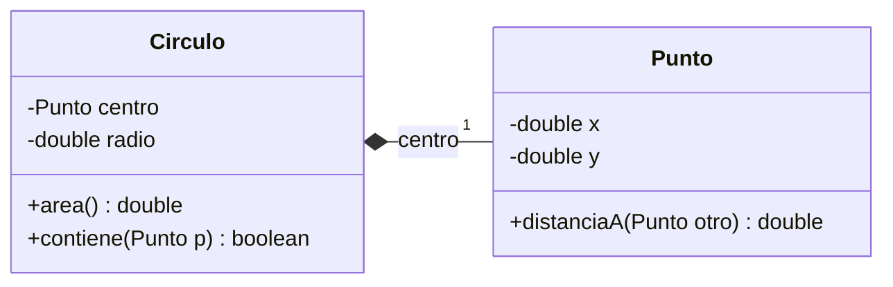

---
{"dg-publish":true,"permalink":"/asignaturas/1-dam-programacion/apuntes/unidad-03/8-atributos-que-son-objetos/","tags":["java/poo"],"dg-note-properties":{"unidad":"[[Asignaturas/1DAM_Programación/Unidades/Unidad 03/Unidad 03 - POO. Los objetos]]","descripcion":"Un atributo puede ser de cualquier tipo, también de una clase escrita por nosotros. Primera visión de la composición, que se estudiará a fondo más adelante.","orden":8,"criterios":["RA2.a","RA2.d"],"tags":["java/poo"]}}
---


```table-of-contents
```

---

Hasta ahora, los atributos de nuestras clases eran números, booleanos o textos. Pero un atributo es, en el fondo, **una variable que pertenece al objeto**, y una variable puede ser **de cualquier tipo**. En este apartado veremos que un objeto puede guardar dentro otros objetos, y daremos una primera idea de la **composición**.

> [!NOTE] Se verá con más profundidad más adelante
> Aquí solo presentamos la idea para que puedas usarla en los ejercicios. La composición, y cuándo conviene usarla en lugar de la herencia, se estudian a fondo en la parte de POO avanzada del módulo.

## 8.1. Un atributo puede ser de cualquier tipo

Al declarar un atributo se indica su **tipo** y su **nombre**, igual que con cualquier variable. Ese tipo puede ser:

| Tipo del atributo | Ejemplo | Valor por defecto |
|---|---|---|
| Primitivo | `private int paginas;` | `0`, `0.0`, `false`… |
| Una clase de la API | `private String titulo;` | `null` |
| Una clase escrita por nosotros | `private Punto centro;` | `null` |

Las dos últimas filas funcionan igual: `String` es una clase como cualquier otra, solo que ya viene hecha en Java. Si podemos tener un atributo `String`, podemos tener uno de tipo `Punto`, `Neumatico` o `Libro`.

> [!WARNING] Un atributo de tipo clase guarda una referencia
> Como vimos en [[Asignaturas/1DAM_Programación/Apuntes/Unidad 03/5. Más sobre métodos#5.5.1 Variables y objetos las referencias\|5.5.1 Variables y objetos: las referencias]], una variable de tipo clase no contiene el objeto, sino una **referencia** a él. Mientras no le asignemos un objeto con `new`, vale `null`, y llamar a uno de sus métodos provoca un `NullPointerException`. Por eso, lo normal es **crear esos objetos en el constructor**.

### 8.1.1. Un ejemplo: un círculo con su centro

Un punto del plano tiene dos coordenadas:

```java
public class Punto {

    private double x;
    private double y;

    public Punto(double x, double y) {
        this.x = x;
        this.y = y;
    }

    public double distanciaA(Punto otro) {
        double dx = x - otro.x;
        double dy = y - otro.y;
        return Math.sqrt(dx * dx + dy * dy);
    }

    @Override
    public String toString() {
        return "(" + x + ", " + y + ")";
    }
}
```

Un círculo tiene un **centro**, que es un punto, y un radio. En lugar de guardar dos `double` para el centro, guardamos un objeto `Punto`:

```java
public class Circulo {

    private Punto centro;   // atributo de tipo Punto
    private double radio;

    public Circulo(double x, double y, double radio) {
        this.centro = new Punto(x, y);   // el círculo crea su propio centro
        this.radio = radio;
    }

    public double area() {
        return Math.PI * Math.pow(radio, 2);
    }

    /** Un punto está dentro si su distancia al centro no supera el radio. */
    public boolean contiene(Punto p) {
        return centro.distanciaA(p) <= radio;   // el círculo le pide el cálculo a su centro
    }

    @Override
    public String toString() {
        return "Círculo de centro " + centro + " y radio " + radio;
    }
}
```

Fíjate en dos cosas:

- `contiene()` no calcula la distancia: **le pide al punto** que lo haga. Cada clase se ocupa de lo suyo. A esto se le llama **delegar**.
- En `toString()`, al concatenar `centro` con un texto, Java llama automáticamente a `centro.toString()`.

```java
Circulo c = new Circulo(0, 0, 5);
System.out.println(c);                              // Círculo de centro (0.0, 0.0) y radio 5.0
System.out.println(c.contiene(new Punto(3, 4)));    // true (distancia 5)
System.out.println(c.contiene(new Punto(4, 4)));    // false
```

## 8.2. La composición: un objeto formado por otros

Cuando un objeto está **formado por** otros objetos, decimos que hay una relación de **composición**. Se reconoce porque se puede describir con la frase «**tiene un**» (o «tiene varios»):

- Un círculo **tiene un** centro.
- Un coche **tiene** cuatro neumáticos.
- Un silo **tiene un** cuerpo cilíndrico y **un** techo cónico.

En un diagrama de clases UML, la composición se dibuja con un rombo relleno en el lado del objeto que contiene a los demás:



> [!TIP] Por qué es útil
> Dividir un problema en clases pequeñas, cada una con su responsabilidad, hace el código más fácil de entender, de probar y de reutilizar: `Punto` sirve también para un rectángulo, un triángulo o una ruta de GPS.
