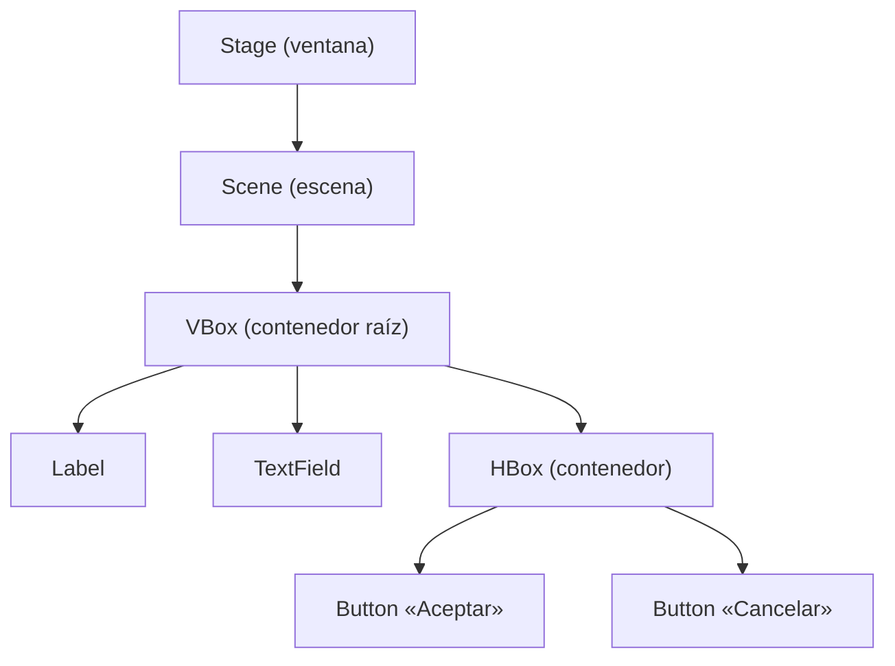

---
{"dg-publish":true,"dg-permalink":"/apuntes/1-dam-programacion/unidad-06-java-fx/2-java-fx/","permalink":"/apuntes/1-dam-programacion/unidad-06-java-fx/2-java-fx/","tags":["java/javafx"],"dg-note-properties":{"unidad":"[[Asignaturas/1DAM_Programación/Unidades/Unidad 06/Unidad 06 - Anexo - JavaFX]]","descripcion":"Qué es JavaFX, cómo organiza la interfaz en ventanas, escenas y nodos, y qué piezas forman una aplicación (FXML, controlador, modelo y CSS).","orden":2,"criterios":["RA5.f"],"tags":["java/javafx"]}}
---


> [!warning] Si quieres cambiar a Swing... 
> Accede desde el siguiente enlace: [[Asignaturas/1DAM_Programación/Unidades/Unidad 06/Unidad 06 - Anexo - Swing\|Unidad 06 - Anexo - Swing]]

```table-of-contents
```

---

**JavaFX** es una biblioteca para crear interfaces gráficas de usuario en aplicaciones de escritorio Java. Es más moderna que Swing y, a diferencia de ella, organiza la interfaz en un **grafo de escena** (*scene graph*): un árbol de objetos gráficos.

## 2.1. Ventana, escena y nodos

Para entender JavaFX conviene pensar en un **teatro**:

| Concepto | Clase | Qué es |
|---|---|---|
| **Escenario** | `Stage` | La **ventana**. Toda aplicación tiene al menos una, la ventana principal, pero puede abrir más. |
| **Escena** | `Scene` | El **contenido** que se muestra en la ventana en un momento dado. Una ventana muestra una escena cada vez, y se puede cambiar por otra. |
| **Nodos** | `Node` | Cada **elemento** de la escena: contenedores, botones, etiquetas, imágenes… |

Los nodos forman un **árbol**. La raíz es un **contenedor** (*layout*), que contiene otros nodos; algunos de ellos son, a su vez, contenedores con sus propios hijos:



En código Java, la relación se ve así:

```java
VBox raiz = new VBox();                     // contenedor raíz
raiz.getChildren().add(new Label("Hola")); // un nodo hijo
Scene escena = new Scene(raiz, 400, 300);   // escena de 400 x 300 píxeles
ventana.setScene(escena);                   // la ventana muestra la escena
ventana.show();
```

## 2.2. Las piezas de una aplicación JavaFX

Una aplicación JavaFX típica se reparte en varios archivos, cada uno con una responsabilidad:

1. **Clase principal.** Extiende `javafx.application.Application`. Su método `start(Stage)` recibe la ventana principal, carga la primera escena y la muestra.
2. **Vistas (archivos FXML).** Describen la interfaz (qué nodos hay y cómo se colocan) en un archivo XML, sin código Java. También se puede construir la interfaz desde Java, como en el ejemplo anterior, pero con FXML el código queda más ordenado.
3. **Controladores.** Cada vista FXML tiene una clase Java asociada, su **controlador**, que responde a las acciones del usuario (**eventos**) y modifica la interfaz.
4. **Modelo.** Las clases con los datos y la lógica de la aplicación (cálculos, acceso a ficheros…), que no dependen de la interfaz.
5. **Hojas de estilo CSS** (opcionales). Cambian el aspecto de los nodos: colores, fuentes, márgenes…

Esta separación sigue la idea del patrón **modelo-vista-controlador** (MVC): la **vista** muestra, el **controlador** coordina y el **modelo** calcula y guarda los datos. JavaFX no obliga a seguirlo, pero facilita mucho el mantenimiento: puedes cambiar el aspecto de una ventana sin tocar la lógica, y al revés.

En [[Asignaturas/1DAM_Programación/Apuntes/Unidad 06/Anexo - JavaFX/4. Comprendiendo cómo funciona JavaFX con un ejemplo\|4. Comprendiendo cómo funciona JavaFX con un ejemplo]] verás todas estas piezas en un programa completo.

## 2.3. Ventajas de JavaFX frente a Swing

- **Aspecto personalizable con CSS**, como una página web.
- **Separación** entre el diseño de la interfaz (FXML) y la lógica (controlador), con herramientas de diseño visual como **Scene Builder**.
- **Propiedades observables y *bindings***: la interfaz se puede actualizar sola cuando cambian los datos.
- Animaciones, efectos visuales, gráficos, multimedia (audio y vídeo) y arrastrar y soltar integrados.

Aun así, hay muchísimas aplicaciones Java hechas con Swing, una tecnología estable y madura. Si vas a dedicarte profesionalmente al desarrollo con Java, te conviene conocer las dos.

> [!NOTE] JavaFX no viene con el JDK
> Desde Java 11, JavaFX se distribuye aparte, como el proyecto de código abierto **OpenJFX**. En [[Asignaturas/1DAM_Programación/Apuntes/Unidad 06/Anexo - JavaFX/3. Crear un proyecto JavaFX\|3. Crear un proyecto JavaFX]] verás cómo añadirlo a un proyecto con Maven sin instalar nada a mano.

---

<p><span>⬅️ <strong>Anterior:</strong> <a data-tooltip-position="top" aria-label="Asignaturas/1DAM_Programación/Apuntes/Unidad 06/Anexo - JavaFX/1. AWT, Swing y JavaFX. ¿Qué es mejor?.md" data-href="Asignaturas/1DAM_Programación/Apuntes/Unidad 06/Anexo - JavaFX/1. AWT, Swing y JavaFX. ¿Qué es mejor?.md" href="Asignaturas/1DAM_Programación/Apuntes/Unidad 06/Anexo - JavaFX/1. AWT, Swing y JavaFX. ¿Qué es mejor?.md" class="internal-link" target="_blank" rel="noopener nofollow">1. AWT, Swing y JavaFX. ¿Qué es mejor?</a> | 🏠 <strong>Unidad:</strong> <a data-tooltip-position="top" aria-label="Asignaturas/1DAM_Programación/Unidades/Unidad 06/Unidad 06 - Anexo - JavaFX.md" data-href="Asignaturas/1DAM_Programación/Unidades/Unidad 06/Unidad 06 - Anexo - JavaFX.md" href="Asignaturas/1DAM_Programación/Unidades/Unidad 06/Unidad 06 - Anexo - JavaFX.md" class="internal-link" target="_blank" rel="noopener nofollow">Unidad 06 - Anexo - JavaFX</a> | <strong>Siguiente:</strong> <a data-tooltip-position="top" aria-label="Asignaturas/1DAM_Programación/Apuntes/Unidad 06/Anexo - JavaFX/3. Crear un proyecto JavaFX.md" data-href="Asignaturas/1DAM_Programación/Apuntes/Unidad 06/Anexo - JavaFX/3. Crear un proyecto JavaFX.md" href="Asignaturas/1DAM_Programación/Apuntes/Unidad 06/Anexo - JavaFX/3. Crear un proyecto JavaFX.md" class="internal-link" target="_blank" rel="noopener nofollow">3. Crear un proyecto JavaFX</a> ➡️</span></p>
